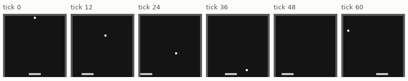
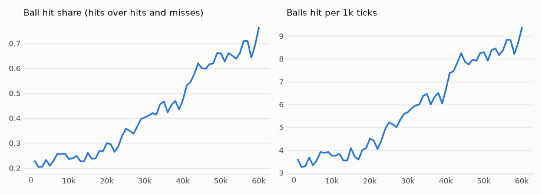
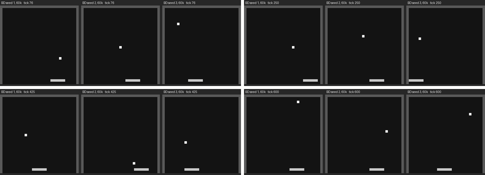

# vm-00103: Breakout — the Default Agent in a New World, the Model Unchanged

**Date:** 2026-11-22
**Status:** Complete
**Source:** `exp/vm-00103` (code: `visual-motor-agent/dev/`)
**Outputs:** `~/data/research/visual-motor-agent/exp_00103/`
**Task plan:** [`../tasks/00111-breakout-world.md`](../tasks/00111-breakout-world.md)

## Goal

Can the default agent learn a Breakout-like game with nothing changed but the wiring? The owner (2026-11-22): "the goal is to have new world without changing the model itself (only custom wiring)".

- **The agent:** `configs/U_agent.json` (vm-00101's TT): the same model, label, instinct and learning as in the food world.
- **The wiring** (`world/breakout_world.py`): what the frame shows, what the move does, and which events feed and hurt the body.

## Method

- **The court:** 64 × 64 grey pixels, the model's whole frame.
  - Walls 2 px wide on the left, right and top.
  - A paddle of 12 × 2 px with its top at row 60.
  - A ball of 2 × 2 px moving 1.5 px a tick. It bounces off the walls, and off the paddle at an angle set by where it hit (up to 60° from vertical).
  - No bricks.
- **The move:** the move token's dx pushes the paddle by dx × 4.5 px (clipped to the court); its dy and click do nothing.
- **The body** (`CircleWorld`'s two values):
  - **hunger:** +.001 a tick;
  - **a hit is a meal:** hunger to 0;
  - **a miss is a poison:** +.5 hunger, with the part the cap cuts off counted (`hunger_cut`, the full dose);
  - after a miss the ball is gone for 8 ticks, then falls from the top at a random place and angle;
  - **restlessness** follows `CircleWorld`'s rule.
- **`configs/U_breakout.json`:** `U_agent.json` with the `env` block replaced.
  - Its `model`, `online` and `ppo` blocks equal the default's (tested).
  - A short life's resolved model, PPO and pieces config equals a default life's.
- **The arm: BD**, 12 seeds, 60k ticks.
  - Seeds 1–6 on the RTX 3090 and 7–12 on the RTX 4090, 6 lives per card, under MPS.
  - One life alone runs 17.5 ticks/s on the 3090.
- **The walkers** (`breakout_walkers.py`, no model, the same world, seeds 1–12, 20k ticks each):
  - **random:** a random push every 6 ticks, held;
  - **still:** the paddle never moves;
  - **tracker:** pushes toward the ball's x; it never misses.
- **New code** (no model code):
  - the world and its tests (`tests/test_breakout_world.py`, 10);
  - `online.frame_record` (body 0's first N frames, any world) and `frames_video.py`;
  - `breakout_walkers.py`.

## Measures

- **Lived**, by 5k and at 40–60k: hits and misses per 1k ticks, the hit share (hits over hits and misses), mean hunger, overrides, move CE, prediction loss.
- **Frozen** at 10k to 60k (`make frozen`): 2,000 ticks with learning off in new worlds (seed 100 + s), the same measures.
- **The walkers:** the same measures.
- **A video** (`make video`): seeds 1–3 at 60k, frozen, the frame as the model sees it.
- **Statistics:** paired by seed, the mean difference with a 95% interval (t, 11 degrees of freedom: 2.201 × SD / √12), and how many of the 12 seeds point the same way.

## Readings, set before the results

1. **Plumbing:**
   - the world's tests pass;
   - all 12 lives run 60k ticks with the default agent's settings unchanged.
2. **It plays:** BD's hit share at 40–60k is above the random walker's, paired by seed.
3. **It plays well (descriptive):** BD's hit share against the tracker's (1.0), lived and frozen.
4. **The label (descriptive):** mean hunger and hits per 1k over the life.

## Results

All 12 lives ran 60k ticks without an error (2026-11-22: seeds 7–12 on the 4090 at 9.9 ticks/s, about 1 h 40 min; seeds 1–6 on the 3090 at 5.6 ticks/s, about 3 h). The 72 frozen tests and the video ran after them.

### R1. Plumbing (reading 1)

- The world's 10 tests pass, with the 12 earlier tests of panels, the body label and label refresh.
- A Breakout life's resolved `model` and `ppo` config equals a default life's; `online` differs only in `steps`, `log_every` and `frame_record`. Not one line of model or learning code changed.

### R2. The walkers

| Walker | Hits per 1k | Misses per 1k | Hit share | Mean hunger |
|---|---|---|---|---|
| random | 3.70 | 12.08 | .235 | .60 |
| still | 3.86 | 11.71 | .248 | .58 |
| tracker | 13.38 | 0 | 1.0 | .04 |

A paddle that never moves catches a quarter of the balls: the serves fall within ±45° and bounce, so some land on it.

### R3. Lived: it learns to play (reading 2 holds)

The 12 seeds' mean by 10k ticks:

| Ticks | Hit share | Hits per 1k | Misses per 1k | Mean hunger | Overrides | Move CE | Patch CE |
|---|---|---|---|---|---|---|---|
| 0–10k | .226 | 3.6 | 12.4 | .63 | .41 | .714 | .681 |
| 10–20k | .251 | 3.9 | 11.8 | .62 | .48 | .551 | .659 |
| 20–30k | .335 | 5.0 | 10.0 | .47 | .48 | .523 | .657 |
| 30–40k | .442 | 6.3 | 8.0 | .36 | .48 | .533 | .656 |
| 40–50k | .602 | 7.9 | 5.3 | .28 | .48 | .563 | .656 |
| 50–60k | .678 | 8.6 | 4.1 | .19 | .47 | .600 | .655 |

- **Reading 2:** at 40–60k BD's hit share is **.40 ± .05 above the random walker's** (paired by seed), **12 of 12** seeds above it; the smallest gap is .28 (seed 7).
- **Until about 20k it plays as a random paddle** (.226 and .251 against .235). Then the share rises steadily and is still rising at 60k.
- Hits per 1k more than double (3.6 to 8.6) and misses fall to a third (12.4 to 4.1). Fewer misses also means fewer pauses, so more balls come in.
- Move CE falls to .52 by 20–30k and rises again to .60 as the agent starts to play: its moves follow the ball and are harder to predict than a drift.

### R4. Frozen: the skill is in the weights

2,000 ticks with learning off in new courts (seed 100 + s), the 12 seeds' mean:

| Checkpoint | Hit share | Hits per 1k | Mean hunger | Against random (paired) | Seeds above random | Range |
|---|---|---|---|---|---|---|
| 10k | .231 | 3.6 | .63 | −.004 ± .047 | 5 | .12–.33 |
| 20k | .309 | 4.6 | .53 | +.075 ± .072 | 8 | .12–.56 |
| 30k | .431 | 6.0 | .40 | +.196 ± .061 | 12 | .24–.56 |
| 40k | .504 | 6.9 | .33 | +.269 ± .072 | 12 | .34–.72 |
| 50k | .606 | 7.9 | .26 | +.371 ± .074 | 12 | .43–.84 |
| 60k | .644 | 8.3 | .22 | +.409 ± .050 | 12 | .46–.76 |

- Frozen at 60k equals lived at 40–60k: +.005 ± .049 (5 of 12 higher). The play is not the online learner correcting itself from tick to tick; it holds with learning off, in courts it never saw.
- Every checkpoint from 30k on is above random in all 12 seeds.

### R5. By seed

| Seed | Random walker | Lived 0–10k | Lived 40–60k | Hunger 50–60k | Frozen 10k | Frozen 60k |
|---|---|---|---|---|---|---|
| 1 | .216 | .274 | .611 | .09 | .118 | .600 |
| 2 | .230 | .201 | .571 | .29 | .188 | .560 |
| 3 | .252 | .188 | .696 | .04 | .219 | .571 |
| 4 | .216 | .230 | .566 | .45 | .310 | .615 |
| 5 | .231 | .239 | .644 | .23 | .235 | .654 |
| 6 | .252 | .241 | .581 | .25 | .333 | .760 |
| 7 | .204 | .211 | .484 | .29 | .323 | .464 |
| 8 | .259 | .233 | .723 | .15 | .188 | .760 |
| 9 | .225 | .292 | .669 | .03 | .212 | .667 |
| 10 | .265 | .222 | .696 | .11 | .233 | .654 |
| 11 | .212 | .220 | .777 | .15 | .258 | .692 |
| 12 | .255 | .160 | .652 | .15 | .152 | .731 |

### R6. Against the tracker and the label (readings 3 and 4)

- **Reading 3:** at 50–60k BD catches .68 of the balls lived and .64 frozen at 60k, against the tracker's 1.0; it gets 8.6 hits per 1k against the tracker's 13.4 (the tracker never pauses).
- **Reading 4:** mean hunger falls from .63 (the random walker's .60) to .19 at 50–60k, with hits per 1k as in R3. The meal label, unchanged from the food world, carried a sparse reward: about 4 meals per 1k ticks early in life, far fewer than the food world's meals.
- **The video** (`make video`, `videos/vm103/play_60k.mp4`): seeds 1–3 at 60k, 600 ticks each; each hit 6 balls and missed 2.

<!-- figures -->
## Figures

*The world of this experiment as its model sees it, every 12 ticks. Moves are random: this shows the world, not the trained agent.*

*From each run's `metrics.jsonl`, the mean of its seeds by arm, smoothed. BD is the default agent (vm-00101's TT) in the Breakout court, 12 seeds; the random paddle's hit share is .235, the tracker's 1.0.*

*Stills from this experiment's video, in time order. BD seeds 1-3 at 60k, frozen, 600 ticks each in new courts: the 64 x 64 frame as the model sees it (walls, the paddle at the bottom, the ball). Each life hit 6 balls and missed 2 here.*
<!-- /figures -->

## Analysis

- **The default agent learns Breakout with only the wiring changed.** The same model, label, instinct and learning that forage in the food world take the paddle from a random paddle's .24 of balls to .68 in 60k ticks, all 12 seeds, and keep it with learning off (.64). The owner's goal for this world is met.
- **Why it works:**
  - The events map onto the body as they are. A hit drops hunger to 0 and a miss raises it by .5; the meal label then values a move by how soon the next meal comes and how much poison comes before it.
  - The whole court is in view and the ball is the only thing that moves besides the paddle, so the frame predictor learns it (patch CE falls over the first 20k, .681 to .657).
  - The instinct picks among the model's own candidate moves by their label, and the label only has to tell moves apart in the last few ticks before the ball reaches the paddle: the paddle crosses the court in about 11 ticks (48 px at 4.5 a tick), while a ball takes about 40 to fall from the top.
- **Why it takes 20k ticks to start:** early on there are about 4 meals per 1k ticks, a quarter of the food world's rate, and they are mostly lucky. The label needs meals that followed a move toward the ball before it can prefer one; once the share rises the meals come faster, so learning speeds up (the rise from 30k to 50k is steeper than from 20k to 30k).
- **What limits it at 60k:** the curve has not flattened, and the seeds differ (lived .48–.78). The meal label is right only to about 10 ticks out (vm-00101), so a ball far up the court gives little reason to move yet, Which balls it misses has not been measured (next steps).

## Conclusions

1. **A new world needs only new wiring.** The default agent, unchanged, learns a Breakout-like game: hit share .40 ± .05 above a random paddle at 40–60k, all 12 seeds; .68 of balls lived at 50–60k and .64 frozen at 60k.
2. **The skill is in the weights:** frozen equals lived (+.005 ± .049), in new courts.
3. **Learning starts late and is not done:** random play to about 20k, then a steady rise, still rising at 60k.

## Next steps

- **Stage 2** (task 00111's plan if reading 2 holds): a narrower paddle, a faster ball, and bricks as a second source of meals.
- **A longer life** (120k ticks) to see where the share levels off.
- **Where it misses:** the misses by the ball's angle and where it fell, from `gt_ball` in frozen lives, to see whether the label's horizon (task 00114) is the limit.
