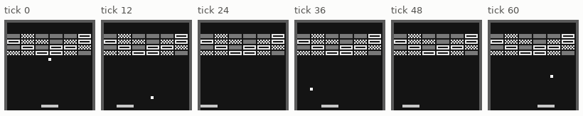
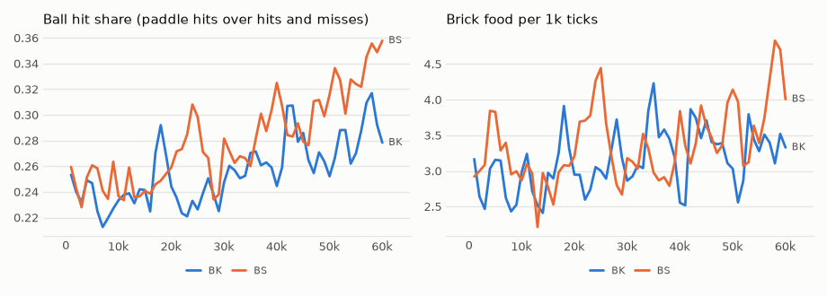
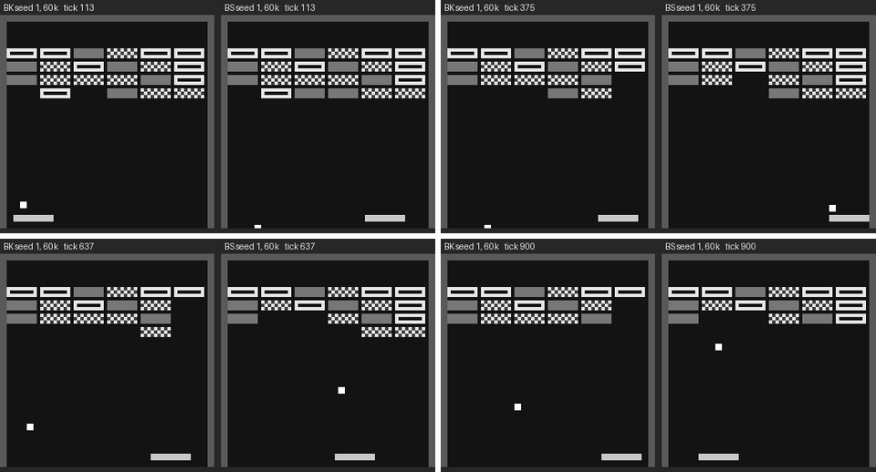

# vm-00104: Breakout with Bricks — Does the Agent Go for the Better Bricks?

**Date:** 2026-11-22
**Status:** Complete
**Source:** `exp/vm-00104` (code: `visual-motor-agent/dev/`)
**Outputs:** `~/data/research/visual-motor-agent/exp_00104/`
**Task plan:** [`../tasks/00117-breakout-bricks.md`](../tasks/00117-breakout-bricks.md)

## Goal

Stage 2 of the Breakout court (vm-00103, stage 1: the default agent, unchanged, learned to keep the ball in play). The owner (2026-11-22): "lets have a faster ball first, keep paddle as is plus bricks and make bricks visibly distinct and they should source food in differenct amouns depending on how brick look so we can estimate if it can target better blocks first. if it completely ate everything all blocks appear back but do not place same type of blocks in the same slots - shuffle it so we know it's not just memory."

- **Does it still play** with a faster ball, when keeping the ball in play is no longer food itself?
- **Does it go for the better bricks?**
- **The catch:** the default meal label scores any fall in hunger as the same meal (V = 1), so the unchanged agent has no way to value a big brick over a small one. A second arm gives the label the meal's size.

## Method

- **The court** (`configs/U_breakout2.json`; stage 1's court otherwise):
  - **the ball** moves 2.25 px a tick (stage 1: 1.5); the paddle is as before (12 px, 4.5 px a tick);
  - **a paddle hit is no meal; a miss is a poison** (+.5 hunger, the full dose counted);
  - **24 bricks**, 4 rows of 6, each 9 × 3 px, the top row at y = 10, with a gap above them;
  - **3 looks, 8 bricks each:** solid grey, a 1 px checkerboard, a hollow frame;
  - **food by type:** .1, .25 and .5 of hunger. Which look feeds how much rotates with the seed (`env.brick_shift` = seed mod 3, 4 seeds each), so a taste for a look is not read as a taste for food;
  - **a ball meeting a brick** removes it and bounces;
  - **when the last brick is gone** a new full wall comes in where no slot keeps its type, with 8 of each type again;
  - after a miss the ball comes from just below the bricks.
- **The arms**, 12 seeds each, 60k ticks:
  - **BK:** the default agent unchanged (`configs/U_agent.json`'s model, label, instinct and learning);
  - **BS:** the same with `online.meal_size = .5`: a meal is worth min(1, food / .5), so a big brick is worth 1, a middle one .5, a small one .2. The food the floor at 0 cut off is counted (`hunger_cut` is now signed). Off by default; the only change from BK.
- **The cards:** seeds 1–4 of both arms on the RTX 3090, seeds 5–12 on the RTX 4090, under MPS: 8 and 16 lives at once. Pilot (12 lives a card): 3.0 ticks/s a life on the 3090, 5.1 on the 4090.
- **The walkers** (`breakout_walkers.py`, no model, the same court and seeds, 20k ticks):
  - **random:** a random push every 6 ticks, held;
  - **still:** the paddle never moves;
  - **tracker:** pushes toward the ball's x; it meets the ball at the paddle's centre, so the ball goes straight up and down one emptied column (it hits almost no bricks);
  - **aimer:** the tracker meeting the ball off-centre by an offset drawn anew after each paddle hit. It never misses and aims at no brick: **the chance level of the preference.**
- **New code:**
  - the bricks, `paddle_relief` and the signed cut in `world/breakout_world.py` (stage 1's defaults unchanged; 18 tests);
  - `online.meal_size` (`tests/test_meal_size.py`);
  - the aimer and the brick measures in `breakout_walkers.py`.

## Measures

- **Play:** the paddle hit share (paddle hits over paddle hits and misses).
- **Food:** bricks and food per 1k ticks, mean hunger, walls cleared.
- **The preference:** at each brick hit, the food rank of the brick hit (0, 1, 2) minus the mean rank of the bricks standing then, averaged over hits. 0 means no preference; the most it can be is about +1. Also the share of hits by type.
  - Lived by 10k and at 40–60k; frozen (learning off, new courts, seed 100 + s, the same look shift) at 10k to 60k.
- **Statistics:** paired by seed, the mean difference with a 95% interval (t, 11 degrees of freedom), and how many of the 12 seeds point the same way.

## Readings, set before the results

1. **Plumbing:** the tests pass; all 24 lives run 60k ticks.
2. **It still plays:** BK's and BS's paddle hit share at 40–60k above the random walker's, paired by seed.
3. **It goes for better bricks:** BS's preference at 40–60k (lived) and at 60k (frozen) above the aimer's, paired by seed.
4. **The unchanged agent (descriptive; expected near the aimer):** BK's preference against the aimer's.
5. **The sized meal's effect:** BS − BK in preference and food per 1k, paired by seed.

## Results

All 24 lives ran 60k ticks without an error (2026-11-22 20:50 to 2026-11-23 01:13; 4.3–4.4 ticks/s a life on both cards). The 144 frozen tests and the video ran after them.

### R1. Plumbing (reading 1)

- The world's 18 tests pass (stage 1's 10 unchanged, 8 for stage 2), and the meal-size tests (5).
- BK's resolved `model`, `online` and `ppo` config equals the default agent's (apart from the run's length and logging); BS differs only in `meal_size`.
- The full suite: 2,020 passed. Two tests fail that this work did not touch: `test_env` (CircleWorld's info has carried `hunger_cut` since vm-00099) and `test_record` (`delays` does not survive the JSON round trip).

### R2. The walkers

| Walker | Paddle hit share | Bricks per 1k | Food per 1k | Mean hunger | Clears | Preference |
|---|---|---|---|---|---|---|
| random | .229 | 11.1 | 3.1 | .87 | 8.7 | +.005 |
| still | .265 | 12.5 | 3.5 | .83 | 9.9 | +.021 |
| tracker | 1.0 | 0.01 | 0.003 | .98 | 0 | — |
| aimer | 1.0 | 24.6 | 7.0 | .09 | 20.1 | −.014 |

- The tracker meets the ball dead centre, so the ball goes straight up and down one emptied column and hits almost no bricks.
- The aimer never misses and eats 2.2 times the random paddle's food; its preference (−.014) is the chance level.
- A random paddle lives near the hunger cap: about 3 food per 1k against 11 hunger per 1k from misses.

### R3. Lived: a little play, no taste

The 12 seeds' mean by 10k:

| Ticks | Arm | Paddle hit share | Bricks per 1k | Food per 1k | Misses per 1k | Hunger | Preference |
|---|---|---|---|---|---|---|---|
| 0–10k | BK | .230 | 10.0 | 2.85 | 23.2 | .87 | +.011 |
| 0–10k | BS | .239 | 11.3 | 3.19 | 22.6 | .83 | +.021 |
| 20–30k | BK | .231 | 10.7 | 3.03 | 22.5 | .87 | −.010 |
| 20–30k | BS | .267 | 12.4 | 3.52 | 20.8 | .88 | +.018 |
| 40–50k | BK | .269 | 12.1 | 3.43 | 21.1 | .86 | −.009 |
| 40–50k | BS | .290 | 12.7 | 3.60 | 20.0 | .86 | +.022 |
| 50–60k | BK | .282 | 11.4 | 3.25 | 20.3 | .87 | +.007 |
| 50–60k | BS | .334 | 13.6 | 3.86 | 18.2 | .83 | −.019 |

At 40–60k, paired by seed:

| Comparison | Mean difference (95%) | Seeds |
|---|---|---|
| BK paddle hit share − random | +.046 ± .012 | 12 of 12 above |
| BS paddle hit share − random | +.082 ± .026 | 12 of 12 above |
| BS − BK paddle hit share | +.036 ± .026 | 11 of 12 above |
| BK food − random | +.22 ± .32 | 8 of 12 above |
| BS food − random | +.60 ± .32 | 11 of 12 above |
| BS − BK food | +.39 ± .43 | 7 of 12 above |
| BK preference − aimer | +.012 ± .043 | 6 of 12 above |
| BS preference − aimer | +.016 ± .046 | 8 of 12 above |
| BS − BK preference | +.004 ± .035 | 8 of 12 above |

- **Reading 2 holds, weakly:** both arms return more balls than a random paddle in all 12 seeds. But at 50–60k BS returns a third of the balls and BK 28%, against stage 1's 68% by then.
- **Reading 3 fails:** no preference for better bricks in either arm, lived or frozen.
- **Hunger stays near the cap** (.83–.87, the random paddle's .87): the food the agent earns does not make up for its misses.
- **The share of hits by food rank is a third each in every arm** (BK .332, .334, .334; BS .333, .333, .334), and a third by look as well. Over a life this is forced: every brick of a wall is hit before it refills. Only the order (the preference) can show a taste.

### R4. Frozen

2,000 ticks with learning off in new courts (seed 100 + s, the same look shift), the 12 seeds' mean:

| Checkpoint | BK paddle hit share | BS paddle hit share | BK − random | BS − random | BK preference − aimer | BS preference − aimer |
|---|---|---|---|---|---|---|
| 10k | .241 | .240 | +.013 ± .053 | +.011 ± .046 | +.046 ± .120 | −.077 ± .132 |
| 30k | .253 | .223 | +.024 ± .040 | −.006 ± .027 | +.049 ± .106 | −.053 ± .065 |
| 50k | .234 | .294 | +.005 ± .029 | +.065 ± .044 (11/12) | −.056 ± .083 | −.052 ± .079 |
| 60k | .250 | .302 | +.021 ± .046 | +.073 ± .039 (11/12) | −.087 ± .090 | −.065 ± .089 |

- **BS keeps its little play with learning off** (+.073 at 60k, 11 of 12 seeds); BK's is not clear of random frozen.
- **No preference frozen either.** At 60k both lean below the aimer (3 of 12 seeds above in each). A frozen life hits only about 20 bricks, so each seed's preference is noisy; the lean is within the intervals.

### R5. The video

`make video` (`videos/vm104/play_60k.mp4`; stills below): BK and BS seed 1 at 60k from the same court, 900 ticks. BK returned 8 balls and missed 23 (8 bricks, .25 food per 100 ticks); BS returned 7 and missed 24 (8 bricks).

<!-- figures -->
## Figures

*The world of this experiment as its model sees it, every 12 ticks. Moves are random: this shows the world, not the trained agent.*

*From each run's `metrics.jsonl`, the mean of its seeds by arm, smoothed. Stage 2 (a ball at 2.25 px a tick, no food for a paddle hit, 24 bricks of 3 looks feeding .1, .25 and .5): BK the default agent unchanged, BS with a meal worth its size; 12 seeds each. A random paddle's hit share is .229 and its food 3.1 per 1k; the aimer's food 7.0.*

*Stills from this experiment's video, in time order. BK (left) and BS (right) seed 1 at 60k, frozen, 900 ticks from the same court (seed 201): the frame as the model sees it, the bricks' three looks (solid, checker, hollow); which look feeds how much rotates with the seed.*
<!-- /figures -->

## Analysis

- **Stage 2 is much harder than stage 1, for the default agent and for the sized meal.** Three things changed at once:
  1. **The ball is 1.5 times as fast.** It falls the court in about 27 ticks; the paddle crosses it in 11.
  2. **A return is no longer food.** In stage 1 the hit itself was the meal, so the label learned to value moves that bring the paddle under the ball. Here the meal comes only when a returned ball reaches a brick, 15 or more ticks after the return, and only a small one. The meal label is right to about 10 ticks (vm-00101), so a return is barely credited.
  3. **Misses still cost a poison.** At about 20 misses per 1k the agent stays near the hunger cap. The full dose counts every miss, but at the cap there is no meal to fall back from.
- **What is learned is learned from the misses.** Both arms raise their return rate slowly and steadily (BK .23 to .28, BS .24 to .33), as a label that mostly sees poisons would teach: avoid the miss. BS's sized meal helps a little (+.036, 11 of 12 seeds; frozen +.073 against random). Its meals are worth less than BK's (a small brick counts .2, not 1), so the gain is not from meals felt more strongly. A guess, not tested: the sized label varies more across moves, which may help the instinct tell them apart.
- **Why no taste for bricks:** to prefer a big brick the agent must aim the ball, through the angle it leaves the paddle, at a brick 30 or more pixels and 15 or more ticks away. That is planning well past the label's horizon. A paddle that returns a third of the balls has few chances to choose, and the bricks it hits are where the ball happens to go. The unchanged agent (BK) cannot value size at all, so its null was expected. BS can, and still shows none: the bottleneck is aiming, not valuing.

## Conclusions

1. **With a faster ball and food only from bricks, the default agent learns very little in 60k ticks:** BK returns 28% of the balls at 50–60k (random 23%), and stays near the hunger cap.
2. **A meal worth its size (BS) helps the play slightly** (+.036 over BK lived, 11 of 12 seeds; +.073 over random frozen), **but neither arm targets better bricks**, lived or frozen. The look-to-food rotation and the refill derangement worked as designed; there was no taste to find.
3. **The bottleneck is the horizon:** the food is 15 or more ticks after the action that earns it, past the meal label's reach.

## Next steps

- **Make the return worth something again:** a small food for a paddle hit (for example .05, with sized meals so that bricks stay worth more), so the play is learned as in stage 1 and the bricks are a choice on top of it.
- **Or the slower ball of stage 1 with bricks:** one change at a time, to separate the ball's speed from the food's delay.
- **A longer horizon:** the label's horizon (task 00114) or the instinct's (task 00107), which this world needs.
