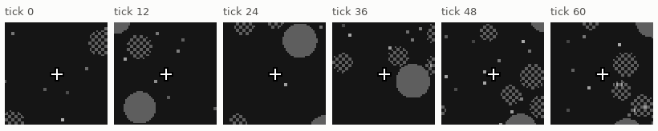
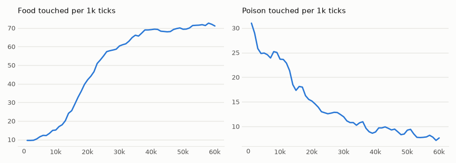
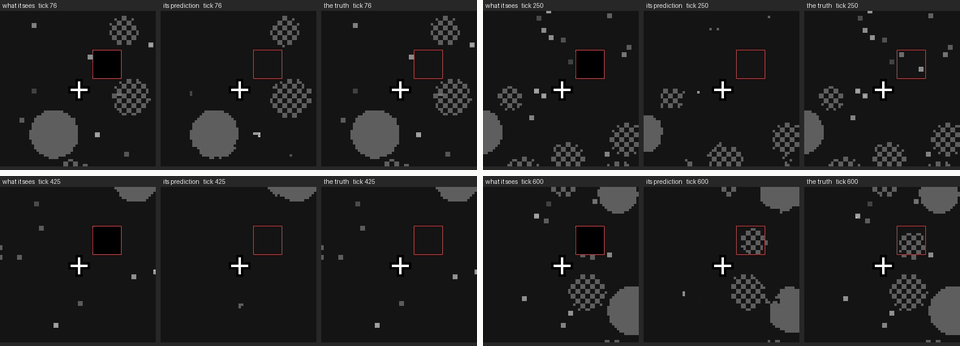

# vm-00105: The Blind Spot — Does the Prediction Restore a Gap the Model Never Sees?

**Date:** 2026-11-23
**Status:** Complete (pending tag)
**Source:** `dev/` (pending tag `exp/vm-00105`)
**Outputs:** `~/data/research/visual-motor-agent/exp_00105/`
**Task plan:** [`../tasks/00118-blind-spot.md`](../tasks/00118-blind-spot.md)

## Goal

The owner (2026-11-22): "we will permanently off some area in the visual field from the foraging world mimicing blind spot of the eye but train on the full picture so the predicted picture should have the gap restored - we will examine how good it is in restoring blind spot".

The eye has a blind spot where the optic nerve leaves; the brain fills it from the surround and from what was seen a moment before. Here the default agent sees its world with a permanent hole and learns against the whole frame. How well does its predicted frame restore the hole?

## Method

- **The agent:** the default (`configs/U_agent.json`, vm-00101's TT): the food world with inertia, a 64 × 64 egocentric view, 4 quarter transformers.
- **The gap** (`online.blind = [38, 16, 12, 12]`): 12 × 12 px at x 38–49, y 16–27, set to black in everything the model sees.
  - That covers acting, every update's inputs and the label's bootstrap windows.
  - It's the same frame for all four transformers; the world, memory and targets stay whole.
  - It sits up and to the right of the body, across parts of 6 patches of the top-right quarter, so the top-right transformer predicts those patches. Every transformer's summaries over the gap are blinded in its input and trained against the real pixels.
  - It's big enough to hide a whole food or poison (10–16 px). The view moves with the body, so the scene slides under the fixed gap.
  - The image `videos/vm105/blind_spot_where.png` shows where it is.
- **The arm: BL**, 12 seeds, 60k ticks. Seeds 1–4 on the RTX 3090, 5–12 on the RTX 4090, under MPS.
- **The control: vm-00101's TT** (the same agent without the gap, 12 seeds), not rerun.
- **The frozen test** (`make frozen`): per checkpoint (20k, 40k, 60k) and seed, 2,000 ticks with learning off in a new world (seed 100 + s). Each tick records the model's predicted current frame (`online.pred_record`: each transformer's own quarter, decoded `pair`, every patch predicted from the tokens before it) and the true frame. Four conditions:
  - **BL_gap:** BL as it lived;
  - **BL_open:** BL with the gap removed (pixels it never saw there);
  - **TT_gap:** TT with the gap put in (never trained with it);
  - **TT_open:** TT as it lived (the ceiling).
- **New code:**
  - `online.blind`, `online.pred_record` (`lifetime.py`, `online.blind_frames`);
  - `eval_blind.py` (measures and video);
  - `tests/test_blind.py`.

## Measures

`eval_blind.py`, grey levels 0–255, after the first 20 ticks:

- **gap:** the mean absolute error of the predicted frame on the gap's pixels.
  - Baselines: **bg**, the gap predicted as plain background; **prev**, the true gap of the tick before (a copy the model could make only if it saw the gap).
- **objects:** the same over ticks with an object in the gap (at least 4 px off the background by more than 25 grey levels), and by ticks since it entered (1, 2–3, 4–7, 8–15, 16+).
- **seen or not:** whether the predicted gap shows an object (the same rule): hits, false alarms, d′.
- **the surround:** the error on the visible pixels within 4 px of the gap, and on the other quarters.
- **lived foraging:** food and poison per 1k at 40–60k against TT.
- **Statistics:** paired by seed (BL and TT seed s share the seed number and test world), the mean difference with a 95% interval (t, 11 degrees of freedom), and how many of the 12 seeds point the same way.

## Readings, set before the results

1. **Plumbing:** the tests pass; all 12 lives run 60k ticks.
2. **It fills the gap:** BL_gap's gap error at 60k below the background baseline's, paired by seed.
3. **Filling is learned:** BL_gap's gap error at 60k below TT_gap's, paired by seed.
4. **Objects (descriptive):** BL_gap's error and hit rate on objects in the gap by ticks since entry, against TT_open's.
5. **The cost (descriptive):** BL's lived food and poison at 40–60k against TT's, and BL_gap's error on the surround against TT_open's.

## Results

All 12 lives ran 60k ticks, and the tests passed (`tests/test_blind.py`, 6; the full suite 2,020 passed, with one failure in `tests/test_record.py` that predates this work and is untouched by it). The frozen tests ran 2,000 ticks per checkpoint, condition and seed; the measures skip the first 20 ticks.

### The gap at each checkpoint (12-seed means, grey levels)

| Condition | Gap error | Background | Previous frame | Objects | Objects, background | Empty gap | Hit | False alarm | d′ | Surround | Other quarters |
|---|---|---|---|---|---|---|---|---|---|---|---|
| BL_gap 20k | 2.05 | 6.82 | 5.37 | 4.32 | 15.18 | 0.25 | .64 | .03 | 2.27 | 1.86 | 1.63 |
| BL_open 20k | 4.51 | 6.62 | 5.03 | 8.79 | 15.00 | 1.22 | .64 | .16 | 1.38 | 3.61 | 2.49 |
| TT_gap 20k | 6.01 | 6.94 | 5.34 | 11.33 | 15.42 | 1.75 | .70 | .31 | 1.23 | 3.23 | 1.65 |
| TT_open 20k | 1.56 | 7.42 | 5.65 | 3.19 | 15.95 | 0.19 | .65 | .02 | 2.46 | 1.73 | 1.61 |
| BL_gap 40k | 1.70 | 6.18 | 5.21 | 3.71 | 14.15 | 0.19 | .62 | .02 | 2.41 | 1.60 | 1.47 |
| BL_open 40k | 4.09 | 5.73 | 4.80 | 8.42 | 13.66 | 1.05 | .60 | .14 | 1.38 | 3.28 | 2.30 |
| TT_gap 40k | 5.89 | 6.41 | 5.46 | 11.08 | 14.36 | 1.81 | .68 | .30 | 1.11 | 3.11 | 1.49 |
| TT_open 40k | 1.27 | 5.97 | 5.14 | 2.83 | 13.98 | 0.15 | .63 | .01 | 2.63 | 1.42 | 1.46 |
| **BL_gap 60k** | **1.56** | 5.85 | 5.19 | **3.44** | 13.54 | 0.17 | .60 | .02 | 2.42 | 1.46 | 1.40 |
| BL_open 60k | 4.21 | 5.80 | 4.92 | 8.49 | 13.43 | 1.05 | .60 | .14 | 1.36 | 3.19 | 2.22 |
| TT_gap 60k | 5.37 | 6.09 | 5.27 | 10.68 | 13.94 | 1.36 | .60 | .22 | 1.31 | 3.03 | 1.45 |
| TT_open 60k | 1.22 | 5.99 | 5.25 | 2.70 | 13.92 | 0.14 | .63 | .01 | 2.71 | 1.32 | 1.39 |

- **Gap error:** on the gap's pixels of the predicted frame. **Background** and **Previous frame** are the baselines (the gap predicted as background; the true gap of the tick before). They differ between conditions because each condition lives its own life in the test world.
- **Objects:** ticks with an object in the gap (about 28% of ticks); **Empty gap:** the other ticks.
- **Hit, false alarm:** the predicted gap shows an object when one is there, and when none is. Even the sighted TT hits only .63: the rule (4 px off the background by 25 grey levels) misses objects that only clip the gap's edge. d′ is the better read.
- **Surround:** the visible pixels within 4 px of the gap. **Other quarters:** the three quarters without the gap.

### Paired by seed (mean difference, 95% interval, seeds below zero)

| Checkpoint | BL_gap − background | BL_gap − TT_gap | BL_gap − TT_open | Objects: BL_gap − TT_gap | Objects: BL_gap − TT_open | Surround: BL_gap − TT_open |
|---|---|---|---|---|---|---|
| 20k | −4.76 ± .45 (12/12) | −3.96 ± .83 (12/12) | +.49 ± .16 (0/12) | −7.01 ± .79 (12/12) | +1.13 ± .18 (0/12) | +.13 ± .11 (2/12) |
| 40k | −4.48 ± .56 (12/12) | −4.19 ± .75 (12/12) | +.43 ± .12 (0/12) | −7.37 ± .72 (12/12) | +.88 ± .18 (0/12) | +.18 ± .09 (1/12) |
| 60k | −4.29 ± .41 (12/12) | −3.82 ± .75 (12/12) | +.34 ± .07 (0/12) | −7.23 ± .53 (12/12) | +.74 ± .14 (0/12) | +.14 ± .05 (1/12) |

BL_open − BL_gap (the same model shown the real pixels it never saw there): +2.45 ± .33, +2.39 ± .30, +2.65 ± .37 at 20k, 40k, 60k (0/12 below).

### Objects in the gap by ticks since they entered (60k, 12 seeds pooled by seed means)

| Condition | 1 tick | 2–3 | 4–7 | 8–15 | 16+ |
|---|---|---|---|---|---|
| BL_gap | 2.63 | 3.48 | 3.85 | 4.04 | 3.48 |
| TT_open (sighted) | 2.26 | 2.84 | 2.77 | 2.96 | 2.86 |
| TT_gap (untrained) | 5.05 | 10.33 | 14.22 | 13.20 | 11.59 |
| BL_open | 5.38 | 8.54 | 9.96 | 10.11 | 10.87 |
| Ticks (BL_gap, all seeds) | 2,385 | 3,509 | 3,001 | 1,077 | 111 |

### Lived foraging, 40–60k (per 1k ticks, 12-seed means)

| Arm | Food | Poison |
|---|---|---|
| BL | 70.2 | 8.6 |
| TT (vm-00101) | 71.6 | 8.3 |
| BL − TT, paired | −1.4 ± 1.35 (9/12 below) | +.33 ± .61 (4/12 below) |

The curves image below shows BL's lived food and poison.

<!-- figures -->
## Figures

*The world of this experiment as its model sees it, every 12 ticks. Moves are random: this shows the world, not the trained agent.*

*From each run's `metrics.jsonl`, the mean of its seeds by arm, smoothed. BL is the default agent with a fixed 12 x 12 px blind spot in everything the model sees (targets whole), 12 seeds; its control, vm-00101's TT, eats 71.6 food and 8.3 poison per 1k at 40-60k.*

*Stills from this experiment's video, in time order. BL seed 1 at 60k, frozen, 600 ticks in a new world (seed 101). Left: what the model sees, the gap black (red box); middle: its predicted frame (each quarter transformer its own quarter, decoded pair); right: the true frame. TT with the gap put in, never trained with it, is in videos/vm105/TT_gap_s1_60k.mp4.*
<!-- /figures -->

## Analysis

- **It fills the gap (reading 2: met).** BL_gap's error on the gap at 60k is 1.56 grey levels, against 5.85 for a gap left as background: 4.3 lower in every seed. With an object in the gap it is 3.44 against 13.5. It's already there at 20k (2.05).
- **Filling is learned (reading 3: met).** TT with the gap put in, never trained with it, errs 5.37 at 60k, close to the background baseline; with objects, 10.7. BL is 3.8 lower overall and 7.2 lower on objects, in every seed. Shown a black box it never saw, TT paints fragments of the box's edges and dots (the TT video).
- **It nearly matches sight.** BL's gap error is .34 above TT's on the same pixels when TT sees them (1.22), and .74 above on objects (2.70 against 3.44). It detects objects in the gap almost as well as sight does: d′ 2.42 against 2.71, false alarms .02 against .01.
- **It beats a copy of the true previous frame** (5.19), which the model never has. The view moves with the body, so the scene slides under the gap. The model fills it with the scene shifted by its own motion, not with what was there before.
- **Memory, not sight (reading 4).** An object that has just slid in is filled nearly as well as a seen one (2.63 against 2.26). The error grows by about 1 grey level over the next 4–15 ticks (3.5–4.0, while sight stays at 2.8–3.0) and stays there. An untrained model's error climbs to 14 within 4–7 ticks.
  - The filled-in object fades a little the longer it sits unseen, but it is held: at 8–15 ticks BL's error is less than a third of TT_gap's.
- **The hole is part of what it expects.** Shown the real pixels in the gap (BL_open), BL does worse than with the black: 4.21 against 1.56. It also draws objects that aren't there (false alarms .14) and its other quarters get worse (2.22 against 1.40).
  - BL's model has learned the black box as the input it always gets. Real pixels there are unfamiliar input, as a blank state read was in vm-00093.
- **Little cost (reading 5).** The surround is .14 worse than sight's (1.46 against 1.32; 11 of 12 seeds), and the other quarters are the same (1.40 against 1.39). Lived food is 1.4 per 1k lower (2%; 9 of 12 seeds, the interval just excludes zero), and poison is the same.

## Conclusions

1. **The default agent, unchanged, learns to fill a permanent blind spot** when trained against the whole frame. At 60k its predicted gap is 1.56 grey levels off, against 5.85 for an empty gap and 1.22 when the gap is seen, all 12 seeds.
2. **The filling is memory of a moving scene.** An object that slid into the gap is held for 15 ticks and more, with its error growing by about 1 grey level. It beats a copy of the true last frame, because it shifts the scene with the body's motion.
3. **The fill is learned, and the hole becomes expected:** an untrained model can't fill it, and the trained one does worse when the gap is opened.
4. **It costs little:** the surround is slightly worse (.14) and the food slightly lower (−1.4 per 1k, 2%).

## Next steps

- **vm-00106 (running): the gap in the targets too.** Like the eye, the model never learns from a filled gap. G0 trains against the black gap, and GB has the motion teacher fill it from the canvas of earlier frames. Can GB come close to BL's 1.56?
- **A gap that moves with the body's direction**, or one in the body's path (ahead of a moving body): does the fill still hold when the scene slides in from the gap's far side?
- **Open the gap after the fact for longer:** how many ticks does BL_open take to start using real pixels there, learning on?
