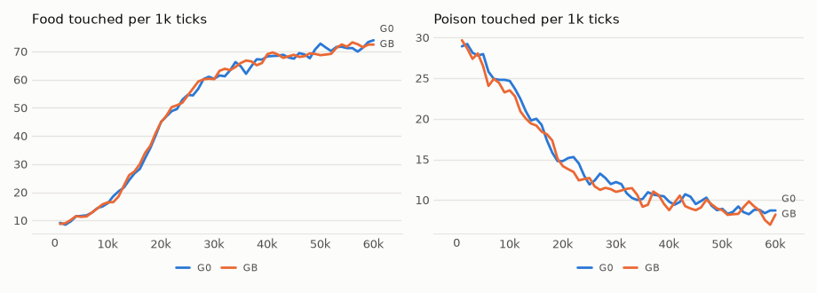
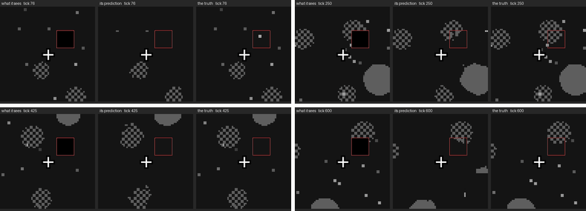

# vm-00106: The Blind Spot in the Targets Too — Can Motion Teach the Model to Fill It?

**Date:** 2026-11-23
**Status:** Complete
**Source:** `exp/vm-00106` (code: `visual-motor-agent/dev/`)
**Outputs:** `~/data/research/visual-motor-agent/exp_00106/`
**Task plan:** [`../tasks/00118-blind-spot.md`](../tasks/00118-blind-spot.md)

## Goal

The owner (2026-11-22): "second experiment - we need to figure out how we can train on a image with blind spot as well but teach model to restore image back nevertheless".

In vm-00105 the model saw a gap but learned against the whole frame. The eye never gets the whole frame: the gap is in everything it learns from. Here the gap is in the targets too.

- **The null (G0):** with the gap black in the targets, the model learns to predict black there.
- **The teacher (GB):** the view moves with the body, so the scene slides under the fixed gap. What the gap hides now was in plain view a moment before. Can a target built only from what was seen elsewhere, at other moments, teach the model to fill the gap?

## Method

- **The agent and the gap:** vm-00105's: the default agent (`configs/U_agent.json`) with `online.blind = [38, 16, 12, 12]`, the same for all four transformers.
- **The arms**, 12 seeds each, 60k ticks:
  - **G0** (`online.blind_target = black`): the targets have the gap as the model sees it, black.
  - **GB** (`online.blind_target = motion`): each step's target is the frame as seen, with its gap filled by `GapTeacher`.
    - The teacher keeps a canvas of the world (128 × 128, wrap-around) per body, painted only from the visible part of each frame. The gap's pixels are never read.
    - The gap of each target is read from the canvas at the gap's world pixels: the last grey seen there. Pixels never seen take the background.
    - The body's position comes from the world (`env.cursor`). It is a training signal only, never an input.
    - It's built when the step is stored, so it uses only the past.
- **The teacher is imperfect.** Objects are drawn at sub-pixel positions, the poison's checker is fixed to the screen, and 32 grey dots move on their own. On random walks (before the runs) the teacher's gap is off by 3.7 grey levels against the background guess's 4.8; with an object in the gap, 8.0 against 11.5. In the life it is logged every 1k ticks (`teach_err`, `teach_filled`).
- **The cards:** seeds 1–4 of both arms on the RTX 3090, 5–12 on the RTX 4090, under MPS.
- **Comparisons, not rerun:** vm-00105's BL (the gap in the input, whole targets: the most the gap could be learned) and TT (no gap).
- **Not run: the masked loss** (no target in the gap at all). The CUDA loss has no per-value mask (`set_step_mask` masks whole steps and their keys); it's left for later.
- **New code:**
  - `online.blind_target`, `GapTeacher` and the memory field `timg` (`online.py`, `lifetime.py`);
  - tests in `tests/test_blind.py`.

## Measures

`eval_blind.py`, as vm-00105, on frozen lives with the gap in (`make frozen`: 20k, 40k, 60k, seed 100 + s; the same test worlds as vm-00105's):

- the gap's error, against the background baseline;
- objects in the gap and by ticks since entry;
- seen or not (hits, false alarms, d′);
- the surround;
- lived food and poison.

## Readings, set before the results

1. **Plumbing:** the tests pass; all 24 lives run 60k ticks.
2. **The teacher teaches:** GB_gap's gap error at 60k below G0_gap's, paired by seed.
3. **Better than a guess:** GB_gap's gap error at 60k below the background baseline's, paired by seed.
4. **How much of whole-frame learning it recovers (descriptive):** GB_gap against vm-00105's BL_gap and the teacher's own error.
5. **The cost (descriptive):** lived food and poison of G0 and GB against BL and TT.

## Results

All 24 lives ran 60k ticks, and the tests passed (`tests/test_blind.py`). The frozen tests are vm-00105's: 2,000 ticks per checkpoint and seed in a new world, the measures after the first 20 ticks. vm-00105's conditions are shown beside them (BL: the gap in the input only; TT: no gap).

### The gap at each checkpoint (12-seed means, grey levels)

| Condition | Gap error | Background | Objects | Objects, background | Empty gap | Hit | False alarm | d′ | Surround | Other quarters |
|---|---|---|---|---|---|---|---|---|---|---|
| G0_gap 20k | 27.20 | 6.20 | 35.40 | 14.40 | 21.15 | .00 | .00 | 0.10 | 1.82 | 1.65 |
| GB_gap 20k | 3.51 | 6.37 | 6.80 | 14.31 | 0.99 | .54 | .05 | 1.80 | 1.86 | 1.67 |
| G0_gap 40k | 27.12 | 6.12 | 35.24 | 14.25 | 21.14 | .00 | .00 | 0.09 | 1.62 | 1.46 |
| GB_gap 40k | 3.62 | 6.24 | 6.90 | 14.35 | 1.17 | .55 | .06 | 1.71 | 1.58 | 1.48 |
| G0_gap 60k | 27.03 | 6.03 | 34.86 | 13.86 | 21.15 | .00 | .00 | 0.10 | 1.51 | 1.38 |
| **GB_gap 60k** | **3.67** | 6.00 | **6.90** | 13.93 | 1.27 | .59 | .07 | 1.72 | 1.48 | 1.40 |
| BL_gap 60k (vm-00105) | 1.56 | 5.85 | 3.44 | 13.54 | 0.17 | .60 | .02 | 2.42 | 1.46 | 1.40 |
| TT_gap 60k (vm-00105) | 5.37 | 6.09 | 10.68 | 13.94 | 1.36 | .60 | .22 | 1.31 | 3.03 | 1.45 |
| TT_open 60k (vm-00105) | 1.22 | 5.99 | 2.70 | 13.92 | 0.14 | .63 | .01 | 2.71 | 1.32 | 1.39 |

The columns are vm-00105's: the gap's pixels of the predicted frame against the truth; background, the gap predicted empty; objects, ticks with an object in the gap; hit and false alarm, the predicted gap showing an object when one is there and when none is.

### Paired by seed (mean difference, 95% interval, seeds below zero)

| Checkpoint | GB_gap − G0_gap | GB_gap − background | GB_gap − BL_gap | Objects: GB_gap − BL_gap | Objects: GB_gap − G0_gap |
|---|---|---|---|---|---|
| 20k | −23.69 ± .57 (12/12) | −2.86 ± .73 (12/12) | +1.46 ± .41 (0/12) | +2.48 ± .39 (0/12) | −28.60 ± 1.01 (12/12) |
| 40k | −23.50 ± .36 (12/12) | −2.61 ± .46 (12/12) | +1.92 ± .31 (0/12) | +3.19 ± .43 (0/12) | −28.35 ± .70 (12/12) |
| 60k | −23.37 ± .46 (12/12) | −2.34 ± .29 (12/12) | +2.11 ± .23 (0/12) | +3.46 ± .36 (0/12) | −27.96 ± .60 (12/12) |

### Objects in the gap by ticks since they entered (60k)

| Condition | 1 tick | 2–3 | 4–7 | 8–15 | 16+ |
|---|---|---|---|---|---|
| GB_gap | 3.98 | 6.67 | 8.78 | 8.54 | 7.21 |
| G0_gap | 25.91 | 34.90 | 40.01 | 39.29 | 38.90 |
| BL_gap (vm-00105) | 2.63 | 3.48 | 3.85 | 4.04 | 3.48 |
| TT_gap (vm-00105, untrained) | 5.05 | 10.33 | 14.22 | 13.20 | 11.59 |
| TT_open (vm-00105, sighted) | 2.26 | 2.84 | 2.77 | 2.96 | 2.86 |

### The teacher in the life (GB, 12-seed means)

| Tick | 1k | 10k | 20k | 40k | 60k |
|---|---|---|---|---|---|
| Teacher's gap error (`teach_err`) | 3.83 | 3.81 | 4.55 | 4.52 | 4.74 |

It filled every gap pixel (`teach_filled` 1.0) after the first ticks. Its error grows as the agent learns to forage: it moves more and spends more time near objects, where the teacher's sub-pixel and checker errors show.

### Lived foraging, 40–60k (per 1k ticks, 12-seed means, paired against TT)

| Arm | Food | Poison | Food − TT | Poison − TT |
|---|---|---|---|---|
| G0 | 70.5 | 9.1 | −1.1 ± 1.4 (10/12 below) | +.85 ± .55 (2/12 below) |
| GB | 70.2 | 8.9 | −1.4 ± 2.1 (7/12 below) | +.65 ± .57 (4/12 below) |
| BL (vm-00105) | 70.2 | 8.6 | −1.4 ± 1.35 (9/12 below) | +.33 ± .61 (4/12 below) |
| TT (vm-00101) | 71.6 | 8.3 | | |

<!-- figures -->
## Figures

*The world of this experiment as its model sees it, every 12 ticks. Moves are random: this shows the world, not the trained agent.*

*From each run's `metrics.jsonl`, the mean of its seeds by arm, smoothed. The default agent with the vm-00105 blind spot in everything it sees and in its targets: G0 learns against the black gap, GB against the gap filled by the motion teacher; 12 seeds each. TT (no gap) eats 71.6 food and 8.3 poison per 1k at 40-60k.*

*Stills from this experiment's video, in time order. GB seed 1 at 60k, frozen, 600 ticks in a new world (seed 101). Left: what the model sees, the gap black (red box); middle: its predicted frame; right: the true frame. GB never learned from the true gap, only from the teacher's fill. G0 (trained against the black gap) predicts black there: videos/vm106/G0_gap_s1_60k.mp4.*
<!-- /figures -->

## Analysis

- **The null does what it's told (G0).** Trained against the black gap, the model predicts black there: 27 grey levels off, and it never shows an object (hits 0). The shared weights fill nothing on their own when the target says black. A masked loss (option A) would be the real null, with no target at all in the gap; it's still left for later.
- **The teacher teaches (reading 2: met).** GB's gap error at 60k is 3.67, 23.4 below G0's, in every seed.
- **Better than a guess (reading 3: met).** GB is 2.34 below the empty-gap baseline (6.00), all 12 seeds; with an object in the gap 6.90 against 13.9. It detects objects with d′ 1.72, against 1.31 for TT shown the gap untrained and 2.42 for BL.
- **About half of what the full frame gives (reading 4).**
  - Against the background guess, BL (the gap in the input only, true targets) gains 4.29 at 60k and GB 2.34: GB recovers 55% of BL's gain.
  - On objects, BL gains 10.1 over the background and GB 7.0 (70%).
  - GB is still better than the untrained TT_gap (5.37) by 1.7, and slightly better than its own teacher was in its life (4.74 at 60k). The test world isn't the life, so that last comparison is loose, but the model doesn't merely copy the teacher's errors: a model averaging many noisy fills can be smoother than any one fill.
- **It holds objects, but less well.** An object that has just slid in is filled at 3.98 (BL 2.63). Over the next 4–15 ticks GB's error rises to 8.5–8.8, against BL's 3.9–4.0 and the untrained model's 13–14. The teacher's fill of a long-hidden spot is old (painted when it was last seen), and the model learns that blur.
- **The cost (reading 5).** Food is the same within noise in all three gap arms (about 1–1.4 below TT). Poison is slightly higher in G0 (+.85, 10 of 12 seeds) and GB (+.65); BL's +.33 is within noise. A gap that is black in the targets too may cost a little poison avoidance; the intervals are wide.

## Conclusions

1. **With nothing ever filled in its targets, the model predicts the hole:** G0 learns the black gap exactly. Prediction alone doesn't fill a blind spot that is also blind in the targets.
2. **Motion is a teacher:** filling the target's gap from what the moving view showed elsewhere, at other moments, teaches the model to fill it. GB beats the black-target model by 23 grey levels and an empty guess by 2.3 in every seed, never having learned from a true pixel of the gap.
3. **It gets about half the way to the full frame** (55% of BL's gain overall, 70% on objects), limited by the teacher: sub-pixel drawing, the screen-fixed checker and old paint for spots seen long ago.

## Next steps

- **A better teacher:** paint only from the last few ticks (fresher fills), or weight the target by how recently the spot was seen; register by the frames (no `env.cursor`), the version that needs nothing from the world.
- **The masked loss (option A):** the true null, no target in the gap at all. It needs a per-value loss mask in the CUDA loss.
- **Two eyes (option C)** with parallax, the eye's own solution.
