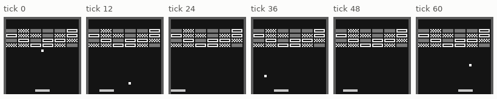
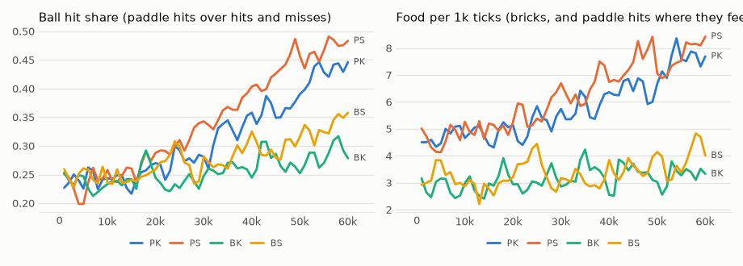
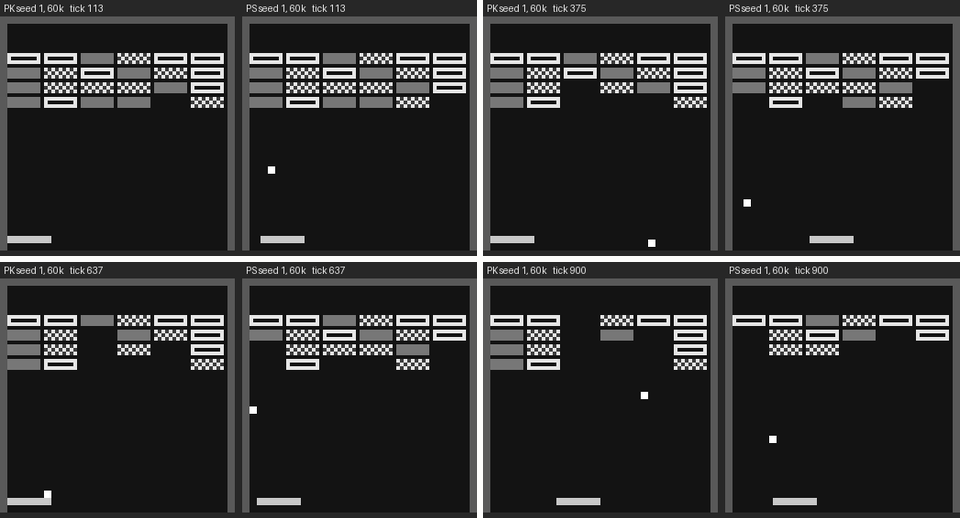

# vm-00107: Breakout with Bricks and Food for the Paddle Hit

**Date:** 2026-11-23
**Status:** Complete
**Source:** `exp/vm-00107` (code: `visual-motor-agent/dev/`)
**Outputs:** `~/data/research/visual-motor-agent/exp_00107/`
**Task plan:** [`../tasks/00119-breakout-paddle-food.md`](../tasks/00119-breakout-paddle-food.md)

## Goal

The owner, 2026-11-23, after watching vm-00104's video: "it feels like we need to feed it on hittin paddle - movement feels random".

- **vm-00104:** with food only from bricks, the default agent barely played. It returned 28% of balls at 50–60k (BK; 33% with a meal worth its size, BS), against a random paddle's 23%, and preferred no brick.
  - The likely cause: food came 15 or more ticks after the return, past the meal label's horizon of about 10 ticks.
- **vm-00103 (stage 1):** a paddle hit was a meal, and the same agent learned to return .68 of balls.
- **Here:** vm-00104's court with a paddle hit feeding again, .25 of hunger (as much as a middle brick). Play should be learned as in stage 1, and the bricks become a choice on top of it.

## Method

- **The court:** `configs/U_breakout2p.json`, vm-00104's `U_breakout2.json` with `env.paddle_relief = .25`.
  - A miss is still a poison.
  - The bricks feed .1, .25 and .5 by type. Which look feeds how much rotates with the seed (`env.brick_shift` = seed mod 3).
  - The wall comes back with no slot keeping its type.
- **The arms**, 12 seeds each, 60k ticks:
  - **PK:** the default agent unchanged. Its label scores any meal as 1, so a paddle hit counts as a full meal.
  - **PS:** the same with `online.meal_size = .5`: a paddle hit is worth .5, and a small, middle or big brick .2, .5 or 1.
- **The cards and tests:** as in vm-00104.
  - Seeds 1–4 run on the RTX 3090 and 5–12 on the RTX 4090, under MPS.
  - Frozen tests at 10k–60k (2,000 ticks, seed 100 + s).
  - The walkers (random, still, tracker, aimer) run in this court.
  - The video shows PK and PS, seed 1, at 60k.
- **No new code:** `paddle_relief` exists since vm-00104.

### The walkers in this court (20k ticks, 12 seeds)

| Walker | Paddle hit share | Bricks per 1k | Food per 1k | Preference |
|---|---|---|---|---|
| random | .229 | 11.1 | 4.82 | +.005 |
| still | .265 | 12.5 | 5.45 | +.021 |
| tracker | 1.000 | 0.0 | 5.03 | −.070 |
| aimer | 1.000 | 24.6 | 12.06 | −.014 |

The tracker returns every ball straight up one emptied column, so its preference over its few bricks means little. The aimer is the chance level of the preference.

## The readings, set before the results

1. **It plays again:** PK's and PS's paddle hit share at 40–60k is above the random walker's, paired by seed. It's also compared with vm-00104's BK and BS (descriptive).
2. **It targets better bricks:** PS's preference at 40–60k lived and at 60k frozen is above the aimer's, paired by seed.
3. **The unchanged agent:** PK's preference is compared with the aimer's. It's expected near chance, since its label can't tell sizes apart.
4. **The sized meal's effect:** PS − PK in preference, paddle hit share and food per 1k, paired by seed.

## Results

All 24 lives ran 60k ticks without an error (2026-11-23 10:18 to 14:13, about 4.3 ticks/s a life on both cards). The 144 frozen tests and the video ran after them (done 15:01).

### R1. Plumbing

- No new code. Each life's resolved config equals vm-00104's same arm and seed (`info.json`) except `env.paddle_relief` (.25 against 0) and three blind-spot keys at their off defaults (added since by task 00118). PS differs from PK only in `online.meal_size`.
- The walkers in this court are in the Method above (`exp_00107/walkers.txt`).

### R2. Lived: play comes back

The 12 seeds' mean by 10k:

| Ticks | Arm | Paddle hit share | Bricks per 1k | Food per 1k | Misses per 1k | Hunger | Preference |
|---|---|---|---|---|---|---|---|
| 0–10k | PK | .237 | 10.4 | 4.72 | 23.1 | .71 | −.012 |
| 0–10k | PS | .232 | 10.6 | 4.73 | 23.0 | .78 | +.029 |
| 10–20k | PK | .245 | 10.9 | 4.90 | 22.1 | .74 | +.026 |
| 10–20k | PS | .258 | 11.0 | 4.98 | 21.6 | .77 | +.021 |
| 20–30k | PK | .267 | 11.6 | 5.18 | 20.8 | .74 | +.009 |
| 20–30k | PS | .306 | 13.0 | 5.83 | 19.3 | .70 | +.019 |
| 30–40k | PK | .326 | 13.0 | 5.89 | 18.5 | .65 | −.026 |
| 30–40k | PS | .364 | 14.3 | 6.50 | 17.3 | .68 | +.012 |
| 40–50k | PK | .364 | 14.2 | 6.51 | 17.4 | .63 | −.022 |
| 40–50k | PS | .429 | 16.8 | 7.44 | 14.2 | .60 | −.003 |
| 50–60k | PK | .431 | 17.5 | 7.65 | 14.5 | .60 | +.015 |
| 50–60k | PS | .466 | 17.4 | 7.85 | 13.4 | .56 | −.001 |

Food per 1k is the hunger relieved per 1k ticks: bricks, and here the paddle hits (.25 each). At 40–60k the paddle gives PK 2.60 and PS 2.79 of it, and the bricks 4.49 and 4.85 (BK 3.34, BS 3.73 in vm-00104).

At 40–60k, paired by seed:

| Comparison | Mean difference (95%) | Seeds |
|---|---|---|
| PK paddle hit share − random | +.167 ± .027 | 12 of 12 above |
| PS paddle hit share − random | +.219 ± .016 | 12 of 12 above |
| PS − PK paddle hit share | +.051 ± .035 | 9 of 12 above |
| PK − BK (vm-00104) paddle hit share | +.121 ± .027 | 12 of 12 above |
| PS − BS (vm-00104) paddle hit share | +.137 ± .030 | 12 of 12 above |
| PK − BK bricks per 1k | +4.08 ± 1.32 | 11 of 12 above |
| PS − BS bricks per 1k | +3.97 ± 1.52 | 12 of 12 above |
| PK food − random | +2.27 ± .49 | 12 of 12 above |
| PS food − random | +2.83 ± .43 | 12 of 12 above |
| PS − PK food | +.56 ± .43 | 9 of 12 above |
| PK preference − aimer | +.011 ± .046 | 6 of 12 above |
| PS preference − aimer | +.012 ± .024 | 7 of 12 above |
| PS − PK preference | +.001 ± .050 | 5 of 12 above |

- **Reading 1 holds:** both arms return far more balls than a random paddle (12 of 12 seeds each), and far more than vm-00104's same arms without paddle food (+.12 and +.14, 12 of 12). At 50–60k PK returns 43% of the balls and PS 47%, and both are still rising at 60k (figure below). Stage 1's BD (vm-00103, a slower ball) returned 68% by then.
- **More play means more bricks:** about 4 more bricks per 1k than vm-00104, and the hunger leaves the cap (.56–.60 at 50–60k against vm-00104's .83–.87).
- **Readings 2 and 3 fail:** neither arm prefers better bricks, lived or frozen. The bricks' food per brick hit is .283 in all four arms, the plain mean of .1, .25 and .5. The share of hits by food rank and by look is a third each.
- **Reading 4:** the sized meal (PS) returns a little more lived (+.051, 9 of 12) and eats a little more (+.56, 9 of 12), within about 1.5 intervals of zero; it does not change the preference.

### R3. Frozen

2,000 ticks with learning off in new courts (seed 100 + s, the same look shift), the 12 seeds' mean:

| Checkpoint | PK paddle hit share | PS paddle hit share | PK − random | PS − random | PK preference − aimer | PS preference − aimer |
|---|---|---|---|---|---|---|
| 10k | .231 | .236 | +.002 ± .039 | +.007 ± .038 | −.018 ± .060 | −.046 ± .085 |
| 20k | .229 | .295 | +.001 ± .032 | +.067 ± .040 (10/12) | −.020 ± .106 | −.002 ± .153 |
| 30k | .288 | .284 | +.059 ± .056 (10/12) | +.055 ± .050 (10/12) | −.127 ± .088 (4/12) | −.009 ± .114 |
| 40k | .310 | .345 | +.081 ± .049 (10/12) | +.117 ± .049 (11/12) | −.038 ± .068 | −.026 ± .084 |
| 50k | .338 | .424 | +.109 ± .051 (11/12) | +.196 ± .030 (12/12) | −.029 ± .109 | −.056 ± .107 |
| 60k | .471 | .436 | +.242 ± .038 (12/12) | +.207 ± .037 (12/12) | +.016 ± .090 | +.023 ± .098 |

- **The play survives with learning off:** at 60k both arms return about twice a random paddle's share in new courts (12 of 12 seeds). PS's frozen lead over PK from 20k to 50k closes at 60k (PS − PK food −.00 ± .99).
- **No preference frozen either** at any checkpoint; the one outlier (PK at 30k, −.127) does not repeat.

### R4. The video

`make video` (`videos/vm107/play_60k.mp4`; stills below): PK and PS seed 1 at 60k from the same court, 900 ticks. PK returned 9 balls and missed 20 (9 bricks); PS returned 10 and missed 19 (12 bricks). vm-00104's BK and BS returned 8 and 7 of 31 there.

<!-- figures -->
## Figures

*The world of this experiment as its model sees it, every 12 ticks. Moves are random: this shows the world, not the trained agent.*

*From each run's `metrics.jsonl`, the mean of its seeds by arm, smoothed. Stage 2 with food for a paddle hit (.25 of hunger; bricks .1, .25 and .5 by look): PK the default agent unchanged, PS with a meal worth its size; 12 seeds each. BK and BS are vm-00104's same arms without paddle food. A random paddle's hit share is .229.*

*Stills from this experiment's video, in time order. PK (left) and PS (right) seed 1 at 60k, frozen, 900 ticks from the same court (seed 201): the frame as the model sees it, the bricks' three looks (solid, checker, hollow); which look feeds how much rotates with the seed.*
<!-- /figures -->

## Analysis

- **The owner's reading of vm-00104's video was right: the return needed to be worth something.** With the same court, ball and bricks, a paddle hit worth .25 of hunger turns a barely-playing agent (BK .28 at 50–60k) into one that returns 43% of the balls and is still improving. The meal is now one tick after the move that earns it, inside the label's horizon, as in stage 1.
- **Slower than stage 1:** BD crossed .33 at 20–30k and reached .68; PK crosses it only at 30–40k. The ball is 1.5 times as fast here, and the bricks change the court each tick. A hit's food is a quarter of stage 1's, but PK's label counts any meal as 1, as there; PS counts the hit as .5 and a big brick as 1. Why PS is a little ahead (lived, and frozen at 20k and 50k) is not tested here.
- **Still no taste for bricks, now with play:** the agent hits 16–17 bricks per 1k, a third of each kind. To prefer a big brick it must aim the ball through where it meets the paddle, at a brick 15 or more ticks away. The paddle food fixed the horizon for the return, not for the aim: a brick's food still comes after the label's reach (about 10 ticks), and sizing the meal (PS) does not help with that.

## Conclusions

1. **Feeding the paddle hit brings the play back:** at 40–60k PK returns .167 more balls than a random paddle and PS .219 (12 of 12 seeds each), against vm-00104's +.046 and +.082 without paddle food. With learning off at 60k both return about .45 in new courts. Neither has levelled off at 60k.
2. **Neither arm targets better bricks**, lived or frozen. The meal worth its size changes the play a little (PS +.05 return, 9 of 12 seeds) and the taste not at all.
3. **What the label credits is learned; what lies past its horizon is not:** the return (one tick to the meal) is learned in both stages; the aim (15 or more ticks to the brick) is learned in neither.

## Next steps

- **The brick's food within reach of the label:** a longer label horizon (γ nearer 1, task 00114's direction) or the instinct's longer horizon (task 00107), in this court where the play now exists.
- **A longer life:** both arms still rising at 60k; 120k ticks would show where the play levels off.
- **The learned baselines (vm-00108, running):** what PPO and Dreamer reach on stage 1 with the same pixels and ticks.
