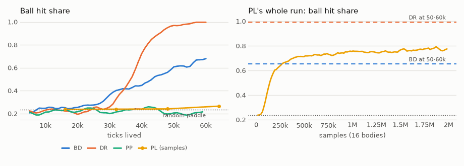
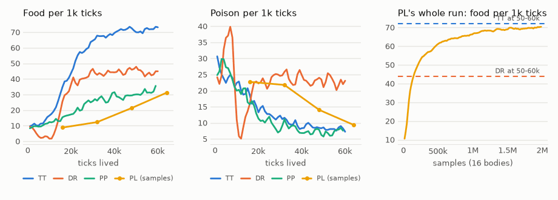

# vm-00108: Learned Baselines — Is the Default Agent Fast or Slow for Its Ticks?

**Date:** 2026-11-23
**Status:** Complete
**Source:** `exp/vm-00108` (code: `visual-motor-agent/dev/`)
**Outputs:** `~/data/research/visual-motor-agent/exp_00108/`
**Task plan:** [`../tasks/00120-learned-baselines.md`](../tasks/00120-learned-baselines.md)

## Goal

Calibrate. Since vm-00001 our results are scored against scripted walkers and our own earlier arms, never against a standard learner given the same experience. The owner, 2026-11-23: "yes write the task and queue it after 107".

- **The question:** does the default agent's architecture learn faster per tick than standard RL given the same signal? That architecture is one next-token predictor for pixels, body and value; one life; one update a tick; and the instinct choosing among sampled moves by the predicted meal label.
- **Not reward-free:** the default agent learns the meal label, a bootstrapped value of meals and poison. The baselines get that label's immediate part as their reward.

## Method

- **Worlds** (unchanged, `world.make_world`, one body, one life of no episodes):
  - **breakout:** stage 1 (`configs/U_breakout.json`, a paddle hit a meal, a miss a poison). Ours: vm-00103's BD.
  - **food:** the default agent's world (`configs/U_agent.json`: 128 world, 64 view, egocentric, inertia 4). Ours: vm-00101's TT.
- **The same input** (`dev/baselines/vm_env.py`): the 64 × 64 grey frame, the drives and the previous move; no `gt_*` keys.
- **The same signal:** reward +1 on a tick whose hunger fell, minus the full dose a poison added, else 0. That's the meal label's immediate part, tested equal to `online.stored_labels`.
- **The action:** the move (dx, dy) in [−1, 1]², continuous.
- **The arms**, seeds 1–6 (the same world seeds as ours):
  - **DR:** DreamerV3 (the PyTorch port `NM512/dreamerv3-torch`, commit 6ef8646; JAX can't run on this CPU). Its defaults for 64 × 64 pixels, train ratio 512, one body, 60k ticks (a 2,500-tick random prefill included).
  - **PP:** PPO (`dev/baselines/run_ppo.py`, CleanRL-style, the Nature CNN), one body, 60k ticks.
  - **PL:** the same PPO, 16 bodies, 2M samples: how many ticks it needs to reach our level.
- **Cards:** seeds 1–3 on the RTX 3090, 4–6 on the RTX 4090, under MPS. Dreamer is timed alone on each card first (`make pilot`).

## Measures

- **breakout:** paddle hit share by 10k lived, against BD (paired by seed, seeds 1–6) and the random paddle (.235).
- **food:** food and poison per 1k by 10k lived, against TT (paired by seed, seeds 1–6).
- **PL:** samples to reach our 50–60k level, by seed.
- **Compute:** wall-clock per life.

## The readings, set before the results

1. **Plumbing:** the wrapper's tests pass; every life runs its ticks.
2. **Against PPO at our budget:** ours at 40–60k against PP's, paired by seed (expected: ours far ahead).
3. **Against Dreamer at our budget:** ours at 40–60k against DR's, paired by seed. Either direction is the answer.
4. **PPO's sample cost:** PL's samples to our level (descriptive; "not reached in 2M" is a result).

## Results

All 36 lives ran (2026-11-23 15:01 to 2026-11-24 00:57): the pilots, then PP and PL (24 at once, 15:21 to 15:50), DR breakout (15:51 to 20:22) and DR food (20:22 to 00:57), 3 Dreamer lives per card.

- **Dreamer's speed alone** (`make pilot`, 5,000 ticks of breakout seed 1, 2,500 of them learning at train ratio 512): 596 s on the RTX 3090 and 563 s on the 4090, about 4.4 learning ticks a second; a 60k life alone about 3.6 hours.

### R1. Plumbing

- The wrapper's 4 tests pass (`tests/test_baselines_env.py`: the reward equals the label's immediate part on random lives in both worlds; no `gt_*` key in the input).
- Every DR life ran 60,000 ticks, every PP life 59,904 (468 rollouts of 128), every PL life 1,998,848 samples (16 bodies).

### R2. Breakout stage 1

Paddle hit share, the mean of seeds 1–6 by 10k lived (BD: vm-00103's default agent, its seeds 1–6; random paddle .235):

| Ticks | BD | DR | PP |
|---|---|---|---|
| 0–10k | .229 | .226 | .213 |
| 10–20k | .256 | .207 | .222 |
| 20–30k | .325 | .263 | .221 |
| 30–40k | .434 | .597 | .235 |
| 40–50k | .572 | .931 | .220 |
| 50–60k | .652 | .992 | .202 |

At 40–60k, paired by seed (6 seeds):

| Comparison | Mean difference (95%) | Seeds |
|---|---|---|
| BD − random | +.376 ± .053 | 6 of 6 above |
| DR − random | +.727 ± .039 | 6 of 6 above |
| PP − random | −.024 ± .043 | 1 of 6 above |
| BD − PP | +.400 ± .080 | 6 of 6 above |
| DR − BD | +.351 ± .074 | 6 of 6 above |

- **Dreamer plays nearly perfectly:** in the last 5k ticks five seeds miss no ball at all and the sixth returns .984 (0.1 misses per 1k at 50–60k; BD 4.5, PP 13.1).
- **Both start at the same time:** BD and DR stay near random until about 25–30k. The first 5k window at .5 or above comes at 32–47k for BD and 31–42k for DR. After that DR reaches .9 within 6–14k ticks (at 37–52k); BD reaches .9 in no seed by 60k.
- **PPO with one body learns nothing in 60k ticks** (.20–.27 by seed at 50–60k).
- **PL (16 bodies) reaches BD's 50–60k level** (BD's own seed) **at 176k–384k samples** (176, 240, 256, 288, 320, 384k), 3 to 6 times BD's 60k ticks, and ends at .72–.82 at 2M samples. It never reaches DR's level.

### R3. The food world

Food and poison per 1k, the mean of seeds 1–6 by 10k lived (TT: vm-00101's default agent, its seeds 1–6):

| Ticks | TT food | TT poison | DR food | DR poison | PP food | PP poison |
|---|---|---|---|---|---|---|
| 0–10k | 12.3 | 24.3 | 4.2 | 27.9 | 10.3 | 25.2 |
| 10–20k | 32.5 | 17.6 | 22.1 | 15.5 | 15.0 | 16.4 |
| 20–30k | 58.2 | 12.7 | 41.1 | 23.7 | 22.9 | 9.5 |
| 30–40k | 68.0 | 9.7 | 43.5 | 24.2 | 27.8 | 8.6 |
| 40–50k | 71.5 | 8.9 | 45.7 | 22.6 | 28.8 | 7.0 |
| 50–60k | 71.9 | 7.9 | 43.8 | 23.1 | 32.1 | 7.3 |

At 40–60k, paired by seed (6 seeds):

| Comparison | Mean difference (95%) | Seeds |
|---|---|---|
| TT − DR food | +26.9 ± 3.1 | 6 of 6 above |
| TT − DR poison | −14.5 ± 3.2 | 0 of 6 above |
| TT − PP food | +41.4 ± 6.6 | 6 of 6 above |
| TT − PP poison | +1.3 ± 2.0 | 5 of 6 above |
| DR − PP food | +14.4 ± 6.3 | 6 of 6 above |

- **Here the order turns round:** TT eats 71.7 food and 8.4 poison per 1k at 40–60k, DR 44.8 and 22.9. Food less poison is 63.3 against 21.9 (+41.4 ± 4.5, 6 of 6).
- **Dreamer learns to reach food, not to avoid poison:** its food rises to about 44 by 30k and stays there in every seed (41.6–48.6 at 40–60k); its poison dips to 15.5 at 10–20k, then returns to about 23 and stays there, near the 25–28 of the first 10k. TT's and PP's poison fall to 7–9. DR's hunger stays low (.20 at 50–60k): it does not starve.
- **PPO with one body** gets a third of TT's food (30.3) with the same poison (7.1).
- **PL reaches TT's 50–60k level** (TT's own seed) **in 3 seeds, at 1.2M, 1.6M and 1.63M samples**, and not in 2M samples in the other 3; all 6 end at 69–71 food and 6–9 poison, 20 to 30 times TT's 60k ticks.

### R4. Compute

Wall-clock per life, each under the load it ran at:

| Arm | Lives at once | Wall-clock per life |
|---|---|---|
| BD (vm-00103) | 12 (6 per card) | 2.98 h |
| TT (vm-00101) | 12 (6 per card) | 5.52 h |
| DR breakout | 6 (3 per card; vm-00109 also on the 4090) | 4.5 h (3090), 3.7 h (4090) |
| DR food | 6 (as above) | 4.6 h (3090), 3.8 h (4090) |
| DR alone (pilot) | 1 | about 3.6 h |
| PP breakout, food | 24 (PP and PL together) | 130 s, 200 s |
| PL breakout, food (2M samples) | 24 | 5 min, 30 min |

- **Card time per life** (wall-clock × the card's share): DR about 1.3–1.5 card-hours, BD about 0.5: Dreamer costs about 3 times as much per breakout life. Per tick it also trains on about 8 times as many replayed steps (29.5M against 3.84M in 60k ticks: our update is 8 windows of 8 steps, the newest among them) and imagines about 15,000 steps per update.
- **PPO is cheap per sample:** 2M samples of Breakout in 5 minutes. In samples it is the least efficient; in wall-clock PL reaches BD's level in about a minute.

<!-- figures -->
## Figures

*Breakout stage 1, seeds 1-6, the mean by arm, smoothed: BD the default agent (vm-00103), DR DreamerV3, PP PPO with one body, PL PPO with 16 bodies (its first 64k samples on the ticks' axis; right, its whole run). The dotted line is a random paddle (.235).*

*The food world, seeds 1-6, the mean by arm, smoothed: TT the default agent (vm-00101), DR DreamerV3, PP PPO with one body, PL PPO with 16 bodies (its first 64k samples on the ticks' axis; right, its whole run, food per 1k ticks of each body).*
<!-- /figures -->

## Analysis

- **The calibration is split by world.** In Breakout DreamerV3 learns far better than the default agent from the same 60k ticks (.99 against .65 at 50–60k); in the food world the default agent eats 1.6 times Dreamer's food and a third of its poison. PPO at our budget is far behind both, as expected; in samples it needs 3–6 times our ticks in Breakout and 20–30 times in the food world.
- **The default agent was made in the food world, not in Breakout.** About a hundred experiments shaped TT's settings (the label, its horizon, the instinct's temperature) in the food world; Breakout ran it unchanged. Dreamer runs its generic defaults in both. The food world result is ours on home ground; Breakout is the fairer test of the architecture, and there Dreamer wins clearly.
- **In Breakout the start is the same, the climb is not.** Both stay near random for 25–30k ticks and cross .5 at about the same time. Dreamer then goes to 1.0 within about 10k ticks; ours climbs slowly and is at .65 at 60k. Two differences fit the climb (neither tested here): Dreamer trains on about 8 times as many replayed steps per tick (vm-00110 tests that alone), and its actor is trained by the gradient through imagined trajectories rather than chosen from 16 sampled moves.
- **In the food world Dreamer does not learn to avoid poison.** Its food plateaus at 44 from 30k on, and its poison stays at the level of its first 10k. Food and poison differ only in look (plain against checkered circles) and in sign of reward; a poison costs about .5 against a meal's +1 (DR s1's last row: 52 food, 22 poison, reward 41). Why Dreamer misses it is not tested here: the reconstruction may blur the checker at 64 × 64, or a γ of .997 may weigh a poison's cost too little against the food behind it. Ours sees the same pixels with γ .95.

## Conclusions

1. **Against PPO at our budget the default agent is far ahead** in both worlds (+.40 hit share; +41 food per 1k, same poison; 6 of 6 seeds). PPO needs 3–6 times our ticks in Breakout and 20–30 times in the food world to reach our level.
2. **Against DreamerV3 the result depends on the world:** in Breakout, Dreamer is far ahead (+.35 hit share at 40–60k, nearly every ball returned by 50k; 6 of 6 seeds); in the food world the default agent is (+27 food and −14.5 poison per 1k; 6 of 6 seeds).
3. **Dreamer spends more:** about 3 times our card time per life and about 8 times our replayed steps per tick, with imagination on top.

## Next steps

- **vm-00110 (running):** the default agent with Dreamer's replayed steps per tick in Breakout. Whether the training budget alone closes the Breakout gap.
- **The in-house ablation** (task 00120's follow-up): our transformer with an actor trained on its own tokens instead of the label and the instinct, isolating the acting rule.
- **Why Dreamer eats poison:** its reconstructions of food and poison, and a run with γ .95.
