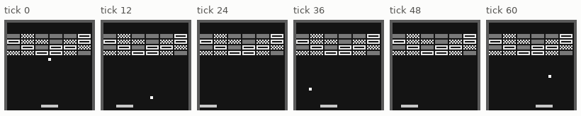
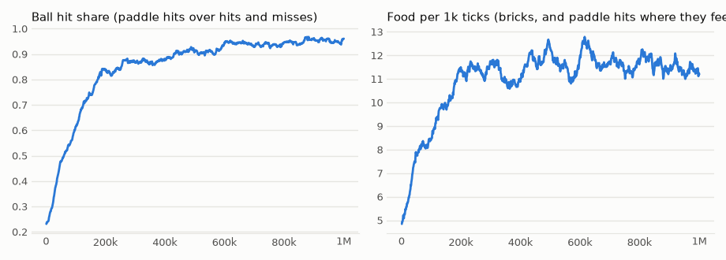
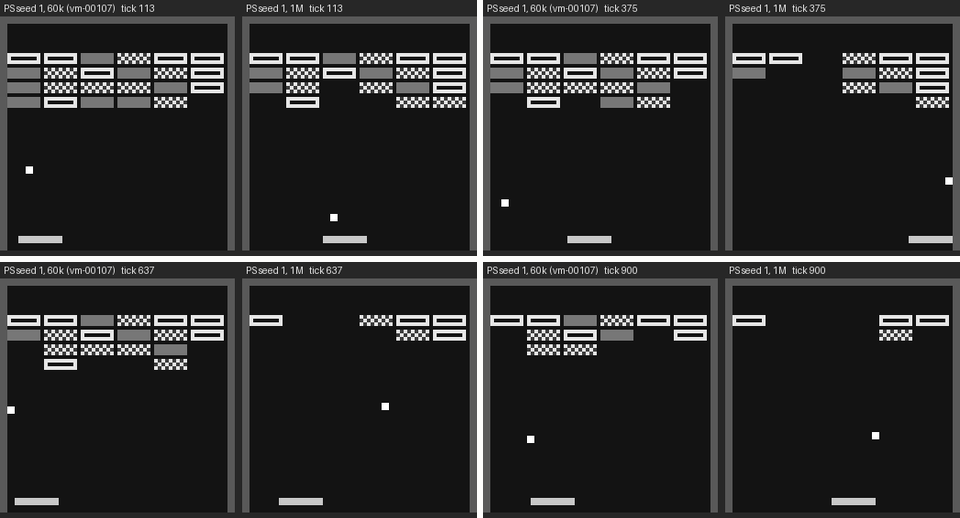

# vm-00109: Breakout Stage 2b — One Long Life of 1M Ticks

**Date:** 2026-11-23
**Status:** Complete
**Source:** `dev/` (pending tag `exp/vm-00109`)
**Outputs:** `~/data/research/visual-motor-agent/exp_00109/`
**Task plan:** [`../tasks/00121-breakout-long-life.md`](../tasks/00121-breakout-long-life.md)

## Goal

The owner, 2026-11-23, after vm-00107: "does paddle improves over time? what if we train to 1m ticks (PS? and just one seed)".

- **vm-00107:** with food for the paddle hit, PS returned .23 of balls at 0–10k and .47 at 50–60k, still rising in all 12 seeds (50–60k minus 40–50k: +.037 ± .015). Stage 1 (vm-00103, a slower ball) reached .68.
- **Here:** the same life run 1M ticks, to see where the return levels off and whether a taste for the better bricks appears given far more time.

## Method

- **One life:** vm-00107's PS (`configs/U_breakout2p.json`, `online.meal_size = .5`), seed 1 (`env.brick_shift` 1), 1M ticks, checkpoints every 50k. Nothing else changed: memory 100k ticks (past it, the newest chunks), a constant learning rate.
- **Card:** the RTX 4090, under MPS, beside vm-00108's runs.
- **Frozen tests:** 2,000 ticks with learning off at 100k, 250k, 500k, 750k and 1M, in 6 new courts each (seeds 101–106, look shift 1).
- **Video:** 900 ticks at 1M beside vm-00107's PS seed 1 at 60k, from the same court (seed 201).

## The readings, set before the results

1. **Does the return keep improving?** The lived hit share by 50k: where it levels off, against vm-00107's .47 at 50–60k and stage 1's .68 (descriptive, one seed).
2. **Does a taste appear?** The lived preference by 100k against the aimer's chance level (−.014), and frozen at 500k and 1M. Expected: none (the label's horizon is about 10 ticks; a brick is 15 or more ticks from the return).
3. **Does a long life break anything?** Hunger, poison and the meal monitor's predicted against real label over the life.

## Results

The life ran 1M ticks without an error (2026-11-23 15:21 to 2026-11-24 15:20, 24.0 h). It ran at about 25 ticks/s alone on the 4090, at 14 beside vm-00108's Dreamer lives and at 2.4 beside vm-00110's. The 30 frozen tests and the video followed (done 15:38).

The walkers in this court (vm-00107, 20k ticks, 12 seeds):

| Walker | Paddle hit share | Bricks per 1k | Food per 1k | Preference |
|---|---|---|---|---|
| random | .229 | 11.1 | 4.82 | +.005 |
| aimer (every ball, a fresh offset) | 1.000 | 24.6 | 12.06 | −.014 |

### R1. Lived: the return climbs to .95

By 50k (a miss is this court's poison, so poison per 1k equals misses per 1k):

| Ticks | Paddle hit share | Misses per 1k | Bricks per 1k | Food per 1k | Hunger | Preference |
|---|---|---|---|---|---|---|
| 0–50k | .325 | 18.6 | 13.4 | 6.03 | .68 | −.007 |
| 50–100k | .528 | 10.9 | 18.3 | 8.23 | .44 | +.005 |
| 100–150k | .700 | 6.4 | 21.0 | 9.68 | .36 | +.029 |
| 150–200k | .797 | 4.1 | 22.6 | 10.45 | .15 | −.033 |
| 200–250k | .827 | 3.6 | 25.9 | 11.59 | .17 | −.001 |
| 250–300k | .868 | 2.6 | 23.6 | 11.01 | .06 | −.048 |
| 300–400k | .869 | 2.5 | 24.3 | 11.15 | .11 | +.012 |
| 400–500k | .902 | 2.0 | 26.3 | 11.92 | .10 | −.001 |
| 500–600k | .905 | 2.0 | 24.1 | 11.44 | .08 | +.020 |
| 600–700k | .944 | 1.1 | 25.7 | 11.94 | .05 | +.002 |
| 700–800k | .933 | 1.4 | 24.4 | 11.61 | .03 | +.026 |
| 800–900k | .948 | 1.0 | 24.2 | 11.58 | .06 | +.009 |
| 900–1000k | .952 | 1.0 | 23.9 | 11.50 | .05 | +.016 |

- **Reading 1:** the return rises fast to about .87 by 250k, then slowly: .90 at 400–600k, .93–.95 from 600k on. At 950k–1M it misses 1.0 ball per 1k ticks, against 18.6 in the first 50k. It has not quite levelled off at 1M, but the last 400k add only about .015.
- **Against the earlier lives:** vm-00107's PS returned .47 at 50–60k (its seed 1 .483; this life .480 then); stage 1's BD .68 at 50–60k. Stage 1 with DreamerV3 (vm-00108) reached .99 by 50k.
- **Food levels off at 200k** (about 11.5 per 1k) while the return keeps rising: bricks per 1k stay at about 24, the aimer's level. A returned ball is not aimed at bricks.

### R2. Frozen

2,000 ticks with learning off in 6 new courts (seeds 101–106, look shift 1), the mean over courts (95%, t with 5 df):

| Checkpoint | Paddle hit share | Per court | Food per 1k | Bricks per 1k | Preference |
|---|---|---|---|---|---|
| 100k | .596 ± .089 | .52–.75 | 9.14 | 20.4 | −.039 ± .148 |
| 250k | .808 ± .102 | .71–.95 | 11.14 | 23.7 | −.019 ± .124 |
| 500k | .851 ± .069 | .74–.93 | 11.53 | 24.4 | +.001 ± .064 |
| 750k | .921 ± .081 | .79–1.00 | 13.09 | 28.8 | −.045 ± .130 |
| 1M | .947 ± .036 | .90–1.00 | 11.95 | 25.8 | −.078 ± .104 |

vm-00107's PS seed 1 frozen at 60k (one court, seed 101): .481.

- **Frozen agrees with lived:** .95 at 1M, every court .90 or above.
- **In the video** (900 ticks from one court, seed 201): at 1M the agent returns 20 balls and misses 1; at 60k (vm-00107) it returned 10 and missed 19.

### R3. No taste for bricks

- **Reading 2 fails, as expected:**
  - The lived preference by 100k is −.024 to +.026 (0–1M), around the aimer's −.014.
  - Over 500k–1M it is +.014 over 12,223 bricks (by 10k windows, ± .016 if the windows were independent). The big bricks' share of hits is .333.
  - Frozen it is −.078 ± .104 at 1M and +.001 ± .064 at 500k.
- **The play at 1M is the aimer's:** nearly every ball returned, 24 bricks and 11.5 food per 1k, which brick a matter of chance (the aimer: 24.6 and 12.06).

### R4. Nothing breaks in a long life

- **Hunger** falls to .03–.06 from 600k on; misses (the poison) to 1 per 1k.
- **The meal monitor**, the predicted label (`meal`) and the stored label (`meal_stored`) against the real label, by ticks to the next meal:

| Ticks | Label | 0 | 1 | 2–3 | 4–7 | 8–15 | 16–31 | 32–63 |
|---|---|---|---|---|---|---|---|---|
| 0–50k | real | +.55 | +.52 | +.48 | +.41 | +.30 | +.04 | −.19 |
| 0–50k | predicted | +.33 | +.29 | +.25 | +.22 | +.17 | +.12 | +.08 |
| 450–500k | real | +.55 | +.52 | +.48 | +.41 | +.30 | +.15 | +.01 |
| 450–500k | predicted | +.60 | +.54 | +.49 | +.42 | +.31 | +.25 | +.23 |
| 950–1000k | real | +.55 | +.52 | +.48 | +.41 | +.30 | +.16 | +.04 |
| 950–1000k | predicted | +.60 | +.54 | +.50 | +.43 | +.32 | +.25 | +.21 |
| 950–1000k | stored | +.55 | +.45 | +.41 | +.36 | +.26 | +.18 | +.14 |

- From about 200k the predicted label matches the real one within .05 up to 15 ticks before a meal, and stays so to 1M: no drift. Further from a meal (16–63 ticks) it is .1–.2 too high, as early in the life. The label's horizon (γ .95) is about where its error starts.
- **Memory** has been full since 100k (the newest chunks kept, `ltm_age_max` 100k ticks); nothing changed when it filled.

<!-- figures -->
## Figures

*The world of this experiment as its model sees it, every 12 ticks. Moves are random: this shows the world, not the trained agent.*

*From each run's `metrics.jsonl`, the mean of its seeds by arm, smoothed. One life of 1M ticks in vm-00107's court (stage 2, paddle food .25): PS seed 1 (a meal worth its size, .5), smoothed over about 40k ticks. vm-00107's PS returned .47 at 50-60k; a random paddle .229.*

*Stills from this experiment's video, in time order. PS seed 1 at 60k (vm-00107, left) and at 1M (right), frozen, 900 ticks from the same court (seed 201): the frame as the model sees it, the bricks' three looks (solid, checker, hollow).*
<!-- /figures -->

## Analysis

- **Given time, the default agent learns stage 2's return almost perfectly.** The slow climb of vm-00107 (.47 at 60k, still rising) goes on to .87 at 250k and .95 at 1M. The skill is the one the label credits: the meal is one tick after the return.
- **It is slow.** Stage 1's ball is slower and BD reached .68 at 60k; DreamerV3 (vm-00108, stage 1) reached .99 by 50k. Here .9 takes about 400k ticks, and the last misses go very slowly (2 per 1k at 500k, 1 per 1k at 1M).
- **More time does not bring a taste.** With 24,000 bricks hit, the preference stays at the aimer's chance level, lived and frozen, and each look takes a third of the hits. The aim at a brick is 15 or more ticks before its food, beyond the label's horizon; a million ticks do not change that. The meal monitor shows the same edge: the predicted label is right up to 15 ticks before a meal and too high beyond.
- **A long life is stable:** no drift in the label, hunger low, memory full since 100k without an effect.

## Conclusions

1. **The return keeps improving well past 60k:** .48 at 50–60k, .87 at 250k, .90 at 500k, .95 at 1M (lived; frozen .95 at 1M in 6 courts, every court .90 or above). It has nearly levelled off.
2. **No taste for better bricks in 1M ticks**, lived or frozen: the agent plays like the aimer, every ball returned to a chance brick.
3. **Nothing breaks:** the label, hunger and memory are stable to 1M.

## Next steps

- **The brick's food within the label's reach** (a longer horizon, γ nearer 1) is still the open question for the taste; this life shows that time alone does not do it.
- **vm-00110 (running):** whether more training per tick (Dreamer's budget) makes the return faster; its first 6 seeds start faster in stage 1 (.5 by 18–27k against BD's 33–55k) but end at about BD's level at 60k.
