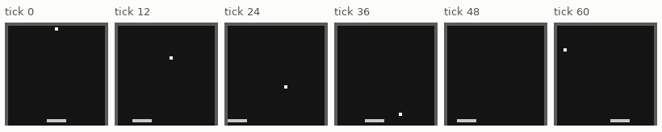
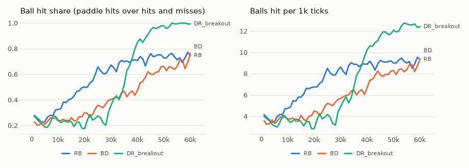

# vm-00110: Dreamer's Training Budget — the Default Agent at 7 Times the Replay

**Date:** 2026-11-23
**Status:** Complete
**Source:** `dev/` (pending tag `exp/vm-00110`)
**Outputs:** `~/data/research/visual-motor-agent/exp_00110/`
**Task plan:** [`../tasks/00122-replay-ratio.md`](../tasks/00122-replay-ratio.md)

## Goal

The owner, 2026-11-23: "yes write the task and queue it after dreamer".

- **vm-00108:** in Breakout stage 1, DreamerV3 returns nearly every ball by 40–50k ticks; our default agent (vm-00103's BD) .61–.70 at 50–60k.
- **But Dreamer trains on about 8 times as much per tick:** 29.5M replayed steps in its 60k ticks (one update every 2 ticks on 1,024 steps) against our 3.84M (one update a tick on 64 steps: 8 windows of 8, the newest among them).
- **Here:** the same agent with Dreamer's replayed steps per tick, on the same 60k ticks of experience. Does the training budget explain the gap?

## Method

- **RB:** the default agent in Breakout stage 1 (`configs/U_breakout.json`) with `online.batch = 56`: each update 56 windows of 8 steps, the newest and 55 replayed, 448 steps (BD: 8 windows, 64 steps). 26.9M steps in 60k ticks (Dreamer 29.5M). Nothing else changed: no imagination, the same model, label and instinct.
- **Seeds 1–12, 60k ticks**, 6 per card under MPS; frozen at 30k and 60k (2,000 ticks, seed 100 + s, as vm-00103).
- **Pilot:** 2,000 ticks beside three Dreamer lives: batch 56 at 2.4 ticks/s against batch 8's 3.8.

## The readings, set before the results

1. **Does more training per tick speed learning?** RB against BD at 40–60k lived, paired by seed (12 seeds).
2. **Does it close the gap to Dreamer?** RB against DR at 40–60k lived, paired by seed (seeds 1–6).
3. **Cost:** wall-clock per life against BD's.

## Results

All 12 lives ran 60k ticks (2026-11-24 00:58; seeds 7–12 on the 4090 done about 12:00, seeds 1–6 on the 3090 18:35), then the 24 frozen tests (done 19:47).

### R1. Lived

Paddle hit share, the mean by 10k (BD: vm-00103, batch 8; DR: vm-00108's DreamerV3, seeds 1–6; random paddle .235):

| Ticks | BD (12) | RB (12) | BD (1–6) | RB (1–6) | DR (1–6) |
|---|---|---|---|---|---|
| 0–10k | .226 | .262 | .229 | .253 | .226 |
| 10–20k | .251 | .431 | .256 | .418 | .207 |
| 20–30k | .335 | .600 | .325 | .600 | .263 |
| 30–40k | .442 | .684 | .434 | .677 | .597 |
| 40–50k | .602 | .727 | .572 | .710 | .931 |
| 50–60k | .678 | .735 | .652 | .752 | .992 |

Paired by seed:

| Comparison | Ticks | Mean difference (95%) | Seeds |
|---|---|---|---|
| RB − BD | 10–30k | +.220 ± .051 | 12 of 12 above |
| RB − BD | 20–40k | +.254 ± .052 | 12 of 12 above |
| RB − BD | 40–60k | +.092 ± .060 | 10 of 12 above |
| RB − BD | 50–60k | +.057 ± .063 | 10 of 12 above |
| RB − DR | 10–30k | +.271 ± .062 | 6 of 6 above |
| RB − DR | 40–60k | −.231 ± .055 | 0 of 6 above |
| RB 50–60k − RB 40–50k | | +.008 ± .042 | 6 of 12 above |
| BD 50–60k − BD 40–50k | | +.076 ± .027 | 12 of 12 above |

The first 5k window at or above a share, per seed:

| Share | RB | BD | DR |
|---|---|---|---|
| .5 | 17–27k (median 21.5k) | 32–55k (median 40.5k) | 31–42k |
| .7 | 24–60k, 12 of 12 | 44–58k, 8 of 12 | 33–46k |
| .9 | 48k, 1 of 12 | none | 37–52k, 6 of 6 |

RB reaches .5 19.5k ± 5.3k ticks before BD (12 of 12).

- **Reading 1, more training per tick speeds learning: yes, early.** RB leaves random by 10–20k and reaches .5 at about half BD's ticks. At 20–40k it returns .25 more balls (12 of 12).
- **But it levels off at about .73:** 50–60k adds nothing to 40–50k (+.008), while BD is still climbing (+.076, 12 of 12). By 40–60k the lead is +.09 (10 of 12), by 50–60k +.06, within its interval of zero. Only one RB seed reaches .9 in any 5k window.
- **Reading 2, it does not close the gap to Dreamer.** RB is far ahead of DR at 10–30k (+.27, 6 of 6), when Dreamer is still at random, and far behind at 40–60k (−.23, 0 of 6), when Dreamer returns nearly every ball. Misses per 1k at 50–60k: RB 3.3, BD 4.1, DR 0.1.

### R2. Frozen

2,000 ticks with learning off in new courts (seed 100 + s), 12 seeds:

| Checkpoint | RB | BD | RB − BD | RB − random |
|---|---|---|---|---|
| 30k | .615 | .431 | +.184 ± .111 (10 of 12) | +.380 ± .073 (12 of 12) |
| 60k | .717 | .644 | +.073 ± .082 (9 of 12) | +.482 ± .048 (12 of 12) |

Frozen agrees with lived: well ahead at 30k, a small lead at 60k.

### R3. Why it levels off: the candidates run out

- **RB's move prediction becomes nearly certain.** Its move token's cross-entropy (the training loss on its own past moves) is .07–.08 from 20k on, against BD's .52–.60. Body and frame are predicted as well as BD's (.38 against .37–.40; .653 against .655).
- **So the instinct has less to choose from** (`eval_candidates.py`, frozen at 60k, 16 bodies × 300 ticks in each seed's court; `exp_00110/candidates.jsonl`):

| | RB | BD |
|---|---|---|
| Distinct moves among the 16 candidates | 8.07 | 13.60 |
| Ticks with all 16 the same | .016 | .0001 |
| The predicted label's spread over the candidates (median) | .0055 | .0081 |

RB − BD distinct moves: −5.53 ± .24, 12 of 12 seeds below. The instinct overrules the model's own move less often (.38 of ticks at 50–60k against .47).

- **The mechanism is vm-00098's:** the candidates are samples of the model's own move prediction. Seven times the replay fits the move token to the moves the instinct picked, the candidates narrow, and the instinct stops finding better moves. In Breakout dy is ignored, so the distinct (dx, dy) pairs overstate the choice in dx.

### R4. Cost

- **Wall-clock per life:** RB 10.6 h (the 4090) and 17.6 h (the 3090), 6 lives per card, beside vm-00109 on the 4090; BD 3.0 h with 6 per card. Frozen RB also runs the batch-56 update (learning rate 0): 0.9 ticks/s.
- At 6 lives per card RB takes 3.5 (the 4090) to 6 (the 3090) times BD's wall-clock per life, the same order as Dreamer or more (vm-00108: about 3 times BD's card time).

<!-- figures -->
## Figures

*The world of this experiment as its model sees it, every 12 ticks. Moves are random: this shows the world, not the trained agent.*

*From each run's `metrics.jsonl`, the mean of its seeds by arm, smoothed. Breakout stage 1: RB the default agent with online.batch 56 (Dreamer's replayed steps per tick), BD the default agent (vm-00103, batch 8), 12 seeds each; DR_breakout DreamerV3 (vm-00108, seeds 1-6). A random paddle's hit share is .235.*
<!-- /figures -->

## Analysis

- **The training budget explains Dreamer's quick start relative to ours, not its ceiling.** With Dreamer's replayed steps per tick, the default agent learns the return twice as fast as before, and faster than Dreamer, which stays at random until 30k. But it stops at .73 while Dreamer goes on to .99.
- **More replay narrows the agent's own choice.** The move token learns to imitate the instinct's picks; with 7 times the updates on the same experience it fits them nearly exactly (cross-entropy .08), so the 16 candidates are half as varied. The instinct can only pick among moves the model already proposes: the more it is trained on its own choices, the less it explores. Dreamer's actor keeps an entropy bonus and learns from the critic's gradient, not from imitating its own picks.
- **This points at the acting rule** (task 00123): both the plateau here and the gap to Dreamer sit where our agent chooses moves.

## Conclusions

1. **More training per tick speeds learning:** RB reaches .5 at 17–27k against BD's 32–55k (12 of 12 seeds earlier) and returns .25 more balls at 20–40k.
2. **It levels off at about .73 and does not close the gap to Dreamer** (−.23 at 40–60k, 0 of 6 seeds); at 50–60k BD nearly catches up (+.06, within the interval).
3. **The plateau comes with collapsed candidates:** the move prediction becomes nearly certain (cross-entropy .08 against .55), and the instinct's candidates are 8 distinct moves instead of 14 (12 of 12 seeds).
4. **Cost:** 3.5–6 times BD's wall-clock per life.

## Next steps

- **The acting rule** (task 00123, the owner's priority for later): an actor trained on the critic's value instead of the move token imitating the instinct.
- **Keeping the candidates varied under more replay** (cheaper): a higher `online.instinct_temp`, or the move token's loss weighted down, with batch 56.
