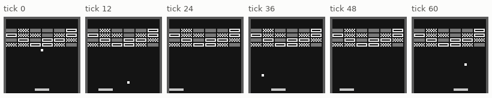
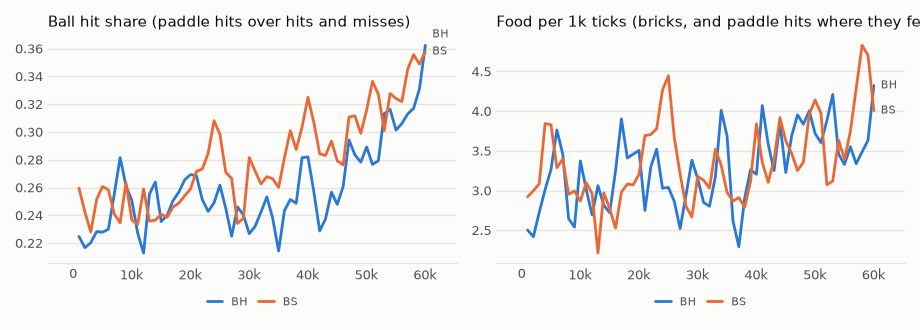

# vm-00111: A Long Label Horizon in the Bricks-Only Court

**Date:** 2026-11-24
**Status:** Complete
**Source:** `dev/` (pending tag `exp/vm-00111`)
**Outputs:** `~/data/research/visual-motor-agent/exp_00111/`
**Task plan:** [`../tasks/00124-long-horizon-bricks.md`](../tasks/00124-long-horizon-bricks.md)

## Goal

The owner, 2026-11-24: "for now we need to do #1 (0.997) and #2 - make both to be 3 lives"; the court chosen with the owner: bricks only.

- **No taste for better bricks** in vm-00104, vm-00107 and vm-00109 (1M ticks): each look gets a third of the hits.
- **The suspected cause is the label's horizon:** at γ .95 a brick 20 ticks after the aim is worth .36 of its size there; at γ .997, .94.
- **Why the bricks-only court:** a meal step's label is its own worth with no tail (`online.meal_parts`). With paddle food (vm-00107) the paddle hit is a meal, so the label of the aiming ticks stops there at any γ. Without it, the next meal after a return is the brick.

## Method

- **BH:** vm-00104's BS (`configs/U_breakout2.json`, `online.meal_size` .5) with `online.label_gamma = .997`. Nothing else changed.
- **Seeds 1–12, 60k ticks** (planned 1–3; 4–12 added while the cards were free), `env.brick_shift` = seed mod 3, under MPS, 1–6 on the RTX 3090 and 7–12 on the RTX 4090; paired with vm-00104's BS and BK seeds 1–12 and its aimer.
- **Frozen** at 30k and 60k (2,000 ticks, seed 100 + s).

## The readings, set before the results (for 3 seeds: descriptive; run with 12)

1. **Does a taste appear?** BH's preference at 40–60k above the aimer's level and above BS's, in each seed; the big bricks' share above a third.
2. **Does the play come back?** BH's hit share at 40–60k against BS's (.33 at 50–60k over 12 seeds).
3. **Does the long horizon break the label?** The meal monitor against the real label; hunger.

## Results

All 12 lives ran 60k ticks, then the 24 frozen tests (seeds 1–3 on the 3090 2026-11-24 19:47–21:39; seeds 4–6 there to 2026-11-25 00:24; seeds 7–12 on the 4090 to 01:18; 1.7 h per life). The plan was 3 seeds; seeds 4–12 were added while the cards were free, to pair with vm-00104's 12. **The 3 seeds alone overstated the taste** (below): read the 12.

### R1. Lived

The mean of 12 seeds by 10k (BS and BK: vm-00104, γ .95, BS with the meal worth its size as BH, BK the plain label; the aimer's preference −.014, a random paddle's hit share .229):

| Ticks | BH hit share | BS hit share | BK hit share | BH preference | BS preference | BK preference |
|---|---|---|---|---|---|---|
| 0–10k | .236 | .239 | .230 | +.014 | +.021 | +.011 |
| 10–20k | .240 | .244 | .244 | +.033 | −.001 | −.011 |
| 20–30k | .237 | .267 | .231 | +.004 | +.018 | −.010 |
| 30–40k | .245 | .279 | .254 | +.039 | −.033 | +.014 |
| 40–50k | .257 | .290 | .269 | +.037 | +.022 | −.009 |
| 50–60k | .308 | .334 | .282 | +.042 | −.019 | +.007 |

Paired by seed (12 seeds; the aimer in each seed's own court):

| Comparison | 40–60k | 50–60k |
|---|---|---|
| BH preference − aimer | +.053 ± .034 (9 of 12 above) | +.056 ± .043 (10 of 12) |
| BS preference − aimer | +.016 ± .046 (8 of 12) | −.005 ± .048 (8 of 12) |
| BH − BS preference | +.037 ± .053 (7 of 12) | +.061 ± .054 (10 of 12) |
| BH − BS hit share | −.029 ± .024 (3 of 12) | −.026 ± .043 (4 of 12) |
| BH − BS food per 1k | +.01 ± .31 (6 of 12) | −.12 ± .55 (4 of 12) |
| BH − BS big bricks' share | −.002 ± .005 (4 of 12) | .000 ± .012 (5 of 12) |

- **Reading 1, a taste: at most a faint lean, short of the reading.** BH's preference sits above the aimer's chance level at 40–60k (+.053 ± .034, 9 of 12), where BS (+.016) and BK (+.012) in the same court are not clear of zero, nor was vm-00109's 1M-tick life. But it is not above BS's at 40–60k (+.037 ± .053, 7 of 12), not in each seed (BH's per-seed preference −.05 to +.11), and it is not there frozen (R2). It is small: +.05 means the brick hit ranks about a twentieth of a step above the standing mean (the most is about +1).
- **The 3 seeds first seen** (vm-00111 as planned) had +.107 at 50–60k, all above BS; seeds 4–12 have +.02. The early report was the luck of three seeds.
- **The big bricks' share stays a third** (.333, .333, .334), as in every arm: over a life every brick of a wall is hit before it refills, so the shares are forced; only the order (the preference) can show a taste. This part of reading 1 could not have moved.
- **Reading 2, the play: it does not come back.** BH returns slightly fewer balls than BS (−.029 ± .024 at 40–60k, 3 of 12 above); both are near random until 40k and reach .31 and .33 at 50–60k.

### R2. Frozen

2,000 ticks with learning off in new courts (seed 100 + s), 12 seeds (about 20–24 bricks per life):

| Checkpoint | BH hit share | BS hit share | BH − BS | BH preference − aimer | BS preference − aimer |
|---|---|---|---|---|---|
| 30k | .239 | .223 | +.016 ± .044 (5 of 12) | −.023 ± .090 (6 of 12) | −.053 ± .065 (5 of 12) |
| 60k | .298 | .302 | −.003 ± .064 (6 of 12) | −.016 ± .084 (4 of 12) | −.065 ± .089 (3 of 12) |

- **No preference frozen**, in either arm; with about 20 bricks per life each seed's figure is noisy (intervals of ±.09).
- Hit share frozen at 60k: BH .298, BS .302 (random .229).

### R3. The label at γ .997

The meal monitor at 50–60k, the mean of 12 seeds: the predicted label (`meal`) against the real one, by ticks to the next meal (a brick):

| Ticks to the meal | 0 | 1 | 2–3 | 4–7 | 8–15 | 16–31 | 32–63 |
|---|---|---|---|---|---|---|---|
| BH real | .587 | .578 | .572 | .566 | .553 | .528 | .299 |
| BH predicted | .301 | .260 | .222 | .168 | .051 | −.165 | −.241 |
| BS real | .585 | .553 | .513 | .441 | .328 | .182 | −.076 |
| BS predicted | .373 | .334 | .302 | .260 | .176 | .059 | .027 |

- **Reading 3, the label: the long horizon is not learned.** At γ .997 the real label hardly falls with distance (.59 at the meal, .53 at 16–31 ticks); a brick 20 ticks ahead is worth nearly its full size, as designed. The predicted label falls faster than BS's (from .30 to −.17 over the same range) and turns negative 16 ticks out, where the real one is .53. At γ .95 the prediction is low near the meal too but falls with the real label.
- **So the long label exists in hindsight but not in the model's prediction**, which is what the instinct reads. The bootstrapped tail (γ × the model's own prediction for the next step) compounds the model's low estimate over about 330 ticks instead of 20; in 60k ticks it does not catch up.
- **Hunger** is the same (BH .87 at 50–60k, BS .83).

## Analysis

- **The longer horizon gives the label what a taste needs, and the model does not learn it.** In the real label a brick's worth now reaches 20+ ticks back to the aim. The model's predicted label, the thing the instinct chooses by, is biased low and falls off sooner than BS's. A faint lean above chance (+.05, 9 of 12) is all that reaches behaviour; it does not show frozen and does not beat BS's.
- **Playing well comes first.** Both arms return under a third of the balls by 60k; a paddle that rarely returns has few aims to choose among, and the play at γ .997 is if anything a little worse (−.03). vm-00109 showed the play in the paddle-food court rises to .95 over 1M ticks, but there the paddle meal cuts the label at the return.
- **For the acting rule** (task 00123): the instinct reads one-step predicted labels of its candidates; a long horizon only helps if the value of a far meal is predicted at the aim. That is the critic's job in an actor-critic; here it is the model's label, and it lags.

## Conclusions

1. **No clear taste for better bricks at γ .997:** a faint lean above the aimer's chance level lived at 40–60k (+.053 ± .034, 9 of 12), not above γ .95's (+.037 ± .053), and none frozen. The first 3 seeds (+.107 at 50–60k) overstated it.
2. **The play does not come back:** hit share .31 at 50–60k (BS .33; −.029 ± .024 at 40–60k).
3. **The long label is real but not learned:** the real label is .53 at 16–31 ticks before a brick, the predicted −.17; at 60k the model's estimate lags far behind its horizon.

## Next steps

- **The acting rule** (task 00123, the owner's priority): the instinct can only use a far meal if the predicted label at the aim carries it; a learned critic or a multi-step instinct are the two ways in.
- If the horizon is revisited: a longer life (the label's error at γ .997 may close with time, as vm-00109's did at γ .95), or a γ between (.98, a horizon of 50 ticks).

<!-- figures -->
## Figures

*The world of this experiment as its model sees it, every 12 ticks. Moves are random: this shows the world, not the trained agent.*

*From each run's `metrics.jsonl`, the mean of its seeds by arm, smoothed. Stage 2 bricks only (vm-00104's court): BH the meal worth its size with label gamma .997, BS the same at .95 (vm-00104); 12 seeds each. A random paddle's hit share is .229.*
<!-- /figures -->
