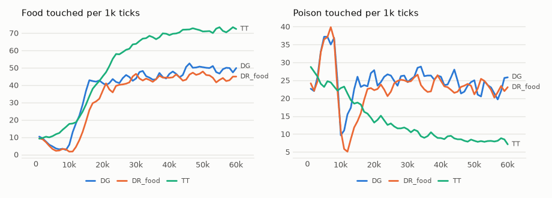
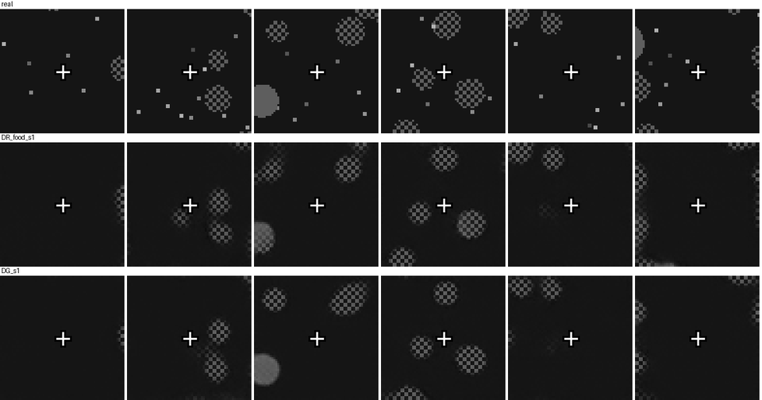

# vm-00112: Dreamer in the Food World with Our Horizon

**Date:** 2026-11-24
**Status:** Complete
**Source:** `dev/` (pending tag `exp/vm-00112`)
**Outputs:** `~/data/research/visual-motor-agent/exp_00112/`
**Task plan:** [`../tasks/00125-dreamer-short-horizon.md`](../tasks/00125-dreamer-short-horizon.md)

## Goal

The owner, 2026-11-24: "for now we need to do #1 (0.997) and #2 - make both to be 3 lives".

- **vm-00108:** in the food world DreamerV3 reaches food (44.8 per 1k at 40–60k) but never learns to avoid poison (22.9 per 1k; our TT 8.4).
- **Two candidate causes:** its horizon (discount .997, about 330 ticks, against our .95), or a world model that blurs the poison's checker away.

## Method

- **DG:** vm-00108's DR in the food world (train ratio 512, its defaults) with `discount = .95` (`run_dreamer.py --dset discount=0.95`). Nothing else changed.
- **Seeds 1–3, 60k ticks**, on the RTX 4090 under MPS; paired with vm-00108's DR food seeds 1–3, and against TT.
- **The reconstruction check** (`dev/baselines/dreamer_recon.py`): DR's and DG's world models at 60k, the decoded frame beside the real one, the checker's contrast inside poison against food.

## The readings, set before the results (3 seeds: descriptive)

1. **Is it the horizon?** DG's poison at 40–60k against DR's: down to TT's level says yes.
2. **Is it the look?** Whether the reconstruction keeps the checker.
3. **Food:** DG's against DR's and TT's.

## Results

All 3 lives ran 60k ticks on the RTX 4090, 3 at once (2026-11-24 19:47–23:27, 3.7 h per life, as vm-00108's DR food).

### R1. Lived

Food and poison per 1k, the mean of seeds 1–3 by 10k (DR: vm-00108's DreamerV3 with discount .997, its seeds 1–3; TT: vm-00101's default agent, its seeds 1–3):

| Ticks | DG food | DR food | TT food | DG poison | DR poison | TT poison |
|---|---|---|---|---|---|---|
| 0–10k | 5.5 | 4.2 | 11.1 | 27.7 | 26.4 | 25.5 |
| 10–20k | 34.6 | 18.0 | 32.1 | 22.5 | 13.0 | 17.9 |
| 20–30k | 43.1 | 42.1 | 57.1 | 25.3 | 25.5 | 13.0 |
| 30–40k | 45.4 | 45.4 | 68.3 | 26.5 | 24.9 | 10.1 |
| 40–50k | 49.1 | 47.0 | 71.9 | 24.3 | 22.4 | 9.1 |
| 50–60k | 49.2 | 43.9 | 73.2 | 22.7 | 23.2 | 8.0 |

At 40–60k, paired by seed (3 seeds):

| Comparison | Mean difference (95%) | Seeds |
|---|---|---|
| DG − DR poison | +0.7 ± 5.5 | 2 of 3 above |
| DG − TT poison | +15.0 ± 1.7 | 3 of 3 above |
| DG − DR food | +3.7 ± 9.8 | 2 of 3 above |
| DG − TT food | −23.4 ± 1.3 | 0 of 3 above |
| DG − DR food less poison | +3.0 ± 11.8 | 2 of 3 above |

- **Reading 1, the horizon: no.** DG's poison at 40–60k is 23.5 per 1k (24.0, 23.0, 23.4 by seed), DR's 22.8, TT's 8.5. With our discount Dreamer eats as much poison as with its own.
- **The same course as DR's:** poison dips at 10–20k (DG 22.5, DR 13.0), then returns to about 23–26 from 20k on and stays there.
- **Reading 3, food:** DG learns to reach food sooner (10–20k: +16.6 ± 20.0, 3 of 3 above), then levels off where DR does (49.1 at 40–60k against 45.5; TT 72.6). Food less poison: DG 25.7, DR 22.6, TT 64.0.
- **Not blind to poison:** a third of DG's touches are poison at 40–60k (.32; DR .33), against .83 in its first 10k of mostly random moves (the prefill); TT's are .11. Both Dreamers steer toward food and away from poison in part, and stop improving at the same level.
- **DG's hunger is higher** at 50–60k (.30 against DR's .14 and TT's .03): at .95 it is less settled, not less poisoned.

### R2. The world model: the look and the cost

`dev/baselines/dreamer_recon.py`: a new life of 2,000 random moves (seed 101) observed through each world model at 60k (encoder, posterior, decoder). Objects are found in the real frame by their grey and classed by how much of their area is lit (food about 1, poison about .5); inside each, the real and decoded pixels:

| Model | Poison: real spread | Poison: decoded spread | Poison: correlation | Food: real mean | Food: decoded mean | Poison: decoded mean |
|---|---|---|---|---|---|---|
| DR seeds 1–3 | 36.8 | 29.5–29.8 | .76–.78 | 88.7 | 69.6–71.7 | 46.9–47.9 |
| DG seeds 1–3 | 36.8 | 28.9–30.2 | .75–.80 | 88.7 | 71.0–73.6 | 46.6–48.7 |

- **Reading 2, the look: no.** Every model keeps the poison's checker (the decoded spread about .8 of the real, correlation about .77 pixel by pixel). Food is decoded plain and dimmer (about 71 against 88), poison at about 47: the two are as far apart in the decoded frame as in the real one. The sheet below shows it.
- **The reward head knows poison's cost.** At the ticks a poison was eaten (45 in this life) the predicted reward is −.22 to −.34 (real −.5); at the 21 food ticks +.10 to +.66 (real +1); elsewhere about 0. DG's poison predictions are a little stronger than DR's (−.32 to −.34 against −.22 to −.27).

## Analysis

- **Neither horizon nor look explains the poison.** At .95 Dreamer eats as much poison as at .997, and both world models see the checker and predict poison's cost.
- **What is left is how Dreamer acts on what its model knows.** Its actor learns from imagined returns through the world model: it avoids poison in part (a third of touches against .83 at random) and stops there, while our agent, choosing among imagined candidates by the meal label each tick, gets it down to a tenth. In Breakout the same actor plays nearly perfectly (vm-00108); in the food world it settles at a third. A guess, not tested here: random moves touch poison about twice as often as food (25.5 against 11.1 per 1k in TT's first 10k), and at half a meal's cost a route through both still pays.
- **For the acting rule** (task 00123): an actor trained on the critic's value, as Dreamer's, is not by itself the fix for the food world. The two acting rules fail in different worlds: ours plateaus in Breakout (vm-00110), Dreamer's in the food world.

## Conclusions

1. **The horizon is not the cause:** Dreamer with discount .95 eats as much poison as with .997 (23.5 against 22.8 per 1k at 40–60k; TT 8.5).
2. **The look is not the cause:** both world models keep the poison's checker in the decoded frame, and the reward head predicts poison's cost (−.22 to −.34 of the real −.5).
3. **The shorter discount changes little else:** food is reached sooner at 10–20k and ends at the same level (49 against 46; TT 73).
4. **Dreamer's poison problem sits in its acting**, the actor trained on imagined returns, not in its model or its discount.

## Next steps

- **The acting rule** (task 00123, the owner's priority for later): this experiment adds that an actor-critic like Dreamer's is not a ready fix in the food world; whatever replaces the move token's imitation should be tested in both worlds.
- Optional, cheap: Dreamer in the food world with a lower actor entropy (`actor` `entropy`, default 3e-4) or a longer imagination (`imag_horizon`, default 15).

<!-- figures -->
## Figures

*The world of this experiment as its model sees it, every 12 ticks. Moves are random: this shows the world, not the trained agent.*

*From each run's `metrics.jsonl`, the mean of its seeds by arm, smoothed. The food world: DG DreamerV3 with discount .95, seeds 1-3; DR_food DreamerV3 with its default .997 (vm-00108, seeds 1-6); TT the default agent (vm-00101, 12 seeds).*

*The world models' decoded frames beside the real ones (`recon/recon_sheet.png`). A new life of random moves (seed 101) observed through DR_food seed 1's and DG seed 1's world models at 60k (`dev/baselines/dreamer_recon.py`): top the real frame, then each model's decoded frame. Plain circles are food, checkered ones poison; both models keep the checker. The small squares, the moving distractor dots, are not decoded.*
<!-- /figures -->
