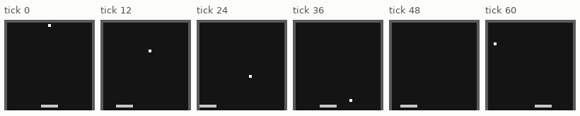
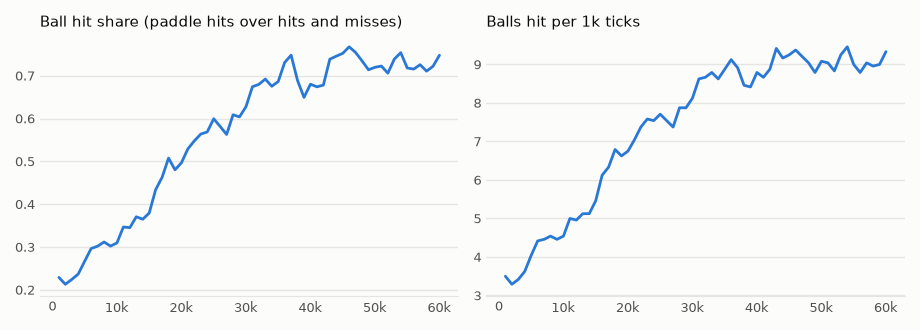

# vm-00113: Dreamer's Training Budget with Varied Candidates

**Date:** 2026-11-25
**Status:** Complete (negative: the candidates' variety comes back, the plateau stays)
**Source:** `exp/vm-00113` (code: `visual-motor-agent/dev/`)
**Outputs:** `~/data/research/visual-motor-agent/exp_00113/`
**Task plan:** [`../tasks/00126-replay-ratio-temp.md`](../tasks/00126-replay-ratio-temp.md)

## Goal

The owner, 2026-11-25, on queuing it on the free 3090: "yes - queue it".

- **vm-00110:** with Dreamer's replayed steps per tick (`online.batch` 56) the default agent learns Breakout twice as fast but levels off at .73 (Dreamer .99). The move token fits the instinct's picks and the 16 candidates narrow to 8 distinct moves (BD 14).
- **Is the plateau the narrowed candidates?** Draw them at a higher temperature and see.
- **The check before the run** (`eval_candidates.py`, RB seed 1 at 60k, frozen): `instinct_temp` 2 gives 7.9 distinct moves, 4 gives 13.5 (BD 13.6), 8 gives 15.5. Temperature 4 restores BD's variety.

## Method

- **RT:** vm-00110's RB (`configs/U_breakout.json`, `online.batch = 56`) with `online.instinct_temp = 4` (default 2). Nothing else changed.
- **Seeds 1–12, 60k ticks**, under MPS, 1–6 on the RTX 3090 and 7–12 on the RTX 4090, as RB's; frozen at 30k and 60k (seed 100 + s).
- Paired by seed with RB (vm-00110), BD (vm-00103) and DR (vm-00108, Breakout).
- The candidates at 60k (`eval_candidates.py`), the move token's cross-entropy and the override share.

## The readings, set before the results (12 seeds)

1. **Does widening lift the plateau?** RT − RB at 40–60k above zero, and RT still climbing at 50–60k.
2. **Is the early speed kept?** RT − BD at 10–30k (RB: +.22).
3. **Toward Dreamer:** RT − DR at 40–60k (RB: −.23).

## Results

All 12 lives ran 60k ticks (seeds 7–12 on the 4090 in 10.3 h, seeds 1–6 on the 3090 in 18.0 h, 6 per card), then the 24 frozen tests (done 2026-11-25 19:35) and the candidates check.

### R1. Lived

Paddle hit share, the mean by 10k (RB: vm-00110, batch 56 at temperature 2; BD: vm-00103, batch 8; DR: vm-00108's DreamerV3, seeds 1–6; random paddle .235):

| Ticks | BD (12) | RB (12) | RT (12) | RT (1–6) | DR (1–6) |
|---|---|---|---|---|---|
| 0–10k | .226 | .262 | .266 | .253 | .226 |
| 10–20k | .251 | .431 | .421 | .394 | .207 |
| 20–30k | .335 | .600 | .581 | .567 | .263 |
| 30–40k | .442 | .684 | .687 | .671 | .597 |
| 40–50k | .602 | .727 | .724 | .727 | .931 |
| 50–60k | .678 | .735 | .721 | .696 | .992 |

Paired by seed:

| Comparison | Ticks | Mean difference (95%) | Seeds |
|---|---|---|---|
| RT − RB | 40–60k | −.009 ± .037 | 5 of 12 above |
| RT − RB | 50–60k | −.014 ± .055 | 4 of 12 above |
| RT 50–60k − RT 40–50k | | −.002 ± .034 | 6 of 12 above |
| RT − RB | 10–30k | −.014 ± .049 | 5 of 12 above |
| RT − BD | 10–30k | +.206 ± .029 | 12 of 12 above |
| RT − BD | 40–60k | +.083 ± .043 | 12 of 12 above |
| RT − DR | 40–60k | −.250 ± .055 | 0 of 6 above |

The first 5k window at or above a share, per seed: .5 at 16–27k (median 21k; RB 17–27k, median 21.5k), .7 at 31–43k in 11 of 12 (RB 24–60k, 12 of 12), .9 in 1 of 12 (57k; RB 1 of 12).

- **Reading 1, does widening lift the plateau: no.** RT and RB are the same at 40–60k (−.009, 5 of 12), and RT is flat from 40–50k to 50–60k (−.002).
- **Reading 2, the early speed is kept:** +.21 over BD at 10–30k (12 of 12), as RB's +.22.
- **Reading 3, no closer to Dreamer:** −.25 at 40–60k (0 of 6), RB −.23.

### R2. Frozen

2,000 ticks with learning off in new courts (seed 100 + s), 12 seeds:

| Checkpoint | RT | RB | BD | RT − RB | RT − BD |
|---|---|---|---|---|---|
| 30k | .588 | .615 | .431 | −.027 ± .121 (6 of 12) | +.157 ± .121 (10 of 12) |
| 60k | .712 | .717 | .644 | −.006 ± .094 (6 of 12) | +.068 ± .061 (8 of 12) |

Frozen agrees with lived: RT is RB.

### R3. The candidates came back

`eval_candidates.py`, frozen at 60k, 16 bodies × 300 ticks in each seed's court (`exp_00113/candidates_a.jsonl`, `candidates_b.jsonl`):

| | RT | RB | BD |
|---|---|---|---|
| Distinct moves among the 16 candidates | 14.16 | 8.07 | 13.60 |
| Ticks with all 16 the same | 0 | .016 | .0001 |
| The predicted label's spread over the candidates (median) | .0080 | .0055 | .0081 |

RT − RB distinct moves: +6.09 ± .18, 12 of 12 seeds above; spread +.0025 ± .0007, 12 of 12.

- **The move token is still nearly certain:** cross-entropy .095 at 20–60k (RB .074, BD .555); the temperature widens the candidates, not the model's own prediction. Body predicted as well (.384; RB .381, BD .401).
- **The instinct overrules the model's own move more often:** .46 of ticks at 50–60k (RB .38, BD .47), BD's rate.

<!-- figures -->
## Figures

*The world of this experiment as its model sees it, every 12 ticks. Moves are random: this shows the world, not the trained agent.*

*From each run's `metrics.jsonl`, the mean of its seeds by arm, smoothed. RT only (12 seeds); RB, BD and DR are in the R1 table and vm-00110's figure. A random paddle's hit share is .235.*
<!-- /figures -->

## Analysis

- **The narrowed candidates are not the plateau.** RT has BD's choice back (14 distinct moves, BD's label spread, BD's override rate) and RB's replay budget, and plays exactly as RB: the same early speed, the same level at .72, the same flat top. vm-00110's R3 found the candidates narrowing together with the plateau; this separates them, and the plateau stays.
- **So the instinct's choice, varied or not, tops out near .72–.73 in this court.** The label's spread over 16 varied moves is small (.008), and the pick it makes is one tick ahead (γ .95). Whatever Dreamer's actor does past .9, picking among one-tick label predictions at a higher temperature does not do it.
- **This points again at the acting rule as a whole** (task 00123): the critic's one-step scores of sampled moves, not their variety. vm-00114 (lookahead in the dream, negative) and vm-00115 (an actor trained by the label's advantage, running) are the two other parts of that question.

## Conclusions

1. **Temperature 4 restores the candidates' variety under batch 56** (14.2 distinct moves against RB's 8.1, 12 of 12) **but not the play:** RT − RB −.009 ± .037 at 40–60k, frozen −.006 at 60k.
2. **The early speed of more replay is kept** (+.21 over BD at 10–30k, 12 of 12), and the gap to Dreamer stays (−.25 at 40–60k).
3. **vm-00110's plateau is not caused by the collapsed candidates;** the ceiling lies elsewhere in the acting rule.

## Next steps

- vm-00115 (task 00128): the move token as a policy-gradient actor with the label as critic, in both worlds (running).
