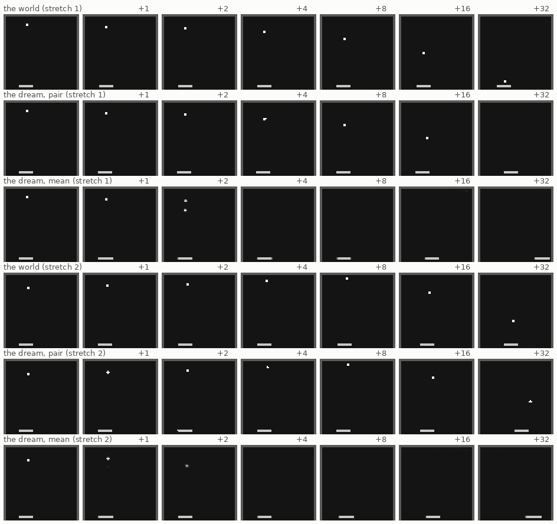
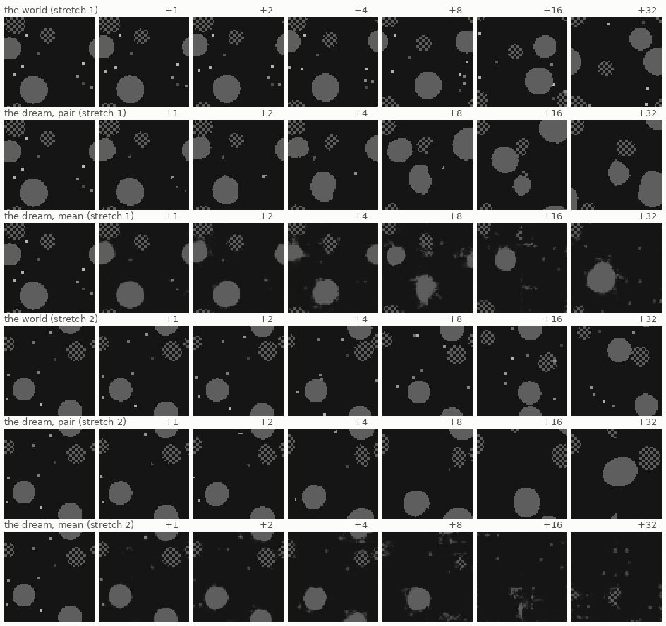
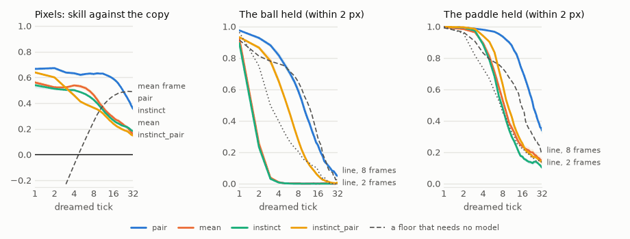
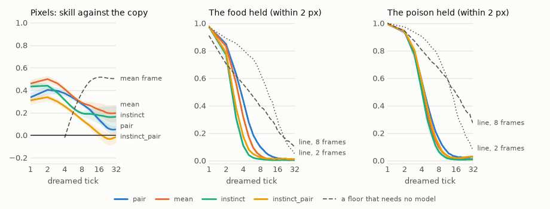

# vm-00119: Watching Worlds — the World Model's First Reference Table

**Date:** 2026-11-26
**Status:** Complete
**Source:** `exp/vm-00119` (code: `visual-motor-agent/dev/`)
**Outputs:** `~/data/research/visual-motor-agent/exp_00119/`
**Task plan:** [`../tasks/00132-watching-worlds.md`](../tasks/00132-watching-worlds.md)

## Goal

The owner's decisions of 2026-11-26 (`ARCHITECTURE.md` section 15): the world model, its dream and its memory come before anything else; for now the model makes no moves and no decisions, it only watches worlds that move by themselves; and two models are compared by numbers that do not depend on their parts, never by the loss.

This experiment gives the first such numbers. How well does the default agent's model predict a world it only watches, how many ticks does its dream hold, and between which floors and ceiling are those numbers read? Every later change to the model (its tokens, its decoder, its memory) is judged against this table.

## Method

### The worlds and the lives

- **WD, moving food and poison** (`configs/W_discs.json`, task 00132): 2 food discs at 1.5 px a tick and 2 checker poison discs at .75 on a 64 x 64 torus, with 8 dots under them. They bounce off each other without overlapping and every disc keeps its speed. No body, nothing eaten; nothing is left to chance after the first frame.
- **WB, Breakout played by a script** (`configs/W_breakout.json`): the paddle follows the ball as it was 6 ticks ago and returns about .80 of the balls. The score is the body's hunger: a hit sets it to 0, a miss adds .5. The only chance is where a new ball is served after a miss.
- **The model** is the default agent's (`configs/U_agent.json`: 4 quarter transformers of 8 layers, 8.6M parameters in all, context 8 ticks, 32 bins, the ring) without the label and without the instinct. It only watches (`online.watch = 1`): the move made is the null move at every tick.
- **The lives:** WD and WB, seeds 1–12, 60k ticks each, a checkpoint every 10k. Seeds 1–8 ran on the RTX 4090, seeds 9–12 on the RTX 3090. A life's frames can be made again exactly from its seed (checked on 400 ticks in both worlds). In these lives the script returned .80 of the balls (.77 to .82 by seed), and a disc world had 5,800 to 7,300 ticks with a bounce.

### The measures (`dev/wm_measures.py`)

A model is read through three calls only: `reset`, `observe(frame, body, move)` for one real tick, and `dream(H)` for the next H ticks as frames in grey levels and body values. Its loss, bins and tokens are never read.

- **The four transformers through the three calls.** The window is the last 8 real ticks. In a dreamed tick each transformer decodes its own quarter, the quarters make one frame, and that frame is the input of all four; the decoding is repeated until the frame stops changing, which is decoding token by token exactly. The same weights give four predictors:
  - `pair`: each value is the most probable bin and its neighbour. Sharp. This is the reference.
  - `mean`: each value is the expected value. The least squared error for one value, and a blur.
  - `instinct` (added after the first results): the way the agent's instinct and vm-00114's lookahead dream (`online.uni_lookahead` with its defaults): the expected value, 2 passes, and each quarter alone, the rest of the frame left as the last real one.
  - `instinct_pair` (added after the first results): the same way with `pair` in place of the expected value (`online.instinct_decode = pair`).
- **The exam** is the same for every model: one world of 16 copies (seed 1001), 2,300 ticks. From each of 256 regular starts the model is shown 64 real ticks and dreams 32. A second set (seed 2001) stays unopened for a final comparison.
- **Floors and ceilings that need no model:** `copy` (the last real frame, held), the mean frame of the exam, a straight line for each thing, the world itself and, in the court, the world with other dice for the serves. The straight line is drawn in two ways: through the thing's last two true places, as set beforehand, and (added after the first results) through its places as the last 2, 4 or 8 frames show them. In the court a thing is drawn at whole pixels, so frames show its speed only coarsely; in the disc world a disc's centre can be read off a frame to .07 px.
- **Skill** is 1 − the model's summed squared error ÷ the copy's, in grey levels: 0 is no better than copying the last frame, 1 is exact.
- **The numbers:**
  - **Next-frame skill:** the first dreamed tick, over the frame and by kind of thing.
  - **Events.** The court: the predicted change of the hunger as a forecast of a hit or a miss, by the area under the curve (.5 is chance), for the next tick over all 33,584 ticks of the set and within 1 to 16 dreamed ticks. The disc world: the skill and the distance on the discs that turn at the next tick against discs in free flight.
  - **The dream's horizon by pixels:** the ticks from the first on during which the dream's error stays below both the copy's and the mean frame's.
  - **The things in the dream.** A reader finds each thing in a dreamed frame: the shift (within 8 px) at which drawing the thing gains most, the gain being the summed abs(F − B) − abs(F − P) over its painted pixels, with B the real frame without the thing and P its paint. It is lost if no shift gains above 0, held if found within 2 px of its true place. The horizon of a kind of thing is the ticks from the first on during which at least half are held.
  - **Valid frames:** the count of bright pixels of each zone (the disc world: the frame; the court: the walls, the paddle's rows, the rest) lies within the range of the same copy's real frames; and the distance between the grey-level distributions of dreamed and real frames.
  - **Warm-up** (shown only the last k real ticks), **learning** (the same numbers at every checkpoint, 8 dreamed ticks), **home** (the life's own world from tick 60,000 on, against the working set), a **dream of 200 ticks** (seeds 1–3).
- **Tests** (`tests/test_wm_measures.py`, 29): on predictors made by hand the world itself scores 1 at every horizon and the copy 0; a frame shifted by 4 px has every disc read 4 px off; a blank frame has lost everything; a blurred ball beats a ball 2 px off on pixel error and is lost to the reader. The adapter's decoding gives the same frames from another first guess.

## What was set beforehand

How each number is counted was written in the task plan before any of these lives was scored, with what I expected:

1. `mean` scores better than `pair` on pixels, and worse on valid frames and on the things held, because it blurs.
2. The dream's horizon by pixels is under 8 ticks in both worlds (vm-00114: the dream's score was noise at 4 ticks).
3. Each thing kept moving as it last moved (a straight line through its last two true places), which needs no model, holds the things longer than the dream does.
4. The next-tick forecast of a hit is above .9.
5. In the disc world home is better than away: a life saw the same four discs for 60k ticks.

Added after the first lives were scored, and marked so below: the decoders `instinct` and `instinct_pair`; the straight lines through the frames as seen; the dream after a short warm-up; the counts by zone behind the valid frames; the discs read at tick 4 by whether they turned; the floors on two spare draws of the exam.

## Results

All 24 lives ran to 60k ticks, and every life's files were checked for completeness before the tables were made (1,015 items). Every number of a model is the mean of its seeds with the 95% interval, on the working set, at 60k. The floors and ceilings have no seeds. `make table` prints every table; `make images` makes the pictures.

- WD: 12 seeds at 60k (1, 2, 3, 4, 5, 6, 7, 8, 9, 10, 11, 12); the working set: 256 starts, 3482 ticks with a bounce
- WB: 12 seeds at 60k (1, 2, 3, 4, 5, 6, 7, 8, 9, 10, 11, 12); the working set: 256 starts, 315 hits and 68 misses

### R1. The board

**The moving discs (WD).**

| Predictor | Next-frame skill | Skill on discs that turn: food | poison | Dream horizon by pixels, ticks | Horizon of the food, ticks | Horizon of the poison, ticks | Valid frames at 8 ticks |
|---|---|---|---|---|---|---|---|
| the four transformers, `pair` | .337 ± .042 | .602 ± .043 | .083 ± .088 | 6.2 ± 0.4 | 3.0 ± 0.0 | 3.9 ± 0.2 | .095 ± .010 |
| the same weights, `mean` | .459 ± .036 | – | – | 6.3 ± 0.3 | 2.8 ± 0.2 | 3.6 ± 0.3 | .063 ± .029 |
| the same weights, as the instinct dreams (`instinct`; added after the first results) | .433 ± .033 | – | – | 5.4 ± 0.3 | 2.0 ± 0.0 | 3.6 ± 0.3 | .046 ± .021 |
| the same weights, the instinct's way with `pair` (`instinct_pair`; added after the first results) | .310 ± .039 | – | – | 5.0 ± 0.0 | 2.0 ± 0.0 | 3.9 ± 0.2 | .073 ± .009 |
| copy | .000 | .000 | .000 | 0.0 | 1.0 | 2.0 | 1.000 |
| the mean frame | −1.916 | −3.167 | −3.824 | 0.0 | 0.0 | 0.0 | .000 |
| the world itself | 1.000 | 1.000 | 1.000 | 32+ | 32+ | 32+ | 1.000 |
| a straight line through the last 2 frames as seen | – | – | – | – | 10.0 | 13.0 | – |
| a straight line through the last 4 frames as seen | – | – | – | – | 9.0 | 18.0 | – |
| a straight line through the last 8 frames as seen | – | – | – | – | 5.0 | 15.0 | – |
| a straight line through the last 2 true places | – | – | – | – | 12.0 | 20.0 | – |

**The court (WB).**

| Predictor | Next-frame skill | Hit forecast, next tick | Miss forecast, next tick | Dream horizon by pixels, ticks | Horizon of the ball, ticks | Horizon of the paddle, ticks | Valid frames at 8 ticks |
|---|---|---|---|---|---|---|---|
| the four transformers, `pair` | .667 ± .010 | .996 ± .001 | .987 ± .009 | 22.7 ± 0.8 | 9.1 ± 0.4 | 22.9 ± 0.8 | .752 ± .028 |
| the same weights, `mean` | .561 ± .019 | – | – | 10.4 ± 0.5 | 1.0 ± 0.0 | 7.8 ± 0.2 | .902 ± .010 |
| the same weights, as the instinct dreams (`instinct`; added after the first results) | .540 ± .021 | – | – | 10.0 ± 0.3 | 1.0 ± 0.0 | 7.2 ± 0.3 | .513 ± .018 |
| the same weights, the instinct's way with `pair` (`instinct_pair`; added after the first results) | .640 ± .007 | – | – | 9.2 ± 0.2 | 4.9 ± 0.2 | 9.1 ± 0.2 | .416 ± .019 |
| copy | .000 | .500 | .500 | 0.0 | 1.0 | 3.0 | 1.000 |
| the mean frame | −.990 | .500 | .500 | 0.0 | 0.0 | 0.0 | .000 |
| the world itself | 1.000 | 1.000 | 1.000 | 32+ | 32+ | 32+ | 1.000 |
| the world, other dice | 1.000 | – | – | 32+ | 32+ | 32+ | 1.000 |
| a straight line through the last 2 frames as seen | – | – | – | – | 2.0 | 7.0 | – |
| a straight line through the last 4 frames as seen | – | – | – | – | 7.0 | 12.0 | – |
| a straight line through the last 8 frames as seen | – | – | – | – | 11.0 | 15.0 | – |
| a straight line through the last 2 true places | – | – | – | – | 15.0 | 22.0 | – |

- **The court is predicted well, the disc world half as well.** The next-frame skill is .667 ± .010 in the court and .337 ± .042 in the disc world.
- **Events are foreseen.** A hit at the next tick is forecast with an area under the curve of .996 ± .001, a miss with .987 ± .009.
- **The picture outlasts the things.** By pixels the dream beats both floors for 22.7 ticks in the court and 6.2 in the disc world. The ball is held for 9.1 ticks, a food disc for 3.0, a poison disc for 3.9.
- **In the disc world a straight line holds the discs three times longer than the dream.** A line through a disc's centre in the last two frames, with no model at all, holds a food disc for 10 ticks and a poison disc for 13.
- **In the court the dream holds the ball about as long as a straight line through all 8 frames of its window, and it does so from the last 2 frames** (R5, R9). The ball is drawn at whole pixels, so two frames give its speed only to the pixel: a line through the last 2 frames holds the ball for 2 ticks, through 4 frames for 7, through all 8 frames of the window for 11. A line through the ball's true places, which no frame shows, holds it for 15. The paddle, which follows the ball, is held by the dream for 22.9 ticks and by no line through the frames for more than 15.
- **The decoder decides.** The same weights dreamed with the expected value hold the ball for 1.0 tick, not 9.1 (R6).

### R2. What the dreams look like

*The court, seed 1 at 60k, two stretches of the exam. The first frame of each row is the last real tick; then ticks 1, 2, 4, 8, 16 and 32. Top row the world, then the dream with `pair`, then with `mean`. With `pair` a sharp ball moves on for 16 ticks, near where it should be. With `mean` the ball doubles at tick 2 and is gone at tick 4; the paddle stays.*

*The disc world, the same layout. The dots are gone at the first dreamed tick with both decoders. With `pair` the discs stay sharp, drift, change shape and merge. With `mean` they dissolve.*

*By dreamed tick, the seeds' mean and its 95% band, one colour a decoder. Left: the pixel skill against the copy, beside the mean frame's. Middle and right: the share of each kind of thing held, beside straight lines through its places in the last 2 and the last 8 frames as seen.*

### R3. The next frame, by kind of thing

**The moving discs (WD).**

| Pixels of | Pixels per frame | Copy's error, grey levels (root mean square) | Skill, `pair` | Error, `pair` | Skill, `mean` | Error, `mean` | Skill, `instinct` | Error, `instinct` | Skill, `instinct_pair` | Error, `instinct_pair` |
|---|---|---|---|---|---|---|---|---|---|---|
| the whole frame | 4096 | 16.40 | .337 ± .042 | 13.34 ± 0.41 | .459 ± .036 | 12.04 ± 0.39 | .433 ± .033 | 12.33 ± 0.35 | .310 ± .039 | 13.61 ± 0.38 |
| the food | 597.2 | 31.09 | .668 ± .040 | 17.84 ± 1.02 | .728 ± .039 | 16.12 ± 1.08 | .669 ± .035 | 17.83 ± 0.90 | .600 ± .035 | 19.63 ± 0.82 |
| the poison | 268.8 | 20.97 | .342 ± .077 | 16.95 ± 0.92 | .486 ± .065 | 14.97 ± 0.88 | .485 ± .064 | 15.00 ± 0.86 | .339 ± .075 | 16.99 ± 0.90 |
| the dots | 42.3 | 97.95 | .257 ± .005 | 84.41 ± 0.28 | .334 ± .011 | 79.91 ± 0.65 | .334 ± .011 | 79.93 ± 0.64 | .257 ± .005 | 84.45 ± 0.28 |
| rest | 3187.7 | 0.00 | – | 7.02 ± 0.63 | – | 5.74 ± 0.64 | – | 5.58 ± 0.63 | – | 6.77 ± 0.63 |

**The court (WB).**

| Pixels of | Pixels per frame | Copy's error, grey levels (root mean square) | Skill, `pair` | Error, `pair` | Skill, `mean` | Error, `mean` | Skill, `instinct` | Error, `instinct` | Skill, `instinct_pair` | Error, `instinct_pair` |
|---|---|---|---|---|---|---|---|---|---|---|
| the whole frame | 4096 | 10.11 | .667 ± .010 | 5.84 ± 0.08 | .561 ± .019 | 6.69 ± 0.15 | .540 ± .021 | 6.85 ± 0.16 | .640 ± .007 | 6.07 ± 0.06 |
| the ball | 7.0 | 219.80 | .807 ± .006 | 96.65 ± 1.49 | .823 ± .004 | 92.40 ± 1.05 | .807 ± .003 | 96.55 ± 0.69 | .789 ± .006 | 100.88 ± 1.35 |
| the paddle | 25.3 | 56.77 | .753 ± .016 | 28.19 ± 0.91 | .783 ± .012 | 26.41 ± 0.70 | .693 ± .007 | 31.46 ± 0.34 | .672 ± .012 | 32.48 ± 0.59 |
| rest | 4063.8 | 0.00 | – | 3.65 ± 0.09 | – | 5.11 ± 0.17 | – | 5.01 ± 0.21 | – | 3.61 ± 0.11 |

- **The court:** the ball's pixels are predicted with skill .807 ± .006, the paddle's with .753 ± .016.
- **The disc world:** the food's pixels .668 ± .040, the poison's .342 ± .077, the dots' .257 ± .005. The dots are 42 pixels of 4,096 and carry over a third of the copy's error (42 pixels at 98 grey levels against 597 at 31 and 269 at 21), so they hold the whole-frame skill down.
- **The rest** is where nothing moves. An error there is something drawn where nothing is: 3.6 grey levels in the court, 7.0 in the disc world.
- **The loss overstates this.** The lives' own logs give the error of each patch predicted from the true patches before it: 3.6 grey levels in the court and 7.7 in the disc world (seed 1, ticks 50–60k). Predicting the whole next frame, as measured here, the same weights are 5.7 and 13.0 off with `pair`.

### R4. The dream, tick by tick

**The moving discs (WD).**

| Dreamed tick | 1 | 2 | 4 | 8 | 16 | 32 |
|---|---|---|---|---|---|---|
| Skill against the copy, `pair` | .337 ± .042 | .403 ± .037 | .372 ± .024 | .279 ± .018 | .140 ± .027 | .052 ± .034 |
| Skill against the mean frame, `pair` | .773 ± .014 | .648 ± .022 | .386 ± .024 | −.156 ± .030 | −.775 ± .056 | −.910 ± .068 |
| Error in grey levels, `pair` | 13.34 ± 0.41 | 16.60 ± 0.50 | 21.94 ± 0.41 | 30.08 ± 0.38 | 37.27 ± 0.59 | 38.67 ± 0.70 |
| Skill against the copy, `mean` | .459 ± .036 | .499 ± .031 | .410 ± .023 | .290 ± .017 | .228 ± .057 | .196 ± .077 |
| Skill against the mean frame, `mean` | .815 ± .012 | .705 ± .018 | .423 ± .022 | −.139 ± .028 | −.593 ± .118 | −.618 ± .155 |
| Error in grey levels, `mean` | 12.04 ± 0.39 | 15.20 ± 0.45 | 21.27 ± 0.41 | 29.85 ± 0.36 | 35.26 ± 1.30 | 35.52 ± 1.70 |
| Skill against the copy, `instinct` | .433 ± .033 | .441 ± .027 | .314 ± .016 | .196 ± .023 | .177 ± .074 | .164 ± .099 |
| Skill against the mean frame, `instinct` | .806 ± .011 | .670 ± .016 | .329 ± .015 | −.290 ± .038 | −.698 ± .153 | −.684 ± .200 |
| Error in grey levels, `instinct` | 12.33 ± 0.35 | 16.08 ± 0.37 | 22.94 ± 0.26 | 31.76 ± 0.46 | 36.37 ± 1.61 | 36.19 ± 2.09 |
| Skill against the copy, `instinct_pair` | .310 ± .039 | .338 ± .031 | .258 ± .019 | .139 ± .019 | .016 ± .043 | −.015 ± .055 |
| Skill against the mean frame, `instinct_pair` | .763 ± .013 | .610 ± .018 | .273 ± .018 | −.381 ± .031 | −1.030 ± .089 | −1.044 ± .111 |
| Error in grey levels, `instinct_pair` | 13.61 ± 0.38 | 17.48 ± 0.40 | 23.87 ± 0.30 | 32.87 ± 0.36 | 39.85 ± 0.88 | 39.99 ± 1.09 |
| Error of the copy | 16.40 | 21.51 | 27.71 | 35.43 | 40.19 | 39.72 |
| Error of the mean frame | 28.00 | 28.00 | 28.01 | 27.97 | 27.98 | 27.99 |

**The court (WB).**

| Dreamed tick | 1 | 2 | 4 | 8 | 16 | 32 |
|---|---|---|---|---|---|---|
| Skill against the copy, `pair` | .667 ± .010 | .673 ± .010 | .633 ± .011 | .627 ± .009 | .589 ± .012 | .356 ± .017 |
| Skill against the mean frame, `pair` | .833 ± .005 | .765 ± .007 | .660 ± .010 | .497 ± .013 | .245 ± .022 | −.263 ± .033 |
| Error in grey levels, `pair` | 5.84 ± 0.08 | 6.92 ± 0.10 | 8.31 ± 0.12 | 10.09 ± 0.13 | 12.40 ± 0.18 | 16.03 ± 0.21 |
| Skill against the copy, `mean` | .561 ± .019 | .523 ± .012 | .539 ± .011 | .463 ± .018 | .288 ± .016 | .162 ± .012 |
| Skill against the mean frame, `mean` | .780 ± .010 | .657 ± .008 | .573 ± .010 | .277 ± .025 | −.309 ± .030 | −.645 ± .023 |
| Error in grey levels, `mean` | 6.69 ± 0.15 | 8.35 ± 0.10 | 9.32 ± 0.11 | 12.11 ± 0.21 | 16.32 ± 0.18 | 18.29 ± 0.13 |
| Skill against the copy, `instinct` | .540 ± .021 | .512 ± .009 | .502 ± .007 | .426 ± .010 | .267 ± .008 | .183 ± .007 |
| Skill against the mean frame, `instinct` | .769 ± .011 | .649 ± .007 | .538 ± .006 | .227 ± .014 | −.347 ± .014 | −.602 ± .013 |
| Error in grey levels, `instinct` | 6.85 ± 0.16 | 8.45 ± 0.08 | 9.69 ± 0.07 | 12.52 ± 0.11 | 16.56 ± 0.09 | 18.06 ± 0.07 |
| Skill against the copy, `instinct_pair` | .640 ± .007 | .601 ± .006 | .461 ± .014 | .364 ± .009 | .240 ± .010 | .149 ± .008 |
| Skill against the mean frame, `instinct_pair` | .819 ± .004 | .713 ± .004 | .501 ± .013 | .143 ± .012 | −.396 ± .019 | −.670 ± .015 |
| Error in grey levels, `instinct_pair` | 6.07 ± 0.06 | 7.64 ± 0.06 | 10.07 ± 0.13 | 13.18 ± 0.09 | 16.86 ± 0.11 | 18.43 ± 0.09 |
| Error of the copy | 10.11 | 12.10 | 13.73 | 16.53 | 19.35 | 19.98 |
| Error of the mean frame | 14.27 | 14.27 | 14.26 | 14.24 | 14.27 | 14.26 |
| Error of the world with other dice | 0.00 | 0.65 | 0.92 | 1.12 | 2.64 | 4.43 |

- **The court:** the skill against the copy stays above .6 for 8 ticks (.667, .673, .633, .627 at ticks 1, 2, 4 and 8), is .589 at 16 and .356 at 32. Against the mean frame it falls from .833 to −.263 at tick 32: late in the dream a ball drawn in the wrong place costs more than no ball.
- **The disc world:** .337 at the first tick, .403 at the second, .279 at 8, .052 at 32. After 6.2 ticks the mean frame is nearer to the truth than the dream.

### R5. The things in the dream

**The moving discs (WD).**

| Thing | Read on | Tick 1 | Tick 2 | Tick 4 | Tick 8 | Tick 16 | Tick 32 |
|---|---|---|---|---|---|---|---|
| food | held, `pair` | .974 ± .004 | .847 ± .019 | .438 ± .023 | .099 ± .010 | .018 ± .003 | .011 ± .004 |
| food | lost, `pair` | .000 ± .000 | .000 ± .000 | .003 ± .003 | .073 ± .019 | .411 ± .043 | .593 ± .041 |
| food | px off where found (median), `pair` | 0.1 ± 0.2 | 1.0 ± 0.0 | 2.3 ± 0.1 | 6.0 ± 0.2 | 8.4 ± 0.1 | 8.8 ± 0.1 |
| food | held, `mean` | .975 ± .005 | .833 ± .041 | .317 ± .034 | .037 ± .012 | .006 ± .003 | .006 ± .004 |
| food | lost, `mean` | .000 ± .000 | .000 ± .000 | .026 ± .018 | .277 ± .135 | .659 ± .124 | .767 ± .101 |
| food | px off where found (median), `mean` | 0.1 ± 0.2 | 1.1 ± 0.1 | 2.8 ± 0.2 | 7.3 ± 0.3 | 8.7 ± 0.1 | 8.7 ± 0.2 |
| food | held, `instinct` | .975 ± .006 | .771 ± .051 | .110 ± .018 | .012 ± .005 | .004 ± .003 | .004 ± .002 |
| food | lost, `instinct` | .000 ± .000 | .000 ± .000 | .023 ± .016 | .288 ± .127 | .729 ± .115 | .735 ± .117 |
| food | px off where found (median), `instinct` | 0.2 ± 0.2 | 1.5 ± 0.1 | 4.0 ± 0.1 | 8.3 ± 0.1 | 8.9 ± 0.2 | 8.5 ± 0.2 |
| food | held, `instinct_pair` | .978 ± .005 | .785 ± .027 | .176 ± .015 | .024 ± .006 | .013 ± .004 | .010 ± .005 |
| food | lost, `instinct_pair` | .000 ± .000 | .000 ± .000 | .003 ± .004 | .083 ± .030 | .500 ± .053 | .564 ± .058 |
| food | px off where found (median), `instinct_pair` | 0.1 ± 0.2 | 1.3 ± 0.1 | 3.7 ± 0.1 | 8.1 ± 0.0 | 8.7 ± 0.1 | 8.7 ± 0.1 |
| food | held, a straight line through the last 2 frames as seen | .973 | .891 | .807 | .635 | .297 | .055 |
| food | held, a straight line through the last 4 frames as seen | .967 | .838 | .699 | .521 | .293 | .123 |
| food | held, a straight line through the last 8 frames as seen | .910 | .705 | .557 | .391 | .221 | .098 |
| food | held, a straight line through the last 2 true places | .977 | .889 | .811 | .641 | .371 | .145 |
| food | held, left where it was | 1.000 | .047 | .020 | .008 | .006 | .002 |
| poison | held, `pair` | .994 ± .002 | .938 ± .018 | .581 ± .031 | .159 ± .004 | .029 ± .008 | .028 ± .009 |
| poison | lost, `pair` | .000 ± .000 | .000 ± .000 | .002 ± .002 | .014 ± .005 | .128 ± .020 | .366 ± .040 |
| poison | px off where found (median), `pair` | 0.0 ± 0.0 | 1.0 ± 0.0 | 1.9 ± 0.2 | 4.2 ± 0.1 | 8.1 ± 0.1 | 8.4 ± 0.1 |
| poison | held, `mean` | .994 ± .002 | .940 ± .014 | .527 ± .057 | .097 ± .030 | .016 ± .006 | .009 ± .005 |
| poison | lost, `mean` | .000 ± .000 | .000 ± .001 | .044 ± .037 | .217 ± .159 | .396 ± .165 | .582 ± .140 |
| poison | px off where found (median), `mean` | 0.0 ± 0.0 | 1.0 ± 0.0 | 1.9 ± 0.2 | 4.9 ± 0.4 | 8.4 ± 0.2 | 8.6 ± 0.2 |
| poison | held, `instinct` | .994 ± .002 | .939 ± .017 | .509 ± .056 | .065 ± .021 | .008 ± .005 | .009 ± .005 |
| poison | lost, `instinct` | .000 ± .000 | .000 ± .000 | .043 ± .039 | .246 ± .165 | .448 ± .166 | .609 ± .140 |
| poison | px off where found (median), `instinct` | 0.0 ± 0.0 | 1.0 ± 0.0 | 2.0 ± 0.1 | 5.1 ± 0.3 | 8.6 ± 0.2 | 8.5 ± 0.1 |
| poison | held, `instinct_pair` | .995 ± .003 | .941 ± .021 | .575 ± .030 | .116 ± .010 | .018 ± .005 | .027 ± .009 |
| poison | lost, `instinct_pair` | .000 ± .000 | .000 ± .000 | .003 ± .005 | .024 ± .014 | .135 ± .034 | .393 ± .048 |
| poison | px off where found (median), `instinct_pair` | 0.0 ± 0.0 | 1.0 ± 0.0 | 2.0 ± 0.1 | 4.4 ± 0.1 | 8.3 ± 0.1 | 8.3 ± 0.1 |
| poison | held, a straight line through the last 2 frames as seen | 1.000 | .973 | .904 | .750 | .369 | .088 |
| poison | held, a straight line through the last 4 frames as seen | 1.000 | .963 | .881 | .746 | .539 | .266 |
| poison | held, a straight line through the last 8 frames as seen | 1.000 | .943 | .805 | .668 | .488 | .273 |
| poison | held, a straight line through the last 2 true places | 1.000 | .977 | .902 | .795 | .592 | .326 |
| poison | held, left where it was | 1.000 | 1.000 | .043 | .023 | .006 | .002 |

**The court (WB).**

| Thing | Read on | Tick 1 | Tick 2 | Tick 4 | Tick 8 | Tick 16 | Tick 32 |
|---|---|---|---|---|---|---|---|
| ball | held, `pair` | .976 ± .004 | .928 ± .010 | .818 ± .020 | .591 ± .026 | .246 ± .018 | .050 ± .006 |
| ball | lost, `pair` | .018 ± .004 | .044 ± .010 | .087 ± .011 | .170 ± .019 | .354 ± .030 | .668 ± .030 |
| ball | px off where found (median), `pair` | 0.0 ± 0.0 | 0.5 ± 0.3 | 1.0 ± 0.0 | 1.3 ± 0.1 | 2.6 ± 0.2 | 4.7 ± 0.3 |
| ball | held, `mean` | .925 ± .012 | .255 ± .030 | .010 ± .004 | .003 ± .002 | .001 ± .001 | .001 ± .001 |
| ball | lost, `mean` | .016 ± .006 | .604 ± .037 | .929 ± .013 | .963 ± .005 | .959 ± .009 | .979 ± .003 |
| ball | px off where found (median), `mean` | 0.5 ± 0.3 | 1.3 ± 0.1 | 6.0 ± 0.8 | 6.9 ± 0.5 | 6.9 ± 0.5 | 7.8 ± 0.6 |
| ball | held, `instinct` | .895 ± .015 | .234 ± .031 | .008 ± .002 | .000 ± .000 | .000 ± .000 | .004 ± .000 |
| ball | lost, `instinct` | .040 ± .007 | .636 ± .035 | .933 ± .010 | .977 ± .007 | .989 ± .003 | .974 ± .003 |
| ball | px off where found (median), `instinct` | 0.5 ± 0.3 | 1.3 ± 0.1 | 6.5 ± 0.6 | 8.2 ± 0.5 | 8.3 ± 0.7 | 8.3 ± 0.2 |
| ball | held, `instinct_pair` | .933 ± .004 | .866 ± .012 | .654 ± .022 | .278 ± .017 | .052 ± .011 | .005 ± .001 |
| ball | lost, `instinct_pair` | .060 ± .005 | .103 ± .012 | .224 ± .013 | .484 ± .023 | .751 ± .014 | .957 ± .006 |
| ball | px off where found (median), `instinct_pair` | 0.0 ± 0.0 | 0.7 ± 0.3 | 1.0 ± 0.0 | 2.0 ± 0.1 | 4.5 ± 0.5 | 7.5 ± 0.5 |
| ball | held, a straight line through the last 2 frames as seen | .964 | .749 | .398 | .206 | .088 | .004 |
| ball | held, a straight line through the last 4 frames as seen | .948 | .876 | .811 | .492 | .121 | .012 |
| ball | held, a straight line through the last 8 frames as seen | .915 | .812 | .763 | .649 | .292 | .012 |
| ball | held, a straight line through the last 2 true places | .980 | .932 | .888 | .770 | .498 | .145 |
| ball | held, left where it was | 1.000 | .024 | .008 | .000 | .000 | .004 |
| ball | held, the world with other dice | 1.000 | .996 | .992 | .988 | .972 | .937 |
| paddle | held, `pair` | .997 ± .002 | .994 ± .002 | .980 ± .004 | .937 ± .010 | .717 ± .016 | .339 ± .022 |
| paddle | lost, `pair` | .000 ± .001 | .000 ± .000 | .000 ± .000 | .002 ± .001 | .019 ± .006 | .168 ± .016 |
| paddle | px off where found (median), `pair` | 0.0 ± 0.0 | 0.0 ± 0.0 | 0.0 ± 0.0 | 1.0 ± 0.0 | 1.0 ± 0.0 | 3.3 ± 0.3 |
| paddle | held, `mean` | .996 ± .003 | .984 ± .004 | .895 ± .018 | .531 ± .023 | .239 ± .021 | .143 ± .020 |
| paddle | lost, `mean` | .000 ± .000 | .000 ± .000 | .002 ± .002 | .014 ± .004 | .228 ± .027 | .516 ± .012 |
| paddle | px off where found (median), `mean` | 0.0 ± 0.0 | 0.1 ± 0.2 | 1.0 ± 0.0 | 2.1 ± 0.2 | 4.7 ± 0.4 | 5.1 ± 0.4 |
| paddle | held, `instinct` | .997 ± .002 | .993 ± .002 | .886 ± .007 | .481 ± .018 | .173 ± .009 | .102 ± .007 |
| paddle | lost, `instinct` | .000 ± .000 | .000 ± .000 | .005 ± .002 | .046 ± .008 | .272 ± .023 | .606 ± .019 |
| paddle | px off where found (median), `instinct` | 0.0 ± 0.0 | 0.0 ± 0.0 | 1.0 ± 0.0 | 2.6 ± 0.3 | 5.9 ± 0.2 | 5.8 ± 0.2 |
| paddle | held, `instinct_pair` | .998 ± .001 | .996 ± .002 | .941 ± .007 | .630 ± .013 | .256 ± .015 | .138 ± .009 |
| paddle | lost, `instinct_pair` | .000 ± .000 | .001 ± .001 | .001 ± .001 | .038 ± .003 | .199 ± .008 | .540 ± .009 |
| paddle | px off where found (median), `instinct_pair` | 0.0 ± 0.0 | 0.0 ± 0.0 | 0.2 ± 0.2 | 1.9 ± 0.2 | 4.9 ± 0.3 | 5.5 ± 0.3 |
| paddle | held, a straight line through the last 2 frames as seen | 1.000 | .957 | .734 | .453 | .219 | .133 |
| paddle | held, a straight line through the last 4 frames as seen | 1.000 | .988 | .898 | .660 | .383 | .176 |
| paddle | held, a straight line through the last 8 frames as seen | .992 | .965 | .832 | .734 | .480 | .191 |
| paddle | held, a straight line through the last 2 true places | 1.000 | .992 | .918 | .824 | .609 | .320 |
| paddle | held, left where it was | .992 | .715 | .406 | .230 | .109 | .105 |
| paddle | held, the world with other dice | 1.000 | 1.000 | 1.000 | 1.000 | .988 | .965 |

- **The ball** is held in .976 of the dreams at tick 1, .818 at tick 4, .591 at tick 8, .246 at tick 16. A straight line through the 8 frames of the window holds it in .763, .649 and .292 at ticks 4, 8 and 16; through the last 2 frames in .398, .206 and .088; through its true places in .888, .770 and .498. Early in the dream the dream is ahead of every line through the frames; by tick 8 the 8-frame line has caught up. (These lines go through the first and the last of the frames; a least-squares line through all 8 drawn places holds the ball for 12 ticks, one more.)
- **The paddle** is held in .937 at tick 8 and .717 at tick 16, where the best line through the frames holds .734 and .480: the paddle's moves follow the ball, and the dream has that.
- **The discs:** a food disc is held in .847 at tick 2, .438 at tick 4 and .099 at tick 8; a poison disc in .938, .581 and .159. A straight line through the last two frames holds .807 of the food and .904 of the poison at tick 4, and .635 and .750 at tick 8. The dreamed discs are not lost at first, they drift: at tick 8 only .073 of the food discs are lost, and the found ones are 6.0 px from their places.

### R6. The same weights decoded four ways

**The moving discs (WD).**

| Number | `pair` | `mean` | `mean` − `pair` | Seeds with `mean` above | `instinct` | `instinct` − `pair` | Seeds with `instinct` above | `instinct_pair` | `instinct_pair` − `pair` | Seeds with `instinct_pair` above |
|---|---|---|---|---|---|---|---|---|---|---|
| Next-frame skill | .337 ± .042 | .459 ± .036 | +.123 ± .009 | 12 of 12 above | .433 ± .033 | +.096 ± .010 | 12 of 12 above | .310 ± .039 | −.026 ± .004 | 0 of 12 above |
| Skill against the copy at tick 8 | .279 ± .018 | .290 ± .017 | +.011 ± .013 | 8 of 12 above | .196 ± .023 | −.083 ± .019 | 0 of 12 above | .139 ± .019 | −.140 ± .009 | 0 of 12 above |
| Dream horizon by pixels, ticks | 6.2 ± 0.4 | 6.3 ± 0.3 | +0.2 ± 0.4 | 3 of 12 above | 5.4 ± 0.3 | −0.8 ± 0.4 | 0 of 12 above | 5.0 ± 0.0 | −1.2 ± 0.4 | 0 of 12 above |
| Valid frames at 8 ticks | .095 ± .010 | .063 ± .029 | −.032 ± .030 | 4 of 12 above | .046 ± .021 | −.049 ± .021 | 0 of 12 above | .073 ± .009 | −.022 ± .013 | 1 of 12 above |
| Grey levels off the real distribution at 8 ticks | 1.37 ± 0.38 | 3.49 ± 1.01 | +2.12 ± 1.14 | 12 of 12 above | 3.48 ± 0.91 | +2.11 ± 1.03 | 12 of 12 above | 1.59 ± 0.58 | +0.22 ± 0.40 | 8 of 12 above |
| The food held at tick 2 | .847 ± .019 | .833 ± .041 | −.014 ± .025 | 5 of 12 above | .771 ± .051 | −.077 ± .035 | 0 of 12 above | .785 ± .027 | −.062 ± .015 | 0 of 12 above |
| The food held at tick 8 | .099 ± .010 | .037 ± .012 | −.062 ± .017 | 0 of 12 above | .012 ± .005 | −.087 ± .011 | 0 of 12 above | .024 ± .006 | −.075 ± .009 | 0 of 12 above |
| Horizon of the food, ticks | 3.0 ± 0.0 | 2.8 ± 0.2 | −0.2 ± 0.2 | 0 of 12 above | 2.0 ± 0.0 | −1.0 ± 0.0 | 0 of 12 above | 2.0 ± 0.0 | −1.0 ± 0.0 | 0 of 12 above |
| The poison held at tick 2 | .938 ± .018 | .940 ± .014 | +.002 ± .006 | 7 of 12 above | .939 ± .017 | +.001 ± .007 | 7 of 12 above | .941 ± .021 | +.003 ± .005 | 10 of 12 above |
| The poison held at tick 8 | .159 ± .004 | .097 ± .030 | −.062 ± .031 | 1 of 12 above | .065 ± .021 | −.094 ± .021 | 0 of 12 above | .116 ± .010 | −.043 ± .009 | 0 of 12 above |
| Horizon of the poison, ticks | 3.9 ± 0.2 | 3.6 ± 0.3 | −0.3 ± 0.3 | 0 of 12 above | 3.6 ± 0.3 | −0.3 ± 0.3 | 0 of 12 above | 3.9 ± 0.2 | +0.0 ± 0.0 | 0 of 12 above |

**The court (WB).**

| Number | `pair` | `mean` | `mean` − `pair` | Seeds with `mean` above | `instinct` | `instinct` − `pair` | Seeds with `instinct` above | `instinct_pair` | `instinct_pair` − `pair` | Seeds with `instinct_pair` above |
|---|---|---|---|---|---|---|---|---|---|---|
| Next-frame skill | .667 ± .010 | .561 ± .019 | −.105 ± .016 | 0 of 12 above | .540 ± .021 | −.126 ± .018 | 0 of 12 above | .640 ± .007 | −.027 ± .004 | 0 of 12 above |
| Skill against the copy at tick 8 | .627 ± .009 | .463 ± .018 | −.164 ± .019 | 0 of 12 above | .426 ± .010 | −.201 ± .011 | 0 of 12 above | .364 ± .009 | −.263 ± .012 | 0 of 12 above |
| Dream horizon by pixels, ticks | 22.7 ± 0.8 | 10.4 ± 0.5 | −12.2 ± 1.0 | 0 of 12 above | 10.0 ± 0.3 | −12.7 ± 0.9 | 0 of 12 above | 9.2 ± 0.2 | −13.5 ± 0.8 | 0 of 12 above |
| Valid frames at 8 ticks | .752 ± .028 | .902 ± .010 | +.150 ± .032 | 12 of 12 above | .513 ± .018 | −.240 ± .035 | 0 of 12 above | .416 ± .019 | −.336 ± .025 | 0 of 12 above |
| Grey levels off the real distribution at 8 ticks | 0.01 ± 0.00 | 0.19 ± 0.00 | +0.18 ± 0.00 | 12 of 12 above | 0.27 ± 0.01 | +0.26 ± 0.01 | 12 of 12 above | 0.05 ± 0.01 | +0.04 ± 0.01 | 12 of 12 above |
| The ball held at tick 2 | .928 ± .010 | .255 ± .030 | −.673 ± .035 | 0 of 12 above | .234 ± .031 | −.694 ± .036 | 0 of 12 above | .866 ± .012 | −.062 ± .010 | 0 of 12 above |
| The ball held at tick 8 | .591 ± .026 | .003 ± .002 | −.589 ± .026 | 0 of 12 above | .000 ± .000 | −.591 ± .026 | 0 of 12 above | .278 ± .017 | −.314 ± .030 | 0 of 12 above |
| Horizon of the ball, ticks | 9.1 ± 0.4 | 1.0 ± 0.0 | −8.1 ± 0.4 | 0 of 12 above | 1.0 ± 0.0 | −8.1 ± 0.4 | 0 of 12 above | 4.9 ± 0.2 | −4.2 ± 0.5 | 0 of 12 above |
| The paddle held at tick 2 | .994 ± .002 | .984 ± .004 | −.010 ± .004 | 0 of 12 above | .993 ± .002 | −.000 ± .002 | 3 of 12 above | .996 ± .002 | +.002 ± .002 | 4 of 12 above |
| The paddle held at tick 8 | .937 ± .010 | .531 ± .023 | −.406 ± .020 | 0 of 12 above | .481 ± .018 | −.456 ± .020 | 0 of 12 above | .630 ± .013 | −.307 ± .019 | 0 of 12 above |
| Horizon of the paddle, ticks | 22.9 ± 0.8 | 7.8 ± 0.2 | −15.1 ± 0.7 | 0 of 12 above | 7.2 ± 0.3 | −15.7 ± 0.9 | 0 of 12 above | 9.1 ± 0.2 | −13.8 ± 0.9 | 0 of 12 above |

- **The expected value loses the ball.** With `pair` the ball is held in .928 of the dreams at tick 2 and .818 at tick 4. With `mean` it is held in .255 at tick 2 and .010 at tick 4; with `instinct`, the way the agent's instinct dreams, in .234 and .008.
- **The pixel error understates it, and in the disc world it points the other way.** In the court, at the first tick `pair`, `mean` and `instinct` are .667, .561 and .540 in next-frame skill; at tick 8, .627, .463 and .426. The ball's hold falls from .818 to .010 meanwhile. In the disc world `mean` is ahead of `pair` on pixels (.459 against .337 at the first tick) while it holds fewer discs at tick 4 (.317 of the food against .438).
- **It is the expected value far more than the 2 passes or the quarters alone.** `mean`, decoded exactly and jointly, loses the ball as fast as `instinct`. The instinct's way with `pair` in place of the expected value (`instinct_pair`: 2 passes, each quarter alone) holds the ball in .866 of the dreams at tick 2, .654 at tick 4 and .278 at tick 8, for 4.9 ticks: the quick decoding costs about half of the 9.1 ticks of the exact one, the expected value nearly all.

### R7. Is a dreamed frame a possible frame?

**The moving discs (WD).**

| Dreamed tick | 1 | 2 | 4 | 8 | 16 | 32 |
|---|---|---|---|---|---|---|
| Valid frames, `pair` | .576 ± .116 | .310 ± .057 | .164 ± .029 | .095 ± .010 | .087 ± .012 | .076 ± .016 |
| Grey levels off the real distribution, `pair` | 0.38 ± 0.14 | 0.61 ± 0.23 | 1.00 ± 0.28 | 1.37 ± 0.38 | 1.65 ± 0.51 | 1.73 ± 0.70 |
| Valid frames, `mean` | .534 ± .118 | .254 ± .062 | .111 ± .034 | .063 ± .029 | .037 ± .020 | .034 ± .021 |
| Grey levels off the real distribution, `mean` | 0.98 ± 0.06 | 1.44 ± 0.13 | 2.22 ± 0.42 | 3.49 ± 1.01 | 4.59 ± 1.42 | 5.26 ± 1.64 |
| Valid frames, `instinct` | .528 ± .103 | .244 ± .046 | .106 ± .020 | .046 ± .021 | .035 ± .017 | .027 ± .017 |
| Grey levels off the real distribution, `instinct` | 0.97 ± 0.06 | 1.43 ± 0.12 | 2.19 ± 0.37 | 3.48 ± 0.91 | 4.78 ± 1.27 | 5.65 ± 1.44 |
| Valid frames, `instinct_pair` | .551 ± .114 | .292 ± .050 | .141 ± .023 | .073 ± .009 | .048 ± .006 | .044 ± .009 |
| Grey levels off the real distribution, `instinct_pair` | 0.38 ± 0.13 | 0.63 ± 0.21 | 1.05 ± 0.30 | 1.59 ± 0.58 | 2.71 ± 0.99 | 2.70 ± 1.17 |
| Grey levels off, the mean frame | 20.01 | 20.01 | 20.01 | 20.00 | 20.00 | 20.01 |

By zone (added after the first results): the share of dreamed frames whose count of bright pixels is one the real frames reach, and the counts.

| Zone | Read | Tick 1 | Tick 2 | Tick 4 | Tick 8 | Tick 16 | Tick 32 |
|---|---|---|---|---|---|---|---|
| the frame | valid, `pair` | .576 ± .116 | .310 ± .057 | .164 ± .029 | .095 ± .010 | .087 ± .012 | .076 ± .016 |
| the frame | bright pixels, `pair` | 688.3 ± 12.0 | 692.7 ± 22.2 | 701.4 ± 35.1 | 708.0 ± 48.5 | 685.0 ± 60.8 | 658.9 ± 64.8 |
| the frame | bright pixels, `mean` | 682.1 ± 12.1 | 664.8 ± 22.6 | 622.2 ± 46.0 | 541.5 ± 94.1 | 479.6 ± 125.6 | 437.3 ± 137.0 |
| the frame | bright pixels, the real frames | 695.0 | 695.3 | 695.2 | 694.5 | 694.4 | 695.0 |

**The court (WB).**

| Dreamed tick | 1 | 2 | 4 | 8 | 16 | 32 |
|---|---|---|---|---|---|---|
| Valid frames, `pair` | .716 ± .022 | .720 ± .026 | .729 ± .020 | .752 ± .028 | .772 ± .018 | .821 ± .025 |
| Grey levels off the real distribution, `pair` | 0.02 ± 0.00 | 0.01 ± 0.00 | 0.01 ± 0.00 | 0.01 ± 0.00 | 0.04 ± 0.01 | 0.09 ± 0.01 |
| Valid frames, `mean` | .417 ± .022 | .781 ± .022 | .899 ± .011 | .902 ± .010 | .891 ± .017 | .896 ± .011 |
| Grey levels off the real distribution, `mean` | 0.17 ± 0.01 | 0.13 ± 0.00 | 0.18 ± 0.01 | 0.19 ± 0.00 | 0.19 ± 0.01 | 0.19 ± 0.01 |
| Valid frames, `instinct` | .429 ± .018 | .672 ± .015 | .640 ± .014 | .513 ± .018 | .431 ± .021 | .412 ± .023 |
| Grey levels off the real distribution, `instinct` | 0.16 ± 0.01 | 0.13 ± 0.00 | 0.21 ± 0.01 | 0.27 ± 0.01 | 0.34 ± 0.03 | 0.38 ± 0.03 |
| Valid frames, `instinct_pair` | .648 ± .023 | .590 ± .019 | .466 ± .024 | .416 ± .019 | .440 ± .024 | .460 ± .021 |
| Grey levels off the real distribution, `instinct_pair` | 0.02 ± 0.00 | 0.02 ± 0.00 | 0.02 ± 0.01 | 0.05 ± 0.01 | 0.16 ± 0.01 | 0.25 ± 0.02 |
| Grey levels off, the mean frame | 1.75 | 1.75 | 1.75 | 1.75 | 1.75 | 1.75 |

By zone (added after the first results): the share of dreamed frames whose count of bright pixels is one the real frames reach, and the counts.

| Zone | Read | Tick 1 | Tick 2 | Tick 4 | Tick 8 | Tick 16 | Tick 32 |
|---|---|---|---|---|---|---|---|
| the walls | valid, `pair` | 1.000 ± .001 | .999 ± .001 | .999 ± .001 | 1.000 ± .001 | .999 ± .002 | 1.000 ± .000 |
| the walls | bright pixels, `pair` | 376.0 ± 0.0 | 376.0 ± 0.0 | 376.0 ± 0.0 | 376.0 ± 0.0 | 376.0 ± 0.1 | 376.0 ± 0.0 |
| the walls | bright pixels, `mean` | 376.0 ± 0.0 | 376.0 ± 0.0 | 376.0 ± 0.0 | 376.0 ± 0.0 | 376.0 ± 0.0 | 376.0 ± 0.1 |
| the walls | bright pixels, the real frames | 376.0 | 376.0 | 376.0 | 376.0 | 376.0 | 376.0 |
| the paddle's rows | valid, `pair` | .996 ± .002 | .994 ± .003 | .993 ± .003 | .994 ± .004 | .992 ± .003 | .992 ± .002 |
| the paddle's rows | bright pixels, `pair` | 24.0 ± 0.0 | 24.1 ± 0.0 | 24.1 ± 0.0 | 24.1 ± 0.0 | 24.1 ± 0.0 | 24.1 ± 0.0 |
| the paddle's rows | bright pixels, `mean` | 24.7 ± 0.1 | 24.7 ± 0.1 | 24.7 ± 0.1 | 24.8 ± 0.1 | 24.8 ± 0.2 | 24.8 ± 0.3 |
| the paddle's rows | bright pixels, the real frames | 24.0 | 24.0 | 24.0 | 24.0 | 24.0 | 24.0 |
| the court (the ball) | valid, `pair` | .719 ± .022 | .725 ± .026 | .735 ± .020 | .756 ± .027 | .777 ± .017 | .827 ± .026 |
| the court (the ball) | bright pixels, `pair` | 4.2 ± 0.0 | 4.1 ± 0.1 | 4.0 ± 0.1 | 3.7 ± 0.1 | 3.2 ± 0.1 | 2.3 ± 0.2 |
| the court (the ball) | bright pixels, `mean` | 5.4 ± 0.1 | 2.0 ± 0.2 | 0.3 ± 0.1 | 0.0 ± 0.0 | 0.0 ± 0.1 | 0.0 ± 0.1 |
| the court (the ball) | bright pixels, the real frames | 3.9 | 3.9 | 3.9 | 3.9 | 3.9 | 3.9 |

- **The court:** .716 of the `pair` frames are valid at the first tick and .821 at tick 32. What fails is the ball's zone: its count of bright pixels is off (4.2 on average at the first tick where the real frames have 3.9). The walls are right in 1.000 of the frames at tick 8 and the paddle's rows in .994.
- **The disc world:** .576 of the frames are valid at the first tick and .095 at tick 8. With `pair` the amount of disc nearly stays (659 bright pixels at tick 32 where the real frames have 695) while single frames gain or lose some. With `mean` the discs fade: 541 bright pixels at tick 8 and 437 at tick 32.
- **A caution:** in the court a frame without a ball is a possible frame (after a miss), so a dream that has lost its ball counts as valid. `mean` rises from .417 at the first tick to .902 at tick 8 this way, with the ball's zone all but empty (0.04 bright pixels on average). Valid frames must be read beside the things held.

### R8. Events

**The moving discs (WD).**

| Starts | Discs | Scored | Skill on their pixels | Held | Lost | px off where found | px off, kept moving as it last moved | px off, left where it was |
|---|---|---|---|---|---|---|---|---|
| the next tick has a bounce (the discs that turn) | food | 145 | .602 ± .043 | .993 ± .004 | .000 ± .000 | 0.39 ± 0.07 | 0.40 | 1.23 |
| the next tick has a bounce (the discs that turn) | poison | 75 | .083 ± .088 | .991 ± .012 | .000 ± .000 | 0.50 ± 0.04 | 0.33 | 0.57 |
| free flight | food | 256 | .721 ± .040 | .996 ± .004 | .000 ± .000 | 0.23 ± 0.08 | 0.00 | 1.50 |
| free flight | poison | 256 | .401 ± .076 | .999 ± .001 | .000 ± .000 | 0.28 ± 0.06 | 0.00 | 0.75 |

Added after the results: the discs of the regular starts by when they first turn in the dreamed stretch, and the share held at tick 4.

| Kind | In the dreamed stretch the disc | Discs | Held at tick 4, the dream (`pair`) | Held at tick 4, kept moving as it last moved |
|---|---|---|---|---|
| food | turns within the first 2 ticks | 60 | .114 ± .028 | .067 |
| food | does not turn in the first 4 | 404 | .488 ± .027 | .950 |
| poison | turns within the first 2 ticks | 35 | .236 ± .041 | .086 |
| poison | does not turn in the first 4 | 439 | .605 ± .031 | .961 |

**The court (WB).**

| Event | Events in the set | Area under the curve, next tick | Predicted size ÷ real | Within 1 dreamed tick | Within 2 dreamed ticks | Within 4 dreamed ticks | Within 8 dreamed ticks | Within 16 dreamed ticks |
|---|---|---|---|---|---|---|---|---|
| hit | 315 | .996 ± .001 | .755 ± .021 | .996 ± .004 | .992 ± .007 | .974 ± .011 | .939 ± .017 | .843 ± .033 |
| miss | 68 | .987 ± .009 | .578 ± .031 | .987 ± .008 | .991 ± .006 | .990 ± .006 | .913 ± .020 | .918 ± .031 |

- **The court.** The next tick's hit is forecast with an area under the curve of .996 ± .001 and the miss with .987 ± .009. The predicted fall at a hit is .755 of the real one and the predicted rise at a miss .578: the model is surer of a hit than of a miss.
- **Further ahead:** a hit 8 ticks ahead is forecast with .939, 16 ticks ahead with .843; a miss with .913 and .918.
- **The disc world, the next tick.** At the tick of a bounce the discs that turn are 0.39 px (food) and 0.50 px (poison) off, where the straight line through their true places is 0.40 and 0.33 off. In free flight the dream is 0.23 and 0.28 px off where that line is exact. The dream does not see a bounce coming better than the straight line does.
- **After a bounce** (added after the results): of the food discs that turn within the first 2 dreamed ticks the dream holds .114 at tick 4, of those that do not turn .488. The straight line through the true places holds .067 and .950. A bounce is the end of a food disc in the dream, as it is for the straight line. The slow poison discs fare a little better (.236 against .086).

### R9. Warm-up: how much of the past is used

**The moving discs (WD).**

| Real ticks shown | 1 | 2 | 3 | 4 | 6 | 8 | 16 |
|---|---|---|---|---|---|---|---|
| Next-frame skill | −.118 ± .032 | .308 ± .045 | .330 ± .044 | .334 ± .043 | .336 ± .043 | .337 ± .042 | .337 ± .042 |

**The court (WB).**

| Real ticks shown | 1 | 2 | 3 | 4 | 6 | 8 | 16 |
|---|---|---|---|---|---|---|---|
| Next-frame skill | .533 ± .012 | .639 ± .009 | .657 ± .008 | .667 ± .009 | .671 ± .007 | .667 ± .010 | .667 ± .010 |
| Hit forecast | .972 ± .013 | .986 ± .009 | .992 ± .008 | .997 ± .004 | .998 ± .002 | .996 ± .004 | .996 ± .004 |
| Miss forecast | .972 ± .011 | .977 ± .012 | .985 ± .007 | .990 ± .007 | .990 ± .005 | .987 ± .008 | .987 ± .008 |

- **For the next frame two ticks give the motion and four give all.** Shown 1 real tick the court's skill is .533 and the disc world's −.118; with 2 ticks .639 and .308; with 4 ticks .667 and .334, against .667 and .337 with all 8.
- Past 8 ticks nothing can change for this model, by construction.

**The moving discs (WD).**

| From a reset | Read | Tick 1 | Tick 2 | Tick 4 | Tick 8 |
|---|---|---|---|---|---|
| 2 real ticks shown | skill against the copy | .308 ± .045 | .374 ± .038 | .345 ± .024 | .259 ± .019 |
| 2 real ticks shown | the food held | .976 ± .005 | .829 ± .021 | .407 ± .020 | .099 ± .012 |
| 2 real ticks shown | the poison held | .994 ± .004 | .915 ± .025 | .481 ± .021 | .128 ± .009 |
| 4 real ticks shown | skill against the copy | .334 ± .043 | .400 ± .037 | .370 ± .024 | .277 ± .018 |
| 4 real ticks shown | the food held | .976 ± .004 | .844 ± .019 | .441 ± .025 | .107 ± .010 |
| 4 real ticks shown | the poison held | .993 ± .002 | .936 ± .017 | .584 ± .033 | .161 ± .011 |
| 8 real ticks shown | skill against the copy | .337 ± .042 | .403 ± .037 | .372 ± .024 | .279 ± .018 |
| 8 real ticks shown | the food held | .974 ± .004 | .847 ± .019 | .438 ± .023 | .099 ± .010 |
| 8 real ticks shown | the poison held | .994 ± .002 | .938 ± .018 | .581 ± .031 | .159 ± .004 |

**The court (WB).**

| From a reset | Read | Tick 1 | Tick 2 | Tick 4 | Tick 8 |
|---|---|---|---|---|---|
| 2 real ticks shown | skill against the copy | .639 ± .009 | .649 ± .009 | .619 ± .010 | .627 ± .009 |
| 2 real ticks shown | the ball held | .976 ± .007 | .920 ± .012 | .817 ± .017 | .592 ± .022 |
| 2 real ticks shown | the paddle held | .996 ± .002 | .992 ± .002 | .979 ± .003 | .935 ± .008 |
| 4 real ticks shown | skill against the copy | .667 ± .009 | .672 ± .008 | .635 ± .009 | .628 ± .014 |
| 4 real ticks shown | the ball held | .977 ± .003 | .931 ± .010 | .817 ± .018 | .582 ± .033 |
| 4 real ticks shown | the paddle held | .999 ± .001 | .994 ± .002 | .981 ± .002 | .938 ± .012 |
| 8 real ticks shown | skill against the copy | .667 ± .010 | .673 ± .010 | .633 ± .011 | .627 ± .009 |
| 8 real ticks shown | the ball held | .976 ± .004 | .928 ± .010 | .818 ± .020 | .591 ± .026 |
| 8 real ticks shown | the paddle held | .997 ± .002 | .994 ± .002 | .980 ± .004 | .937 ± .010 |

- **The dream uses no more of the window than the next frame does** (added after the first results). In the court the ball is held at tick 8 in .592 of the dreams that start from 2 real ticks, .582 from 4 and .591 from all 8: two ticks give the whole dream. In the disc world four ticks are needed and are enough: a poison disc is held at tick 4 in .481, .584 and .581 of the dreams from 2, 4 and 8 real ticks, a food disc in .407, .441 and .438.

### R10. Learning

**The moving discs (WD).**

| Ticks lived | 0k | 10k | 20k | 30k | 40k | 50k | 60k |
|---|---|---|---|---|---|---|---|
| Next-frame skill | −55.241 | .265 ± .027 | .299 ± .031 | .310 ± .034 | .323 ± .039 | .329 ± .042 | .337 ± .042 |
| Skill at the 8th dreamed tick | −11.052 | .123 ± .031 | .177 ± .020 | .201 ± .021 | .234 ± .022 | .260 ± .022 | .279 ± .018 |
| Dream horizon by pixels (of 8) | 0.0 | 4.8 ± 0.3 | 5.2 ± 0.3 | 5.4 ± 0.3 | 5.8 ± 0.2 | 6.0 ± 0.3 | 6.2 ± 0.4 |
| Horizon of the food (of 8) | 0.0 | 2.0 ± 0.0 | 2.3 ± 0.3 | 2.8 ± 0.3 | 2.8 ± 0.2 | 3.0 ± 0.0 | 3.0 ± 0.0 |
| Horizon of the poison (of 8) | 0.0 | 3.0 ± 0.0 | 3.3 ± 0.3 | 3.6 ± 0.3 | 3.9 ± 0.2 | 3.9 ± 0.2 | 3.9 ± 0.2 |

The first checkpoint with the next-frame skill within a tenth of its value at 60k, by seed: 30k, 10k, 30k, 40k, 20k, 20k, 40k, 30k, 30k, 30k, 30k, 30k.

**The court (WB).**

| Ticks lived | 0k | 10k | 20k | 30k | 40k | 50k | 60k |
|---|---|---|---|---|---|---|---|
| Next-frame skill | −155.199 | .403 ± .015 | .559 ± .009 | .605 ± .015 | .639 ± .009 | .654 ± .010 | .667 ± .010 |
| Skill at the 8th dreamed tick | −57.904 | .425 ± .015 | .505 ± .013 | .550 ± .008 | .585 ± .013 | .597 ± .012 | .627 ± .009 |
| Dream horizon by pixels (of 8) | 0.0 | 8.0 ± 0.0 | 8.0 ± 0.0 | 8.0 ± 0.0 | 8.0 ± 0.0 | 8.0 ± 0.0 | 8.0 ± 0.0 |
| Horizon of the ball (of 8) | 0.0 | 1.9 ± 0.2 | 4.1 ± 0.2 | 5.9 ± 0.6 | 7.5 ± 0.4 | 7.7 ± 0.5 | 8.0 ± 0.0 |
| Horizon of the paddle (of 8) | 0.0 | 8.0 ± 0.0 | 8.0 ± 0.0 | 8.0 ± 0.0 | 8.0 ± 0.0 | 8.0 ± 0.0 | 8.0 ± 0.0 |
| Hit forecast, next tick | .810 | .963 ± .010 | .974 ± .010 | .992 ± .004 | .992 ± .004 | .995 ± .003 | .996 ± .001 |
| Miss forecast, next tick | .121 | .934 ± .019 | .958 ± .009 | .965 ± .012 | .963 ± .011 | .976 ± .011 | .987 ± .009 |

The first checkpoint with the next-frame skill within a tenth of its value at 60k, by seed: 40k, 30k, 30k, 40k, 40k, 40k, 30k, 30k, 30k, 30k, 40k, 30k.

- **The court:** the next-frame skill is .403 after 10k ticks, .559 after 20k, .639 after 40k and .667 at 60k. The hit is forecast with .963 already at 10k. The ball's horizon keeps growing to the end: 1.9 ticks at 10k, 5.9 at 30k, 7.7 of the 8 dreamed at 50k.
- **The disc world:** .265 at 10k, .299 at 20k, .323 at 40k, .337 at 60k; the food's horizon is 2.0 ticks at 10k and 3.0 at 60k.
- The untrained weights were scored for seed 1 only: far below 0, and the most costly to decode.

### R11. Home and away

**The moving discs (WD).**

| Exam | Starts per life | Next-frame skill | Skill at tick 8 | Dream horizon by pixels | Horizon of the food | Horizon of the poison |
|---|---|---|---|---|---|---|
| away: the working set | 256 | .337 ± .042 | .279 ± .018 | 6.2 ± 0.4 | 3.0 ± 0.0 | 3.9 ± 0.2 |
| home: the life's own world, later | 16 | .558 ± .030 | .310 ± .049 | 6.9 ± 0.5 | 3.3 ± 0.3 | 4.5 ± 0.3 |

Home − away, next-frame skill: +.221 ± .047, 12 of 12 above.
Home − away, skill at tick 8: +.031 ± .037, 9 of 12 above.
Home − away, dream horizon by pixels: +0.8 ± 0.4, 8 of 12 above.

**The court (WB).**

| Exam | Starts per life | Next-frame skill | Skill at tick 8 | Dream horizon by pixels | Horizon of the ball | Horizon of the paddle |
|---|---|---|---|---|---|---|
| away: the working set | 256 | .667 ± .010 | .627 ± .009 | 22.7 ± 0.8 | 9.1 ± 0.4 | 22.9 ± 0.8 |
| home: the life's own world, later | 16 | .699 ± .051 | .617 ± .029 | 23.3 ± 4.0 | 9.9 ± 1.7 | 25.2 ± 3.7 |

Home − away, next-frame skill: +.032 ± .050, 9 of 12 above.
Home − away, skill at tick 8: −.010 ± .030, 5 of 12 above.
Home − away, dream horizon by pixels: +0.7 ± 3.7, 6 of 12 above.

- **A life knows its own discs.** In the disc world the next-frame skill is .558 at home against .337 on the working set (+.221 ± .047, 12 of 12 seeds): a life saw the same four discs for 60k ticks. Further into the dream the difference shrinks (+.031 ± .037 at tick 8).
- **The court is one court:** home and away do not differ (+.032 ± .050).

### R12. A dream of 200 ticks

**The moving discs (WD).**

| Dreamed tick | 1 | 8 | 32 | 64 | 100 | 200 |
|---|---|---|---|---|---|---|
| Valid frames | .458 ± .572 | .146 ± .224 | .083 ± .195 | .083 ± .195 | .052 ± .162 | .042 ± .045 |
| Bright pixels of the frame (the real frames: 694.8) | 675.9 ± 41.2 | 673.2 ± 283.5 | 637.7 ± 379.2 | 604.2 ± 382.4 | 602.5 ± 426.9 | 541.4 ± 342.0 |

The first invalid frame comes at tick 2.0, 1.0, 1.0 (the median of a life's dreams, by seed; 201: none in the dream).

**The court (WB).**

| Dreamed tick | 1 | 8 | 32 | 64 | 100 | 200 |
|---|---|---|---|---|---|---|
| Valid frames | .719 ± .134 | .740 ± .119 | .833 ± .237 | .917 ± .045 | .885 ± .195 | .896 ± .179 |
| Bright pixels of the walls (the real frames: 376.0) | 376.0 ± 0.0 | 376.0 ± 0.0 | 376.0 ± 0.0 | 376.0 ± 0.0 | 376.0 ± 0.0 | 376.0 ± 0.0 |
| Bright pixels of the paddle's rows (the real frames: 24.0) | 24.0 ± 0.0 | 24.0 ± 0.1 | 24.0 ± 0.1 | 24.0 ± 0.1 | 24.0 ± 0.0 | 24.0 ± 0.0 |
| Bright pixels of the court (the ball) (the real frames: 3.9) | 4.2 ± 0.1 | 3.7 ± 0.9 | 2.3 ± 1.1 | 1.0 ± 0.3 | 0.8 ± 1.1 | 0.4 ± 1.4 |

The first invalid frame comes at tick 2.0, 2.5, 2.0 (the median of a life's dreams, by seed; 201: none in the dream).

- **The court keeps its walls and its paddle for 200 ticks and loses its ball:** the ball's zone has 3.7 bright pixels at tick 8, 2.3 at tick 32 and 1.0 at tick 64, where a real frame has 3.9.
- **The disc world:** the three lives differ widely (the intervals in the table). On average the frame still has 541 bright pixels at tick 200, where a real frame has 695.
- The first invalid frame comes within the first 3 ticks in every life (the medians under the tables), so that number says nothing (see R7).

### R13. By seed

**The moving discs (WD).**

| Seed | Next-frame skill | Skill on turning food | poison | Dream horizon by pixels | Horizon of the food | Horizon of the poison | Valid at 8 ticks | Decoding passes a tick |
|---|---|---|---|---|---|---|---|---|
| 1 | .370 | .631 | .120 | 6 | 3 | 4 | .078 | 12.2 |
| 2 | .238 | .439 | .162 | 6 | 3 | 4 | .125 | 12.2 |
| 3 | .337 | .505 | .153 | 7 | 3 | 4 | .082 | 11.4 |
| 4 | .342 | .658 | .137 | 6 | 3 | 4 | .066 | 12.1 |
| 5 | .176 | .582 | −.010 | 5 | 3 | 4 | .102 | 12.9 |
| 6 | .344 | .608 | −.067 | 7 | 3 | 4 | .105 | 12.6 |
| 7 | .355 | .612 | .151 | 6 | 3 | 4 | .105 | 12.7 |
| 8 | .386 | .658 | .190 | 6 | 3 | 4 | .086 | 12.4 |
| 9 | .399 | .622 | .174 | 6 | 3 | 4 | .109 | 11.7 |
| 10 | .382 | .678 | .159 | 6 | 3 | 4 | .105 | 12.3 |
| 11 | .389 | .591 | .111 | 7 | 3 | 4 | .082 | 12.2 |
| 12 | .322 | .641 | −.284 | 6 | 3 | 3 | .094 | 12.0 |

Frames whose decoding did not settle: 0.

**The court (WB).**

| Seed | Next-frame skill | Hit forecast | Miss forecast | Dream horizon by pixels | Horizon of the ball | Horizon of the paddle | Valid at 8 ticks | Decoding passes a tick |
|---|---|---|---|---|---|---|---|---|
| 1 | .680 | .999 | .978 | 22 | 9 | 22 | .711 | 6.1 |
| 2 | .636 | .996 | 1.000 | 23 | 9 | 23 | .781 | 6.2 |
| 3 | .656 | .992 | .971 | 21 | 9 | 22 | .754 | 6.9 |
| 4 | .679 | .994 | .975 | 24 | 9 | 23 | .738 | 6.2 |
| 5 | .672 | .995 | 1.000 | 22 | 10 | 22 | .832 | 6.0 |
| 6 | .653 | .996 | .985 | 22 | 10 | 23 | .727 | 6.2 |
| 7 | .677 | .995 | .999 | 22 | 9 | 23 | .672 | 6.0 |
| 8 | .664 | .992 | .999 | 21 | 8 | 21 | .750 | 6.2 |
| 9 | .688 | .996 | 1.000 | 24 | 9 | 24 | .723 | 6.2 |
| 10 | .652 | .995 | .985 | 22 | 9 | 22 | .754 | 6.1 |
| 11 | .678 | .999 | .957 | 24 | 8 | 24 | .781 | 6.1 |
| 12 | .666 | .999 | 1.000 | 25 | 10 | 26 | .805 | 6.0 |

Frames whose decoding did not settle: 0.

### R14. Cost, and how fine the numbers are

- **The model:** 8.6M parameters; one life alone on the RTX 4090 runs 40 ticks per second, six together 14.5 each, about 1 GB of the card each.
- **A dream** needs 6.2 decoding passes a tick in the court and 12.2 in the disc world with `pair`, 7.3 and 27.7 with `mean`, and 2 the instinct's way. The 256 dreams of 32 ticks take 1 to 2 minutes with `pair` on a card shared with lives.
- **Between two draws of the exam** (two spare seeds, added after the results) the copy's error stays within 3% and the straight line's horizons move by up to 3 ticks (food 12, 9, 10; poison 20, 18, 19; the ball 15, 16, 18; the paddle 22, 19, 21). A horizon by objects should not be read finer than that across exams. On one exam two models are compared stretch by stretch.

## What was expected, and what came

| Expected before the scoring | What came |
|---|---|
| `mean` is better than `pair` on pixels and worse on valid frames and things held | Half right. In the disc world `mean` is ahead on pixels (.459 against .337); in the court it is behind already at the first tick (.561 against .667). It holds fewer things in both worlds. On valid frames the court's number misleads (R7) |
| The dream's horizon by pixels is under 8 ticks in both worlds | Right in the disc world (6.2), wrong in the court (22.7) |
| Each thing kept moving as it last moved holds the things longer than the dream | Right as set (a line through the true places): the ball 15 ticks against 9.1, the discs 12 and 20 against 3.0 and 3.9; the paddle is held as long by the dream. But the frames do not show the ball's true places: against a line through the frames as seen the dream holds the ball about as long (R5) |
| The next-tick forecast of a hit is above .9 | Right: .996 |
| In the disc world home is better than away | Right: +.221 ± .047 in next-frame skill |

## Analysis

1. **The model knows what comes next in the court.** It forecasts a hit and a miss almost surely one tick ahead and well 8 ticks ahead, its next frame has a third of the squared error of the last frame copied, and its dreamed paddle follows the ball as the script's does. The weakness is not in knowing events.
2. **In the disc world the dream's weakness is where the things are.** One tick ahead the discs are in place. Then they drift: a disc is held for 3.0 or 3.9 ticks where a straight line through the last two frames holds it for 10 or 13, and that line is not yet a model of bounces. The likely cause: each dreamed tick starts from a frame that is a little off, and the model was trained on real frames only. Training on its own dreamed frames would test this.
3. **In the court the dream holds the ball nearly as long as a straight line through its whole window would, without reading the window.** The ball is drawn at whole pixels and moves 1.5 px a tick, so its course can only be read from several frames: a straight line through the last 2 frames as seen holds it for 2 ticks, through 4 frames for 7, through all 8 for 11. The dream holds it for 9.1 ticks, and just as long when it is shown only 2 real ticks (R9). So the model reads the ball's course off the last two frames. What it adds to them must be what it has learned of the court (the ball's speed, the walls, the paddle that follows), since a straight line through those two frames holds the ball for 2 ticks only. A model that also read the other 6 frames it is given should hold the ball longer; and to hold it as long as its true places allow (15 ticks) it must carry the course over more ticks than it sees at once. The paddle is held for 22.9 ticks where no line through the frames holds it beyond 15: the dream has the script.
4. **Dreaming with the expected value throws the ball away.** A ball that may be here or one pixel on is drawn dimmer in both places (R2), the next tick reads a frame of a kind it has never seen, and the ball fades: with `mean` the ball's zone has 5.4 bright pixels at the first dreamed tick, 2.0 at the second and 0.3 at the fourth, where a real ball has 4. The pixel error shows little of this, and the loss none.
5. **vm-00114 read a dream without a ball.** Its lookahead dreamed with the instinct's defaults: the expected value, 2 passes, each quarter alone. In these lives that dream holds the ball in .234 of the cases at its second tick and in .008 at its fourth. vm-00114 found the dream's score mostly noise at 4 ticks and closed the lookahead as negative. That result stands for that dream. It does not show that a sharp dream cannot rank moves: with `pair` the ball is still held in .818 of the dreams at tick 4, and the existing option `online.instinct_decode = pair` alone, with its 2 passes and its quarters alone, still holds it in .654. vm-00114's agent acted and had a label, and its weights are not these, so this is a reason to test the lookahead again with `pair` once the model moves again, not a result about it.
6. **The disc world is harder, and a life in it is narrow.** Sub-pixel motion, more moving edges, discs that touch, and dots that the model hardly predicts. A life also sees one set of four discs for ever: on new discs its next-frame skill falls from .558 to .337. If the watched world is to teach motion in general, it should bring new discs now and then.
7. **Half of the window is carried and not used.** Four of the eight ticks give everything, for the next frame and for the dream alike; in the court two give the whole dream. Before a memory beyond 8 ticks is asked for, the model does not use the 8 it has. Any memory will be judged by what it adds to these numbers.
8. **What the measures taught about themselves.**
   - They tell the decoders apart where the pixel error understates the difference (the court) or reverses it (the disc world). That was the purpose: a part was swapped and the board moved.
   - The court's next-tick forecast is at its ceiling (.996). The forecast 8 ticks ahead (.939 and .913) has room to move and should take its place on the board.
   - The disc world's next-tick reading of bounces is too small to see (.4 px). The reading at tick 4 after a turn should take its place.
   - Valid frames mislead where an empty frame is a possible one. The counts by zone and the things held say what happened.
   - The first invalid frame of the long dream says nothing.
   - A floor must know no more than a model can see. The straight line through the true places, set beforehand, knows the ball's place to a fraction of a pixel; the lines through the frames as seen are the fair ones.

## Conclusions

- **The first reference table stands.** Two worlds, 12 seeds each, four decoders of the same weights, and floors and ceilings that need no model. The tool reads any model through three calls.
- **In the scripted court** the model predicts the next frame with skill .667, forecasts hits and misses, and dreams a picture that beats both floors for 22.7 ticks. It holds the ball for 9.1 ticks, about as long as a straight line through the 8 frames of its window (11), though it reads only the last 2.
- **In the disc world** the skill is .337 (.558 on its own discs), the dream beats the floors for 6.2 ticks and holds a disc for 3.0 or 3.9 ticks; a straight line through the last two frames holds one for 10 or 13. Bounces are not dreamed and the dots are hardly predicted.
- **The decoder is a part that matters.** With the expected value the ball is gone by the fourth dreamed tick. The agent's instinct dreams this way by default.
- **What limits the dream is where the things are, not knowledge of events:** drift in the disc world, and in the court a ball's course read off two frames.
- **The model uses half of its window:** 4 of the 8 ticks give all it knows, and in the court's dream 2.

## Next steps

For the owner's word; nothing is started.

1. **Make the discs hold** (section 15, step 4). Train the model on its own dreamed frames (self-forcing, with `pair`), which `lifetime.py` refuses today with the four transformers. Judge it by the discs' horizons against the two-frame line's (10 and 13 ticks), on this exam.
2. **Give the watched disc world new discs now and then,** so that a life cannot learn four discs by heart; then home and away should meet.
3. **The window, then memory.** The court already holds the task: the ball held longer than 9.1 ticks. First by reading all 8 frames of the window (a straight line through them holds it for 11), then beyond the window, toward the 15 of its true course. Then a gap that the ball and the discs pass behind (`online.blind`), and the memory span measured there (measure 8).
4. **When the model moves again:** the lookahead of vm-00114 with `pair`; and `online.instinct_decode` should not default to the expected value for a horizon above 1.
5. **An outside reference:** DreamerV3's world model through the same three calls.

## Not done

- Measures 3 and 12 (what a move does, the worth to a decision) wait for moves; 7 (honesty) for a model that gives its dream in versions; 8 (the memory span) for a gap.
- The final set of the exam (seed 2001) is unopened.
- The learning curve is not lived tick by tick: it is the frozen checkpoints of every 10k.

## Files

- `dev/wm_measures.py`: the contract, the adapters, the exam, the measures, `table`, `figure`, `strip`. `dev/tests/test_wm_measures.py` (29).
- `dev/world/watch_world.py`, `env.auto_lag` in `dev/world/breakout_world.py`, `online.watch` in `dev/lifetime.py`, `dev/configs/W_discs.json`, `dev/configs/W_breakout.json`, `dev/tests/test_watch.py` (18).
- `Makefile`: `runs`, `anchors`, `score`, `mean`, `instinct`, `instinct-pair`, `warm-dream`, `home`, `learn`, `free`, `table`, `images`, `test`.
- Outputs: `~/data/research/visual-motor-agent/exp_00119/<ARM>_s<seed>/` (the life, and `wm/` with its numbers) and `anchors_<world>_work.json`.
