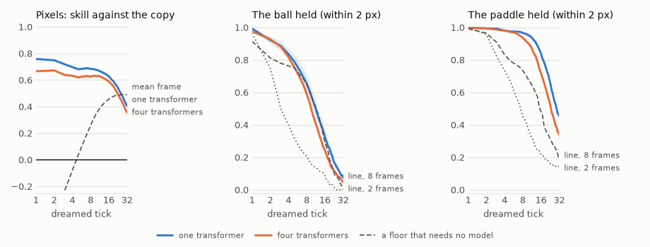
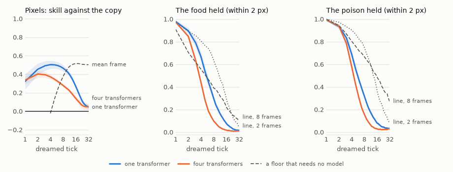
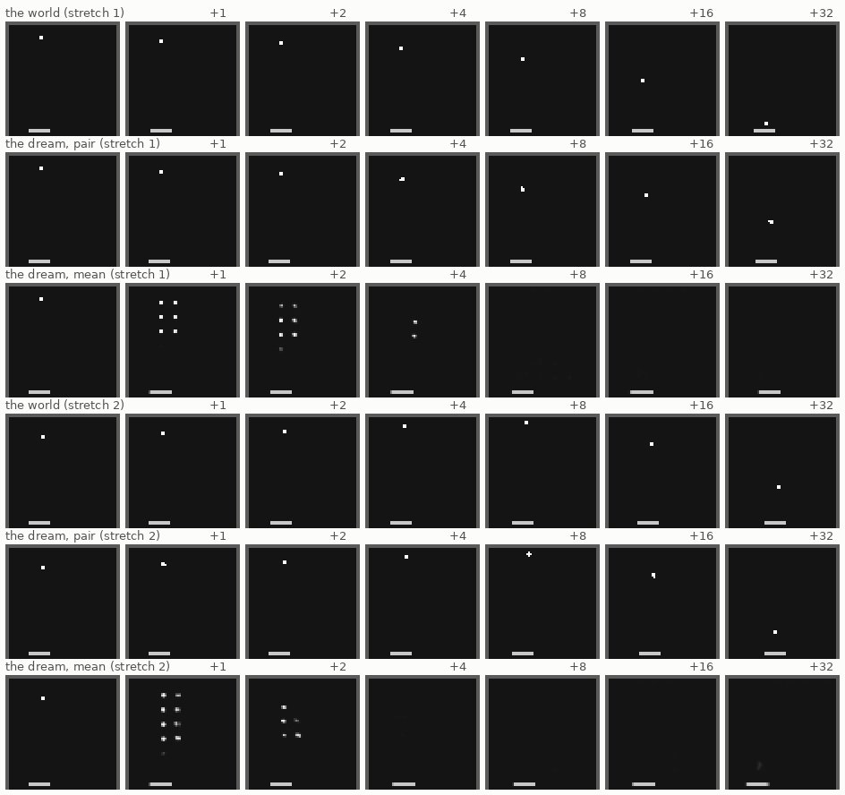
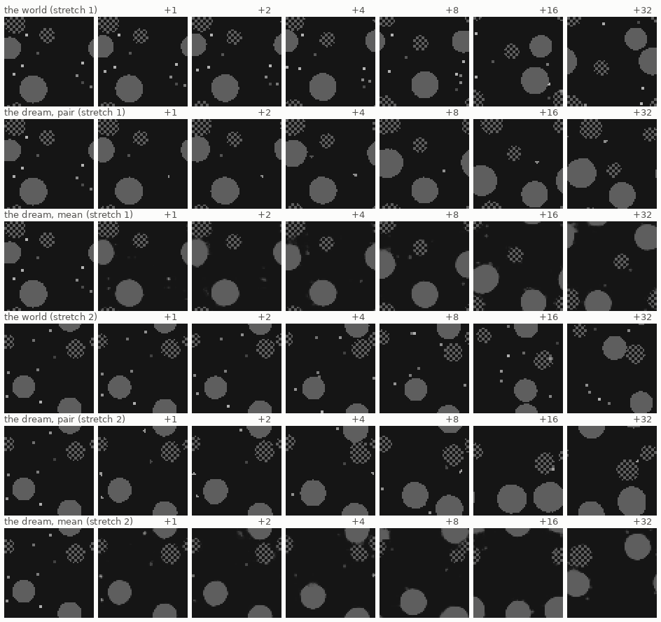

# vm-00120: One Transformer on the Whole Frame

**Date:** 2026-11-26 to 2026-11-27
**Status:** Complete
**Source:** `dev/` (pending tag `exp/vm-00120`)
**Outputs:** `~/data/research/visual-motor-agent/exp_00120/`
**Task plan:** [`../tasks/00133-one-transformer.md`](../tasks/00133-one-transformer.md)

## Goal

The owner, 2026-11-26, after vm-00119: "it is expected that adding transformers will reduce accuracy - lets do the same set of tests (world prediction) on one transformer and 64x64 field and see where it will get us".

The model has four quarter transformers because their competing moves forage better (vm-00051: 42.8 food per 1k against one model's 19.0). Whether the split costs prediction had never been measured on pictures. vm-00119 gave the measures and the four transformers' table. Does one transformer that reads the whole 64 x 64 frame predict the watched worlds better than the four?

## Method

- **OD, OB:** vm-00119's WD and WB with one transformer (`configs/W1_discs.json`, `configs/W1_breakout.json`): the same model (8 layers, width 128, 4 heads, context 8 ticks, 32 bins, the pyramid of summaries) without the split, that is, without `model.band_n`, `band_cols`, `band_win` and `online.pieces`. It only watches (`online.watch = 1`). Seeds 1–12, 60k ticks; seeds 1–8 on the RTX 4090, 9–12 on the RTX 3090, as vm-00119's.
- **Against WD and WB by seed.** A seed's lives watched the same world: the same discs, the same serves.

| | One transformer (OD, OB) | Four quarter transformers (WD, WB) |
|---|---|---|
| Tokens a tick | 87: the body, 64 patches, 21 summaries, the move | 4 x 32: each the body, its 16 patches, 14 summaries near it, the move |
| What a patch token can read | every patch of the frame | the patches of its quarter; the rest as summaries near the quarter, coarser with distance |
| Parameters | 2.17M | 8.64M |
| A dreamed frame | one sequence, decoded patch by patch | four sequences, their quarters joined into one frame |

- **The measures** are vm-00119's (`dev/wm_measures.py`): a model read through `reset`, `observe` and `dream` only, the same exam (256 dreams of 32 ticks after 64 real ticks), the reference decoder `pair`, exact decoding. The other decoders were not run: vm-00119 settled that question.
- **New, the seams** (the part `seam`): the first 8 dreamed ticks of the regular starts, with the error counted apart over the pixels within 4 px of a border between the quarters (960 of the 4,096) and over the rest; and the things held, apart for those that lie across a seam at that tick and those that do not. The four transformers' lives of vm-00119 were scored again for this part.
- **Added after the first results, the things by where they have been** (`wm_measures.py borders`; from the reader's kept distances, so no model is run again). A thing is inside one quarter so far at dreamed tick h if its true shape lay within one quarter of the frame in the last real frame and at every dreamed tick up to h: of the four transformers one alone has drawn it. Otherwise it has lain across a border. In the disc world, a torus, the frame's edge is a border between two quarters too. The things held at tick h are counted apart for the two groups, for both models.
- **Also added, the ticks to the four's level:** on the arms' mean learning curves (the checkpoints of every 10k, linear between them), after how many ticks the one transformer is at the level the four have at 60k.
- **The scoring batch:** the one transformer is scored 64 windows at a time, the four 256 (the one transformer's attention over 696 tokens a window does not fit 256 windows on a card). The decoding is exact in both.
- **Paired by seed:** every difference is one − four over the 12 seeds, with its 95% interval and the seeds above 0. `make compare` prints the tables.

## Readings

Set in the task plan before the results:

1. **The next frame:** one − four in next-frame skill above 0 with its interval: the split costs accuracy, as the owner expects. The interval includes 0: no difference to be seen at this size. Below 0: the four predict better (they have four times the parameters).
2. **The dream:** the same for the things held and the dream's horizon by pixels.
3. **The seams:** if the four lose to the one, the loss should be larger near the seams than away from them.
4. **The window:** does one transformer use more of its 8 ticks than the four (4 ticks; in the court's dream 2)?
5. **What follows:** one ahead on 1 and 2: the world-model work goes on with one transformer. Not ahead: a wider single transformer with the four's parameters is the arm that separates the split from the size. Mixed: reported by world.

**What I expected** (written before the lives ran): one transformer ahead in the disc world, on the next frame and on the discs held, because a disc lies across a seam much of the time; about level in the court on the next frame and ahead on the ball's horizon; and the four's loss sitting near the seams.

## Results

All 24 lives ran to 60k ticks, and every life's files were checked for completeness before the tables were made (1,458 items). Every number of an arm is the mean of its 12 seeds with the 95% interval, at 60k, with `pair`, on the working set of the exam. A difference is one − four, paired by seed. `make compare` prints these tables, `make table` the one transformer's own.

- OD against WD: 12 seeds at 60k (1, 2, 3, 4, 5, 6, 7, 8, 9, 10, 11, 12), paired by seed; OD has 2,166,178 parameters, WD has 8,636,552
- OB against WB: 12 seeds at 60k (1, 2, 3, 4, 5, 6, 7, 8, 9, 10, 11, 12), paired by seed; OB has 2,166,178 parameters, WB has 8,636,552

### R1. The next frame and the dream by pixels

**The moving discs (OD against WD).**

| Number | OD | WD | OD − WD | Seeds with OD above |
|---|---|---|---|---|
| Next-frame skill | .322 ± .082 | .337 ± .042 | −.015 ± .043 | 5 of 12 above |
| Next-frame skill on the food | .704 ± .068 | .668 ± .040 | +.036 ± .034 | 9 of 12 above |
| Next-frame skill on the poison | .347 ± .111 | .342 ± .077 | +.005 ± .044 | 8 of 12 above |
| Next-frame skill on the dots | .264 ± .007 | .257 ± .005 | +.007 ± .005 | 10 of 12 above |
| Error where nothing moves, grey levels | 7.73 ± 1.14 | 7.02 ± 0.63 | +0.71 ± 0.56 | 10 of 12 above |
| Skill against the copy at tick 2 | .454 ± .063 | .403 ± .037 | +.051 ± .031 | 11 of 12 above |
| Skill against the copy at tick 4 | .504 ± .044 | .372 ± .024 | +.131 ± .029 | 12 of 12 above |
| Skill against the copy at tick 8 | .466 ± .033 | .279 ± .018 | +.187 ± .031 | 12 of 12 above |
| Skill against the copy at tick 16 | .269 ± .025 | .140 ± .027 | +.129 ± .023 | 12 of 12 above |
| Skill against the copy at tick 32 | .045 ± .027 | .052 ± .034 | −.007 ± .021 | 4 of 12 above |
| Dream horizon by pixels, ticks | 8.5 ± 1.8 | 6.2 ± 0.4 | +2.3 ± 1.6 | 11 of 12 above |

**The court (OB against WB).**

| Number | OB | WB | OB − WB | Seeds with OB above |
|---|---|---|---|---|
| Next-frame skill | .759 ± .010 | .667 ± .010 | +.092 ± .010 | 12 of 12 above |
| Next-frame skill on the ball | .863 ± .007 | .807 ± .006 | +.057 ± .007 | 12 of 12 above |
| Next-frame skill on the paddle | .857 ± .015 | .753 ± .016 | +.104 ± .017 | 12 of 12 above |
| Error where nothing moves, grey levels | 3.26 ± 0.07 | 3.65 ± 0.09 | −0.39 ± 0.10 | 0 of 12 above |
| Skill against the copy at tick 2 | .749 ± .010 | .673 ± .010 | +.077 ± .011 | 12 of 12 above |
| Skill against the copy at tick 4 | .698 ± .012 | .633 ± .011 | +.065 ± .014 | 12 of 12 above |
| Skill against the copy at tick 8 | .684 ± .011 | .627 ± .009 | +.057 ± .013 | 12 of 12 above |
| Skill against the copy at tick 16 | .628 ± .010 | .589 ± .012 | +.039 ± .014 | 11 of 12 above |
| Skill against the copy at tick 32 | .407 ± .016 | .356 ± .017 | +.051 ± .022 | 12 of 12 above |
| Dream horizon by pixels, ticks | 25.6 ± 1.0 | 22.7 ± 0.8 | +2.9 ± 1.3 | 11 of 12 above |

The seeds' mean with its 95% band, by dreamed tick. Dashed: the mean frame, a floor by pixels. Dotted: a thing kept on a straight line through its places in the last 2 and in the last 8 frames as seen.

- **The court: one transformer predicts the next frame better.** Next-frame skill .759 ± .010 against .667 ± .010: +.092 ± .010, 12 of 12 seeds. It is ahead on the ball (+.057 ± .007) and on the paddle (+.104 ± .017), and it draws less where nothing moves (3.26 grey levels against 3.65). The gain holds through the dream (+.057 ± .013 at tick 8), and the dream stays above both pixel floors for 25.6 ticks against 22.7 (+2.9 ± 1.3).
- **The disc world: level at the next frame on new discs, far ahead in the dream.** Next-frame skill .322 ± .082 against .337 ± .042 (−.015 ± .043, 5 of 12 seeds): a little ahead on the food (+.036 ± .034), level on the poison (+.005 ± .044), and drawing more where nothing moves (7.73 grey levels against 7.02, +0.71 ± 0.56). The exam's discs are new to every life; on a life's own discs the one transformer is ahead at the next frame too (R6). At tick 4 the one is ahead by +.131 ± .029 and at tick 8 by +.187 ± .031 (12 of 12 seeds): its skill at tick 8 is .466 where the four's is .279. Its dream stays above both floors for 8.5 ticks against 6.2 (+2.3 ± 1.6; seed 5's horizon is 0, see the analysis).

### R2. The things in the dream

Seed 1, the two stretches of vm-00119's pictures (the four's dreams of the same stretches: [`dream_WB.png`](../00119-watching-worlds/images/dream_WB.png), [`dream_WD.png`](../00119-watching-worlds/images/dream_WD.png)). In these two stretches the one transformer's discs stay round to the 32nd dreamed tick, though from about the 8th they are no longer where the world's are; the four's discs lose their shape by the 8th. The third row of each stretch is the same weights decoded with the expected value (`mean`), which was not scored here: in the first stretch of the court it draws six balls at the first dreamed tick (24 bright pixels where a ball has 4) and none at the 8th.

**The moving discs (OD against WD).**

| Number | OD | WD | OD − WD | Seeds with OD above |
|---|---|---|---|---|
| The food held at tick 2 | .896 ± .027 | .847 ± .019 | +.049 ± .014 | 12 of 12 above |
| The food held at tick 4 | .666 ± .043 | .438 ± .023 | +.228 ± .045 | 12 of 12 above |
| The food held at tick 8 | .298 ± .029 | .099 ± .010 | +.199 ± .032 | 12 of 12 above |
| The food held at tick 16 | .077 ± .012 | .018 ± .003 | +.059 ± .010 | 12 of 12 above |
| Horizon of the food, ticks | 4.8 ± 0.5 | 3.0 ± 0.0 | +1.8 ± 0.5 | 12 of 12 above |
| The poison held at tick 2 | .935 ± .023 | .938 ± .018 | −.003 ± .019 | 6 of 12 above |
| The poison held at tick 4 | .691 ± .041 | .581 ± .031 | +.110 ± .034 | 12 of 12 above |
| The poison held at tick 8 | .319 ± .022 | .159 ± .004 | +.160 ± .022 | 12 of 12 above |
| The poison held at tick 16 | .081 ± .012 | .029 ± .008 | +.051 ± .017 | 11 of 12 above |
| Horizon of the poison, ticks | 5.0 ± 0.5 | 3.9 ± 0.2 | +1.1 ± 0.4 | 10 of 12 above |
| Valid frames at tick 1 | .533 ± .154 | .576 ± .116 | −.043 ± .088 | 5 of 12 above |
| Valid frames at tick 8 | .176 ± .043 | .095 ± .010 | +.081 ± .042 | 11 of 12 above |

**The court (OB against WB).**

| Number | OB | WB | OB − WB | Seeds with OB above |
|---|---|---|---|---|
| The ball held at tick 2 | .922 ± .023 | .928 ± .010 | −.006 ± .024 | 6 of 12 above |
| The ball held at tick 4 | .836 ± .036 | .818 ± .020 | +.018 ± .032 | 7 of 12 above |
| The ball held at tick 8 | .656 ± .053 | .591 ± .026 | +.065 ± .049 | 10 of 12 above |
| The ball held at tick 16 | .328 ± .039 | .246 ± .018 | +.081 ± .041 | 11 of 12 above |
| Horizon of the ball, ticks | 10.8 ± 1.0 | 9.1 ± 0.4 | +1.8 ± 1.0 | 10 of 12 above |
| The paddle held at tick 2 | .995 ± .002 | .994 ± .002 | +.001 ± .003 | 6 of 12 above |
| The paddle held at tick 4 | .981 ± .003 | .980 ± .004 | +.001 ± .004 | 7 of 12 above |
| The paddle held at tick 8 | .967 ± .008 | .937 ± .010 | +.030 ± .010 | 12 of 12 above |
| The paddle held at tick 16 | .839 ± .019 | .717 ± .016 | +.121 ± .023 | 12 of 12 above |
| Horizon of the paddle, ticks | 28.4 ± 1.3 | 22.9 ± 0.8 | +5.5 ± 1.2 | 12 of 12 above |
| Valid frames at tick 1 | .709 ± .031 | .716 ± .022 | −.007 ± .035 | 6 of 12 above |
| Valid frames at tick 8 | .743 ± .018 | .752 ± .028 | −.009 ± .023 | 5 of 12 above |

- **The discs are held longer.** A food disc is still in place at tick 4 in .666 of the one transformer's dreams and in .438 of the four's (+.228 ± .045, 12 of 12 seeds); at tick 8 in .298 against .099. Its horizon is 4.8 ticks against 3.0, the poison's 5.0 against 3.9. A straight line through the last two frames still holds them longer (10 and 13 ticks).
- **The ball and the paddle are held longer too.** At ticks 2 and 4 the ball is held equally often (−.006 ± .024 and +.018 ± .032). At tick 8: .656 against .591 (+.065 ± .049, 10 of 12 seeds); its horizon 10.8 ticks against 9.1 (+1.8 ± 1.0), where a straight line through all 8 frames of the window holds it for 11. The paddle's horizon is 28.4 ticks against 22.9 (+5.5 ± 1.2).
- **Valid frames:** level in the court (−.009 ± .023 at tick 8); in the disc world the one transformer keeps a few more at tick 8 (.176 against .095, +.081 ± .042).

### R3. Where the four lose: at the seams?

**The moving discs (OD against WD).**

| Number | OD | WD | OD − WD | Seeds with OD above |
|---|---|---|---|---|
| Skill at tick 1, within 4 px of a seam | .334 ± .089 | .345 ± .042 | −.011 ± .051 | 6 of 12 above |
| Skill at tick 1, away from the seams | .318 ± .080 | .334 ± .043 | −.016 ± .041 | 4 of 12 above |
| Skill at tick 4, within 4 px of a seam | .508 ± .046 | .358 ± .023 | +.150 ± .035 | 12 of 12 above |
| Skill at tick 4, away from the seams | .503 ± .044 | .377 ± .025 | +.126 ± .027 | 12 of 12 above |
| Skill at tick 8, within 4 px of a seam | .479 ± .035 | .276 ± .017 | +.203 ± .036 | 12 of 12 above |
| Skill at tick 8, away from the seams | .461 ± .033 | .280 ± .019 | +.181 ± .029 | 12 of 12 above |
| The food held at tick 2, lying across a seam | .894 ± .029 | .842 ± .021 | +.052 ± .020 | 12 of 12 above |
| The food held at tick 2, clear of the seams | .901 ± .027 | .858 ± .018 | +.044 ± .017 | 11 of 12 above |
| The food held at tick 4, lying across a seam | .669 ± .046 | .417 ± .022 | +.253 ± .049 | 12 of 12 above |
| The food held at tick 4, clear of the seams | .660 ± .042 | .481 ± .033 | +.179 ± .045 | 12 of 12 above |
| The food held at tick 8, lying across a seam | .302 ± .030 | .097 ± .009 | +.205 ± .033 | 12 of 12 above |
| The food held at tick 8, clear of the seams | .290 ± .031 | .102 ± .018 | +.188 ± .034 | 12 of 12 above |
| The poison held at tick 2, lying across a seam | .923 ± .030 | .927 ± .017 | −.004 ± .024 | 6 of 12 above |
| The poison held at tick 2, clear of the seams | .948 ± .017 | .950 ± .020 | −.002 ± .018 | 6 of 12 above |
| The poison held at tick 4, lying across a seam | .680 ± .047 | .574 ± .038 | +.106 ± .034 | 12 of 12 above |
| The poison held at tick 4, clear of the seams | .701 ± .038 | .588 ± .028 | +.114 ± .040 | 12 of 12 above |
| The poison held at tick 8, lying across a seam | .324 ± .021 | .149 ± .017 | +.175 ± .018 | 12 of 12 above |
| The poison held at tick 8, clear of the seams | .314 ± .027 | .168 ± .014 | +.146 ± .036 | 12 of 12 above |

Tick 1: (OD − WD) near the seams less (OD − WD) away from them: +.005 ± .015, 8 of 12 above.
Tick 4: (OD − WD) near the seams less (OD − WD) away from them: +.024 ± .011, 11 of 12 above.
Tick 8: (OD − WD) near the seams less (OD − WD) away from them: +.022 ± .013, 10 of 12 above.

**The court (OB against WB).**

| Number | OB | WB | OB − WB | Seeds with OB above |
|---|---|---|---|---|
| Skill at tick 1, within 4 px of a seam | .738 ± .016 | .614 ± .020 | +.125 ± .020 | 12 of 12 above |
| Skill at tick 1, away from the seams | .767 ± .011 | .688 ± .010 | +.079 ± .012 | 12 of 12 above |
| Skill at tick 4, within 4 px of a seam | .679 ± .022 | .615 ± .013 | +.064 ± .025 | 11 of 12 above |
| Skill at tick 4, away from the seams | .704 ± .011 | .639 ± .013 | +.065 ± .014 | 12 of 12 above |
| Skill at tick 8, within 4 px of a seam | .631 ± .019 | .596 ± .017 | +.035 ± .022 | 10 of 12 above |
| Skill at tick 8, away from the seams | .699 ± .010 | .635 ± .009 | +.063 ± .013 | 12 of 12 above |
| The ball held at tick 2, lying across a seam | .922 ± .029 | .899 ± .016 | +.023 ± .033 | 7 of 12 above |
| The ball held at tick 2, clear of the seams | .922 ± .023 | .942 ± .010 | −.020 ± .024 | 3 of 12 above |
| The ball held at tick 4, lying across a seam | .844 ± .053 | .776 ± .029 | +.068 ± .054 | 9 of 12 above |
| The ball held at tick 4, clear of the seams | .832 ± .030 | .837 ± .023 | −.005 ± .028 | 5 of 12 above |
| The ball held at tick 8, lying across a seam | .677 ± .063 | .556 ± .042 | +.121 ± .085 | 8 of 12 above |
| The ball held at tick 8, clear of the seams | .648 ± .052 | .605 ± .026 | +.043 ± .043 | 9 of 12 above |
| The paddle held at tick 2, lying across a seam | .987 ± .005 | .984 ± .004 | +.003 ± .006 | 6 of 12 above |
| The paddle held at tick 2, clear of the seams | .999 ± .001 | .999 ± .001 | +.000 ± .002 | 2 of 12 above |
| The paddle held at tick 4, lying across a seam | .966 ± .010 | .961 ± .009 | +.005 ± .009 | 7 of 12 above |
| The paddle held at tick 4, clear of the seams | .988 ± .003 | .989 ± .003 | −.001 ± .003 | 1 of 12 above |
| The paddle held at tick 8, lying across a seam | .933 ± .016 | .896 ± .018 | +.037 ± .026 | 10 of 12 above |
| The paddle held at tick 8, clear of the seams | .982 ± .007 | .955 ± .010 | +.027 ± .009 | 12 of 12 above |

Tick 1: (OB − WB) near the seams less (OB − WB) away from them: +.045 ± .022, 11 of 12 above.
Tick 4: (OB − WB) near the seams less (OB − WB) away from them: −.001 ± .024, 4 of 12 above.
Tick 8: (OB − WB) near the seams less (OB − WB) away from them: −.029 ± .019, 2 of 12 above.

- **The four's own seam penalty** (vm-00119's lives, scored again): in the court the four's next-frame skill is .614 within 4 px of a seam and .688 away from it; a ball lying across a seam is held at tick 4 in .776 of the dreams, a ball clear of the seams in .837. In the disc world the four show no such gap at the first tick (.345 near, .334 away).
- **One transformer has a gap near the seams too** in the court (.738 near, .767 away). It has no seams, so its gap is what lies in that band of the court (the middle of the paddle's row is in it), and part of the four's gap is that too.
- **What the split adds at the seams:** the one − four difference near the seams less the difference away from them. In the court at the first tick it is +.045 ± .022 (11 of 12 seeds); at tick 4, −.001 ± .024 (4 of 12 seeds); at tick 8, −.029 ± .019 (2 of 12 seeds). In the disc world: +.005 ± .015 (8 of 12 seeds), +.024 ± .011 (11 of 12 seeds) and +.022 ± .013 (10 of 12 seeds). So by pixels the four's loss is larger near the seams in the court at the first dreamed tick only. By the eighth the one transformer's lead is smaller near the seams than away from them: by then both models are worse there (.631 and .596 near, .699 and .635 away), and a band of pixels no longer says whose loss it is. In the disc world the four's loss is not larger near the seams at the first tick and larger by a little at the fourth and the eighth.

A band of pixels at one tick does not follow a thing that crossed a border and moved on. So, added after these results, the things by where they have been:

**The moving discs (OD against WD).**

| Number | OD | WD | OD − WD | Seeds with OD above |
|---|---|---|---|---|
| The food held at tick 2, inside one quarter so far | .919 ± .023 | .859 ± .017 | +.060 ± .028 | 11 of 12 above |
| The food held at tick 2, having lain across a border | .892 ± .028 | .845 ± .021 | +.047 ± .013 | 12 of 12 above |
| The food held at tick 4, inside one quarter so far | .694 ± .062 | .480 ± .037 | +.214 ± .088 | 12 of 12 above |
| The food held at tick 4, having lain across a border | .662 ± .042 | .433 ± .025 | +.230 ± .041 | 12 of 12 above |
| The food held at tick 8, inside one quarter so far | .300 ± .044 | .111 ± .041 | +.189 ± .072 | 12 of 12 above |
| The food held at tick 8, having lain across a border | .297 ± .030 | .098 ± .009 | +.199 ± .031 | 12 of 12 above |
| The food held at tick 16, inside one quarter so far | .028 ± .061 | .028 ± .061 | +.000 ± .090 | 1 of 12 above |
| The food held at tick 16, having lain across a border | .077 ± .012 | .018 ± .003 | +.059 ± .011 | 12 of 12 above |
| The poison held at tick 2, inside one quarter so far | .944 ± .020 | .939 ± .019 | +.004 ± .023 | 5 of 12 above |
| The poison held at tick 2, having lain across a border | .930 ± .028 | .937 ± .019 | −.008 ± .019 | 5 of 12 above |
| The poison held at tick 4, inside one quarter so far | .695 ± .040 | .558 ± .034 | +.136 ± .043 | 12 of 12 above |
| The poison held at tick 4, having lain across a border | .688 ± .047 | .592 ± .032 | +.096 ± .038 | 11 of 12 above |
| The poison held at tick 8, inside one quarter so far | .332 ± .037 | .179 ± .018 | +.153 ± .051 | 12 of 12 above |
| The poison held at tick 8, having lain across a border | .314 ± .019 | .151 ± .008 | +.163 ± .015 | 12 of 12 above |
| The poison held at tick 16, inside one quarter so far | .080 ± .017 | .044 ± .020 | +.036 ± .030 | 10 of 12 above |
| The poison held at tick 16, having lain across a border | .081 ± .013 | .026 ± .007 | +.055 ± .016 | 12 of 12 above |

The food at tick 4: (OD − WD) of those that have lain across a border less (OD − WD) of those inside one quarter so far: +.015 ± .064, 5 of 12 above.
The food at tick 8: (OD − WD) of those that have lain across a border less (OD − WD) of those inside one quarter so far: +.010 ± .060, 6 of 12 above.
The food at tick 16: (OD − WD) of those that have lain across a border less (OD − WD) of those inside one quarter so far: +.059 ± .094, 11 of 12 above.
The poison at tick 4: (OD − WD) of those that have lain across a border less (OD − WD) of those inside one quarter so far: −.040 ± .043, 3 of 12 above.
The poison at tick 8: (OD − WD) of those that have lain across a border less (OD − WD) of those inside one quarter so far: +.010 ± .043, 7 of 12 above.
The poison at tick 16: (OD − WD) of those that have lain across a border less (OD − WD) of those inside one quarter so far: +.019 ± .022, 9 of 12 above.
Of the things of the regular starts there to read, inside one quarter so far: the food 77 of 512 at tick 2, 61 of 512 at tick 4, 30 of 512 at tick 8, 3 of 512 at tick 16; the poison 194 of 512 at tick 2, 176 of 512 at tick 4, 141 of 512 at tick 8, 99 of 512 at tick 16.

**The court (OB against WB).**

| Number | OB | WB | OB − WB | Seeds with OB above |
|---|---|---|---|---|
| The ball held at tick 2, inside one quarter so far | .925 ± .023 | .943 ± .009 | −.019 ± .023 | 5 of 12 above |
| The ball held at tick 2, having lain across a border | .895 ± .055 | .775 ± .059 | +.120 ± .075 | 9 of 12 above |
| The ball held at tick 4, inside one quarter so far | .842 ± .034 | .842 ± .023 | −.001 ± .032 | 5 of 12 above |
| The ball held at tick 4, having lain across a border | .808 ± .052 | .698 ± .029 | +.109 ± .055 | 10 of 12 above |
| The ball held at tick 8, inside one quarter so far | .660 ± .044 | .618 ± .027 | +.042 ± .041 | 10 of 12 above |
| The ball held at tick 8, having lain across a border | .646 ± .080 | .524 ± .040 | +.122 ± .078 | 11 of 12 above |
| The ball held at tick 16, inside one quarter so far | .316 ± .039 | .255 ± .028 | +.062 ± .039 | 9 of 12 above |
| The ball held at tick 16, having lain across a border | .342 ± .056 | .236 ± .024 | +.107 ± .066 | 11 of 12 above |
| The paddle held at tick 2, inside one quarter so far | .998 ± .002 | .995 ± .003 | +.003 ± .003 | 6 of 12 above |
| The paddle held at tick 2, having lain across a border | .982 ± .008 | .988 ± .005 | −.006 ± .011 | 2 of 12 above |
| The paddle held at tick 4, inside one quarter so far | .990 ± .003 | .986 ± .003 | +.003 ± .004 | 8 of 12 above |
| The paddle held at tick 4, having lain across a border | .956 ± .011 | .962 ± .008 | −.007 ± .011 | 2 of 12 above |
| The paddle held at tick 8, inside one quarter so far | .985 ± .009 | .953 ± .010 | +.032 ± .009 | 12 of 12 above |
| The paddle held at tick 8, having lain across a border | .928 ± .014 | .901 ± .015 | +.027 ± .023 | 10 of 12 above |
| The paddle held at tick 16, inside one quarter so far | .873 ± .023 | .769 ± .013 | +.104 ± .021 | 12 of 12 above |
| The paddle held at tick 16, having lain across a border | .786 ± .022 | .639 ± .031 | +.148 ± .034 | 12 of 12 above |

The ball at tick 4: (OB − WB) of those that have lain across a border less (OB − WB) of those inside one quarter so far: +.110 ± .052, 12 of 12 above.
The ball at tick 8: (OB − WB) of those that have lain across a border less (OB − WB) of those inside one quarter so far: +.080 ± .050, 10 of 12 above.
The ball at tick 16: (OB − WB) of those that have lain across a border less (OB − WB) of those inside one quarter so far: +.045 ± .065, 8 of 12 above.
The paddle at tick 4: (OB − WB) of those that have lain across a border less (OB − WB) of those inside one quarter so far: −.010 ± .012, 3 of 12 above.
The paddle at tick 8: (OB − WB) of those that have lain across a border less (OB − WB) of those inside one quarter so far: −.005 ± .023, 6 of 12 above.
The paddle at tick 16: (OB − WB) of those that have lain across a border less (OB − WB) of those inside one quarter so far: +.044 ± .030, 10 of 12 above.
Of the things of the regular starts there to read, inside one quarter so far: the ball 229 of 252 at tick 2, 210 of 252 at tick 4, 179 of 251 at tick 8, 142 of 252 at tick 16; the paddle 199 of 256 at tick 2, 192 of 256 at tick 4, 175 of 256 at tick 8, 155 of 256 at tick 16.

- **The court: the four lose the ball that has crossed a border.** Of the balls inside one quarter so far the one transformer holds .660 at tick 8 and the four .618 (+.042 ± .041); of the balls that have lain across a border, .646 and .524 (+.122 ± .078). The second difference less the first: +.110 ± .052 (12 of 12 seeds) at tick 4, +.080 ± .050 (10 of 12 seeds) at tick 8, +.045 ± .065 (8 of 12 seeds) at tick 16. The one transformer holds a ball that has crossed a border as well as one that has not (−.014 ± .047 at tick 8); the four hold it less well (−.094 ± .037).
- **The paddle** shows it only late: −.005 ± .023 (6 of 12 seeds) at tick 8, +.044 ± .030 (10 of 12 seeds) at tick 16.
- **The disc world: the four lose a disc as fast inside one quarter.** A food disc inside one quarter so far is held at tick 4 in .694 of the one transformer's dreams and .480 of the four's (+.214 ± .088); one that has lain across a border in .662 and .433 (+.230 ± .041). The second difference less the first: +.015 ± .064 (5 of 12 seeds); for the poison −.040 ± .043 (3 of 12 seeds); at tick 8, +.010 ± .060 (6 of 12 seeds) and +.010 ± .043 (7 of 12 seeds). So the four do not lose the discs at the borders: a disc that one quarter transformer has drawn alone all the way is lost as fast as one that passed from one to another.
- **Few discs are inside one quarter.** A disc is 10 to 22 px across and a quarter 32: of the 512 food discs of the exam 92 are inside one quarter at the first dreamed tick and 30 still at the eighth (of the 512 poison discs, which are slower, 203 and 141). Of the court's balls 232 of 251 are, and 179 at the eighth.

### R4. Events

**The moving discs (OD against WD).**

| Number | OD | WD | OD − WD | Seeds with OD above |
|---|---|---|---|---|
| Skill on the food that turns at the next tick | .575 ± .082 | .602 ± .043 | −.027 ± .046 | 5 of 12 above |
| Skill on the poison that turns at the next tick | .049 ± .134 | .083 ± .088 | −.034 ± .056 | 5 of 12 above |
| px off, the food that turns | 0.49 ± 0.09 | 0.39 ± 0.07 | +0.10 ± 0.05 | 11 of 12 above |
| px off, the poison that turns | 0.52 ± 0.06 | 0.50 ± 0.04 | +0.02 ± 0.04 | 6 of 12 above |
| px off, the food in free flight | 0.20 ± 0.10 | 0.23 ± 0.08 | −0.02 ± 0.05 | 5 of 12 above |
| px off, the poison in free flight | 0.31 ± 0.07 | 0.28 ± 0.06 | +0.02 ± 0.04 | 10 of 12 above |

**The court (OB against WB).**

| Number | OB | WB | OB − WB | Seeds with OB above |
|---|---|---|---|---|
| Hit forecast, next tick | .985 ± .007 | .996 ± .001 | −.010 ± .008 | 2 of 12 above |
| Miss forecast, next tick | .990 ± .006 | .987 ± .009 | +.003 ± .013 | 6 of 12 above |
| Hit forecast within 4 dreamed ticks | .962 ± .015 | .974 ± .011 | −.012 ± .022 | 6 of 12 above |
| Hit forecast within 8 dreamed ticks | .900 ± .030 | .939 ± .017 | −.040 ± .035 | 5 of 12 above |
| Hit forecast within 16 dreamed ticks | .792 ± .057 | .843 ± .033 | −.051 ± .051 | 4 of 12 above |
| Miss forecast within 4 dreamed ticks | .983 ± .007 | .990 ± .006 | −.007 ± .008 | 6 of 12 above |
| Miss forecast within 8 dreamed ticks | .941 ± .024 | .913 ± .020 | +.028 ± .028 | 9 of 12 above |
| Miss forecast within 16 dreamed ticks | .905 ± .041 | .918 ± .031 | −.012 ± .056 | 5 of 12 above |

- **The court's events: the four forecast a hit a little better.** A hit at the next tick: .985 ± .007 against .996 ± .001 (−.010 ± .008, 2 of 12 seeds with the one transformer above); 8 ticks ahead −.040 ± .035; 16 ticks ahead −.051 ± .051. A miss is forecast equally well: +.003 ± .013 at the next tick, +.028 ± .028 8 ticks ahead, −.012 ± .056 16 ticks ahead.
- **The disc world's next-tick bounce:** a food disc that turns is 0.49 px off in the one transformer's next frame and 0.39 in the four's (+0.10 ± 0.05, 11 of 12 seeds); the poison (+0.02 ± 0.04) and the discs in free flight (−0.02 ± 0.05 and +0.02 ± 0.04) show no difference. All of it is below a pixel: as vm-00119 found, a bounce moves a disc too little at the next tick to be read.

### R5. How much of the window is used

**The moving discs (OD against WD).**

| Number | OD | WD | OD − WD | Seeds with OD above |
|---|---|---|---|---|
| Next-frame skill shown 1 real tick | −.166 ± .058 | −.118 ± .032 | −.048 ± .033 | 1 of 12 above |
| Next-frame skill shown 2 real ticks | .282 ± .084 | .308 ± .045 | −.025 ± .042 | 4 of 12 above |
| Next-frame skill shown 4 real ticks | .321 ± .083 | .334 ± .043 | −.013 ± .043 | 5 of 12 above |
| Next-frame skill shown 8 real ticks | .322 ± .082 | .337 ± .042 | −.015 ± .043 | 5 of 12 above |
| The food held at tick 4, dreamed from 2 real ticks | .605 ± .046 | .407 ± .020 | +.198 ± .041 | 12 of 12 above |
| The food held at tick 4, dreamed from 4 real ticks | .663 ± .045 | .441 ± .025 | +.222 ± .043 | 12 of 12 above |
| The food held at tick 4, dreamed from 8 real ticks | .666 ± .043 | .438 ± .023 | +.228 ± .045 | 12 of 12 above |
| The poison held at tick 4, dreamed from 2 real ticks | .570 ± .035 | .481 ± .021 | +.090 ± .027 | 12 of 12 above |
| The poison held at tick 4, dreamed from 4 real ticks | .691 ± .043 | .584 ± .033 | +.106 ± .033 | 12 of 12 above |
| The poison held at tick 4, dreamed from 8 real ticks | .691 ± .041 | .581 ± .031 | +.110 ± .034 | 12 of 12 above |

**The court (OB against WB).**

| Number | OB | WB | OB − WB | Seeds with OB above |
|---|---|---|---|---|
| Next-frame skill shown 1 real tick | .568 ± .012 | .533 ± .012 | +.035 ± .012 | 12 of 12 above |
| Next-frame skill shown 2 real ticks | .687 ± .006 | .639 ± .009 | +.048 ± .011 | 12 of 12 above |
| Next-frame skill shown 4 real ticks | .747 ± .007 | .667 ± .009 | +.080 ± .010 | 12 of 12 above |
| Next-frame skill shown 8 real ticks | .759 ± .010 | .667 ± .010 | +.092 ± .010 | 12 of 12 above |
| The ball held at tick 8, dreamed from 2 real ticks | .649 ± .042 | .592 ± .022 | +.057 ± .042 | 10 of 12 above |
| The ball held at tick 8, dreamed from 4 real ticks | .669 ± .053 | .582 ± .033 | +.087 ± .064 | 10 of 12 above |
| The ball held at tick 8, dreamed from 8 real ticks | .656 ± .053 | .591 ± .026 | +.065 ± .049 | 10 of 12 above |
| The paddle held at tick 8, dreamed from 2 real ticks | .964 ± .007 | .935 ± .008 | +.029 ± .013 | 11 of 12 above |
| The paddle held at tick 8, dreamed from 4 real ticks | .968 ± .006 | .938 ± .012 | +.031 ± .013 | 11 of 12 above |
| The paddle held at tick 8, dreamed from 8 real ticks | .967 ± .008 | .937 ± .010 | +.030 ± .010 | 12 of 12 above |

- **The next frame:** shown 1, 2, 4 and 8 real ticks, the one transformer's skill in the court is .568, .687, .747 and .759 (the four: .533, .639, .667, .667); in the disc world −.166, .282, .321 and .322 (the four: −.118, .308, .334, .337). From 4 real ticks to 8 the one transformer gains +.012 ± .008 in the court and +.001 ± .001 in the disc world; the four −.000 ± .008 and +.003 ± .002.
- **The dream:** the ball held at tick 8 from 2, 4 and 8 real ticks: .649, .669 and .656 (the four: .592, .582, .591). A food disc held at tick 4: .605, .663 and .666 (the four: .407, .441, .438).
- **Reading 4:** hardly. At the court's next frame the one transformer still gains from the 5th to the 8th real tick, the four do not; in the disc world neither gains more than .003. The dream uses no more of the window than the four's: the ball is held as well from 2 real ticks as from 8 (+.007 ± .026), a food disc as well from 4 as from 8 (+.003 ± .006) and less well from 2 (+.058 ± .013).

### R6. Home, learning and cost

**The moving discs (OD against WD).**

| Number | OD | WD | OD − WD | Seeds with OD above |
|---|---|---|---|---|
| Next-frame skill at home | .689 ± .027 | .558 ± .030 | +.131 ± .021 | 12 of 12 above |
| Skill at tick 8 at home | .534 ± .042 | .310 ± .049 | +.224 ± .045 | 12 of 12 above |
| Dream horizon by pixels at home | 10.1 ± 0.9 | 6.9 ± 0.5 | +3.2 ± 0.9 | 12 of 12 above |
| Horizon of the food at home | 5.5 ± 0.8 | 3.3 ± 0.3 | +2.2 ± 0.7 | 12 of 12 above |
| Horizon of the poison at home | 6.2 ± 0.7 | 4.5 ± 0.3 | +1.7 ± 0.6 | 11 of 12 above |

**The court (OB against WB).**

| Number | OB | WB | OB − WB | Seeds with OB above |
|---|---|---|---|---|
| Next-frame skill at home | .760 ± .056 | .699 ± .051 | +.061 ± .041 | 10 of 12 above |
| Skill at tick 8 at home | .669 ± .033 | .617 ± .029 | +.052 ± .046 | 9 of 12 above |
| Dream horizon by pixels at home | 24.4 ± 2.7 | 23.3 ± 4.0 | +1.1 ± 2.8 | 5 of 12 above |
| Horizon of the ball at home | 11.1 ± 1.6 | 9.9 ± 1.7 | +1.2 ± 2.2 | 8 of 12 above |
| Horizon of the paddle at home | 28.2 ± 1.8 | 25.2 ± 3.7 | +2.9 ± 3.1 | 7 of 12 above |

**The moving discs (OD against WD).**

| Number | OD | WD | OD − WD | Seeds with OD above |
|---|---|---|---|---|
| Next-frame skill after 10k ticks | .253 ± .054 | .265 ± .027 | −.013 ± .031 | 5 of 12 above |
| The food held at tick 4 after 10k ticks | .346 ± .033 | .218 ± .014 | +.128 ± .039 | 11 of 12 above |
| Horizon of the food (of 8) after 10k ticks | 2.8 ± 0.2 | 2.0 ± 0.0 | +0.8 ± 0.2 | 10 of 12 above |
| Next-frame skill after 20k ticks | .288 ± .069 | .299 ± .031 | −.011 ± .040 | 5 of 12 above |
| The food held at tick 4 after 20k ticks | .482 ± .042 | .280 ± .013 | +.202 ± .043 | 12 of 12 above |
| Horizon of the food (of 8) after 20k ticks | 3.2 ± 0.3 | 2.3 ± 0.3 | +0.9 ± 0.3 | 10 of 12 above |
| Next-frame skill after 30k ticks | .305 ± .078 | .310 ± .034 | −.005 ± .046 | 7 of 12 above |
| The food held at tick 4 after 30k ticks | .562 ± .038 | .330 ± .017 | +.232 ± .041 | 12 of 12 above |
| Horizon of the food (of 8) after 30k ticks | 4.0 ± 0.4 | 2.8 ± 0.3 | +1.2 ± 0.4 | 11 of 12 above |
| Next-frame skill after 40k ticks | .310 ± .083 | .323 ± .039 | −.013 ± .046 | 6 of 12 above |
| The food held at tick 4 after 40k ticks | .604 ± .048 | .367 ± .021 | +.236 ± .041 | 12 of 12 above |
| Horizon of the food (of 8) after 40k ticks | 4.2 ± 0.4 | 2.8 ± 0.2 | +1.4 ± 0.3 | 12 of 12 above |
| Next-frame skill after 50k ticks | .314 ± .082 | .329 ± .042 | −.015 ± .043 | 5 of 12 above |
| The food held at tick 4 after 50k ticks | .622 ± .044 | .398 ± .022 | +.224 ± .030 | 12 of 12 above |
| Horizon of the food (of 8) after 50k ticks | 4.4 ± 0.5 | 3.0 ± 0.0 | +1.4 ± 0.5 | 11 of 12 above |

OD is at WD's level of 60k ticks (the means of 12 seeds; linear between checkpoints) in next-frame skill (.337): not within 60k ticks; skill at tick 8 (.279): after about 19k ticks; the food held at tick 4 (.438): after about 17k ticks; the food held at tick 8 (.099): after about 13k ticks; the poison held at tick 4 (.581): after about 26k ticks; the poison held at tick 8 (.159): after about 19k ticks.

**The court (OB against WB).**

| Number | OB | WB | OB − WB | Seeds with OB above |
|---|---|---|---|---|
| Next-frame skill after 10k ticks | .468 ± .028 | .403 ± .015 | +.064 ± .025 | 11 of 12 above |
| The ball held at tick 8 after 10k ticks | .091 ± .027 | .031 ± .010 | +.060 ± .028 | 11 of 12 above |
| Horizon of the ball (of 8) after 10k ticks | 2.2 ± 0.4 | 1.9 ± 0.2 | +0.3 ± 0.4 | 5 of 12 above |
| Next-frame skill after 20k ticks | .617 ± .026 | .559 ± .009 | +.058 ± .025 | 11 of 12 above |
| The ball held at tick 8 after 20k ticks | .345 ± .079 | .237 ± .018 | +.108 ± .076 | 11 of 12 above |
| Horizon of the ball (of 8) after 20k ticks | 5.2 ± 1.1 | 4.1 ± 0.2 | +1.2 ± 1.1 | 7 of 12 above |
| Next-frame skill after 30k ticks | .687 ± .007 | .605 ± .015 | +.082 ± .017 | 12 of 12 above |
| The ball held at tick 8 after 30k ticks | .502 ± .055 | .392 ± .031 | +.110 ± .044 | 12 of 12 above |
| Horizon of the ball (of 8) after 30k ticks | 7.1 ± 0.6 | 5.9 ± 0.6 | +1.2 ± 0.6 | 11 of 12 above |
| Next-frame skill after 40k ticks | .717 ± .011 | .639 ± .009 | +.078 ± .012 | 12 of 12 above |
| The ball held at tick 8 after 40k ticks | .573 ± .059 | .484 ± .032 | +.089 ± .068 | 9 of 12 above |
| Horizon of the ball (of 8) after 40k ticks | 7.7 ± 0.5 | 7.5 ± 0.4 | +0.2 ± 0.7 | 4 of 12 above |
| Next-frame skill after 50k ticks | .746 ± .010 | .654 ± .010 | +.092 ± .010 | 12 of 12 above |
| The ball held at tick 8 after 50k ticks | .658 ± .058 | .517 ± .032 | +.141 ± .066 | 11 of 12 above |
| Horizon of the ball (of 8) after 50k ticks | 7.9 ± 0.2 | 7.7 ± 0.5 | +0.2 ± 0.6 | 2 of 12 above |

OB is at WB's level of 60k ticks (the means of 12 seeds; linear between checkpoints) in next-frame skill (.667): after about 27k ticks; skill at tick 8 (.627): after about 38k ticks; the ball held at tick 4 (.818): after about 45k ticks; the ball held at tick 8 (.591): after about 42k ticks; the paddle held at tick 4 (.980): after about 49k ticks; the paddle held at tick 8 (.937): after about 35k ticks.

**The moving discs (OD against WD).**

| Number | OD | WD | OD − WD | Seeds with OD above |
|---|---|---|---|---|
| Decoding passes a dreamed tick | 10.9 ± 0.3 | 12.2 ± 0.3 | −1.3 ± 0.2 | 0 of 12 above |

**The court (OB against WB).**

| Number | OB | WB | OB − WB | Seeds with OB above |
|---|---|---|---|---|
| Decoding passes a dreamed tick | 5.8 ± 0.2 | 6.2 ± 0.2 | −0.4 ± 0.2 | 2 of 12 above |

- **Home:** on its own discs the one transformer's next-frame skill is .689 against the four's .558 (+.131 ± .021), and its dream beats the floors for 10.1 ticks against 6.9 (+3.2 ± 0.9). Both know their own discs better than new ones: home − away in next-frame skill is +.367 ± .087 for the one and +.221 ± .047 for the four. In the court home and away do not differ for either (+.001 ± .050 and +.032 ± .050), and the one transformer is ahead at home as on the exam (+.061 ± .041).
- **Learning:** after 10k ticks the one transformer holds a food disc at tick 4 in .346 of its dreams (the four .218), after 30k in .562 (.330). It is at the four's level of 60k ticks after about 17k ticks in the food held at tick 4 and about 13k ticks at tick 8 (the poison: about 26k ticks and about 19k ticks). In the court: about 27k ticks in next-frame skill, about 45k ticks in the ball held at tick 4 and about 42k ticks at tick 8. In the disc world's next-frame skill the two curves run together (−.005 ± .046 at 30k).
- **Cost:** the one transformer has 2.17M parameters against 8.64M; one life alone runs 54 ticks per second on the RTX 4090 against 40, and six together 15.6 each against 14.5 (four of its lives together: 22.6 each, and 11.1 on the RTX 3090); a dreamed tick takes 10.9 decoding passes in the disc world and 5.8 in the court (the four: 12.2 and 6.2), each pass about 1.3 times a pass of the four. A life holds about 1.5 GB of the card against 1 GB; scoring fits 64 windows at a time, not 256.

### R7. The one transformer's own board

**The moving discs (OD).**

| Predictor | Next-frame skill | Skill on discs that turn: food | poison | Dream horizon by pixels, ticks | Horizon of the food, ticks | Horizon of the poison, ticks | Valid frames at 8 ticks |
|---|---|---|---|---|---|---|---|
| one transformer, `pair` | .322 ± .082 | .575 ± .082 | .049 ± .134 | 8.5 ± 1.8 | 4.8 ± 0.5 | 5.0 ± 0.5 | .176 ± .043 |
| copy | .000 | .000 | .000 | 0.0 | 1.0 | 2.0 | 1.000 |
| the mean frame | −1.916 | −3.167 | −3.824 | 0.0 | 0.0 | 0.0 | .000 |
| the world itself | 1.000 | 1.000 | 1.000 | 32+ | 32+ | 32+ | 1.000 |
| a straight line through the last 2 frames as seen | – | – | – | – | 10.0 | 13.0 | – |
| a straight line through the last 4 frames as seen | – | – | – | – | 9.0 | 18.0 | – |
| a straight line through the last 8 frames as seen | – | – | – | – | 5.0 | 15.0 | – |
| a straight line through the last 2 true places | – | – | – | – | 12.0 | 20.0 | – |

**The court (OB).**

| Predictor | Next-frame skill | Hit forecast, next tick | Miss forecast, next tick | Dream horizon by pixels, ticks | Horizon of the ball, ticks | Horizon of the paddle, ticks | Valid frames at 8 ticks |
|---|---|---|---|---|---|---|---|
| one transformer, `pair` | .759 ± .010 | .985 ± .007 | .990 ± .006 | 25.6 ± 1.0 | 10.8 ± 1.0 | 28.4 ± 1.3 | .743 ± .018 |
| copy | .000 | .500 | .500 | 0.0 | 1.0 | 3.0 | 1.000 |
| the mean frame | −.990 | .500 | .500 | 0.0 | 0.0 | 0.0 | .000 |
| the world itself | 1.000 | 1.000 | 1.000 | 32+ | 32+ | 32+ | 1.000 |
| the world, other dice | 1.000 | – | – | 32+ | 32+ | 32+ | 1.000 |
| a straight line through the last 2 frames as seen | – | – | – | – | 2.0 | 7.0 | – |
| a straight line through the last 4 frames as seen | – | – | – | – | 7.0 | 12.0 | – |
| a straight line through the last 8 frames as seen | – | – | – | – | 11.0 | 15.0 | – |
| a straight line through the last 2 true places | – | – | – | – | 15.0 | 22.0 | – |

**The moving discs (OD).**

| Thing | Read on | Tick 1 | Tick 2 | Tick 4 | Tick 8 | Tick 16 | Tick 32 |
|---|---|---|---|---|---|---|---|
| food | held, `pair` | .979 ± .012 | .896 ± .027 | .666 ± .043 | .298 ± .029 | .077 ± .012 | .016 ± .004 |
| food | lost, `pair` | .000 ± .000 | .000 ± .000 | .000 ± .000 | .011 ± .005 | .205 ± .023 | .481 ± .032 |
| food | px off where found (median), `pair` | 0.1 ± 0.2 | 0.8 ± 0.3 | 1.4 ± 0.2 | 3.5 ± 0.2 | 7.6 ± 0.3 | 8.6 ± 0.1 |
| food | held, a straight line through the last 2 frames as seen | .973 | .891 | .807 | .635 | .297 | .055 |
| food | held, a straight line through the last 4 frames as seen | .967 | .838 | .699 | .521 | .293 | .123 |
| food | held, a straight line through the last 8 frames as seen | .910 | .705 | .557 | .391 | .221 | .098 |
| food | held, a straight line through the last 2 true places | .977 | .889 | .811 | .641 | .371 | .145 |
| food | held, left where it was | 1.000 | .047 | .020 | .008 | .006 | .002 |
| poison | held, `pair` | .992 ± .004 | .935 ± .023 | .691 ± .041 | .319 ± .022 | .081 ± .012 | .030 ± .005 |
| poison | lost, `pair` | .000 ± .000 | .000 ± .000 | .001 ± .003 | .007 ± .007 | .086 ± .022 | .266 ± .029 |
| poison | px off where found (median), `pair` | 0.0 ± 0.0 | 1.0 ± 0.0 | 1.5 ± 0.1 | 3.1 ± 0.2 | 6.7 ± 0.3 | 8.2 ± 0.1 |
| poison | held, a straight line through the last 2 frames as seen | 1.000 | .973 | .904 | .750 | .369 | .088 |
| poison | held, a straight line through the last 4 frames as seen | 1.000 | .963 | .881 | .746 | .539 | .266 |
| poison | held, a straight line through the last 8 frames as seen | 1.000 | .943 | .805 | .668 | .488 | .273 |
| poison | held, a straight line through the last 2 true places | 1.000 | .977 | .902 | .795 | .592 | .326 |
| poison | held, left where it was | 1.000 | 1.000 | .043 | .023 | .006 | .002 |

**The court (OB).**

| Thing | Read on | Tick 1 | Tick 2 | Tick 4 | Tick 8 | Tick 16 | Tick 32 |
|---|---|---|---|---|---|---|---|
| ball | held, `pair` | .993 ± .002 | .922 ± .023 | .836 ± .036 | .656 ± .053 | .328 ± .039 | .075 ± .016 |
| ball | lost, `pair` | .005 ± .002 | .055 ± .025 | .079 ± .027 | .140 ± .030 | .287 ± .044 | .548 ± .052 |
| ball | px off where found (median), `pair` | 0.0 ± 0.0 | 0.0 ± 0.0 | 1.0 ± 0.0 | 1.0 ± 0.1 | 2.3 ± 0.2 | 4.6 ± 0.4 |
| ball | held, a straight line through the last 2 frames as seen | .964 | .749 | .398 | .206 | .088 | .004 |
| ball | held, a straight line through the last 4 frames as seen | .948 | .876 | .811 | .492 | .121 | .012 |
| ball | held, a straight line through the last 8 frames as seen | .915 | .812 | .763 | .649 | .292 | .012 |
| ball | held, a straight line through the last 2 true places | .980 | .932 | .888 | .770 | .498 | .145 |
| ball | held, left where it was | 1.000 | .024 | .008 | .000 | .000 | .004 |
| ball | held, the world with other dice | 1.000 | .996 | .992 | .988 | .972 | .937 |
| paddle | held, `pair` | .998 ± .001 | .995 ± .002 | .981 ± .003 | .967 ± .008 | .839 ± .019 | .454 ± .020 |
| paddle | lost, `pair` | .000 ± .000 | .000 ± .000 | .001 ± .001 | .004 ± .002 | .012 ± .003 | .104 ± .012 |
| paddle | px off where found (median), `pair` | 0.0 ± 0.0 | 0.0 ± 0.0 | 0.0 ± 0.0 | 0.0 ± 0.0 | 1.0 ± 0.0 | 2.3 ± 0.3 |
| paddle | held, a straight line through the last 2 frames as seen | 1.000 | .957 | .734 | .453 | .219 | .133 |
| paddle | held, a straight line through the last 4 frames as seen | 1.000 | .988 | .898 | .660 | .383 | .176 |
| paddle | held, a straight line through the last 8 frames as seen | .992 | .965 | .832 | .734 | .480 | .191 |
| paddle | held, a straight line through the last 2 true places | 1.000 | .992 | .918 | .824 | .609 | .320 |
| paddle | held, left where it was | .992 | .715 | .406 | .230 | .109 | .105 |
| paddle | held, the world with other dice | 1.000 | 1.000 | 1.000 | 1.000 | .988 | .965 |

**The moving discs (OD).**

| Seed | Next-frame skill | Skill on turning food | poison | Dream horizon by pixels | Horizon of the food | Horizon of the poison | Valid at 8 ticks | Decoding passes a tick |
|---|---|---|---|---|---|---|---|---|
| 1 | .355 | .619 | .146 | 9 | 5 | 5 | .121 | 11.3 |
| 2 | .199 | .328 | .070 | 9 | 4 | 5 | .148 | 10.9 |
| 3 | .293 | .358 | .197 | 9 | 5 | 4 | .145 | 10.5 |
| 4 | .341 | .709 | .133 | 8 | 5 | 5 | .113 | 10.9 |
| 5 | −.021 | .535 | −.082 | 0 | 4 | 5 | .094 | 11.4 |
| 6 | .350 | .550 | −.198 | 9 | 4 | 4 | .117 | 11.3 |
| 7 | .401 | .640 | .100 | 9 | 4 | 5 | .211 | 11.1 |
| 8 | .442 | .672 | .239 | 10 | 6 | 6 | .281 | 11.0 |
| 9 | .465 | .718 | .287 | 11 | 6 | 6 | .215 | 10.2 |
| 10 | .383 | .613 | .185 | 9 | 5 | 6 | .215 | 11.2 |
| 11 | .360 | .488 | −.026 | 9 | 5 | 5 | .152 | 10.3 |
| 12 | .297 | .664 | −.458 | 10 | 5 | 4 | .297 | 10.8 |

Frames whose decoding did not settle: 0.

**The court (OB).**

| Seed | Next-frame skill | Hit forecast | Miss forecast | Dream horizon by pixels | Horizon of the ball | Horizon of the paddle | Valid at 8 ticks | Decoding passes a tick |
|---|---|---|---|---|---|---|---|---|
| 1 | .775 | .975 | .978 | 23 | 9 | 25 | .723 | 5.7 |
| 2 | .756 | .990 | .985 | 25 | 12 | 26 | .723 | 5.4 |
| 3 | .745 | .987 | 1.000 | 25 | 10 | 28 | .758 | 6.4 |
| 4 | .763 | .996 | 1.000 | 24 | 12 | 28 | .770 | 5.9 |
| 5 | .763 | .995 | .985 | 26 | 11 | 29 | .801 | 5.9 |
| 6 | .742 | .993 | 1.000 | 28 | 11 | 30 | .699 | 6.3 |
| 7 | .796 | .992 | .998 | 25 | 11 | 29 | .742 | 5.8 |
| 8 | .767 | .972 | .985 | 27 | 12 | 29 | .727 | 5.2 |
| 9 | .754 | .987 | .982 | 28 | 10 | 30 | .734 | 5.7 |
| 10 | .745 | .996 | .975 | 25 | 13 | 29 | .719 | 5.6 |
| 11 | .745 | .981 | .998 | 25 | 7 | 26 | .754 | 6.1 |
| 12 | .756 | .961 | 1.000 | 26 | 12 | 32 | .766 | 5.9 |

Frames whose decoding did not settle: 0.

## What was expected, and what came

| Expected before the lives ran | What came |
|---|---|
| One transformer ahead in the disc world on the next frame | Wrong on the exam's new discs: level (−.015 ± .043). On the life's own discs it is ahead (+.131 ± .021) |
| One transformer ahead in the disc world on the discs held, because a disc lies across a seam much of the time | Right on the discs held (+.228 ± .045 of the food at tick 4), wrong on the reason: on the food discs inside one quarter all the way the one transformer is as far ahead (+.214 ± .088) |
| About level in the court on the next frame | Wrong: one transformer is ahead by +.092 ± .010 |
| One transformer ahead on the ball's horizon | Right: +1.8 ± 1.0 ticks (10 of 12 seeds) |
| The four's loss sits near the seams | In the court, yes: by pixels at the first tick (+.045 ± .022 (11 of 12 seeds)) and on the balls that have crossed a border (+.080 ± .050 (10 of 12 seeds) at tick 8). In the disc world, no |

## Analysis

1. **The split costs prediction, as the owner expected.** One transformer with a quarter of the parameters predicts the court's next frame better (+.092 ± .010 in skill) and dreams both worlds longer: its dream beats the pixel floors for +2.3 ± 1.6 more ticks in the disc world and +2.9 ± 1.3 more in the court, and it holds every kind of thing longer (R2). The four are ahead in three smaller places: the forecast of a hit (7, below); what is drawn where nothing moves in the disc world, on new discs only (7.02 grey levels against 7.73; 3, below); and, by a tenth of a pixel, the food disc that turns at the next tick (R4).
2. **In the disc world a one-step number on new discs hides it.** On the exam's discs the next-frame skill is the same for both (−.015 ± .043), while at the 8th dreamed tick the one transformer's skill is .466 and the four's .279. Judged by the next frame alone, or by a loss, the two models would be called equal there. The dream's measures were built for this.
3. **The one transformer knows its own discs better, and new discs no better.** At home its next-frame skill is .689 against the four's .558 (+.131 ± .021, 12 of 12 seeds). The gap between home and away is +.367 ± .087 for the one and +.221 ± .047 for the four: on new discs it draws more where nothing is (7.73 grey levels against 7.02 where nothing moves; at home 5.18 against 5.94). A life has four discs for ever, and the better learner learns them more by heart. Seed 5 shows it most plainly: its life's two food discs are both 10.4 px in radius, it draws the exam's smaller food discs larger than they are (a look at four stretches: 65 to 133 px of empty space more than 30 grey levels too bright, none too dark), and its first dreamed frame on new discs is no better than the copy (skill −.021; the four's of that seed .176). From the second tick to the seventh its dream is above both floors, but the horizon's rule counts from the first tick, so that life's horizon by pixels is 0.
4. **Where the four lose depends on the world.** In the court it is at the borders: by pixels at the first dreamed tick (+.045 ± .022 (11 of 12 seeds) more near the seams than away from them), and by the ball, which the four hold less well once it has crossed a border while the one transformer does not care (R3). In the disc world it is everywhere: a disc that stayed inside one quarter, drawn by one transformer alone, is lost as fast as one that crossed. So the seams are not the whole cost of the split.
5. **Two readings fit both worlds, and this experiment does not separate them.** (a) Each quarter transformer learns from a quarter of the frame, so it meets each kind of thing a quarter as often. (b) It sees a thing whole only while the thing is inside its quarter. The court's ball is 2 px wide and inside one quarter at 232 of 251 starts; a disc is 10 to 22 px across and inside one quarter at 92 of 512 (food) and 203 of 512 (poison), so a quarter transformer learns the discs mostly from their parts.
6. **Counted in ticks of life,** the four at 60k are where the one transformer was after about 17k ticks (the food held at tick 4) and about 26k ticks (the poison) in the disc world, and after about 27k ticks (next-frame skill) and about 42k ticks (the ball held at tick 8) in the court. For a model that has one life to learn in, this is the cost of the split.
7. **The four forecast a hit better.** One tick ahead −.010 ± .008, 8 ticks ahead −.040 ± .035; a miss is forecast equally well (+.003 ± .013 and +.028 ± .028). The forecast is read from the predicted hunger, which in the four is the mean of four transformers' predictions; whether that averaging is the reason was not tested. It is the one measure of the court on which the split helps, and both forecasts stay far above chance (.900 against .939 8 ticks ahead).
8. **One transformer reads little more of its window.** At the court's next frame it gains +.012 ± .008 from the second half of its 8 ticks where the four gain nothing (−.000 ± .008); its dream starts as well from 2 real ticks (the court) or 4 (the discs) as from 8. The half of the window that vm-00119 found unused is still unused in the dream.
9. **The dream's weakness is still where the things are.** One transformer holds a food disc for 4.8 ticks and a poison disc for 5.0; a straight line through the last two frames holds them for 10 and 13. The ball it holds for 10.8 ticks, where a line through the 8 frames of the window holds it for 11 and its true course allows 15. The step back moved the table up; it did not change what is wrong with the dream.
10. **This says nothing about acting.** The four were adopted because their competing moves forage better (vm-00051: 42.8 food per 1k against 19.0), and that was not run again here. When the model moves again the two can be had apart: the picture predicted by one transformer, the candidate moves from several.
11. **What the measures taught about themselves.**
    - The seam's band of pixels at one tick does not follow a thing that crossed it and moved on: in the disc world it showed almost nothing while the four were losing every disc faster. The things by where they have been (`borders`) answer the question the band was meant for.
    - That reading needs no model: the reader's distances are kept by stretch, so a new split of the stretches costs seconds. The kept arrays are worth their space.
    - The pictures (R2) show a difference the 2 px rule only partly counts: the one transformer's discs stay discs after they have left their true places; the four's lose their shape.

## Conclusions

- **One transformer on the whole frame is the better world model of the two in both watched worlds,** with a quarter of the parameters (2.17M against 8.64M) and a life that alone runs 54 ticks per second against 40. The owner's expectation holds.
- **The court:** next-frame skill .759 against .667 (+.092 ± .010, 12 of 12 seeds); the dream above the pixel floors for 25.6 ticks against 22.7; the ball held for 10.8 ticks against 9.1, the paddle for 28.4 against 22.9. A hit is forecast a little better by the four (−.010 ± .008 one tick ahead, −.040 ± .035 eight ticks ahead), a miss equally well.
- **The disc world:** on new discs the next frame is predicted equally well (−.015 ± .043; on the life's own discs the one transformer is ahead by +.131 ± .021), and the dream far better: skill at tick 8 .466 against .279, above the floors for 8.5 ticks against 6.2, a food disc held at tick 4 in .666 of the dreams against .438.
- **The four's loss is at the borders in the court and everywhere in the disc world,** where a disc drawn by one quarter transformer alone is lost as fast as one that crossed a border.
- **In ticks of life** the four at 60k are where the one transformer was after about 17k ticks in the disc world's dream and after about 27k ticks to about 42k ticks in the court.
- **The dream's weakness is unchanged in kind:** a disc is held for 4.8 to 5.0 ticks where a straight line through two frames holds it for 10 and 13.
- **By the reading set beforehand** (one ahead on the next frame and the dream): the world-model work goes on with one transformer.

## Next steps

For the owner's word; nothing is started.

1. **One transformer as the watching model** (`configs/W1_discs.json`, `configs/W1_breakout.json`). Its numbers above become the reference table of `ARCHITECTURE.md` section 15, and each change is judged against them.
2. **Make the discs hold** (section 15, step 4): training on the model's own dreamed frames with `pair`. `lifetime.py` refuses self-forcing with the four transformers and runs it with one (checked in a 96-tick run of `configs/W1_discs.json` with `online.sf_windows = 8`), so this step needs no new code to start. The mark is the straight line through the last two frames (10 and 13 ticks).
3. **New discs now and then in the watched world,** so that a life cannot learn four discs by heart: the one transformer does so more than the four (home − away +.367 ± .087 against +.221 ± .047). Then the window and memory, as section 15 has them.
4. **When the model moves again:** whether the four's better foraging (vm-00051) survives with this model's later parts, and whether one transformer can predict the picture while several propose the moves.
5. **Not needed for the question asked, and so not proposed now:** a single transformer of the four's size (8.64M parameters). It would say how much more size buys at 60k ticks.

## Not done

- The other decoders (`mean`, `instinct`, `instinct_pair`): vm-00119 settled the decoder, and the pictures above show `mean` with one transformer on two stretches only.
- A single transformer with the four's 8.64M parameters, the arm named for the case that one transformer was not ahead.
- Acting: these lives only watch. vm-00051's result that four transformers forage better than one stands untested with this model's later parts.
- The final set of the exam (seed 2001) is unopened.
- What makes each quarter transformer the weaker predictor inside its own quarter: the smaller share of the frame it learns from and its coarse view of the rest are not separated here.

## Files

- `dev/configs/W1_discs.json`, `dev/configs/W1_breakout.json`: the one-transformer watching configs.
- `dev/wm_measures.py`: `score --chunk`, the part `seam`, `borders`, `compare`, `figure --against`; `dev/tests/test_wm_measures.py` (33).
- `Makefile`: `runs`, `anchors`, `score`, `warm-dream`, `seam`, `seam-four`, `home`, `learn`, `free`, `borders`, `table`, `compare`, `images`.
- Outputs: `~/data/research/visual-motor-agent/exp_00120/<ARM>_s<seed>/` (the life, and `wm/` with its numbers); the four's in `exp_00119/`.
