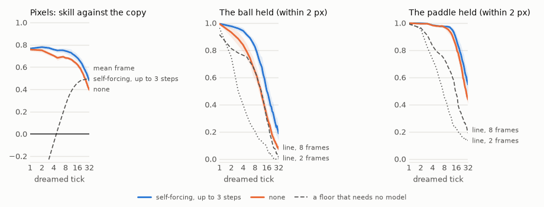
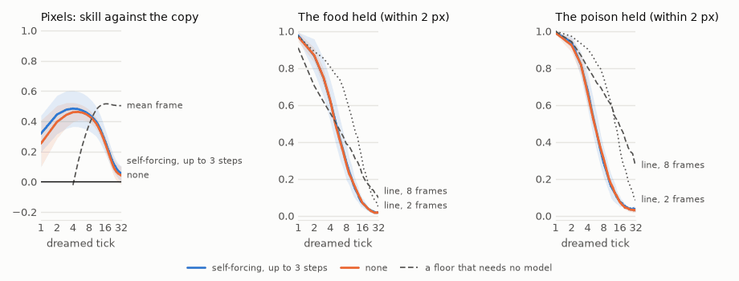
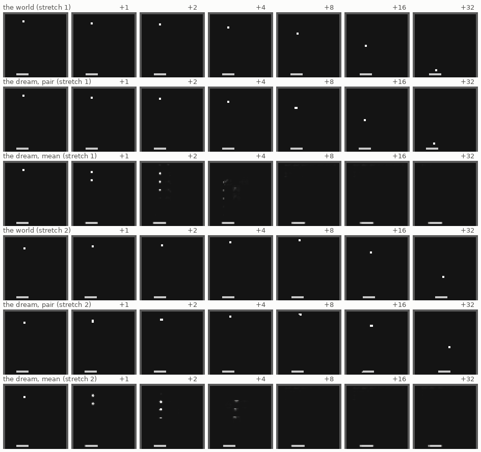

# vm-00121: The Watching Model Trained on Its Own Dreamed Frames

**Date:** 2026-11-27
**Status:** Complete
**Source:** `dev/` (pending tag `exp/vm-00121`)
**Outputs:** `~/data/research/visual-motor-agent/exp_00121/`
**Task plan:** [`../tasks/00134-self-forcing-watching.md`](../tasks/00134-self-forcing-watching.md)

**In short:** training on its own dreamed frames works where the life knows the things. In the court the ball is held for 16.2 dreamed ticks in place of 10.8. In the disc world the life's own discs are dreamed better, and discs it has never seen are not.

## Goal

The first change to the watching model (`ARCHITECTURE.md` section 15, item 4), by the owner's word of 2026-11-27: make the discs hold in the dream.

The one transformer of vm-00120 holds a food disc for 4.8 dreamed ticks and a poison disc for 5.0. A straight line through the disc's places in the last two frames holds them for 10 and 13 ticks. The suspected cause: the model has only ever read real frames, and in a dream it reads its own, a little wrong. Does training on its own dreamed frames (self-forcing, task 00039, vm-00032) make the things hold longer, and what does the next frame pay for it?

## Method

- **The model and the worlds** are vm-00120's: one transformer on the whole 64 x 64 frame (`configs/W1_discs.json`, `configs/W1_breakout.json`; 8 layers, width 128, context 8 ticks, 2.17M parameters), which only watches (`online.watch = 1`). 60k ticks, a checkpoint every 10k.
- **Self-forcing** (`online.sf_windows`, `online.sf_steps`; `lifetime.py`): an update trains on 8 windows, the newest and 7 replayed. Of the 7, 2 get the inputs (frame and body) of their last 1 to K steps from the model's own predictions, dreamed in order: the body from the move token, the frame in 2 passes from the frame before it (`sf_jacobi = 2`), decoded with `pair`. The number of dreamed steps of each window is drawn anew from 1 to K. The targets stay the real frames.

| Arm | World | Self-forcing | Dreamed input steps, share of a batch | Seeds |
|---|---|---|---|---|
| SD3 | discs | 2 windows, up to 3 steps (vm-00032's rule) | 6% | 1–6 |
| SD7 | discs | 2 windows, up to 7 steps (the window is 8) | 12.5% | 1–6 |
| SB3 | the scripted court | as SD3 | 6% | 1–6 |
| SB7 | the scripted court | as SD7 | 12.5% | 1–2 |
| OD, OB | | none (vm-00120's lives of the same seeds; not run again) | 0 | |

- **The seeds as run.** The plan was 12 seeds an arm, seeds 1–6 first. After the disc world's first table the owner skipped seeds 7–12 and then set the rule for what follows: a new idea is tried on few seeds to see whether it works at all, and many seeds wait until something is worth confirming. Four more lives of SB7 (seeds 3–6, at 32k of 60k ticks) were stopped at that word. So SB7 has two seeds: its numbers are a look, not a measurement.
- **Why depth is the second arm:** at dreamed tick h the model's window holds h − 1 dreamed frames (all 8 from tick 9 on). Up to 3 dreamed steps train it for dreamed ticks 2 to 4, up to 7 for ticks 2 to 8.
- **Paired by seed:** a seed's lives watch the same world as vm-00120's life of that seed and start from the same weights.
- **The measures** are vm-00119's (`dev/wm_measures.py`): the model read through `reset`, `observe` and `dream` only, the same exam (256 dreams of 32 ticks after 64 real ticks, seed 1001), `pair`, exact decoding, 64 windows a pass.
- **Two sets of things.** The exam's disc worlds are new to every life: 16 copies with other disc sizes, places and dots. **Home** is the life's own world from tick 60,000 on: the four discs and eight dots it has watched all its life. In the court there is no such difference: every life and the exam have the same ball, paddle and walls.
- **The dream of the training is not the exam's dream.** In training a dreamed frame is 2 passes from the frame before it; the exam decodes a frame exactly (about 11 passes in the disc world).
- **Added after the first results, the course part** (`wm_measures.py score --parts course`; mine, not in the plan). Is a dreamed thing behind the real one on its course, ahead of it or aside?
  - It takes every thing that keeps the step it made into the last real frame: no turn, no push, not standing.
  - The reader's shift (the dreamed place less the true place, in whole px) is split along that step and across it.
  - **The way gone** is the dreamed thing's way along its course since the last real frame, as a share of the true way: 1 keeps the speed, 0 stands still.
  - It is scored on the exam and on 64 starts of the life's own world (`--home-starts 64`; the home set of the other measures has 16).

## Readings, set before the results

Paired by seed, self-forcing − none, with the 95% interval over the seeds, per world and arm.

1. **The discs held (the aim).** The horizon of the food and of the poison in ticks and the shares held at dreamed ticks 4 and 8. Above 0 with the interval: the discs are held longer. **The mark** is the straight line through the last two frames: 10 and 13 ticks; .807 and .635 of the food at ticks 4 and 8.
2. **The price.** Next-frame skill (on the exam's new discs and at home), the error where nothing moves, the valid frames; in the court the forecasts of a hit and of a miss.
3. **The court.** The ball's and the paddle's horizon, the ball held at tick 8, the dream's horizon by pixels.
4. **The depth.** SD7 − SD3 and SB7 − SB3.
5. **What follows.** Held longer and the next frame pays nothing: self-forcing joins the watching model, in the arm with the longer horizon (the cheaper one if they do not differ), for the owner's word. Held longer at a price: both numbers, and the owner decides. Not held longer: the next suspects are the decoding and the window.

**What I expect** (written before the lives ran): the discs held longer in both arms, at tick 4 about .75 to .80 of the food in place of .666 and a horizon of 6 to 7 ticks; SD7 a little ahead of SD3 at tick 8; the mark not reached. The next frame level or slightly worse. In the court the ball's horizon up by a tick or two and the forecasts level.

## Cost, measured before the start

Four lives together on the RTX 3090 (two of each depth, 1,000 and 500 ticks): 6.6 ticks per second a life with up to 3 dreamed steps and 4.0 with up to 7, against 11.1 without self-forcing (vm-00120). A dreamed step is three more forward passes of the 2 windows.

## Results

20 lives ran to 60k ticks and were scored: SD3, SD7 and SB3 on seeds 1–6, SB7 on seeds 1–2. In the tables: the mean of the seeds ± the 95% interval; a difference is paired by seed, with the seeds in which the first arm is above. Dreams are decoded with `pair`. Every block of every arm: `make compare`.

### R1. The court: the ball is held half as long again

| Number | None (OB), 6 seeds | Up to 3 steps (SB3) | SB3 − OB | None (OB), seeds 1 and 2 | Up to 7 steps (SB7), those seeds | SB7 − OB, seed by seed | A line through the window's 8 frames |
|---|---|---|---|---|---|---|---|
| The ball held at tick 4 | .839 ± .049 | .943 ± .022 | +.104 ± .065 (5 of 6) | .851 | .893 | +.127 and −.044 | .763 |
| The ball held at tick 8 | .645 ± .061 | .826 ± .038 | +.181 ± .085 (6 of 6) | .659 | .717 | +.171 and −.056 | .649 |
| The ball held at tick 16 | .319 ± .052 | .503 ± .077 | +.184 ± .097 (6 of 6) | .296 | .405 | +.202 and +.016 | .292 |
| Horizon of the ball, ticks | 10.8 ± 1.2 | 16.2 ± 2.2 | +5.3 ± 2.9 (6 of 6) | 10.5 | 12.5 | +4.0 and +0.0 | 11.0 |
| Horizon of the paddle, ticks | 27.7 ± 2.0 | 31.5 ± 0.9 | +3.8 ± 2.6 (6 of 6) | 25.5 | 30.0 | +7.0 and +2.0 | 15.0 |
| Skill against the copy at tick 8 | .682 ± .013 | .745 ± .024 | +.063 ± .033 (6 of 6) | .674 | .751 | +.074 and +.080 | – |
| Dream horizon by pixels, ticks | 25.2 ± 1.8 | 30.0 ± 2.3 | +4.8 ± 3.8 (5 of 6) | 24.0 | 30.5 | +9.0 and +4.0 | – |
| Valid frames at tick 8 | .745 ± .039 | .720 ± .059 | −.025 ± .040 (2 of 6) | .723 | .777 | +.043 and +.066 | – |

- **With up to 3 dreamed steps the ball is held for 16.2 ticks against 10.8** (+5.3 ± 2.9, 6 of 6 seeds). Seed by seed: 17, 14, 19, 18, 14, 15 against 9, 12, 10, 12, 11, 11. At tick 8 it is in place in .826 of the dreams against .645, at tick 16 in .503 against .319.
- **The mark is passed.** A straight line through the ball's places in the window's 8 frames as seen holds it for 11 ticks, and one through its true places for 15. A line cannot bounce; the dream can.
- **The paddle and the pixels follow:** the paddle is held for 31.5 ticks against 27.7, and the dream stays above both pixel floors for 30.0 ticks against 25.2 (+4.8 ± 3.8).
- **Up to 7 steps, on two seeds, gain in one seed and not in the other on the ball:** its horizon is 13, 12 ticks (+4.0 and +0.0 against the same seeds without), and it is held at tick 8 in +.171 and −.056 of the dreams more. The pixels and the forecast gain in both seeds (skill at tick 8 +.074 and +.080; a hit within 16 dreamed ticks +.197 and +.083). Two seeds are a look, not a measurement: they do not say whether 7 steps are better or worse than 3 in the court.

The price in the court:

| Number | None (OB), 6 seeds | Up to 3 steps (SB3) | SB3 − OB | None (OB), seeds 1 and 2 | Up to 7 steps (SB7), those seeds | SB7 − OB, seed by seed |
|---|---|---|---|---|---|---|
| Next-frame skill | .757 ± .013 | .766 ± .011 | +.009 ± .016 (4 of 6) | .765 | .762 | −.009 and +.002 |
| Error where nothing moves, grey levels | 3.24 ± 0.10 | 3.27 ± 0.09 | +0.02 ± 0.13 (4 of 6) | 3.23 | 3.34 | +0.19 and +0.03 |
| Hit forecast, next tick | .989 ± .008 | .992 ± .006 | +.003 ± .012 (4 of 6) | .983 | .999 | +.024 and +.009 |
| Miss forecast, next tick | .991 ± .010 | .974 ± .046 | −.017 ± .041 (3 of 6) | .981 | .985 | −.008 and +.015 |
| Hit forecast within 8 dreamed ticks | .922 ± .035 | .974 ± .021 | +.052 ± .046 (6 of 6) | .906 | .993 | +.125 and +.049 |
| Hit forecast within 16 dreamed ticks | .815 ± .059 | .908 ± .031 | +.093 ± .072 (6 of 6) | .781 | .921 | +.197 and +.083 |
| Miss forecast within 8 dreamed ticks | .943 ± .041 | .983 ± .012 | +.039 ± .044 (6 of 6) | .946 | .973 | +.007 and +.047 |
| Miss forecast within 16 dreamed ticks | .923 ± .046 | .956 ± .026 | +.034 ± .066 (4 of 6) | .946 | .977 | +.009 and +.051 |

- **The next frame pays nothing** (+.009 ± .016), and **a hit is forecast better through the dream:** within 16 dreamed ticks .908 against .815 (+.093 ± .072, 6 of 6 seeds).
- The share of valid frames at tick 8 is not higher (−.025 ± .040): the ball is where it should be more often, and a frame is not more often a possible frame.

On its course (added after the first results):

| Number | None (OB), 6 seeds | Up to 3 steps (SB3) | SB3 − OB | None (OB), seeds 1 and 2 | Up to 7 steps (SB7), those seeds | SB7 − OB, seed by seed |
|---|---|---|---|---|---|---|
| The ball on a straight course held at tick 8 | .634 ± .068 | .848 ± .031 | +.214 ± .086 (6 of 6) | .650 | .811 | +.273 and +.049 |
| The ball's way gone at tick 8, share of the true way | .943 ± .030 | .971 ± .007 | +.029 ± .035 (5 of 6) | .930 | .981 | +.049 and +.051 |
| The ball behind at tick 8 | .447 ± .075 | .346 ± .030 | −.101 ± .072 (0 of 6) | .513 | .331 | −.150 and −.212 |
| The ball ahead at tick 8 | .144 ± .040 | .114 ± .021 | −.031 ± .052 (1 of 6) | .108 | .141 | −.017 and +.083 |
| px aside of its course, the ball at tick 8 | 1.39 ± 0.13 | 0.90 ± 0.10 | −0.50 ± 0.20 (0 of 6) | 1.35 | 0.83 | −0.62 and −0.42 |

- Without self-forcing the dreamed ball has gone .943 of its true way at tick 8; with up to 3 steps .971 (+.029 ± .035).

### R2. The disc world's new discs: not held longer

| Number | None (OD) | Up to 3 steps (SD3) | Up to 7 steps (SD7) | SD3 − OD | SD7 − OD | SD7 − SD3 | A line through the last 2 frames |
|---|---|---|---|---|---|---|---|
| The food held at tick 2 | .870 ± .039 | .868 ± .090 | .771 ± .157 | −.003 ± .060 (3 of 6) | −.100 ± .164 (1 of 6) | −.097 ± .153 (1 of 6) | .891 |
| The food held at tick 4 | .625 ± .036 | .622 ± .113 | .507 ± .151 | −.003 ± .081 (2 of 6) | −.118 ± .151 (1 of 6) | −.115 ± .151 (1 of 6) | .807 |
| The food held at tick 8 | .280 ± .028 | .290 ± .096 | .157 ± .078 | +.010 ± .069 (3 of 6) | −.123 ± .070 (1 of 6) | −.133 ± .100 (1 of 6) | .635 |
| The food held at tick 16 | .070 ± .013 | .072 ± .023 | .031 ± .022 | +.002 ± .019 (2 of 6) | −.039 ± .019 (0 of 6) | −.041 ± .036 (0 of 6) | .297 |
| Horizon of the food, ticks | 4.5 ± 0.6 | 4.5 ± 1.4 | 3.5 ± 1.1 | +0.0 ± 1.3 (2 of 6) | −1.0 ± 1.1 (0 of 6) | −1.0 ± 1.5 (1 of 6) | 10.0 |
| The poison held at tick 2 | .925 ± .037 | .941 ± .031 | .889 ± .070 | +.016 ± .027 (4 of 6) | −.036 ± .086 (2 of 6) | −.052 ± .070 (1 of 6) | .973 |
| The poison held at tick 4 | .665 ± .062 | .680 ± .094 | .574 ± .126 | +.015 ± .083 (4 of 6) | −.091 ± .171 (2 of 6) | −.106 ± .160 (2 of 6) | .904 |
| The poison held at tick 8 | .310 ± .015 | .289 ± .081 | .167 ± .043 | −.021 ± .073 (2 of 6) | −.143 ± .052 (0 of 6) | −.121 ± .105 (0 of 6) | .750 |
| The poison held at tick 16 | .076 ± .014 | .079 ± .030 | .030 ± .015 | +.003 ± .022 (2 of 6) | −.046 ± .021 (0 of 6) | −.049 ± .040 (0 of 6) | .369 |
| Horizon of the poison, ticks | 4.7 ± 0.5 | 5.0 ± 0.9 | 3.8 ± 0.8 | +0.3 ± 1.1 (4 of 6) | −0.8 ± 1.2 (1 of 6) | −1.2 ± 1.2 (0 of 6) | 13.0 |
| Valid frames at tick 8 | .123 ± .022 | .183 ± .070 | .079 ± .054 | +.060 ± .067 (5 of 6) | −.044 ± .065 (2 of 6) | −.104 ± .088 (1 of 6) | – |
| Skill against the copy at tick 2 | .396 ± .108 | .445 ± .127 | .361 ± .134 | +.049 ± .047 (5 of 6) | −.035 ± .139 (2 of 6) | −.084 ± .124 (2 of 6) | – |
| Skill against the copy at tick 4 | .460 ± .064 | .484 ± .119 | .414 ± .109 | +.024 ± .066 (4 of 6) | −.046 ± .105 (2 of 6) | −.070 ± .114 (2 of 6) | – |
| Skill against the copy at tick 8 | .435 ± .043 | .446 ± .109 | .387 ± .061 | +.011 ± .080 (3 of 6) | −.049 ± .052 (1 of 6) | −.059 ± .094 (2 of 6) | – |
| Skill against the copy at tick 16 | .256 ± .045 | .269 ± .079 | .308 ± .076 | +.013 ± .064 (3 of 6) | +.052 ± .040 (6 of 6) | +.039 ± .087 (4 of 6) | – |
| Dream horizon by pixels, ticks | 7.3 ± 3.8 | 8.8 ± 2.1 | 6.7 ± 3.6 | +1.5 ± 2.7 (3 of 6) | −0.7 ± 5.1 (2 of 6) | −2.2 ± 3.8 (2 of 6) | – |

- **Up to 3 dreamed steps change nothing.** A food disc is held at tick 4 in .622 of the dreams against .625 (−.003 ± .081), at tick 8 in .290 against .280 (+.010 ± .069). Its horizon is 4.5 ticks against 4.5, the poison's 5.0 against 4.7. The next frame pays nothing (+.066 ± .071, 5 of 6 seeds).
- **Up to 7 dreamed steps hold the new discs shorter.** The food at tick 8: .157 (−.123 ± .070, 1 of 6 seeds above); the poison at tick 8: .167 (−.143 ± .052, 0 of 6).
- **With up to 7 steps the food dissolves:** it is not found at all in .357 of the dreams at tick 8, against .013 without self-forcing and .024 with up to 3 steps. In those two arms a lost disc is still there, off its place.
- **Up to 7 steps cost on the next frame of new discs too:** next-frame skill on the food .394 against .650 (−.256 ± .373). The spread is wide: one life (seed 4) ends below the copy. And its skill falls when more real ticks are shown: .248 from 4 ticks, .190 from 8 (without self-forcing .251 and .253).
- **The mark is as far as before:** a straight line through the last two frames holds the food at tick 4 in .807 and for 10.0 ticks.

### R3. The life's own discs: both arms dream better

| Number | None (OD) | Up to 3 steps (SD3) | Up to 7 steps (SD7) | SD3 − OD | SD7 − OD | SD7 − SD3 |
|---|---|---|---|---|---|---|
| Next-frame skill at home | .686 ± .052 | .699 ± .054 | .696 ± .037 | +.012 ± .040 (4 of 6) | +.010 ± .028 (4 of 6) | −.003 ± .033 (3 of 6) |
| Skill at tick 8 at home | .516 ± .081 | .620 ± .045 | .606 ± .055 | +.104 ± .049 (6 of 6) | +.090 ± .054 (6 of 6) | −.014 ± .051 (3 of 6) |
| Dream horizon by pixels at home, ticks | 9.8 ± 1.4 | 11.7 ± 1.6 | 12.3 ± 1.3 | +1.8 ± 1.2 (6 of 6) | +2.5 ± 1.4 (6 of 6) | +0.7 ± 0.9 (3 of 6) |
| The food held at tick 4 at home | .693 ± .109 | .771 ± .099 | .802 ± .087 | +.078 ± .105 (4 of 6) | +.109 ± .092 (5 of 6) | +.031 ± .051 (4 of 6) |
| The food held at tick 8 at home | .286 ± .096 | .375 ± .104 | .385 ± .124 | +.089 ± .094 (5 of 6) | +.099 ± .149 (4 of 6) | +.010 ± .099 (2 of 6) |
| The poison held at tick 4 at home | .792 ± .115 | .844 ± .099 | .896 ± .061 | +.052 ± .082 (5 of 6) | +.104 ± .101 (5 of 6) | +.052 ± .087 (4 of 6) |
| The poison held at tick 8 at home | .339 ± .084 | .411 ± .143 | .432 ± .132 | +.073 ± .176 (3 of 6) | +.094 ± .163 (4 of 6) | +.021 ± .120 (3 of 6) |
| Horizon of the food at home, ticks | 5.3 ± 1.1 | 6.2 ± 1.0 | 6.5 ± 1.1 | +0.8 ± 1.2 (4 of 6) | +1.2 ± 1.4 (3 of 6) | +0.3 ± 1.8 (3 of 6) |
| Horizon of the poison at home, ticks | 6.3 ± 0.9 | 7.0 ± 1.6 | 7.2 ± 1.2 | +0.7 ± 1.8 (2 of 6) | +0.8 ± 1.5 (3 of 6) | +0.2 ± 1.5 (3 of 6) |

- **By pixels the dream of the own discs is better in both arms:** skill against the copy at tick 8 .620 and .606 against .516 (+.104 ± .049, 6 of 6 seeds; +.090 ± .054, 6 of 6). The dream stays above the pixel floors for 11.7 and 12.3 ticks against 9.8.
- **The discs held at home lean the same way,** on 16 starts a life: the food at tick 4 .771 and .802 against .693 (+.078 ± .105; +.109 ± .092).
- The next frame at home is level (+.012 ± .040; +.010 ± .028).

### R4. On its course: a dreamed disc falls behind (added after the first results)

The exam's new discs:

| Number | None (OD) | Up to 3 steps (SD3) | Up to 7 steps (SD7) | SD3 − OD | SD7 − OD | SD7 − SD3 |
|---|---|---|---|---|---|---|
| The food on a straight course held at tick 4 | .719 ± .051 | .707 ± .133 | .575 ± .175 | −.013 ± .090 (2 of 6) | −.145 ± .168 (1 of 6) | −.132 ± .180 (1 of 6) |
| The food on a straight course held at tick 8 | .368 ± .046 | .366 ± .127 | .211 ± .117 | −.002 ± .092 (1 of 6) | −.157 ± .108 (1 of 6) | −.155 ± .144 (1 of 6) |
| The food's way gone at tick 4, share of the true way | .882 ± .042 | .867 ± .092 | .771 ± .156 | −.015 ± .059 (3 of 6) | −.111 ± .147 (2 of 6) | −.096 ± .135 (1 of 6) |
| The food's way gone at tick 8, share of the true way | .861 ± .048 | .866 ± .065 | .789 ± .091 | +.005 ± .032 (3 of 6) | −.072 ± .062 (1 of 6) | −.077 ± .076 (1 of 6) |
| The poison on a straight course held at tick 4 | .718 ± .068 | .724 ± .105 | .601 ± .149 | +.006 ± .094 (4 of 6) | −.117 ± .203 (2 of 6) | −.123 ± .189 (2 of 6) |
| The poison on a straight course held at tick 8 | .353 ± .013 | .318 ± .082 | .174 ± .053 | −.035 ± .073 (2 of 6) | −.179 ± .055 (0 of 6) | −.144 ± .112 (0 of 6) |
| The poison's way gone at tick 4, share of the true way | .719 ± .041 | .705 ± .097 | .518 ± .167 | −.015 ± .085 (3 of 6) | −.201 ± .191 (0 of 6) | −.186 ± .180 (0 of 6) |
| The poison's way gone at tick 8, share of the true way | .661 ± .038 | .649 ± .081 | .449 ± .126 | −.011 ± .091 (4 of 6) | −.211 ± .142 (0 of 6) | −.200 ± .145 (0 of 6) |

The life's own discs (64 starts a life):

| Number | None (OD) | Up to 3 steps (SD3) | Up to 7 steps (SD7) | SD3 − OD | SD7 − OD | SD7 − SD3 |
|---|---|---|---|---|---|---|
| The food on a straight course held at tick 4 | .830 ± .057 | .878 ± .069 | .920 ± .052 | +.048 ± .088 (4 of 6) | +.090 ± .081 (5 of 6) | +.042 ± .062 (4 of 6) |
| The food on a straight course held at tick 8 | .418 ± .086 | .495 ± .125 | .530 ± .137 | +.077 ± .087 (5 of 6) | +.112 ± .164 (4 of 6) | +.035 ± .143 (3 of 6) |
| The food's way gone at tick 4, share of the true way | .935 ± .015 | .962 ± .027 | .969 ± .023 | +.027 ± .029 (5 of 6) | +.034 ± .032 (5 of 6) | +.007 ± .025 (5 of 6) |
| The food's way gone at tick 8, share of the true way | .895 ± .025 | .936 ± .020 | .951 ± .031 | +.041 ± .034 (5 of 6) | +.056 ± .042 (6 of 6) | +.016 ± .037 (4 of 6) |
| The poison on a straight course held at tick 4 | .820 ± .032 | .888 ± .029 | .915 ± .048 | +.069 ± .046 (6 of 6) | +.095 ± .075 (6 of 6) | +.027 ± .051 (3 of 6) |
| The poison on a straight course held at tick 8 | .405 ± .032 | .445 ± .084 | .495 ± .112 | +.041 ± .110 (3 of 6) | +.090 ± .124 (5 of 6) | +.049 ± .147 (4 of 6) |
| The poison's way gone at tick 4, share of the true way | .786 ± .014 | .856 ± .013 | .864 ± .053 | +.071 ± .014 (6 of 6) | +.079 ± .056 (6 of 6) | +.008 ± .061 (3 of 6) |
| The poison's way gone at tick 8, share of the true way | .709 ± .034 | .770 ± .032 | .747 ± .079 | +.060 ± .060 (6 of 6) | +.037 ± .081 (5 of 6) | −.023 ± .081 (2 of 6) |

- **Without self-forcing a dreamed disc falls behind on its course, on its own discs too.** At tick 8 a food disc has gone .895 of its true way at home and .861 on new discs; a poison disc .709 and .661. Of the new food discs .675 are behind at tick 8 and .060 ahead.
- **Self-forcing reduces the lag on the life's own discs.** The poison's way at tick 4: .856 with up to 3 steps (+.071 ± .014, 6 of 6 seeds) and .864 with up to 7 (+.079 ± .056, 6 of 6) against .786. A poison disc on a straight course is held at tick 4 in .888 and .915 of the dreams against .820 (+.069 ± .046; +.095 ± .075).
- **On new discs up to 3 steps change nothing and up to 7 make the lag worse.** The poison's way at tick 4: .705 (−.015 ± .085) and .518 (−.201 ± .191, 0 of 6 seeds) against .719.

### R5. What is new on the exam: the dots more than the discs

From the next frame by kind of thing, the life without self-forcing, the exam against home:

- on the food .650 against .790, on the poison .345 against .567;
- **on the dots .264 against .780**;
- a possible frame at the first dreamed tick in .411 of the dreams against .938.

A life watches the same eight dots, each with its own grey level and speed, for 60k ticks, and knows them by heart as it knows its four discs.

### R6. Cost as run

- Ticks per second a life: up to 3 steps 6.2 (four together on the RTX 3090), up to 7 steps 4.2 (eight lives together on the RTX 4090). vm-00120's lives without self-forcing ran 15.6 (six together on the RTX 4090).
- A dreamed frame of the exam settles a little sooner: 10.1 passes a tick with up to 3 steps against 11.0.

## What was expected, and what came

| Expected (written before the lives ran) | Came |
|---|---|
| The discs held longer in both arms: the food at tick 4 in about .75 to .80 of the dreams, a horizon of 6 to 7 ticks | **Wrong on the exam's new discs:** .622 and .507 against .625; horizons 4.5 and 3.5 ticks. On the life's own discs about that: .771 and .802 against .693, 6.2 and 6.5 ticks |
| SD7 a little ahead of SD3 at tick 8 | Wrong on new discs: behind (−.133 ± .100). At home no difference to be seen (+.010 ± .099) |
| The mark of the straight line not reached | Right in the disc world. In the court the mark is passed |
| The next frame level or slightly worse | Right for up to 3 steps in both worlds; up to 7 steps cost on new discs |
| The court: the ball's horizon up by a tick or two, the forecasts level | Too low: +5.3 ± 2.9 ticks, and a hit is forecast better through the dream |

## Analysis

- **Self-forcing teaches the model to go on from its own frames of the things it has watched.** In the court the exam's things are those things, and the gain is large. In the disc world they are not: the exam has other disc sizes and other dots, and nothing of the gain is seen there.
- **The disc world's exam was measuring two things at once:** how well a dream holds, and how well a life that has seen four discs and eight dots deals with others. The second hides the first. vm-00120 had seen it in the next frame (a life learns its own four discs by heart); here it decides the reading of an experiment.
- **The lag is the form of the dream's error.** A dreamed disc moves slower than the real one and drifts aside; it is rarely gone. Self-forcing takes part of the lag away where it works. On new discs the model is unsure how the disc moves from the first dreamed tick, before any of its own frames is in the window: that is not what self-forcing trains.
- **Why 7 steps harm on new discs** is not settled by this run. What is seen: the damage comes late in the life (in next-frame skill on new discs the 7-step arm is ahead after 10k and 20k ticks, +.036 ± .028 and +.038 ± .015, and lower after 50k with a wide spread over the seeds, −.103 ± .234), the food dissolves in place of drifting, and the next frame of new discs gets worse when more real ticks are shown. A model trained on long dreams of its own scene may lean on that scene more; a window with one real frame, which one in seven of its dreamed windows is, shows no motion at all.

## Conclusions

1. **Reading 3, the court: self-forcing works.** With up to 3 dreamed steps the ball is held for 16.2 ticks against 10.8 (+5.3 ± 2.9, 6 of 6 seeds), past the straight line through the window's frames (11) and through the true places (15).
2. **Reading 1, the discs held: not longer on the exam's new discs.** Up to 3 steps: −.003 ± .081 at tick 4. Up to 7 steps: shorter (−.123 ± .070 at tick 8).
3. **On the life's own discs both arms dream better** (skill at tick 8 +.104 ± .049 and +.090 ± .054) and the lag is smaller (the poison's way at tick 4 +.071 ± .014 and +.079 ± .056).
4. **Reading 2, the price:** none for up to 3 steps in either world. Up to 7 steps cost on new discs.
5. **Reading 4, the depth:** 7 steps add nothing to 3 at home and harm on new discs. The court has two seeds of it.
6. **Reading 5, what follows.** In the court the condition is met: held longer, and the next frame pays nothing. In the disc world it is not met on the exam, and the cause found is not one of the two suspects named beforehand (the decoding, the window): it is that the exam's discs and dots are new. For the owner's word: up to 3 dreamed steps as the watching model's setting, and the disc world with variety next.

## Next steps

For the owner's word; each on 1 to 2 seeds an arm:

- **The disc world with variety:** discs and dots replaced now and then, so that a life cannot learn its scene by heart (`ARCHITECTURE.md` section 15, item 4, the second change), with and without up to 3 dreamed steps. If self-forcing works wherever the things are known, it should then show on the exam.
- **Up to 3 dreamed steps as the watching model's setting** (`online.sf_windows = 2`, `online.sf_steps = 3`): it costs 40% of the speed and nothing on the next frame.

## Not done

- Seeds 7–12, and SB7's seeds 3–6 (stopped by the owner's word).
- Other doses (`sf_windows`), more passes for the training's dreamed frames (`sf_jacobi`), a depth between 3 and 7.
- Why 7 steps harm on new discs.
- The final exam set (seed 2001) stays unopened. Acting was not run.

## Files

- `Makefile`: `runs`, `anchors`, `score`, `warm-dream`, `home`, `learn`, `free`, `course`, `course-base`, `table`, `compare`, `images`.
- `images/` (`make images ARMS="SD3 SB3"`):
  - `curves_SB3.png`, `curves_SD3.png`: up to 3 dreamed steps against none, the seeds' mean with its 95% band: the pixel skill and the things held by dreamed tick, beside the floors that need no model;
  - `dream_SB3.png`, `dream_SD3.png`: seed 1's life with up to 3 dreamed steps, two stretches of the exam: the world, the dream with `pair`, and the dream with the expected value, 1 to 32 ticks after the last real frame.

The court. The ball is held longer at every dreamed tick.

The disc world's new discs. The two curves lie on each other.

The court, seed 1 with up to 3 dreamed steps. In the second stretch the dreamed ball (`pair`) turns at the top wall as the real one does.
