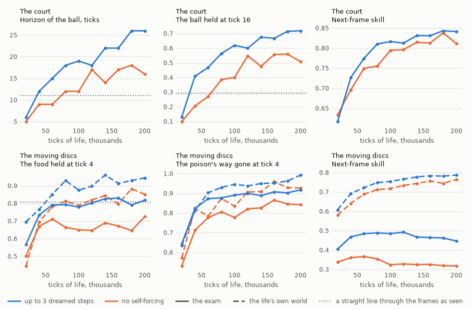

# vm-00122: Lives of 200k Ticks, Watching

**Date:** 2026-11-27
**Status:** Complete (one seed an arm: a look, not a measurement)
**Source:** `dev/` (pending tag `exp/vm-00122`)
**Outputs:** `~/data/research/visual-motor-agent/exp_00122/`
**Task plan:** [`../tasks/00135-long-lives.md`](../tasks/00135-long-lives.md)

## Goal

The owner, 2026-11-27, after vm-00121: "how about we run 200k runs for both worlds to see if it improves over time?"

The lives of vm-00119 to vm-00121 are 60k ticks long, and at 60k the watching transformer's dream was still getting better. Does it go on improving in a life more than three times as long, with and without training on its own dreamed frames, and do the things it has never seen catch up with the things it knows?

## Method

- **The model and the worlds** are vm-00120's: one transformer on the whole 64 x 64 frame, only watching (`configs/W1_discs.json`, `configs/W1_breakout.json`), with `online.steps = 200000` and a checkpoint every 10k ticks. Its memory holds 100k ticks; from there on the oldest go.
- **One seed an arm** (seed 1; the owner's rule of the same day: few seeds first). Its worlds are those of vm-00120's and vm-00121's seed 1.

| Arm | World | Self-forcing |
|---|---|---|
| OD | discs | none |
| SD3 | discs | 2 of the 7 replayed windows, up to 3 dreamed steps (vm-00121) |
| OB | the scripted court | none |
| SB3 | the scripted court | as SD3 |

- **The measures** are vm-00119's (`dev/wm_measures.py`, `pair`, the exam of seed 1001), at 20k, 40k, ..., 200k: next-frame skill, the dream of 32 ticks, the things held, and the course part of vm-00121. The disc lives are also scored on their own world after the life's end (64 starts from tick 200,000 on).
- **The run:** the two lives without self-forcing together on the RTX 3090 (2 h 46 min), the two with it on the RTX 4090 beside the scoring (3 h 05 min); about 21 ticks per second a life.

## Readings, set before the results

One seed an arm: a look, not a measurement. A change over time counts as seen only if it is larger than the spread among the six seeds of vm-00120 and vm-00121 at 60k (the 95% half-widths there: the ball's horizon 1.2 ticks, the food held at tick 4 on new discs .04, next-frame skill on new discs .15, in the court .013).

1. **Does it improve after 60k?** Per world and arm, 200k against 60k: the things held, next-frame skill, the way gone.
2. **Does self-forcing keep its gain?** In the court (+5.3 ticks of the ball's horizon at 60k in vm-00121): kept, grown or gone. On the disc world's exam: still without a gain or not.
3. **New discs against own discs:** does a longer life close the gap, or widen it?
4. **The marks:** a straight line through the last two frames holds a food disc for 10 ticks and a poison disc for 13; in the court the line through the window's 8 frames holds the ball for 11.

**What I expect** (written before the lives ran): the court keeps improving in both arms and self-forcing stays ahead; the life's own discs keep improving; on new discs the things held rise a little more and level off far below the mark, next-frame skill stays flat, and self-forcing still adds nothing there.

## Results

One seed an arm: every number below is one life's.

**In short: a longer life keeps improving what the life knows, and does nothing for what it has never seen.**

- **The court improves to the end, in both arms.** The ball is held for 16 dreamed ticks at 200k against 9 at 60k without self-forcing, and for 26 against 15 with it. A straight line through the window's 8 frames holds it for 11.
- **Self-forcing keeps its gain there** (+10 ticks at 200k, +6 at 60k). The life trained on its own dreamed frames held the ball after about 65k ticks as long as the other does at 200k.
- **The life's own discs improve to the end too:** the food held at dreamed tick 8 in .516 of the dreams against .266 at 60k, and .523 against .375 with self-forcing.
- **Discs the life has never seen do not improve after 60k:** the food held at tick 4 in .725 of the dreams against .711 at 60k, and .818 against .791 with self-forcing. Time does not replace variety.

*Solid: the exam. Dashed: the life's own world after its end (the disc lives). Blue: trained on up to 3 of its own dreamed steps; orange: no self-forcing. Dotted: a straight line through the frames as seen (the court: the window's 8 frames; the discs: the last two).*

### 1. Does it improve after 60k?

| Where | Measure | Arm | 60k | 100k | 200k | 200k less 60k |
|---|---|---|---|---|---|---|
| The court | The ball held, dreamed ticks | OB | 9 | 12 | 16 | +7 |
| The court | The ball held, dreamed ticks | SB3 | 15 | 19 | 26 | +11 |
| The court | The ball held at tick 16 | OB | .270 | .401 | .508 | +.238 |
| The court | The ball held at tick 16 | SB3 | .468 | .619 | .718 | +.250 |
| The court | Next-frame skill | OB | .750 | .794 | .811 | +.061 |
| The court | Next-frame skill | SB3 | .775 | .816 | .841 | +.067 |
| Own discs | The food held at tick 8 | OD | .266 | .336 | .516 | +.250 |
| Own discs | The food held at tick 8 | SD3 | .375 | .438 | .523 | +.148 |
| Own discs | The poison held, dreamed ticks | OD | 5 | 7 | 10 | +5 |
| Own discs | The poison held, dreamed ticks | SD3 | 8 | 8 | 11 | +3 |
| Own discs | Next-frame skill | OD | .689 | .718 | .764 | +.076 |
| Own discs | Next-frame skill | SD3 | .722 | .754 | .787 | +.065 |
| New discs | The food held at tick 4 | OD | .711 | .650 | .725 | +.014 |
| New discs | The food held at tick 4 | SD3 | .791 | .779 | .818 | +.027 |
| New discs | The food held at tick 8 | OD | .314 | .295 | .363 | +.049 |
| New discs | The food held at tick 8 | SD3 | .398 | .316 | .469 | +.070 |
| New discs | Next-frame skill | OD | .367 | .324 | .318 | −.048 |
| New discs | Next-frame skill | SD3 | .485 | .485 | .447 | −.038 |

- **The court: yes, in both arms, to the end.** The changes are several times the sizes set beforehand (1.2 ticks, .013). The second 100k still add +4 and +7 ticks of the ball's horizon. The life without self-forcing is uneven from 120k on (17, 14, 17, 18, 16 ticks; its highest point 18 at 180k).
- **The life's own discs: yes, in both arms, to the end.** The food held at tick 8 about doubles without self-forcing. A dreamed poison disc falls behind on its course less: at tick 4 it has gone .927 and .993 of its true way, against .783 and .903 at 60k.
- **New discs: nothing that one life can show.** The food held at tick 4, the number the reading names, changes by +.014 and +.027, less than the .04 set beforehand. The other things held rise a little (the food at tick 8 by +.049 and +.070, the horizons by 1 to 2 ticks), which is the size two runs of one seed differ by (below). Next-frame skill falls a little in both arms (−.048 and −.038; highest at 60k and 120k): far less than the .15 set beforehand, which is the spread across seeds, and more than two runs of one seed differ by there (+.012 and +.024 at 60k).

### 2. Does self-forcing keep its gain?

- **The court: kept, and no smaller at the end.** The ball's horizon: +6 ticks at 60k (vm-00121's six seeds: +5.3 ± 2.9), +7 at 100k, +10 at 200k, and between +1 and +10 from point to point. The ball held at tick 16: +.198 at 60k, +.210 at 200k. The next frame still pays nothing (+.030 at 200k).
- **In ticks of life:** the life without self-forcing ends at 16 dreamed ticks; the self-forced one held the ball for 15 at 60k and 18 at 80k, so it was there after about 65k ticks. With vm-00121's speeds (6.6 ticks per second against 11.1; here the arms ran on different cards) those ticks take the time of about 110k without self-forcing: it is ahead on the clock as well.
- **The life's own discs: kept, and shrinking.** Skill against the copy at tick 8: +.103 at 60k, +.071 at 100k, +.052 at 200k. The life without self-forcing ends at .679, where the self-forced one was at 80k (.679) and, after a dip, again at 120k (.685): it catches up slowly.
- **The disc world's exam: ahead at every tick in this seed, which is not evidence.** The food held at tick 4: +.080 at 60k, +.094 at 200k; next-frame skill +.128. Seed 1 is the seed in which self-forcing was furthest ahead at 60k among vm-00121's six (below). Whether self-forcing helps on new discs in a long life stays open: it needs a seed in which it did not at 60k.

### 3. New discs against own discs

The gap widens, in both arms. Next-frame skill, own discs less new ones: +.322 at 60k, +.394 at 100k and +.446 at 200k without self-forcing; +.237, +.269 and +.341 with it. The dream's skill against the copy at tick 8: +.079 at 60k and +.166 at 200k; +.063 and +.122. The own discs' side rises and the new discs' side does not: a longer life learns its four discs and eight dots more by heart.

The two sets differ in size (64 starts of one world against 256 starts of 16 worlds), so the own discs' numbers move more from point to point.

### 4. The marks

- **The court.** The life without self-forcing passes the line through the window's 8 frames (11 ticks) at 80k (12) and the line through the ball's true places (15) at 120k (17; at 140k it is below it once more). The self-forced life passes them at 40k (12) and 80k (18) and ends at 26 of the dream's 32 ticks.
- **The life's own discs: close.** On the life's own world the line through the last two frames holds the food for 9 ticks and the poison for 13. At 200k the lives hold the food for 8 and 8 and the poison for 10 and 11. At tick 4 both are past the line (the food held in .852 and .945 of the dreams against .797); at tick 8 just below it (.516 and .523 against .555).
- **New discs: far below, as at 60k.** The food is held for 6 and 7 ticks against the line's 10, the poison for 6 and 9 against 13.

### Against what I expected

- The court keeps improving in both arms and self-forcing stays ahead: right.
- The life's own discs keep improving: right.
- On new discs the things held rise a little more and level off far below the mark, and next-frame skill stays flat: about right. The rises are too small for one life to show, and next-frame skill is not flat but falls a little.
- Self-forcing still adds nothing on new discs: not answered by this seed.
- Not foreseen: that the gap between own and new discs widens from both sides, and that on its own discs the life without self-forcing catches up.

### How far one life can be trusted (added after the results)

- **The same seed run twice is not the same life.** The first 60k ticks of these lives repeat seed 1 of vm-00120 and vm-00121: the same world, the same settings, and `online.steps` enters nothing but the length. Lives on a card do not repeat bit for bit, and at 60k the two runs differ: the court's ball held for 15 dreamed ticks here against 17 there (SB3), the food held at tick 8 on new discs in .398 against .463 (SD3) and at tick 4 in .711 against .676 (OD), the court's next-frame skill .750 against .775 (OB). A step of that size between two points of a curve says nothing.
- **Seed 1 is the disc world's best seed of the six.** At 60k its lives had the highest next-frame skill on the exam in both arms of vm-00120 and vm-00121, and the largest gain from self-forcing in the food held at tick 4 (+.098; the six seeds' mean in vm-00121: −.003 ± .081). So that SD3 is ahead of OD on new discs here is the seed until another seed shows it.
- **What stands on one life:** changes several times these sizes that hold from point to point: the court's rise in both arms, the rise on the life's own discs, the court's gain from self-forcing, and that new discs do not follow.

### A dream of 1,000 ticks (added on the owner's request)

The owner, after the results: "I want you generate video where it starts for 20 tickes and then dream 1000 ticks". `make videos-long`: the life at 200k is given 20 real ticks and nothing before them, then dreams 1,000; four stretches a video, both arms beside the world, the true places outlined on the first 32 dreamed ticks.

What the videos show, by eye and by a scratch count over their four stretches a world (a look, not a measure; the script is not in the repository):

- **The court's dream ends in an empty court.** In all eight dreams the ball is missed, the last one seen at tick 57 to 585, and no new ball is ever served. In the world a new ball comes 9 ticks after a miss, and a ball is in play in .98 or more of the 1,000 ticks. Once the ball is gone the dreamed frames no longer change; in six of the eight dreams the paddle ends at the left wall. In one stretch both dreams miss within 2 ticks of the world's own miss, 54 ticks after the last real frame.
- **The discs' dream goes on to the end.** At ticks 901 to 1,000 as many pixels change a tick as in the world (134 to 181 against 153 to 177), and the discs stay discs: every one of the 16 dreams still shows its solid discs (two in 15, three in one) and 14 show a checkered one.
- **The dots are gone within about 100 ticks,** on the life's own world too (about 5 separate dots at the first dreamed tick, .5 or fewer at tick 100). On the exam, whose dots are new, only about 2 are drawn at the first dreamed tick.
- **Started from new discs, the dream grows them.** The pixels that are not background rise from the exam's 685 to about 800 within 100 ticks; the life's own world has about 825. My reading: the dream replaces discs it does not know by the ones it knows.
- **Why no ball is served** (my reading, not tested): after a miss the window holds 8 empty frames, which look the same one tick before the serve and nine. Where the new ball will be is then uncertain pixel by pixel, and the sharp decoding takes each pixel's most probable value: empty.

### The numbers by tick

A row is a curve. The third row of a measure is the difference between the two arms.

### The moving discs, the exam

| Measure | Arm | 20k | 40k | 60k | 80k | 100k | 120k | 140k | 160k | 180k | 200k |
|---|---|---|---|---|---|---|---|---|---|---|---|
| Next-frame skill | OD: no self-forcing | .338 | .361 | .367 | .355 | .324 | .328 | .325 | .326 | .319 | .318 |
| Next-frame skill | SD3: up to 3 dreamed steps | .405 | .468 | .485 | .489 | .485 | .493 | .467 | .465 | .462 | .447 |
| Next-frame skill | SD3 − OD | +.068 | +.107 | +.118 | +.134 | +.161 | +.164 | +.142 | +.139 | +.143 | +.128 |
| The food held at tick 4 | OD: no self-forcing | .500 | .670 | .711 | .664 | .650 | .646 | .689 | .672 | .646 | .725 |
| The food held at tick 4 | SD3: up to 3 dreamed steps | .566 | .734 | .791 | .793 | .779 | .803 | .826 | .830 | .791 | .818 |
| The food held at tick 4 | SD3 − OD | +.066 | +.064 | +.080 | +.129 | +.129 | +.156 | +.137 | +.158 | +.145 | +.094 |
| The food held at tick 8 | OD: no self-forcing | .137 | .264 | .314 | .256 | .295 | .275 | .307 | .301 | .326 | .363 |
| The food held at tick 8 | SD3: up to 3 dreamed steps | .223 | .312 | .398 | .371 | .316 | .412 | .434 | .451 | .377 | .469 |
| The food held at tick 8 | SD3 − OD | +.086 | +.049 | +.084 | +.115 | +.021 | +.137 | +.127 | +.150 | +.051 | +.105 |
| Horizon of the food, ticks | OD: no self-forcing | 4.0 | 5.0 | 5.0 | 5.0 | 5.0 | 5.0 | 5.0 | 5.0 | 5.0 | 6.0 |
| Horizon of the food, ticks | SD3: up to 3 dreamed steps | 4.0 | 6.0 | 6.0 | 6.0 | 6.0 | 6.0 | 7.0 | 7.0 | 6.0 | 7.0 |
| Horizon of the food, ticks | SD3 − OD | 0.0 | +1.0 | +1.0 | +1.0 | +1.0 | +1.0 | +2.0 | +2.0 | +1.0 | +1.0 |
| Horizon of the poison, ticks | OD: no self-forcing | 4.0 | 5.0 | 5.0 | 6.0 | 6.0 | 6.0 | 6.0 | 6.0 | 6.0 | 6.0 |
| Horizon of the poison, ticks | SD3: up to 3 dreamed steps | 4.0 | 6.0 | 7.0 | 8.0 | 8.0 | 9.0 | 8.0 | 9.0 | 8.0 | 9.0 |
| Horizon of the poison, ticks | SD3 − OD | 0.0 | +1.0 | +2.0 | +2.0 | +2.0 | +3.0 | +2.0 | +3.0 | +2.0 | +3.0 |
| Skill against the copy at tick 8 | OD: no self-forcing | .260 | .379 | .463 | .446 | .442 | .454 | .470 | .489 | .470 | .512 |
| Skill against the copy at tick 8 | SD3: up to 3 dreamed steps | .371 | .535 | .583 | .592 | .579 | .613 | .598 | .606 | .586 | .609 |
| Skill against the copy at tick 8 | SD3 − OD | +.111 | +.156 | +.119 | +.146 | +.137 | +.159 | +.127 | +.117 | +.116 | +.096 |
| The poison's way gone at tick 4 | OD: no self-forcing | .531 | .713 | .777 | .806 | .777 | .821 | .826 | .865 | .846 | .842 |
| The poison's way gone at tick 4 | SD3: up to 3 dreamed steps | .643 | .823 | .873 | .877 | .891 | .900 | .888 | .907 | .903 | .917 |
| The poison's way gone at tick 4 | SD3 − OD | +.112 | +.111 | +.096 | +.071 | +.114 | +.079 | +.062 | +.042 | +.057 | +.075 |

### The moving discs, the life's own world, after its end

| Measure | Arm | 20k | 40k | 60k | 80k | 100k | 120k | 140k | 160k | 180k | 200k |
|---|---|---|---|---|---|---|---|---|---|---|---|
| Next-frame skill | OD: no self-forcing | .580 | .641 | .689 | .712 | .718 | .734 | .744 | .757 | .745 | .764 |
| Next-frame skill | SD3: up to 3 dreamed steps | .608 | .692 | .722 | .748 | .754 | .766 | .778 | .783 | .782 | .787 |
| Next-frame skill | SD3 − OD | +.028 | +.051 | +.034 | +.037 | +.037 | +.032 | +.034 | +.027 | +.037 | +.023 |
| The food held at tick 4 | OD: no self-forcing | .445 | .695 | .781 | .812 | .789 | .820 | .844 | .797 | .883 | .852 |
| The food held at tick 4 | SD3: up to 3 dreamed steps | .695 | .766 | .852 | .930 | .875 | .898 | .961 | .914 | .930 | .945 |
| The food held at tick 4 | SD3 − OD | +.250 | +.070 | +.070 | +.117 | +.086 | +.078 | +.117 | +.117 | +.047 | +.094 |
| The food held at tick 8 | OD: no self-forcing | .070 | .258 | .266 | .281 | .336 | .344 | .438 | .453 | .438 | .516 |
| The food held at tick 8 | SD3: up to 3 dreamed steps | .203 | .305 | .375 | .398 | .438 | .445 | .586 | .570 | .555 | .523 |
| The food held at tick 8 | SD3 − OD | +.133 | +.047 | +.109 | +.117 | +.102 | +.102 | +.148 | +.117 | +.117 | +.008 |
| Horizon of the food, ticks | OD: no self-forcing | 3.0 | 5.0 | 6.0 | 6.0 | 6.0 | 6.0 | 7.0 | 7.0 | 7.0 | 8.0 |
| Horizon of the food, ticks | SD3: up to 3 dreamed steps | 4.0 | 6.0 | 7.0 | 7.0 | 7.0 | 7.0 | 8.0 | 9.0 | 8.0 | 8.0 |
| Horizon of the food, ticks | SD3 − OD | +1.0 | +1.0 | +1.0 | +1.0 | +1.0 | +1.0 | +1.0 | +2.0 | +1.0 | 0.0 |
| Horizon of the poison, ticks | OD: no self-forcing | 4.0 | 6.0 | 5.0 | 6.0 | 7.0 | 7.0 | 7.0 | 9.0 | 9.0 | 10.0 |
| Horizon of the poison, ticks | SD3: up to 3 dreamed steps | 4.0 | 7.0 | 8.0 | 9.0 | 8.0 | 9.0 | 10.0 | 11.0 | 10.0 | 11.0 |
| Horizon of the poison, ticks | SD3 − OD | 0.0 | +1.0 | +3.0 | +3.0 | +1.0 | +2.0 | +3.0 | +2.0 | +1.0 | +1.0 |
| Skill against the copy at tick 8 | OD: no self-forcing | .341 | .490 | .543 | .573 | .582 | .612 | .643 | .661 | .658 | .679 |
| Skill against the copy at tick 8 | SD3: up to 3 dreamed steps | .487 | .580 | .646 | .679 | .653 | .685 | .722 | .735 | .731 | .730 |
| Skill against the copy at tick 8 | SD3 − OD | +.146 | +.090 | +.103 | +.105 | +.071 | +.073 | +.079 | +.074 | +.073 | +.052 |
| The poison's way gone at tick 4 | OD: no self-forcing | .570 | .824 | .783 | .873 | .835 | .907 | .909 | .959 | .929 | .927 |
| The poison's way gone at tick 4 | SD3: up to 3 dreamed steps | .634 | .812 | .903 | .930 | .946 | .938 | .950 | .952 | .963 | .993 |
| The poison's way gone at tick 4 | SD3 − OD | +.064 | −.012 | +.120 | +.057 | +.111 | +.031 | +.041 | −.007 | +.034 | +.066 |

### The court, the exam

| Measure | Arm | 20k | 40k | 60k | 80k | 100k | 120k | 140k | 160k | 180k | 200k |
|---|---|---|---|---|---|---|---|---|---|---|---|
| Next-frame skill | OB: no self-forcing | .633 | .696 | .750 | .755 | .794 | .796 | .815 | .813 | .838 | .811 |
| Next-frame skill | SB3: up to 3 dreamed steps | .617 | .727 | .775 | .810 | .816 | .813 | .831 | .831 | .843 | .841 |
| Next-frame skill | SB3 − OB | −.016 | +.031 | +.025 | +.055 | +.022 | +.016 | +.017 | +.018 | +.005 | +.030 |
| The ball held at tick 8 | OB: no self-forcing | .335 | .562 | .610 | .681 | .681 | .821 | .773 | .793 | .809 | .781 |
| The ball held at tick 8 | SB3: up to 3 dreamed steps | .410 | .789 | .829 | .857 | .888 | .865 | .880 | .928 | .880 | .892 |
| The ball held at tick 8 | SB3 − OB | +.076 | +.227 | +.219 | +.175 | +.207 | +.044 | +.108 | +.135 | +.072 | +.112 |
| The ball held at tick 16 | OB: no self-forcing | .099 | .206 | .270 | .385 | .401 | .548 | .476 | .556 | .560 | .508 |
| The ball held at tick 16 | SB3: up to 3 dreamed steps | .131 | .409 | .468 | .563 | .619 | .599 | .675 | .667 | .714 | .718 |
| The ball held at tick 16 | SB3 − OB | +.032 | +.202 | +.198 | +.179 | +.218 | +.052 | +.198 | +.111 | +.155 | +.210 |
| Horizon of the ball, ticks | OB: no self-forcing | 5.0 | 9.0 | 9.0 | 12.0 | 12.0 | 17.0 | 14.0 | 17.0 | 18.0 | 16.0 |
| Horizon of the ball, ticks | SB3: up to 3 dreamed steps | 6.0 | 12.0 | 15.0 | 18.0 | 19.0 | 18.0 | 22.0 | 22.0 | 26.0 | 26.0 |
| Horizon of the ball, ticks | SB3 − OB | +1.0 | +3.0 | +6.0 | +6.0 | +7.0 | +1.0 | +8.0 | +5.0 | +8.0 | +10.0 |
| Horizon of the paddle, ticks | OB: no self-forcing | 18.0 | 24.0 | 28.0 | 31.0 | 31.0 | 32.0 | 31.0 | 32.0 | 32.0 | 32.0 |
| Horizon of the paddle, ticks | SB3: up to 3 dreamed steps | 20.0 | 28.0 | 32.0 | 32.0 | 32.0 | 32.0 | 32.0 | 32.0 | 32.0 | 32.0 |
| Horizon of the paddle, ticks | SB3 − OB | +2.0 | +4.0 | +4.0 | +1.0 | +1.0 | 0.0 | +1.0 | 0.0 | 0.0 | 0.0 |
| Skill against the copy at tick 8 | OB: no self-forcing | .539 | .627 | .674 | .702 | .695 | .763 | .760 | .778 | .790 | .765 |
| Skill against the copy at tick 8 | SB3: up to 3 dreamed steps | .539 | .684 | .734 | .766 | .789 | .788 | .782 | .816 | .816 | .834 |
| Skill against the copy at tick 8 | SB3 − OB | +.001 | +.057 | +.060 | +.064 | +.094 | +.025 | +.022 | +.038 | +.026 | +.069 |
| The ball's way gone at tick 8 | OB: no self-forcing | .982 | .936 | .952 | .962 | .981 | .962 | .945 | .959 | .943 | .965 |
| The ball's way gone at tick 8 | SB3: up to 3 dreamed steps | .924 | .960 | .965 | .966 | .982 | .979 | .968 | .984 | .978 | .984 |
| The ball's way gone at tick 8 | SB3 − OB | −.058 | +.024 | +.013 | +.004 | +.002 | +.017 | +.023 | +.025 | +.035 | +.019 |

The paddle's 32 ticks are the dream's length: it is held to the end.

## Checks

- **Every life's files** (711 checks, 0 failed): 22 checkpoints, a log that ends at tick 200,000 without an error, 200 rows of metrics, in the self-forced lives 2,000 dreamed windows per 1,000 ticks. Every scored checkpoint (40 on the exam, 20 on the lives' own world): the life it names, one transformer, 64 windows a pass, `pair`, both parts whole, no frame unsettled. The exam's floors in every file are the anchors' (the same exam at every tick).
- **The home set is after the life.** Its floors are the same in all 20 files and equal those worked out again from the world from tick 200,000 on, with no model. From tick 60,000 on they differ, and that working-out gives vm-00121's home set. No checkpoint was examined on ticks its life had lived.
- **At 60k against the six seeds of vm-00120 and vm-00121:** 19 of 24 numbers are within their range. The 5 outside are the disc lives a little above the best of the six, which is this seed: next-frame skill .367 against .355 (OD) and .485 against .461 (SD3), the food held at tick 4 .711 against .676 and .791 against .773, the poison's horizon 7 against 6 (SD3). The task plan asked for the lives without self-forcing to be within the range: OB is, OD is above it on two numbers of six.
- **Tests:** `tests/test_wm_curves.py` (4), `tests/test_wm_video.py` (4, with the long dream), `tests/test_wm_measures.py` (36, with the home set's start); the whole dev suite 2,134 passed, 34 skipped.

## Next

For the owner's word:

- **The disc world with variety** (discs and dots replaced now and then), with and without up to 3 dreamed steps, one seed an arm: the proposal after vm-00121. This look adds a reason: 140k more ticks of the same scene did nothing for new discs.
- **Up to 3 dreamed steps as the watching model's standard setting:** in the court about 65k ticks with it do what 200k do without, and it is ahead on the clock as well.
- **Not proposed:** more seeds of these lives. The one open question (self-forcing on new discs in a long life) is answered better in a world with variety.

## Files

- `Makefile`: `runs`, `anchors`, `score`, `home`, `curves`, `images`, `videos`, `videos-long`.
- `images/curves.png`: the curves (`make images`).
- Videos of the dreams at 200k beside the world (not in the repository), in `~/data/research/visual-motor-agent/exp_00122/videos/`: `court_seed1.mp4`, `discs_new_seed1.mp4`, `discs_own_seed1.mp4` (`make videos`: 8 watched ticks, a dream of 32 or 24); `court_long_seed1.mp4`, `discs_new_long_seed1.mp4`, `discs_own_long_seed1.mp4` (`make videos-long`: 20 watched ticks, a dream of 1,000; 86 seconds each).
- New in `dev/`: `wm_curves.py` (the numbers by tick as tables and as a picture; `tests/test_wm_curves.py`), `wm_measures.home_skip` (a life's home set starts after its last tick), and in `wm_video.py` the long dream (`--warm`, `--outline`, an exam as much longer as the dream).
