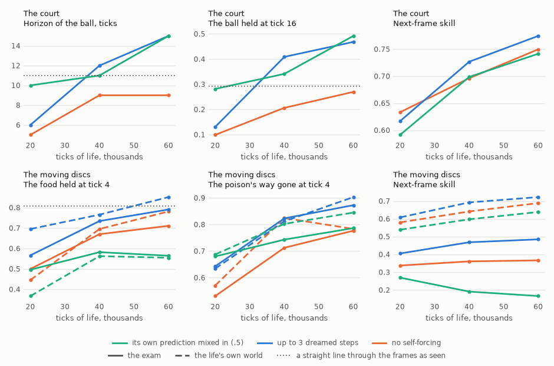
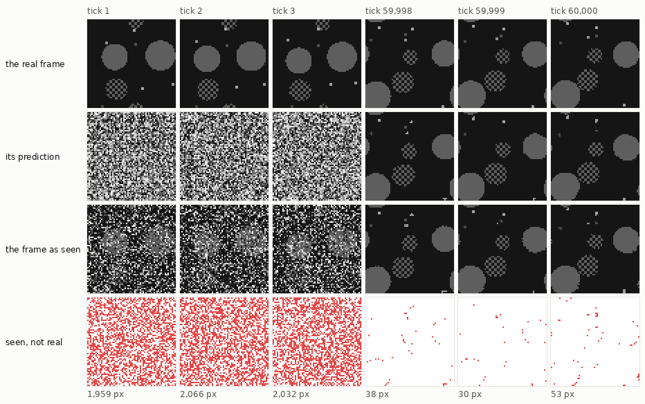

# vm-00123: The Model Sees Its Own Prediction Mixed into Every Frame

**Date:** 2026-11-27
**Status:** Complete (one seed an arm: a look, not a measurement)
**Source:** `exp/vm-00123` (code: `visual-motor-agent/dev/`)
**Outputs:** `~/data/research/visual-motor-agent/exp_00123/`
**Task plan:** [`../tasks/00136-mixed-frames.md`](../tasks/00136-mixed-frames.md)

## Goal

The owner, 2026-11-27, after the dream of 1,000 ticks of vm-00122 lost its ball and never served a new one:

> we need to add some sort of noise into the mix - so model learn to recover lost ball for example. And the way I'm thinking about that is - each time lets say 50% of pixels in current image comes from dream (prediction of the next) - so for current frame we take and swap 50% of random pixels with what was predicted on previous step and then we train that against real image - what is important - model sees only these 50% mixed images and newer full frame

And while it was being built: "replay - mix should be re-made each replay".

Does a model that is only ever shown such frames dream better: does it hold the things longer, does the next frame pay for it, and does its long dream still end in an empty court?

## Method

**The mix** (`online.mix = .5`; `online.mix_inputs`):

- **In the life, at every tick.** Before the model is shown the new frame it predicts it from what it has seen so far: its last 7 frames as it saw them, the bodies and the moves. The prediction is its sharp dream of one step (2 decoding passes that start from the frame before as seen, `pair`, as self-forcing makes its dreamed frames). A fresh draw for every pixel then takes it from the prediction with probability .5 and from the real frame otherwise. The model watches this frame and carries it in its window. Memory keeps the real frame only.
- **At every update** the mix is made again for all 8 windows (the newest and the 7 replayed), step by step, with the model as it is then: frame 2 is predicted from frame 1 as seen and mixed with a fresh mask, frame 3 from frames 1 and 2 as seen, and so on. The inputs are the frames as seen, the targets the real frames.
- **A frame with nothing before it** (the first of a window, the first tick of the life) is predicted from an empty frame: what the model expects of a frame it knows nothing about. It is mixed like every other, so the model is never given a whole real frame.
- **The body's values are not mixed.** The frame is predicted with the body the model itself predicted, so nothing of the tick being predicted enters its prediction.

**The lives:** the one watching transformer of vm-00120 (`configs/W1_discs.json`, `configs/W1_breakout.json`), 60k ticks, seed 1 (few seeds first).

| Arm | World | What it sees |
|---|---|---|
| MD | discs | `online.mix = .5` |
| MB | the scripted court | `online.mix = .5` |

Against seed 1 of the lives of vm-00122 at the same ticks: OD and OB (no self-forcing), SD3 and SB3 (up to 3 dreamed steps). At 60k each of those has a second run, seed 1 of vm-00120 and vm-00121.

**The cost:** the mix made again at every update is 16 decoding passes of 8 windows, 66 ms a tick on the RTX 4090. MB ran alone there at 12.3 ticks per second (1 h 21 min; a life without the mix alone: 54), MD alone on the RTX 3090 at 7.7 (2 h 11 min).

**The numbers:** vm-00119's measures (`dev/wm_measures.py`, `pair`, the exam of seed 1001) at 20k, 40k and 60k, the exam shown whole real frames as to every other model; the disc life also on its own world (the stretch vm-00122's lives were scored on: seed 1's world from tick 200,000 on). At 60k also with the exam shown as the life saw frames (`--lived`), and the free dream of 200 ticks (32 stretches).

## Readings, set before the results

One seed an arm: a look. Two runs of one seed differ at 60k by up to 2 ticks of the ball's horizon, .06 of the things held at a tick and .025 of next-frame skill (vm-00122). A difference from a baseline counts only if it is outside the range of that baseline's two runs by more than that.

1. **Does the mix hold the things longer in the dream than no self-forcing?** The court: the ball's horizon (OB 9 and 9, SB3 17 and 15) and the ball held at tick 16 (OB .230 and .270, SB3 .524 and .468). The discs: the food held at ticks 4 and 8, on the life's own world first, then on the exam.
2. **Does the next frame pay?** Next-frame skill shown whole frames (OB .775 and .750, OD .355 and .367).
3. **Shown frames as lived or whole:** does the model need the whole frame it never saw, or the mix it lived with?
4. **The long dream:** is the ball in the court longer, and is a new ball ever served?
5. **How wrong is the half it is shown?** The noise the idea adds is the model's own error, and it shrinks as the model learns.

**What I expect** (written before any checkpoint was scored):

- The court's ball is held longer than without self-forcing and less long than with it (a horizon of 11 to 14). Half of every frame is real, so a thing is always half in sight and the model is seldom made to carry it on its own prediction.
- Next-frame skill a little lower than OB's and OD's (by .01 to .03): half the input is the model's guess.
- Frames as lived and whole frames score about the same.
- The life's own discs are dreamed a little better than OD's, new discs no better.
- The long dream still ends in an empty court: nothing here makes a serve.
- The half it is shown is soon nearly right (in a trial of 600 ticks in the court, 0.75% of the pixels taken from the prediction were not the real ones), so late in life the mix adds little noise.

## Results

One seed an arm: every number below is one life's.

**In short: the mix gives the court's dream what self-forcing gives it, harms the disc world's, and does not mend a long dream.**

- **The court:** at 60k the ball is held for 15 dreamed ticks, against 9 and 9 in the two runs without self-forcing and 15 and 17 with it. The next frame is a little worse (.742 against .750 and .775).
- **The disc world:** the life with the mix is behind the plain one. The food is held at tick 4 in .555 of the dreams on its own discs against .781, and in .564 against .711 on new ones; next-frame skill on new discs falls through the life (.270, .191, .166).
- **The long dream is not mended.** In the free dream of 200 ticks the court life with the mix has 0.47 ball pixels left at tick 200 (a ball is 4), against 2.03 and 1.78. No dream serves a new ball.
- **The noise is the model's own error, and in the court it goes away:** at 60k 0.05% of the pixels taken from the prediction are not the real ones there (1 a frame); in the disc world 2.42% (50 a frame).

*Solid: the exam. Dashed: the life's own world (the disc lives). Green: its own prediction mixed in; blue: up to 3 dreamed steps (self-forcing); orange: neither. Dotted: a straight line through the frames as seen.*

*The court life's first three ticks and its last three: the real frame, the model's prediction of it, the frame as seen, and in red the pixels of the frame as seen that are not the real ones.*

*The same for the disc life: at the end its prediction is still wrong at the rims and in the checker.*

### 1. Does the mix hold the things longer in the dream?

**The court** (the exam; at 60k the baselines' two runs):

| Measure | Ticks | OB: neither | SB3: self-forcing | MB: the mix |
|---|---|---|---|---|
| The ball held, dreamed ticks | 20k | 5 | 6 | 10 |
| The ball held, dreamed ticks | 40k | 9 | 12 | 11 |
| The ball held, dreamed ticks | 60k | 9 and 9 | 15 and 17 | 15 |
| The ball held at tick 8 | 60k | .610 and .582 | .829 and .845 | .825 |
| The ball held at tick 16 | 20k | .099 | .131 | .282 |
| The ball held at tick 16 | 40k | .206 | .409 | .341 |
| The ball held at tick 16 | 60k | .270 and .230 | .468 and .524 | .492 |

- **Against no self-forcing: held longer, far beyond the yardstick.** At 60k +6 dreamed ticks and +.222 of the ball held at tick 16 against vm-00122's OB; OB's second run is no higher.
- **Against self-forcing: level.** MB's 15 ticks and .492 at tick 16 lie within SB3's two runs.
- **The curve is uneven:** ahead of both at 20k (10 ticks against 5 and 6), between them at 40k, level with self-forcing at 60k. A reading taken at 40k alone would have said otherwise: one life's curve is read at more than one point.

**The discs:**

| Measure | Where | Ticks | OD: neither | SD3: self-forcing | MD: the mix |
|---|---|---|---|---|---|
| The food held at tick 4 | own discs | 20k | .445 | .695 | .367 |
| The food held at tick 4 | own discs | 40k | .695 | .766 | .562 |
| The food held at tick 4 | own discs | 60k | .781 | .852 | .555 |
| The food held at tick 8 | own discs | 60k | .266 | .375 | .203 |
| Skill against the copy at tick 8 | own discs | 60k | .543 | .646 | .456 |
| The food held at tick 4 | new discs | 20k | .500 | .566 | .496 |
| The food held at tick 4 | new discs | 40k | .670 | .734 | .582 |
| The food held at tick 4 | new discs | 60k | .711 and .676 | .791 and .773 | .564 |
| The food held at tick 8 | new discs | 60k | .314 and .324 | .398 and .463 | .217 |
| The poison's way gone at tick 4 | new discs | 60k | .777 | .873 | .786 |

- **Its own discs: behind the plain life, at 40k and at 60k.** At 60k the food held at tick 4 −.227, at tick 8 −.062, the dream's skill against the copy at tick 8 −.086.
- **New discs: behind as well:** the food held at tick 4 −.146 against vm-00122's OD, at tick 8 −.098.
- **One thing is no worse:** a dreamed poison disc has gone .786 of its true way at tick 4 on new discs (.777 without self-forcing) and .845 on its own (.783).
- **Why the disc world loses** (my reading, not tested). Its prediction is still wrong in 2.42% of the pixels it lends at 60k. The poison is a checker of 2 px cells: a prediction 2 px off is its opposite, and mixed with the real one it scrambles the texture that says where the disc is. The court has no such texture, and its prediction is right almost everywhere.

### 2. Does the next frame pay?

| Next-frame skill, shown whole frames | Ticks | Neither | Self-forcing | The mix |
|---|---|---|---|---|
| The court | 20k | .633 | .617 | .591 |
| The court | 40k | .696 | .727 | .699 |
| The court | 60k | .750 and .775 | .775 and .775 | .742 |
| New discs | 20k | .338 | .405 | .270 |
| New discs | 40k | .361 | .468 | .191 |
| New discs | 60k | .367 and .355 | .485 and .461 | .166 |
| Own discs | 20k | .580 | .608 | .539 |
| Own discs | 40k | .641 | .692 | .597 |
| Own discs | 60k | .689 | .722 | .639 |

- **The court pays little:** −.008 against vm-00122's OB at 60k and +.002 at 40k; OB's second run is higher (.775). At the edge of the yardstick.
- **The disc world pays much:** −.050 on its own discs at 60k and −.200 on new ones. There its skill falls from 20k on while on its own discs it rises: shown half its own prediction, the model learns its own scene and little else.

### 3. Shown frames as lived, or whole frames

| At 60k | Whole real frames | Frames as lived |
|---|---|---|
| The court: next-frame skill | .742 | .688 |
| The court: the ball held, dreamed ticks | 15 | 15 |
| The court: the ball held at tick 8 | .825 | .765 |
| The court: the ball held at tick 16 | .492 | .492 |
| New discs: next-frame skill | .166 | −.107 |
| New discs: the food held at tick 4 | .564 | .514 |
| Own discs: next-frame skill | .639 | .526 |
| Own discs: the food held at tick 4 | .555 | .523 |

- **Neither model needs its mix to see.** Shown whole real frames, which it was never given in life, each predicts the next frame better than when shown frames as it lived, and holds the things at least as long.
- **In the disc world the frames as lived do harm:** on new discs the next frame is then worse than repeating the last one (a skill of −.107). Whole frames are both the fair comparison with every other model and the better way to read these.

### 4. The long dream

The free dream of 200 ticks at 60k, 32 stretches of the exam. The court: the bright pixels in the ball's zone, a mean over the dreams (a ball is 4; the world itself has 4.00 at tick 200):

| Dreamed tick | OB: neither | SB3: self-forcing | MB: the mix |
|---|---|---|---|
| 50 | 3.50 | 3.62 | 3.38 |
| 100 | 2.41 | 2.84 | 2.62 |
| 200 | 2.03 | 1.78 | 0.47 |

- **Up to about 100 dreamed ticks the three lives keep their ball about as often. After that the life with the mix loses it faster:** at tick 200 it has 0.47 ball pixels left a dream, about one dream in eight with a ball, where the others have about one in two.
- **No dream serves a new ball,** as in vm-00122. In the video's four stretches (a look, by a scratch count) the life with the mix sees its last ball at ticks 56 to 214; the one without self-forcing at 43 to 644, the self-forced one at 67 to 395 and in one stretch keeps it for all 1,000. In three of its four stretches the last ball leaves by the bottom row 2 to 4 px beside the dreamed paddle: the dream's paddle misses.
- **The disc world's free dream** grows new discs toward the size of the life's own, as vm-00122's did: 779.8 bright pixels at tick 200 where the world has 693 (OD 842, SD3 802.5).
- **So the owner's aim, a model that recovers a lost ball, is not reached by this mix.** It trains the model to mend a frame of which half is given, and a dream gives it none.

### 5. How wrong is the half it is shown?

Of the pixels taken from the prediction, the share that are not the real ones (and so many a frame), in the 1,000 ticks before:

| Tick | The court (MB) | The discs (MD) |
|---|---|---|
| 1k | 6.04% (124) | 23.21% (475) |
| 2k | 0.48% (10) | 14.37% (294) |
| 5k | 0.22% (4) | 4.53% (93) |
| 20k | 0.09% (2) | 2.89% (59) |
| 40k | 0.08% (2) | 2.56% (53) |
| 60k | 0.05% (1) | 2.42% (50) |

- **The court:** from 2k ticks on the prediction is nearly the real frame, and the frame as seen differs from it in a few pixels around the ball: what the mix adds is a ball drawn a pixel off, in half its pixels. The life's lead at 20k was made while its prediction was still wrong.
- **The disc world:** the prediction stays wrong in about one pixel in forty it lends, 50 a frame at 60k. In the record of the life's last 64 ticks (a count of mine) 97% of the prediction's wrong pixels lie at a rim or in a checker, where one pixel in eight is wrong; plain background and the inside of a food disc are right but for one pixel in a thousand.

### Against what I expected

- The court's ball held longer than without self-forcing and less long than with it (a horizon of 11 to 14): half right. It is held longer than without, and as long as with it.
- Next-frame skill a little lower, by .01 to .03: right in the court; in the disc world it is lower by far more.
- Frames as lived and whole frames about the same: wrong. Whole frames are better, in the disc world by much.
- The life's own discs dreamed a little better than OD's, new discs no better: wrong. Both are dreamed worse.
- The long dream still ends in an empty court: right, and it empties sooner than the others', which I did not expect.
- The half it is shown is soon nearly right: right in the court, not in the disc world.

### The numbers by tick

A row is a curve. OD, SD3, OB and SB3 are vm-00122's lives at the same ticks.

### The moving discs, the exam

| Measure | Arm | 20k | 40k | 60k |
|---|---|---|---|---|
| Next-frame skill | OD: no self-forcing | .338 | .361 | .367 |
| Next-frame skill | SD3: up to 3 dreamed steps | .405 | .468 | .485 |
| Next-frame skill | MD: its own prediction mixed in (.5) | .270 | .191 | .166 |
| The food held at tick 4 | OD: no self-forcing | .500 | .670 | .711 |
| The food held at tick 4 | SD3: up to 3 dreamed steps | .566 | .734 | .791 |
| The food held at tick 4 | MD: its own prediction mixed in (.5) | .496 | .582 | .564 |
| The food held at tick 8 | OD: no self-forcing | .137 | .264 | .314 |
| The food held at tick 8 | SD3: up to 3 dreamed steps | .223 | .312 | .398 |
| The food held at tick 8 | MD: its own prediction mixed in (.5) | .141 | .238 | .217 |
| Horizon of the food, ticks | OD: no self-forcing | 4.0 | 5.0 | 5.0 |
| Horizon of the food, ticks | SD3: up to 3 dreamed steps | 4.0 | 6.0 | 6.0 |
| Horizon of the food, ticks | MD: its own prediction mixed in (.5) | 3.0 | 4.0 | 4.0 |
| Horizon of the poison, ticks | OD: no self-forcing | 4.0 | 5.0 | 5.0 |
| Horizon of the poison, ticks | SD3: up to 3 dreamed steps | 4.0 | 6.0 | 7.0 |
| Horizon of the poison, ticks | MD: its own prediction mixed in (.5) | 4.0 | 4.0 | 4.0 |
| Skill against the copy at tick 8 | OD: no self-forcing | .260 | .379 | .463 |
| Skill against the copy at tick 8 | SD3: up to 3 dreamed steps | .371 | .535 | .583 |
| Skill against the copy at tick 8 | MD: its own prediction mixed in (.5) | .262 | .331 | .351 |
| The poison's way gone at tick 4 | OD: no self-forcing | .531 | .713 | .777 |
| The poison's way gone at tick 4 | SD3: up to 3 dreamed steps | .643 | .823 | .873 |
| The poison's way gone at tick 4 | MD: its own prediction mixed in (.5) | .680 | .743 | .786 |

### The moving discs, the life's own world, after its end

| Measure | Arm | 20k | 40k | 60k |
|---|---|---|---|---|
| Next-frame skill | OD: no self-forcing | .580 | .641 | .689 |
| Next-frame skill | SD3: up to 3 dreamed steps | .608 | .692 | .722 |
| Next-frame skill | MD: its own prediction mixed in (.5) | .539 | .597 | .639 |
| The food held at tick 4 | OD: no self-forcing | .445 | .695 | .781 |
| The food held at tick 4 | SD3: up to 3 dreamed steps | .695 | .766 | .852 |
| The food held at tick 4 | MD: its own prediction mixed in (.5) | .367 | .562 | .555 |
| The food held at tick 8 | OD: no self-forcing | .070 | .258 | .266 |
| The food held at tick 8 | SD3: up to 3 dreamed steps | .203 | .305 | .375 |
| The food held at tick 8 | MD: its own prediction mixed in (.5) | .117 | .172 | .203 |
| Horizon of the food, ticks | OD: no self-forcing | 3.0 | 5.0 | 6.0 |
| Horizon of the food, ticks | SD3: up to 3 dreamed steps | 4.0 | 6.0 | 7.0 |
| Horizon of the food, ticks | MD: its own prediction mixed in (.5) | 3.0 | 4.0 | 4.0 |
| Horizon of the poison, ticks | OD: no self-forcing | 4.0 | 6.0 | 5.0 |
| Horizon of the poison, ticks | SD3: up to 3 dreamed steps | 4.0 | 7.0 | 8.0 |
| Horizon of the poison, ticks | MD: its own prediction mixed in (.5) | 4.0 | 5.0 | 4.0 |
| Skill against the copy at tick 8 | OD: no self-forcing | .341 | .490 | .543 |
| Skill against the copy at tick 8 | SD3: up to 3 dreamed steps | .487 | .580 | .646 |
| Skill against the copy at tick 8 | MD: its own prediction mixed in (.5) | .287 | .441 | .456 |
| The poison's way gone at tick 4 | OD: no self-forcing | .570 | .824 | .783 |
| The poison's way gone at tick 4 | SD3: up to 3 dreamed steps | .634 | .812 | .903 |
| The poison's way gone at tick 4 | MD: its own prediction mixed in (.5) | .687 | .802 | .845 |

### The court, the exam

| Measure | Arm | 20k | 40k | 60k |
|---|---|---|---|---|
| Next-frame skill | OB: no self-forcing | .633 | .696 | .750 |
| Next-frame skill | SB3: up to 3 dreamed steps | .617 | .727 | .775 |
| Next-frame skill | MB: its own prediction mixed in (.5) | .591 | .699 | .742 |
| The ball held at tick 8 | OB: no self-forcing | .335 | .562 | .610 |
| The ball held at tick 8 | SB3: up to 3 dreamed steps | .410 | .789 | .829 |
| The ball held at tick 8 | MB: its own prediction mixed in (.5) | .606 | .641 | .825 |
| The ball held at tick 16 | OB: no self-forcing | .099 | .206 | .270 |
| The ball held at tick 16 | SB3: up to 3 dreamed steps | .131 | .409 | .468 |
| The ball held at tick 16 | MB: its own prediction mixed in (.5) | .282 | .341 | .492 |
| Horizon of the ball, ticks | OB: no self-forcing | 5.0 | 9.0 | 9.0 |
| Horizon of the ball, ticks | SB3: up to 3 dreamed steps | 6.0 | 12.0 | 15.0 |
| Horizon of the ball, ticks | MB: its own prediction mixed in (.5) | 10.0 | 11.0 | 15.0 |
| Horizon of the paddle, ticks | OB: no self-forcing | 18.0 | 24.0 | 28.0 |
| Horizon of the paddle, ticks | SB3: up to 3 dreamed steps | 20.0 | 28.0 | 32.0 |
| Horizon of the paddle, ticks | MB: its own prediction mixed in (.5) | 24.0 | 28.0 | 32.0 |
| Skill against the copy at tick 8 | OB: no self-forcing | .539 | .627 | .674 |
| Skill against the copy at tick 8 | SB3: up to 3 dreamed steps | .539 | .684 | .734 |
| Skill against the copy at tick 8 | MB: its own prediction mixed in (.5) | .590 | .655 | .709 |
| The ball's way gone at tick 8 | OB: no self-forcing | .982 | .936 | .952 |
| The ball's way gone at tick 8 | SB3: up to 3 dreamed steps | .924 | .960 | .965 |
| The ball's way gone at tick 8 | MB: its own prediction mixed in (.5) | .939 | .951 | .978 |

## Checks

- **Every life's files** (191 checks, 0 failed): 7 checkpoints and the final one, a log that ends at tick 60,000 without an error, 60 rows of metrics with a mixed share of .5 in each, the record of what the life was shown (every recorded pixel is the prediction's or the real one, as its mask says). Every scored checkpoint: the life it names, one transformer, 64 windows a pass, `pair`, both parts whole, no frame unsettled; the exam's floors are the anchors', the home set's those of vm-00122's lives (the same stretch); the files scored as lived say so.
- **The option:** `tests/test_mix.py` (24): a pixel is the prediction's or the real one; no real frame enters its own prediction; a window made in parts is one made whole; a frame with nothing before it; a short life is never shown a whole real frame, its first tick included; what the option is refused with; the exam shown as lived repeats.
- **Tests:** `tests/test_mix_strip.py` (1), `tests/test_wm_curves.py` (5), `tests/test_wm_measures.py` (36, with the later home set); the whole dev suite 2,160 passed, 34 skipped.

## Next

- **vm-00124, by the owner's word (done 2026-11-27, [its report](../00124-mix-shares/README.md)):** the same mix with .7 of the pixels from the prediction, and with .5 from the prediction and .2 a random grey. Neither does better than .5.
- **For the owner's word, mine:** in the court the mix together with self-forcing (in the code and tested, not run): the two reach the same dream by different means, and self-forcing alone trains what a dream needs, frames with no real pixel. In the disc world nothing of this kind before the world has variety (vm-00122).

## Files

- `Makefile`: `runs`, `anchors`, `score`, `home`, `lived`, `free`, `free-base`, `curves`, `images`, `videos-long` (`video-court`, `video-discs`).
- `images/curves.png` (the curves), `images/seen_MB.png`, `images/seen_MD.png` (what the lives were shown; `make images`).
- Videos (not in the repository), in `~/data/research/visual-motor-agent/exp_00123/videos/`: `court_long_seed1.mp4`, `discs_new_long_seed1.mp4`: 20 watched ticks, then a dream of 1,000, the life with the mix beside vm-00122's two at 60k (`make videos-long`).
- New in `dev/`: `online.mix`, `online.mix_jacobi`, `online.mix_record` (`online.mix_inputs`, `lifetime.py`); `wm_measures.py score --lived` and `--home-from`; `wm_video.py --lived`; `wm_curves.py` with arms of another output folder; `mix_strip.py`; `tests/test_mix.py`, `tests/test_mix_strip.py`.
