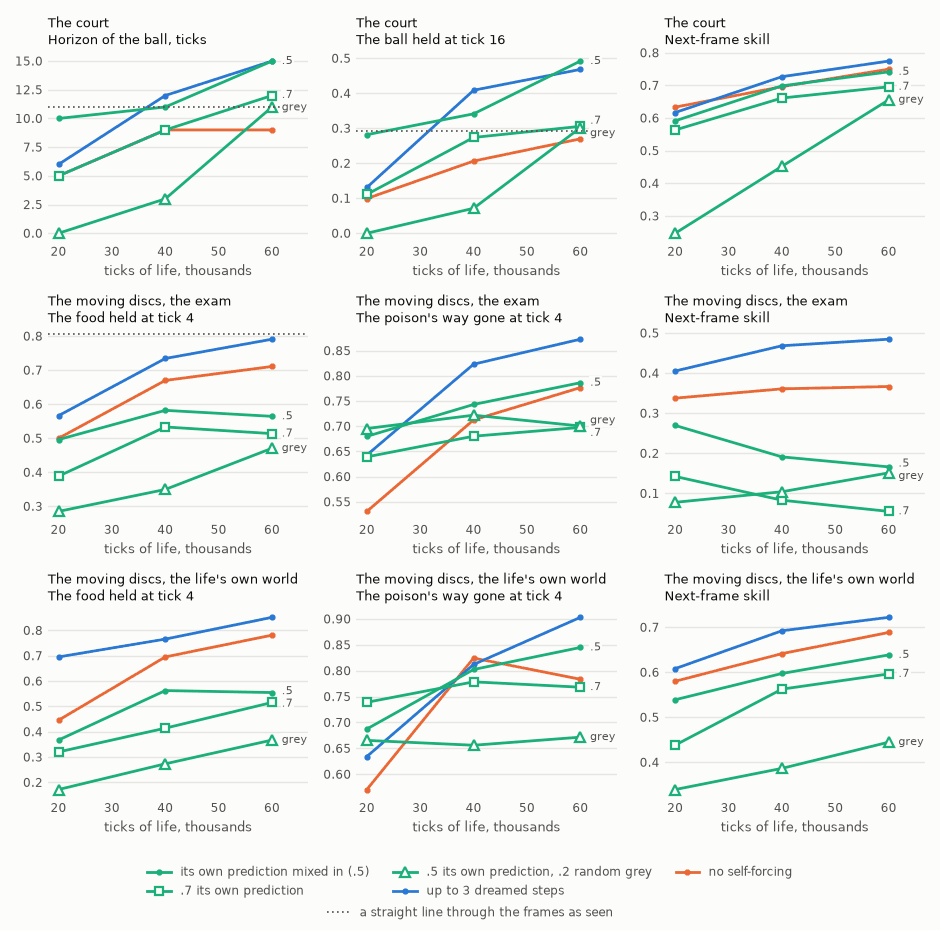
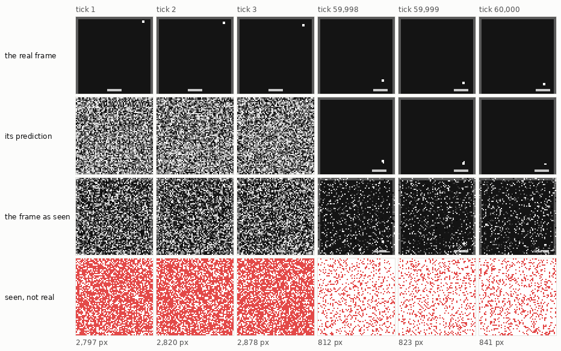
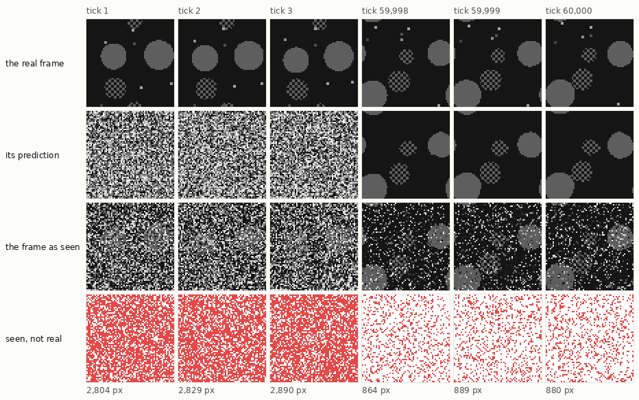

# vm-00124: What the Mix Is Made of: More Prediction, and Random Grey

**Date:** 2026-11-27
**Status:** Complete (one seed an arm: a look, not a measurement)
**Source:** `dev/` (pending tag `exp/vm-00124`)
**Outputs:** `~/data/research/visual-motor-agent/exp_00124/`
**Task plan:** [`../tasks/00137-mix-shares.md`](../tasks/00137-mix-shares.md)

## Goal

The owner, 2026-11-27, while vm-00123 ran: "and next experiment once this one is finished - lets do 70% mix from next frame and 30% keep from real and yet another experiment - 30% real, 50% from prediction and 20% just grey noise".

vm-00123 shows the watching transformer only frames in which half the pixels come from its own prediction of that frame. What should that mix be made of: more of the prediction, or noise that is not the model's own?

## Method

**The mix** is vm-00123's (`online.mix`, `online.mix_inputs`): at every tick the model predicts the coming frame from what it has seen, and each pixel of the frame it is shown is drawn anew; the targets and memory are the real frames, and the mix is made again at every update.

| Arms | From its prediction | Random grey | Real | Options |
|---|---|---|---|---|
| M7D, M7B | .7 | none | .3 | `online.mix = .7` |
| MND, MNB | .5 | .2 | .3 | `online.mix = .5`, `online.mix_noise = .2` |

D: the disc world (`configs/W1_discs.json`); B: the scripted court (`configs/W1_breakout.json`). Seed 1, 60k ticks (few seeds first).

**Random grey** (`online.mix_noise`, new here): such a pixel is a grey level drawn uniformly from 0 to 255, fresh at every tick and at every update. It is part of the frame as seen: the model carries it in its window.

Against vm-00123's MD and MB (.5 from its prediction, .5 real) and vm-00122's OD, SD3, OB and SB3 at the same ticks; at 60k OD, SD3, OB and SB3 have a second run each (seed 1 of vm-00120 and vm-00121).

**The run:** M7B and MNB together on the RTX 4090 (8.7 and 8.2 ticks per second; 1 h 55 min and 2 h 02 min), M7D on the RTX 3090 (7.0; 2 h 22 min), then MND on the RTX 4090 (11.2; 1 h 30 min).

**The numbers** are vm-00123's: vm-00119's measures at 20k, 40k and 60k with the exam shown whole real frames; the disc lives also on their own world (the stretch vm-00122's lives were scored on); at 60k the exam shown as the life saw frames, and the free dream of 200 ticks.

## Readings, set before the results

One seed an arm: a look. A difference counts only if it is outside what two runs of one seed differ by at 60k (2 ticks of the ball's horizon, .06 of the things held at a tick, .025 of next-frame skill; vm-00122).

1. **More prediction (.7 against .5):** are the things held longer in the dream, and what does the next frame pay?
2. **Random grey (.5 with .2 grey against .5):** the same two questions. Does noise that does not shrink do more than noise that does?
3. **Shown whole frames or frames as lived:** a model that lived with random grey may need its grey to see as it learnt to.
4. **The long dream:** is a ball in the court longer, is one ever served?

**What I expect** (written before any life of this experiment ran, with vm-00123's court life scored only at 10k):

- .7: the dream a little better than at .5 and the next frame a little worse; the differences small, because late in life the prediction is nearly the real frame at either share.
- Random grey: next-frame skill shown whole frames clearly lower than without it; the dream no better than at .5. A random grey is not an error the model makes, so learning to see through it does not teach it to mend its own dream.
- Neither serves a ball in the long dream.

## Results

One seed an arm: every number below is one life's.

**In short: neither make does better than the half-and-half mix of vm-00123, and both pay more for it.** More of its own prediction (.7) holds the court's ball less long and dreams the discs a little worse. Random grey learns to see late, is behind in both worlds, and its long dream loses the ball soonest.

- **The court at 60k:** the ball is held for 12 dreamed ticks at .7 and 11 with random grey, against 15 at .5 (9 and 9 with neither, 15 and 17 with self-forcing). The next frame pays more: .696 and .656 against .742.
- **Random grey learns to see late:** at 20k its dream holds the ball at no tick, at 40k for 3 ticks, at 60k for 11: it is still climbing when the life ends.
- **The disc world:** every mix is behind the plain life, .7 a little behind .5 and random grey far behind. The food held at tick 4 on the life's own discs: .555 at .5, .516 at .7, .367 with random grey, against .781.
- **Whole frames are again the better input,** also for the model that lived with random grey: it does not need its grey to see.
- **The long dream is not mended.** In the free dream of 200 ticks the court's ball is lost sooner with every mix than without one, with random grey soonest (0.00 ball pixels left at tick 200; 1.34 at .7, 0.47 at .5, 2.03 and 1.78 without a mix). No dream serves a new ball: every life expects the serve when it is due but not where, and the sharp decoding then draws nothing (a scratch test).
- **One thing the noisier makes do** (a look, by a scratch count): a ball their dream drops for 3 to 5 ticks is sometimes drawn again, twice in 32 dreams at .7 and 4 times with random grey, never at .5. That is the recovery the owner's idea aims at, but only while the ball is still in the window of 8 ticks.

*A row for the court, for new discs (the exam) and for the life's own discs. Green: its own prediction mixed in, of three makes that differ by their marker and the label at the line's end: .5 (vm-00123), .7, and .5 with .2 random grey ("grey"). Blue: up to 3 dreamed steps (self-forcing); orange: neither. Dotted: a straight line through the frames as seen.*

*The court life with random grey, its first three ticks and its last three: the real frame, the model's prediction of it, the frame as seen (a fifth of its pixels a random grey), and in red the pixels of the frame as seen that are not the real ones. In the frame as seen the ball is 4 bright pixels among some hundreds of bright specks: my reading of why this life learns the ball so late.*

*The same for the disc life with random grey.*

### 1 and 2. The dream: more prediction, and random grey

**The court** (the exam; at 60k OB's and SB3's two runs):

| Measure | Ticks | OB: neither | SB3: self-forcing | MB: .5 | M7B: .7 | MNB: .5, .2 grey |
|---|---|---|---|---|---|---|
| The ball held, dreamed ticks | 20k | 5 | 6 | 10 | 5 | 0 |
| The ball held, dreamed ticks | 40k | 9 | 12 | 11 | 9 | 3 |
| The ball held, dreamed ticks | 60k | 9 and 9 | 15 and 17 | 15 | 12 | 11 |
| The ball held at tick 8 | 60k | .610 and .582 | .829 and .845 | .825 | .709 | .633 |
| The ball held at tick 16 | 60k | .270 and .230 | .468 and .524 | .492 | .306 | .302 |

- **.7 against .5: the ball is held less long.** At 60k 12 dreamed ticks against 15 (−3, outside the 2 ticks two runs differ by), and at tick 16 in .306 of the dreams against .492 (−.187). It is behind at 20k and 40k too.
- **Random grey against .5: less long as well:** 11 ticks (−4) and .302 at tick 16 (−.190). It comes from far behind. At 20k its dream holds the ball at no tick (a look at its frames then, mine: it draws no ball at all), and from 40k to 60k it goes from 3 ticks to 11. Its curve is the steepest at the end: where a longer life would take it is not known.
- **Against a life with neither** (9 and 9 ticks): +3 and +2 ticks, the first just outside the yardstick and the second at its edge. At tick 16 neither is ahead by more than the yardstick (.270 and .230).
- **Neither reaches self-forcing** (15 and 17 ticks), which the half-and-half mix did.

**The discs:**

| Measure | Where | Ticks | OD: neither | SD3: self-forcing | MD: .5 | M7D: .7 | MND: .5, .2 grey |
|---|---|---|---|---|---|---|---|
| The food held at tick 4 | own discs | 20k | .445 | .695 | .367 | .320 | .172 |
| The food held at tick 4 | own discs | 40k | .695 | .766 | .562 | .414 | .273 |
| The food held at tick 4 | own discs | 60k | .781 | .852 | .555 | .516 | .367 |
| Skill against the copy at tick 8 | own discs | 60k | .543 | .646 | .456 | .438 | .373 |
| The food held at tick 4 | new discs | 60k | .711 and .676 | .791 and .773 | .564 | .514 | .471 |
| The food held at tick 8 | new discs | 60k | .314 and .324 | .398 and .463 | .217 | .209 | .115 |

- **.7 against .5: a little behind.** At 60k the food held at tick 4 is −.039 on the life's own discs and −.051 on new ones: each inside the yardstick, but the same way on both sets and at every scored tick (on its own discs −.047 at 20k and −.148 at 40k).
- **Random grey against .5: far behind on the life's own discs,** the food held at tick 4 −.188 and the dream's skill against the copy at tick 8 −.083; behind on new discs too (−.094 at tick 4, −.102 at tick 8).
- **Every mix is behind the plain life** on both sets, and self-forcing is ahead of it.
- **What was no worse at .5 is worse with both makes:** a dreamed poison disc has gone .698 and .700 of its true way at tick 4 on new discs, against .786 at .5 and .777 with neither.

### What the next frame pays

| Next-frame skill, shown whole frames | Ticks | Neither | Self-forcing | .5 | .7 | .5, .2 grey |
|---|---|---|---|---|---|---|
| The court | 20k | .633 | .617 | .591 | .563 | .247 |
| The court | 40k | .696 | .727 | .699 | .661 | .452 |
| The court | 60k | .750 and .775 | .775 and .775 | .742 | .696 | .656 |
| New discs | 60k | .367 and .355 | .485 and .461 | .166 | .055 | .151 |
| Own discs | 20k | .580 | .608 | .539 | .438 | .339 |
| Own discs | 40k | .641 | .692 | .597 | .563 | .386 |
| Own discs | 60k | .689 | .722 | .639 | .596 | .445 |

- **The court: each make pays more.** At 60k .742 at .5, .696 at .7 (−.046) and .656 with random grey (−.086); the plain life's two runs have .750 and .775.
- **Random grey learns to see late:** .247 at 20k, where the other four court lives have .563 to .633, and .452 at 40k.
- **New discs: at .7 the next frame is all but lost,** .055 against .166 at .5 and .367 and .355 with neither. A skill of 0 is repeating the last frame.
- **Random grey on new discs is level with .5 at 60k** (.151, −.015: inside the yardstick), and it is the only mix whose curve rises there: .078, .104, .151, where .5 falls (.270, .191, .166) and .7 falls (.142, .083, .055).
- **The life's own discs: random grey pays most,** .445 against .639 at .5, .596 at .7 and .689 with neither.

### 3. Shown whole frames, or frames as lived

| At 60k | M7B whole | M7B as lived | MNB whole | MNB as lived |
|---|---|---|---|---|
| Next-frame skill | .696 | .511 | .656 | .466 |
| The ball held, dreamed ticks | 12 | 10 | 11 | 8 |
| The ball held at tick 8 | .709 | .570 | .633 | .546 |

| At 60k | M7D whole | M7D as lived | MND whole | MND as lived |
|---|---|---|---|---|
| New discs: next-frame skill | .055 | −.262 | .151 | −.237 |
| New discs: the food held at tick 4 | .514 | .479 | .471 | .387 |
| Own discs: next-frame skill | .596 | .405 | .445 | .259 |
| Own discs: the food held at tick 4 | .516 | .477 | .367 | .477 |

- **Whole frames are again the better input:** for the next frame in every life, and for the court's ball. The court's next-frame skill shown as lived against shown whole is −.185 at .7 and −.190 with random grey (−.053 at .5, vm-00123); the ball is held for 10 and 8 dreamed ticks in place of 12 and 11.
- **The model that lived with random grey does not need its grey to see** (reading 3). Shown whole frames, which it never saw, it predicts the next frame better in both worlds and holds the court's ball longer than shown frames with a fifth of the pixels a random grey, as it lived.
- **In the disc world frames as lived are worse than repeating the last frame** on new discs: a next-frame skill of −.262 at .7 and −.237 with random grey (−.107 at .5). The dreamed food is held a little less well as lived on new discs (−.035 and −.084 at tick 4).
- **One number goes the other way:** on its own discs the life with random grey holds the food at tick 4 in .477 of the dreams as lived against .367 shown whole. The home set, 64 starts of one world, is the set that moves most from point to point; its next frame there is still worse as lived (−.186).

### 4. The long dream

The free dream of 200 ticks at 60k, 32 stretches of the exam. The court: the bright pixels in the ball's zone, a mean over the dreams (a ball is 4):

| Dreamed tick | OB: neither | SB3: self-forcing | MB: .5 | M7B: .7 | MNB: .5, .2 grey |
|---|---|---|---|---|---|
| 50 | 3.50 | 3.62 | 3.38 | 3.31 | 2.19 |
| 100 | 2.41 | 2.84 | 2.62 | 2.53 | 0.66 |
| 200 | 2.03 | 1.78 | 0.47 | 1.34 | 0.00 |

The same 32 dreams by a scratch count of mine (not one of the repository's tools): the dreams with a ball in the court, the new balls served, and the balls that come back (no ball in the court for 3 ticks or more, then a ball again for 3 or more, away from the top rows where the world serves).

| Of 32 dreams of 200 ticks | The world itself | OB: neither | SB3: self-forcing | MB: .5 | M7B: .7 | MNB: .5, .2 grey |
|---|---|---|---|---|---|---|
| A ball in the court at tick 100 | 31 | 18 | 21 | 19 | 18 | 5 |
| A ball in the court at tick 200 | 32 | 16 | 14 | 3 | 10 | 0 |
| New balls served | 11 | 0 | 0 | 0 | 0 | 0 |
| Balls that come back | 0 | 1 | 2 | 0 | 2 | 4 |
| The last ball seen, median tick | 200 | 185 | 145 | 117 | 116 | 66 |

- **Every mix loses the ball sooner than the lives without one, random grey soonest.** Up to tick 100 only random grey is behind: a ball in 5 dreams of 32 where the other four lives have 18 to 21, and at tick 200 in none. At .7 more dreams keep a ball to tick 200 than at .5 (10 against 3), fewer than without a mix (16 and 14).
- **No dream serves a new ball.** The world itself serves 11 times in these stretches, at the top of the court; why the dreams do not is tested below.
- **The noisier makes sometimes draw a dropped ball again.** With random grey a ball is back 4 times after 3 to 4 ticks without one, at .7 twice after 3 and 5 ticks, each time in the open court (rows 25 to 48 of 64). At .5 it never happens. The three returns without a mix are of another kind: at the paddle's rows (rows 56 to 58), and with self-forcing after 28 and 121 empty ticks, a ball out of nothing.
- **A first sign of what the owner's idea aims at, and its limit** (counts this small are a look and no more). A model that must look through noise does sometimes draw a ball again that was gone for a few ticks, while the frames before the gap are still in its window of 8 ticks. With random grey it also loses the ball for good far sooner, and at any share a ball that has left the window does not come back: 8 empty frames give the model nothing to mend.
- **The video's four stretches** (20 watched ticks, then 1,000 dreamed, each life watching as it lived; the same scratch count): the last ball is seen at ticks 56 to 214 at .5, 107 to 406 at .7 and 46 to 90 with random grey. After it every dream is an empty court to the end.
- **The disc world's free dream:** at .7 it grows new discs toward the size of the life's own, as at .5: 783.5 pixels that are not background at tick 200 where the world has 693 (MD 779.8). With random grey it does not: 666.5.

**Why no ball is served** (a scratch test of mine on the 60k checkpoints; it corrects my reading in vm-00122, which blamed the window as well). The world serves at a column drawn at random, after 8 or 9 frames without a ball (37 and 36 of the exam's 73 serves). Each life is shown the real frames up to a serve, and its prediction of the next frame is read as the expected value (`mean`): the brightness above the background in the court's top rows, in ball pixels (a served ball is 4).

| The predicted frame | OB: neither | SB3: self-forcing | MB: .5 | M7B: .7 | MNB: .5, .2 grey |
|---|---|---|---|---|---|
| The serve's own tick | 0.92 | 0.85 | 0.58 | 1.22 | 0.62 |
| One tick before | 0.94 | 0.83 | 0.56 | 1.19 | 0.60 |
| Two ticks before | 0.20 | 0.09 | 0.01 | 0.03 | 0.10 |
| Four ticks before | 0.00 | 0.00 | 0.00 | 0.00 | 0.00 |
| The serve's own tick, decoded with `pair` | 0.00 | 0.00 | 0.00 | 0.00 | 0.00 |

- **Every life expects the serve when it is due, and does not know where.** In the last two ticks before a serve its expected frame holds a band of brightness in the top rows, spread over the columns (the brightest pixel has 1% to 5% of a ball's brightness); four ticks before there is none.
- **`pair` draws each pixel's most probable value, and at every column that is empty.** So the dreamed frame is empty, the next tick's window is as empty, and so on to the end. The missing serve is a matter of the decoding: not of the window, and not of noise in what the model sees.

### How wrong is the part it is shown?

Not one of the four readings; as in vm-00123. Of the pixels taken from the prediction, the share that are not the real ones (and so many a frame), in the 1,000 ticks before:

| Tick | MB: .5 | M7B: .7 | MNB: .5, .2 grey | MD: .5 | M7D: .7 | MND: .5, .2 grey |
|---|---|---|---|---|---|---|
| 2k | 0.48% (10) | 0.56% (16) | 0.71% (14) | 14.37% (294) | 14.53% (416) | 20.80% (426) |
| 20k | 0.09% (2) | 0.16% (5) | 0.19% (4) | 2.89% (59) | 3.82% (109) | 4.27% (87) |
| 60k | 0.05% (1) | 0.08% (2) | 0.09% (2) | 2.42% (50) | 2.94% (84) | 3.41% (70) |

- **The court: from 20k on a handful of the pixels it lends a frame are wrong, at any share:** 2, 5 and 4 at 20k, 1, 2 and 2 at 60k. So late in life a larger share of the prediction adds almost nothing to what the model sees.
- **This number hardly sees a missing ball.** At 20k the life with random grey draws no ball at all, and 4 of the pixels it lends a frame are wrong: a missing ball is 2 of them (a ball is 4 pixels, and half are lent).
- **Random grey does not shrink:** a fifth of every frame, about 819 pixels, is a random grey to the last tick.
- **The disc world: the prediction stays wrong, and more so in both makes.** At 60k 2.42% of the lent pixels at .5 (50 a frame), 2.94% at .7 (84), 3.41% with random grey (70).

### Against what I expected

- ".7: the dream a little better than at .5 and the next frame a little worse; the differences small": wrong for the dream, which is worse (the court's ball held 12 ticks against 15, the discs a little less well). Right that the next frame is worse, wrong that it is by little (−.046 in the court, −.111 on new discs).
- "Random grey: next-frame skill shown whole frames clearly lower than without it; the dream no better than at .5": right on both (−.086 and −4 ticks in the court). I did not expect it to learn to see so late, nor that its dream would sometimes draw a dropped ball again.
- "Neither serves a ball in the long dream": right.

### The numbers by tick

A row is a curve. OD, SD3, OB and SB3 are vm-00122's lives, MD and MB vm-00123's, at the same ticks.

### The moving discs, the exam

| Measure | Arm | 20k | 40k | 60k |
|---|---|---|---|---|
| Next-frame skill | OD: no self-forcing | .338 | .361 | .367 |
| Next-frame skill | SD3: up to 3 dreamed steps | .405 | .468 | .485 |
| Next-frame skill | MD: its own prediction mixed in (.5) | .270 | .191 | .166 |
| Next-frame skill | M7D: .7 its own prediction | .142 | .083 | .055 |
| Next-frame skill | MND: .5 its own prediction, .2 random grey | .078 | .104 | .151 |
| The food held at tick 4 | OD: no self-forcing | .500 | .670 | .711 |
| The food held at tick 4 | SD3: up to 3 dreamed steps | .566 | .734 | .791 |
| The food held at tick 4 | MD: its own prediction mixed in (.5) | .496 | .582 | .564 |
| The food held at tick 4 | M7D: .7 its own prediction | .389 | .533 | .514 |
| The food held at tick 4 | MND: .5 its own prediction, .2 random grey | .285 | .350 | .471 |
| The food held at tick 8 | OD: no self-forcing | .137 | .264 | .314 |
| The food held at tick 8 | SD3: up to 3 dreamed steps | .223 | .312 | .398 |
| The food held at tick 8 | MD: its own prediction mixed in (.5) | .141 | .238 | .217 |
| The food held at tick 8 | M7D: .7 its own prediction | .145 | .199 | .209 |
| The food held at tick 8 | MND: .5 its own prediction, .2 random grey | .094 | .098 | .115 |
| Horizon of the food, ticks | OD: no self-forcing | 4.0 | 5.0 | 5.0 |
| Horizon of the food, ticks | SD3: up to 3 dreamed steps | 4.0 | 6.0 | 6.0 |
| Horizon of the food, ticks | MD: its own prediction mixed in (.5) | 3.0 | 4.0 | 4.0 |
| Horizon of the food, ticks | M7D: .7 its own prediction | 3.0 | 4.0 | 4.0 |
| Horizon of the food, ticks | MND: .5 its own prediction, .2 random grey | 2.0 | 3.0 | 3.0 |
| Horizon of the poison, ticks | OD: no self-forcing | 4.0 | 5.0 | 5.0 |
| Horizon of the poison, ticks | SD3: up to 3 dreamed steps | 4.0 | 6.0 | 7.0 |
| Horizon of the poison, ticks | MD: its own prediction mixed in (.5) | 4.0 | 4.0 | 4.0 |
| Horizon of the poison, ticks | M7D: .7 its own prediction | 3.0 | 4.0 | 4.0 |
| Horizon of the poison, ticks | MND: .5 its own prediction, .2 random grey | 3.0 | 4.0 | 4.0 |
| Skill against the copy at tick 8 | OD: no self-forcing | .260 | .379 | .463 |
| Skill against the copy at tick 8 | SD3: up to 3 dreamed steps | .371 | .535 | .583 |
| Skill against the copy at tick 8 | MD: its own prediction mixed in (.5) | .262 | .331 | .351 |
| Skill against the copy at tick 8 | M7D: .7 its own prediction | .243 | .296 | .326 |
| Skill against the copy at tick 8 | MND: .5 its own prediction, .2 random grey | .133 | .200 | .307 |
| The poison's way gone at tick 4 | OD: no self-forcing | .531 | .713 | .777 |
| The poison's way gone at tick 4 | SD3: up to 3 dreamed steps | .643 | .823 | .873 |
| The poison's way gone at tick 4 | MD: its own prediction mixed in (.5) | .680 | .743 | .786 |
| The poison's way gone at tick 4 | M7D: .7 its own prediction | .639 | .680 | .698 |
| The poison's way gone at tick 4 | MND: .5 its own prediction, .2 random grey | .695 | .722 | .700 |

### The moving discs, the life's own world, after its end

| Measure | Arm | 20k | 40k | 60k |
|---|---|---|---|---|
| Next-frame skill | OD: no self-forcing | .580 | .641 | .689 |
| Next-frame skill | SD3: up to 3 dreamed steps | .608 | .692 | .722 |
| Next-frame skill | MD: its own prediction mixed in (.5) | .539 | .597 | .639 |
| Next-frame skill | M7D: .7 its own prediction | .438 | .563 | .596 |
| Next-frame skill | MND: .5 its own prediction, .2 random grey | .339 | .386 | .445 |
| The food held at tick 4 | OD: no self-forcing | .445 | .695 | .781 |
| The food held at tick 4 | SD3: up to 3 dreamed steps | .695 | .766 | .852 |
| The food held at tick 4 | MD: its own prediction mixed in (.5) | .367 | .562 | .555 |
| The food held at tick 4 | M7D: .7 its own prediction | .320 | .414 | .516 |
| The food held at tick 4 | MND: .5 its own prediction, .2 random grey | .172 | .273 | .367 |
| The food held at tick 8 | OD: no self-forcing | .070 | .258 | .266 |
| The food held at tick 8 | SD3: up to 3 dreamed steps | .203 | .305 | .375 |
| The food held at tick 8 | MD: its own prediction mixed in (.5) | .117 | .172 | .203 |
| The food held at tick 8 | M7D: .7 its own prediction | .055 | .172 | .141 |
| The food held at tick 8 | MND: .5 its own prediction, .2 random grey | .023 | .102 | .109 |
| Horizon of the food, ticks | OD: no self-forcing | 3.0 | 5.0 | 6.0 |
| Horizon of the food, ticks | SD3: up to 3 dreamed steps | 4.0 | 6.0 | 7.0 |
| Horizon of the food, ticks | MD: its own prediction mixed in (.5) | 3.0 | 4.0 | 4.0 |
| Horizon of the food, ticks | M7D: .7 its own prediction | 3.0 | 3.0 | 4.0 |
| Horizon of the food, ticks | MND: .5 its own prediction, .2 random grey | 2.0 | 2.0 | 3.0 |
| Horizon of the poison, ticks | OD: no self-forcing | 4.0 | 6.0 | 5.0 |
| Horizon of the poison, ticks | SD3: up to 3 dreamed steps | 4.0 | 7.0 | 8.0 |
| Horizon of the poison, ticks | MD: its own prediction mixed in (.5) | 4.0 | 5.0 | 4.0 |
| Horizon of the poison, ticks | M7D: .7 its own prediction | 3.0 | 4.0 | 4.0 |
| Horizon of the poison, ticks | MND: .5 its own prediction, .2 random grey | 3.0 | 3.0 | 4.0 |
| Skill against the copy at tick 8 | OD: no self-forcing | .341 | .490 | .543 |
| Skill against the copy at tick 8 | SD3: up to 3 dreamed steps | .487 | .580 | .646 |
| Skill against the copy at tick 8 | MD: its own prediction mixed in (.5) | .287 | .441 | .456 |
| Skill against the copy at tick 8 | M7D: .7 its own prediction | .284 | .373 | .438 |
| Skill against the copy at tick 8 | MND: .5 its own prediction, .2 random grey | .151 | .213 | .373 |
| The poison's way gone at tick 4 | OD: no self-forcing | .570 | .824 | .783 |
| The poison's way gone at tick 4 | SD3: up to 3 dreamed steps | .634 | .812 | .903 |
| The poison's way gone at tick 4 | MD: its own prediction mixed in (.5) | .687 | .802 | .845 |
| The poison's way gone at tick 4 | M7D: .7 its own prediction | .739 | .779 | .768 |
| The poison's way gone at tick 4 | MND: .5 its own prediction, .2 random grey | .665 | .656 | .672 |

### The court, the exam

| Measure | Arm | 20k | 40k | 60k |
|---|---|---|---|---|
| Next-frame skill | OB: no self-forcing | .633 | .696 | .750 |
| Next-frame skill | SB3: up to 3 dreamed steps | .617 | .727 | .775 |
| Next-frame skill | MB: its own prediction mixed in (.5) | .591 | .699 | .742 |
| Next-frame skill | M7B: .7 its own prediction | .563 | .661 | .696 |
| Next-frame skill | MNB: .5 its own prediction, .2 random grey | .247 | .452 | .656 |
| The ball held at tick 8 | OB: no self-forcing | .335 | .562 | .610 |
| The ball held at tick 8 | SB3: up to 3 dreamed steps | .410 | .789 | .829 |
| The ball held at tick 8 | MB: its own prediction mixed in (.5) | .606 | .641 | .825 |
| The ball held at tick 8 | M7B: .7 its own prediction | .367 | .625 | .709 |
| The ball held at tick 8 | MNB: .5 its own prediction, .2 random grey | .000 | .251 | .633 |
| The ball held at tick 16 | OB: no self-forcing | .099 | .206 | .270 |
| The ball held at tick 16 | SB3: up to 3 dreamed steps | .131 | .409 | .468 |
| The ball held at tick 16 | MB: its own prediction mixed in (.5) | .282 | .341 | .492 |
| The ball held at tick 16 | M7B: .7 its own prediction | .111 | .274 | .306 |
| The ball held at tick 16 | MNB: .5 its own prediction, .2 random grey | .000 | .071 | .302 |
| Horizon of the ball, ticks | OB: no self-forcing | 5.0 | 9.0 | 9.0 |
| Horizon of the ball, ticks | SB3: up to 3 dreamed steps | 6.0 | 12.0 | 15.0 |
| Horizon of the ball, ticks | MB: its own prediction mixed in (.5) | 10.0 | 11.0 | 15.0 |
| Horizon of the ball, ticks | M7B: .7 its own prediction | 5.0 | 9.0 | 12.0 |
| Horizon of the ball, ticks | MNB: .5 its own prediction, .2 random grey | 0.0 | 3.0 | 11.0 |
| Horizon of the paddle, ticks | OB: no self-forcing | 18.0 | 24.0 | 28.0 |
| Horizon of the paddle, ticks | SB3: up to 3 dreamed steps | 20.0 | 28.0 | 32.0 |
| Horizon of the paddle, ticks | MB: its own prediction mixed in (.5) | 24.0 | 28.0 | 32.0 |
| Horizon of the paddle, ticks | M7B: .7 its own prediction | 17.0 | 24.0 | 25.0 |
| Horizon of the paddle, ticks | MNB: .5 its own prediction, .2 random grey | 7.0 | 20.0 | 29.0 |
| Skill against the copy at tick 8 | OB: no self-forcing | .539 | .627 | .674 |
| Skill against the copy at tick 8 | SB3: up to 3 dreamed steps | .539 | .684 | .734 |
| Skill against the copy at tick 8 | MB: its own prediction mixed in (.5) | .590 | .655 | .709 |
| Skill against the copy at tick 8 | M7B: .7 its own prediction | .584 | .636 | .655 |
| Skill against the copy at tick 8 | MNB: .5 its own prediction, .2 random grey | .357 | .538 | .662 |
| The ball's way gone at tick 8 | OB: no self-forcing | .982 | .936 | .952 |
| The ball's way gone at tick 8 | SB3: up to 3 dreamed steps | .924 | .960 | .965 |
| The ball's way gone at tick 8 | MB: its own prediction mixed in (.5) | .939 | .951 | .978 |
| The ball's way gone at tick 8 | M7B: .7 its own prediction | .958 | .971 | .970 |
| The ball's way gone at tick 8 | MNB: .5 its own prediction, .2 random grey | 1.408 | .904 | .964 |

## Checks

- **Every life's files** (373 checks, 0 failed): 7 checkpoints and the final one; a log that ends at tick 60,000 without an error; 60 rows of metrics with the arm's shares in each (.7, or .5 and .2 random grey); the settings differ from the plain life of the same seed in the mix alone; the record of what the life was shown (every recorded pixel is the prediction's, a random grey or the real one, as its mask says). Every scored checkpoint: the life it names, one transformer, 64 windows a pass, `pair`, both parts whole, no frame unsettled; the exam's floors are the anchors', the home set's those of vm-00122's lives (the same stretch); the files scored as lived say so; the free dreams have 32 stretches of 200 ticks.
- **The option:** `tests/test_mix.py` (24, vm-00123's with random grey: a pixel is the prediction's, a random grey or the real one; the shares; without `mix_noise` every draw is as it was; what it is refused with).
- **The picture:** vm-00122's and vm-00123's pictures drawn again with the changed `wm_curves.py` are the committed ones pixel for pixel. The three colours kept (blue, orange, green) pass the palette check for every pair; no five of the palette's colours with these three among them do.
- **Tests:** `tests/test_wm_curves.py` (6, one new: five arms a world), `tests/test_wm_measures.py` (36); the whole dev suite 2,161 passed, 34 skipped.

## Next

For the owner's word (mine):

- **A dream that draws.** The test above says what a serve needs: a dream that draws one of the futures the model holds possible, in place of each pixel's most probable value (a sampled decoding). It is not built. It needs no new life to try: the 60k checkpoints of the five court lives are there.
- **Where a mix is used, .5 with no random grey.** Neither make is worth a longer run as it stands. One point is open: the court life with random grey was still climbing at 60k.
- **Standing from vm-00122 and vm-00123:** the disc world with variety (discs and dots replaced now and then), where every result so far says the life learns its own four discs by heart; and up to 3 dreamed steps (self-forcing) as the watching model's standard setting: it gives the court's dream as much as the best mix and does not harm the disc world's.
- **A measure of the long dream.** The counts and the test above are scratch scripts (kept beside the outputs, `exp_00124/scratch/`); as parts of `wm_measures.py` they would let the long dream be read like the rest.

## Files

- `Makefile`: `runs`, `anchors`, `score`, `home`, `lived`, `free`, `curves`, `images`, `videos-long` (`video-court`, `video-discs`).
- `images/curves.png` (the curves), `images/seen_M7B.png`, `images/seen_MNB.png`, `images/seen_M7D.png`, `images/seen_MND.png` (what the lives were shown; `make images`).
- Videos (not in the repository), in `~/data/research/visual-motor-agent/exp_00124/videos/`: `court_long_seed1.mp4`, `discs_new_long_seed1.mp4`: 20 watched ticks, then a dream of 1,000, the three mixes side by side at 60k (`make videos-long`).
- New in `dev/`: `online.mix_noise` (`online.mix_inputs`, `lifetime.py`, the metric `noise_share`; `wm_measures.Pieces` draws it when the exam is shown as lived). `wm_curves.py`: the arms' names, and a picture for five arms a world (the makes of the mix in one colour with a marker and a label each, a row a set).
