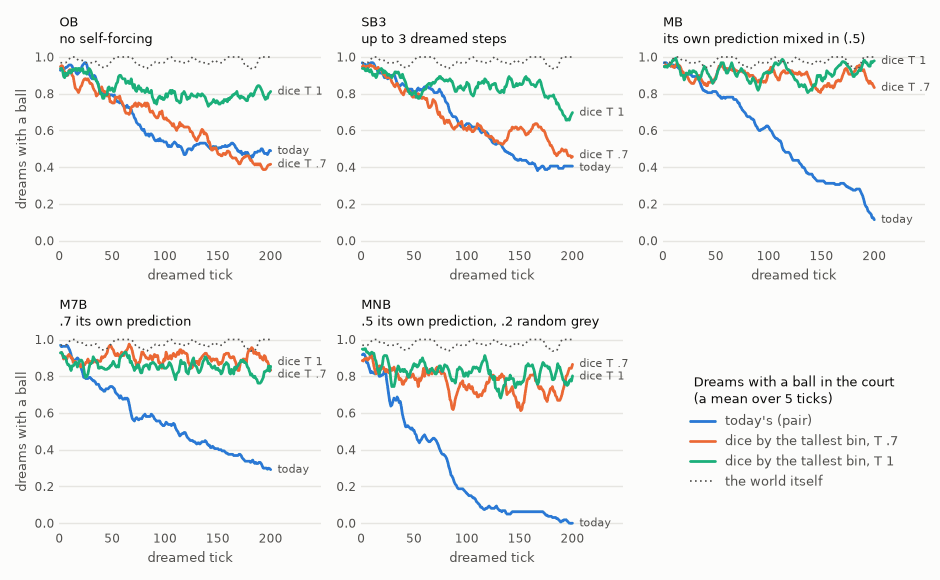

# vm-00125: A Dream That Rolls Dice

**Date:** 2026-11-27
**Status:** Complete (no new life; one throw of the dice a cell, a second for the main ones: a look, not a measurement)
**Source:** `dev/` (pending tag `exp/vm-00125`)
**Outputs:** `~/data/research/visual-motor-agent/exp_00125/`
**Task plan:** [`../tasks/00138-dream-dice.md`](../tasks/00138-dream-dice.md)

## Goal

No dream of the scripted court ever serves a new ball. vm-00124 found why: the model expects the serve when it is due and does not know where (the world serves at a random column), and the sharp decoding `pair` draws each pixel's most probable value, which is the empty court at every column.

The owner, 2026-11-27, to my first step (let the dream roll dice where the model is split): "yes - lets do that. can temperature help?"

Does a dream that rolls dice serve, what does it cost where today's way works, and does a temperature help?

## Method

**The decoding with dice.** A pixel is predicted as chances over 32 grey bins; a sure grey level is a hump of two neighbouring bins.

1. Every bin belongs to the hump it climbs to (from a bin to its more probable neighbour while there is one).
2. One random number a pixel picks a hump by the humps' weights. With a temperature T each weight is raised to 1/T first: T = 1 the weights as they are, below 1 the heavy hump more often, toward 0 always the heaviest.
3. The pixel's value is the sharp value at the chosen hump's peak, as `pair` decodes.

A pixel with one hump is drawn exactly as `pair` draws it: where the model is sure nothing changes. The dice of a dreamed tick are thrown once and kept through its decoding passes, so the decoding settles as before.

**Two ways to weigh a hump** (the second added on the way, below):

| Decoding | A hump's weight | Without dice |
|---|---|---|
| `draw`, `draw0.7`, `draw0.5` | its chance: the sum of its bins | `draw0`: each pixel's likeliest value |
| `drawp`, `drawp0.7`, `drawp0.5` | its tallest bin, as `pair` ranks values | `pair` itself |

The number after the name is the temperature (none: 1).

**The runs.** No new life. The 60k checkpoints of the five court lives of seed 1: OB (neither) and SB3 (self-forcing) of vm-00122, MB (.5 its own prediction mixed in) of vm-00123, M7B (.7) and MNB (.5 with .2 random grey) of vm-00124. Each with eight decodings: `pair`, `draw0`, and the two kinds of dice at temperatures 1, .7 and .5; one throw of the dice (for the long dream a second throw of the dice by the tallest bin was added). The exam shown whole real frames.

**The numbers.**

- **The long dream** (the free part): 200 dreamed ticks from 32 stretches of the exam. A ball is a blob: a window of 3 x 3 with 3 bright pixels or more of the ball's zone (a ball is 4), so that a ball drawn a pixel short is one and a stray pixel is none. A ball is **served** when one is back within 8 rows under the top wall after 3 ticks or more without a ball and stays 3 ticks; it is **back elsewhere** when it returns anywhere else after such a gap. **Stray pixels** are bright pixels of the ball's zone in no ball.
- **The short dreams** (the regular part): 64 real ticks, then a dream of 32, scored against the world's own continuation as always.

## Readings, set before the results

One throw of the dice and 32 long dreams a cell: a look.

1. **Does a dream with dice serve?** The balls served in the 32 free dreams, and the dreams with a ball at ticks 100 and 200.
2. **What do the dice cost where today's way works?** The regular part against `pair`: the ball's horizon, the ball held at ticks 8 and 16, next-frame skill; the stray pixels a frame.
3. **Temperature:** which of 1, .7 and .5 serves at the least cost?
4. **Do the lives that lived with the mix make a ball of a drawn pixel more often than the plain ones?**

**What I expect** (written before any dream with dice was made):

- T = 1: after the ball is lost a bright pixel comes up in the top rows about once a tick. MB and M7B make balls of some of them and serve several times in the 32 dreams; OB and SB3 seldom or never; MNB I cannot call.
- The cost at T = 1 is plain: the ball's horizon in the regular part a few ticks shorter, next-frame skill a little lower, a few stray pixels a frame.
- T = .5: nearly no cost and fewer serves, still some for the lives with the mix. T = .7 between.
- A served ball is lost again as the others are, so the dreams do not hold a ball to tick 200 much more often; but a court that serves is not empty for good.

**Changed on the way, after the first dreams of one life and before the runs:**

- **The second way to weigh a hump.** Every pixel's likeliest value (`draw0`) turned out not to be `pair`'s frame, and to lose the ball far sooner (section 5). So the dice by chance do not lead from today's decoding; the dice by the tallest bin do, and both were run.
- **A ball is a blob,** not an exact block of 2 x 2: with dice a ball is often a pixel short or long, and exact blocks read such balls as gone and back.

## Results

One throw of the dice a cell: every number below is one set of 32 dreams (the long dream) or 256 (the short ones). A second throw of the main cells is in section 1.

**In short: a dream that rolls dice serves, and its court does not stay empty. A temperature below 1 keeps most of that at a small cost for the lives that lived with the owner's mix; the plain lives need the full dice.**

- **Serves:** with today's decoding no new ball comes; with dice by the tallest bin at T 1 the five lives serve 3, 11, 20, 14 and 18 balls in their 32 long dreams, where the world serves 12.
- **A ball in the court at tick 200:** in .812, .719, .969, .875 and .812 of the dreams, against .500, .406, .094, .312 and .000 today.
- **Temperature helps the lives with the mix** (the owner's question). At .7 the life with the .5 mix serves 23 times and has a ball at tick 200 in .844 of its dreams (18 and .938 in a second throw of the dice) with 0.09 stray pixels a frame; in the short dreams it holds the ball for 14 ticks where today's decoding holds it for 15. The lives without a mix serve few or none below 1.
- **The cost:** scored against what the world really did, a dream with dice is worse, the more so the higher the temperature: at T 1 the ball is held for 6 to 11 dreamed ticks against 9 to 15, and next-frame skill falls by .06 to .30. A dream with dice is one of the futures the model holds possible, not its best guess.
- **Why the lives with the mix serve** (a scratch test): shown one pixel of a served ball they dream a ball in .84 and .86 of the cases; the plain lives in none.
- **Found on the way:** today's sharp decoding is not the model's likeliest value. It leans toward the ball's white, and that lean is part of what holds the ball in today's dreams.

*A panel a life: the share of the 32 long dreams with a ball in the court, a mean over 5 ticks. Blue: today's decoding; orange and green: dice by the tallest bin at temperatures .7 and 1; dotted: the world itself on the same stretches.*

### 1. Does a dream with dice serve?

| In 32 dreams of 200 ticks | Decoding | OB: neither | SB3: self-forcing | MB: .5 mix | M7B: .7 mix | MNB: .5 mix, .2 grey |
|---|---|---|---|---|---|---|
| Balls served | today's (`pair`) | 0 | 1 | 0 | 0 | 1 |
| Balls served | dice by the tallest bin, T 1 | 3 | 11 | 20 | 14 | 18 |
| Balls served | dice by the tallest bin, T .7 | 0 | 4 | 23 | 7 | 18 |
| Balls served | dice by the tallest bin, T .5 | 0 | 0 | 6 | 6 | 15 |
| Balls served | dice by chance, T 1 | 5 | 12 | 10 | 11 | 26 |
| Balls served | the world itself | 12 | 12 | 12 | 12 | 12 |
| Dreams with a ball at tick 200 | today's (`pair`) | .500 | .406 | .094 | .312 | .000 |
| Dreams with a ball at tick 200 | dice by the tallest bin, T 1 | .812 | .719 | .969 | .875 | .812 |
| Dreams with a ball at tick 200 | dice by the tallest bin, T .7 | .438 | .500 | .844 | .844 | .844 |
| Dreams with a ball at tick 200 | dice by the tallest bin, T .5 | .500 | .375 | .625 | .906 | .562 |
| Dreams with a ball at tick 200 | dice by chance, T 1 | .375 | .562 | .906 | .750 | .469 |
| Dreams with a ball at tick 200 | the world itself | 1.000 | 1.000 | 1.000 | 1.000 | 1.000 |

- **With today's decoding no life serves.** The two balls counted for SB3 and MNB are no serves: a ball near the top wall drawn with one to three scattered pixels for three ticks, then whole again (a look at the two cases).
- **With dice every life serves at T 1:** 3 to 20 balls by the tallest bin, 5 to 26 by chance; the world itself 12.
- **The court no longer stays empty.** At tick 200 a ball is there in .719 to .969 of the dreams with dice by the tallest bin at T 1; today in .000 to .500. In the video's dreams of 1,000 ticks (the life with the .5 mix, four stretches) all four courts with dice at .7 have a ball at tick 597 (a frame I looked at), and today's four are empty.
- **Below T 1 the lives part:** the three that lived with a mix go on serving (23, 7 and 18 balls at .7; 6, 6 and 15 at .5); OB serves none and SB3 4 at .7 and none at .5.
- **Dice by chance do worse below T 1:** toward 0 they become every pixel's likeliest value, which loses the ball (section 5). At .7 the plain lives have a ball at tick 200 in .031 and .094 of the dreams, fewer than today.
- **The balls are ragged.** A dreamed ball with dice is often 3 or 5 pixels, and it drops out and comes back: 12 to 41 balls are back elsewhere after 3 ticks or more without one at T 1 (1 to 12 today; the world none). The 64 pixels of a patch are drawn apart.

**A second throw of the dice** (mine, added after the runs to see how far a cell moves; the free part of the three dice by the tallest bin, `DICE=1`). The first throw and the second:

| In 32 dreams of 200 ticks | Decoding | OB: neither | SB3: self-forcing | MB: .5 mix | M7B: .7 mix | MNB: .5 mix, .2 grey |
|---|---|---|---|---|---|---|
| Balls served | dice by the tallest bin, T 1 | 3 and 6 | 11 and 11 | 20 and 15 | 14 and 13 | 18 and 20 |
| Balls served | dice by the tallest bin, T .7 | 0 and 0 | 4 and 6 | 23 and 18 | 7 and 9 | 18 and 12 |
| Balls served | dice by the tallest bin, T .5 | 0 and 0 | 0 and 0 | 6 and 8 | 6 and 5 | 15 and 20 |
| Dreams with a ball at tick 200 | dice by the tallest bin, T 1 | .812 and .656 | .719 and .812 | .969 and .875 | .875 and .844 | .812 and .844 |
| Dreams with a ball at tick 200 | dice by the tallest bin, T .7 | .438 and .562 | .500 and .562 | .844 and .938 | .844 and .938 | .844 and .812 |
| Dreams with a ball at tick 200 | dice by the tallest bin, T .5 | .500 and .469 | .375 and .312 | .625 and .688 | .906 and .938 | .562 and .562 |

- **The two throws agree in everything said here.** Between them a cell moves by up to 6 balls served and .16 of the share at tick 200 (5 dreams of 32); the stray pixels a frame by .04 at most.
- **In both** the lives with a mix serve at every temperature, OB serves none below T 1, and SB3 serves a few at .7 and none at .5.
- **So a difference between .5 and .7, or between two lives with a mix, of that size is the dice.**

### 2. What the dice cost in the short dreams

The regular part: 64 real ticks, a dream of 32, against the world's own continuation.

| Measure | Decoding | OB: neither | SB3: self-forcing | MB: .5 mix | M7B: .7 mix | MNB: .5 mix, .2 grey |
|---|---|---|---|---|---|---|
| The ball held, dreamed ticks | today's (`pair`) | 9 | 15 | 15 | 12 | 11 |
| The ball held, dreamed ticks | dice by the tallest bin, T .5 | 9 | 14 | 16 | 10 | 9 |
| The ball held, dreamed ticks | dice by the tallest bin, T .7 | 8 | 12 | 14 | 9 | 9 |
| The ball held, dreamed ticks | dice by the tallest bin, T 1 | 6 | 11 | 11 | 6 | 7 |
| The ball held at tick 8 | today's (`pair`) | .610 | .829 | .825 | .709 | .633 |
| The ball held at tick 8 | dice by the tallest bin, T .5 | .562 | .773 | .761 | .633 | .570 |
| The ball held at tick 8 | dice by the tallest bin, T .7 | .518 | .773 | .749 | .562 | .542 |
| The ball held at tick 8 | dice by the tallest bin, T 1 | .418 | .625 | .645 | .323 | .466 |
| Next-frame skill | today's (`pair`) | .750 | .775 | .742 | .696 | .656 |
| Next-frame skill | dice by the tallest bin, T .5 | .752 | .755 | .685 | .605 | .565 |
| Next-frame skill | dice by the tallest bin, T .7 | .732 | .735 | .655 | .534 | .483 |
| Next-frame skill | dice by the tallest bin, T 1 | .693 | .688 | .572 | .400 | .353 |
| Stray pixels a frame of the long dream | today's (`pair`) | 0.08 | 0.04 | 0.03 | 0.04 | 0.05 |
| Stray pixels a frame of the long dream | dice by the tallest bin, T .5 | 0.14 | 0.09 | 0.06 | 0.11 | 0.22 |
| Stray pixels a frame of the long dream | dice by the tallest bin, T .7 | 0.21 | 0.22 | 0.09 | 0.19 | 0.37 |
| Stray pixels a frame of the long dream | dice by the tallest bin, T 1 | 0.34 | 0.37 | 0.17 | 0.51 | 0.71 |

- **Against the world's own continuation the dice lose, the more the higher the temperature.** At T 1 the ball is held for 6 to 11 dreamed ticks where today's decoding holds it for 9 to 15, and next-frame skill changes by −.056 (OB) to −.303 (MNB).
- **At .5 little is lost:** the ball's horizon is within 2 ticks of today's in every life (9, 14, 16, 10 and 9 ticks against 9, 15, 15, 12 and 11); next-frame skill changes by +.002 (OB) to −.091 (M7B and MNB).
- **The lives with a mix pay more of the next frame than the plain ones** at every temperature (at .7: −.086, −.162 and −.173 against −.018 and −.040). My reading: their predictions leave more pixels undecided, so the dice have more to choose.
- **Part of the cost is in the nature of the thing.** The exam scores a dream against the one future that happened. A dream with dice is another of the futures the model holds possible: where the model is unsure of the ball's next place, today's decoding takes its best guess and the dice take a guess. The numbers say what the dice cost a forecast.
- **The stray pixels are few:** under one a frame at any temperature (0.17 to 0.71 at T 1, 0.06 to 0.22 at .5; today 0.03 to 0.08).

### 3. Temperature

- **Yes, a temperature helps, for the lives that make a ball of a fragment.** Below 1 the stray pixels thin out faster than the serves. The life with the .5 mix: 0.17, 0.09 and 0.06 stray pixels a frame at T 1, .7 and .5, and 20, 23 and 6 balls served; the life with the .7 mix: 0.51, 0.19, 0.11 and 14, 7, 6; the life with random grey: 0.71, 0.37, 0.22 and 18, 18, 15.
- **For the lives without a mix a lower temperature ends the serves, or nearly** (OB 3, 0, 0; SB3 11, 4, 0).
- **Which temperature:** between .5 and .7 for a life with a mix; two throws of the dice do not say more. At .7 a ball is in the court at tick 200 in .844 of the long dreams of each of the three (.938, .938 and .812 in the second throw; .094, .312 and .000 today), and the short dreams hold the ball for 14, 9 and 9 ticks (15, 12 and 11 today). At .5 the short dreams lose less (16, 10 and 9 ticks), and the long ones keep a ball in .625, .906 and .562 (.688, .938 and .562 in the second throw): fewer for two of the three.

### 4. What a life makes of a fragment of a ball

A scratch test of mine (not one of the repository's tools; kept beside the outputs, `exp_00125/scratch/`), with today's decoding and no dice. At each of the exam's 73 real serves the model is shown the real frames up to the tick before and then the serve's frame with only some of the served ball's 4 pixels left, and dreams on. The share of the cases with a ball at the second dreamed tick:

| Of the served ball's 4 pixels shown | OB: neither | SB3: self-forcing | MB: .5 mix | M7B: .7 mix | MNB: .5 mix, .2 grey |
|---|---|---|---|---|---|
| 1 | .00 | .00 | .84 | .86 | .19 |
| 2 | .14 | .11 | .93 | .74 | .67 |
| 3 | .75 | .47 | .95 | .84 | .74 |
| 4 (the whole ball) | .97 | .85 | .96 | .75 | .70 |
| none | .00 | .00 | .00 | .00 | .00 |

- **One pixel is enough for the lives that lived with the mix of their own prediction:** a ball follows in .84 (MB) and .86 (M7B) of the cases. In their lives every new ball came so: some of its pixels real, the others from their own prediction, which has no ball, and the whole ball as the target.
- **The plain lives need nearly the whole ball:** none from one pixel, .14 and .11 from two, .75 and .47 from three.
- **The life with random grey needs two pixels** (.19 from one, .67 from two): it has learnt that one bright pixel is noise.
- **So the dice and the mix do together what neither does alone.** The dice put a pixel where the model expects a serve; a model that lived with the mix makes a ball of it. That is why, in my reading, those lives go on serving at a low temperature, where the dice seldom give more than one pixel.

### 5. Today's sharp decoding leans toward the ball

Found on the way; not one of the four readings.

| Without dice | OB: neither | SB3: self-forcing | MB: .5 mix | M7B: .7 mix | MNB: .5 mix, .2 grey |
|---|---|---|---|---|---|
| Long dream, the last ball's median tick: `pair` | 185 | 138 | 116 | 116 | 60 |
| Long dream, the last ball's median tick: the likeliest value | 94 | 78 | 98 | 35 | 17 |
| Short dreams, the ball held, ticks: `pair` | 9 | 15 | 15 | 12 | 11 |
| Short dreams, the ball held, ticks: the likeliest value | 9 | 13 | 13 | 8 | 5 |
| Next-frame skill: `pair` | .750 | .775 | .742 | .696 | .656 |
| Next-frame skill: the likeliest value | .762 | .777 | .752 | .697 | .676 |

- **`pair` is not the model's likeliest value.** It ranks a pixel's values by their most probable bin. A grey level that sits on a bin has all its chance in that bin; one between two bins has it split. In the court the ball's white (255) sits on bin 31 and the background (20) lies between bins 2 and 3 (.57 and .43), so `pair` draws a ball's pixel from a chance of .36 on, not .50.
- **That lean holds the ball.** With every pixel's likeliest value the long dream loses its ball sooner in every life, and the short dreams hold it no longer and mostly less long.
- **The likeliest value is the better forecast of the next frame** in every life (by .001 to .020 of skill), as it should be.
- So today's decoding is a dream's decoding more than a forecast's, by an accident of where the greys sit on the bins. In the disc world both greys lie between bins (21 and 94), so `pair` has no such lean there (not run).

### Against what I expected

- "T = 1: a bright pixel in the top rows about once a tick; MB and M7B serve several times; OB and SB3 seldom or never; MNB I cannot call": right for MB, M7B and OB; wrong for SB3, which serves about as often as the lives with the mix at T 1; MNB serves as often as any.
- "The cost at T = 1 is plain: the horizon a few ticks shorter, next-frame skill a little lower, a few stray pixels a frame": right for the horizon; next-frame skill falls by more than a little; the stray pixels are fewer than I thought (under one a frame).
- "T = .5: nearly no cost and fewer serves, still some for the lives with the mix; T = .7 between": right.
- "A served ball is lost again, so the dreams do not hold a ball to tick 200 much more often": wrong. They do, by far.
- Not expected: that today's decoding leans toward the ball, and what that is worth.

### The numbers

A row is a measure and a decoding, a column a life.

### The long dream: 200 ticks from 32 stretches of the exam

| Measure | Decoding | OB: no self-forcing | SB3: up to 3 dreamed steps | MB: its own prediction mixed in (.5) | M7B: .7 its own prediction | MNB: .5 its own prediction, .2 random grey |
|---|---|---|---|---|---|---|
| Balls served in the long dreams | today's (`pair`) | 0 | 1 | 0 | 0 | 1 |
| Balls served in the long dreams | the likeliest value, no dice | 0 | 0 | 0 | 0 | 1 |
| Balls served in the long dreams | dice by chance, T 1 | 5 | 12 | 10 | 11 | 26 |
| Balls served in the long dreams | dice by chance, T .7 | 0 | 0 | 18 | 11 | 21 |
| Balls served in the long dreams | dice by chance, T .5 | 0 | 0 | 6 | 9 | 13 |
| Balls served in the long dreams | dice by the tallest bin, T 1 | 3 | 11 | 20 | 14 | 18 |
| Balls served in the long dreams | dice by the tallest bin, T .7 | 0 | 4 | 23 | 7 | 18 |
| Balls served in the long dreams | dice by the tallest bin, T .5 | 0 | 0 | 6 | 6 | 15 |
| Balls served in the long dreams | the world itself | 12 | 12 | 12 | 12 | 12 |
| Dreams with a ball at tick 50 | today's (`pair`) | .812 | .750 | .812 | .750 | .531 |
| Dreams with a ball at tick 50 | the likeliest value, no dice | .625 | .719 | .688 | .250 | .031 |
| Dreams with a ball at tick 50 | dice by chance, T 1 | .688 | .719 | .812 | .781 | .688 |
| Dreams with a ball at tick 50 | dice by chance, T .7 | .594 | .625 | .781 | .688 | .656 |
| Dreams with a ball at tick 50 | dice by chance, T .5 | .500 | .594 | .750 | .656 | .281 |
| Dreams with a ball at tick 50 | dice by the tallest bin, T 1 | .781 | .719 | .938 | .875 | .875 |
| Dreams with a ball at tick 50 | dice by the tallest bin, T .7 | .656 | .719 | .875 | .938 | .844 |
| Dreams with a ball at tick 50 | dice by the tallest bin, T .5 | .688 | .812 | .844 | .906 | .688 |
| Dreams with a ball at tick 50 | the world itself | .969 | .969 | .969 | .969 | .969 |
| Dreams with a ball at tick 100 | today's (`pair`) | .562 | .656 | .625 | .531 | .156 |
| Dreams with a ball at tick 100 | the likeliest value, no dice | .312 | .344 | .500 | .031 | .000 |
| Dreams with a ball at tick 100 | dice by chance, T 1 | .406 | .719 | .781 | .594 | .562 |
| Dreams with a ball at tick 100 | dice by chance, T .7 | .219 | .406 | .750 | .719 | .375 |
| Dreams with a ball at tick 100 | dice by chance, T .5 | .188 | .281 | .656 | .656 | .312 |
| Dreams with a ball at tick 100 | dice by the tallest bin, T 1 | .750 | .875 | .969 | .844 | .875 |
| Dreams with a ball at tick 100 | dice by the tallest bin, T .7 | .562 | .656 | .938 | 1.000 | .781 |
| Dreams with a ball at tick 100 | dice by the tallest bin, T .5 | .781 | .781 | .812 | .906 | .625 |
| Dreams with a ball at tick 100 | the world itself | .969 | .969 | .969 | .969 | .969 |
| Dreams with a ball at tick 200 | today's (`pair`) | .500 | .406 | .094 | .312 | .000 |
| Dreams with a ball at tick 200 | the likeliest value, no dice | .062 | .062 | .125 | .000 | .000 |
| Dreams with a ball at tick 200 | dice by chance, T 1 | .375 | .562 | .906 | .750 | .469 |
| Dreams with a ball at tick 200 | dice by chance, T .7 | .031 | .094 | .812 | .812 | .406 |
| Dreams with a ball at tick 200 | dice by chance, T .5 | .031 | .094 | .531 | .594 | .156 |
| Dreams with a ball at tick 200 | dice by the tallest bin, T 1 | .812 | .719 | .969 | .875 | .812 |
| Dreams with a ball at tick 200 | dice by the tallest bin, T .7 | .438 | .500 | .844 | .844 | .844 |
| Dreams with a ball at tick 200 | dice by the tallest bin, T .5 | .500 | .375 | .625 | .906 | .562 |
| Dreams with a ball at tick 200 | the world itself | 1.000 | 1.000 | 1.000 | 1.000 | 1.000 |
| Balls back elsewhere after 3 ticks or more without one | today's (`pair`) | 1 | 3 | 1 | 5 | 12 |
| Balls back elsewhere after 3 ticks or more without one | the likeliest value, no dice | 9 | 0 | 4 | 7 | 3 |
| Balls back elsewhere after 3 ticks or more without one | dice by chance, T 1 | 34 | 26 | 24 | 60 | 80 |
| Balls back elsewhere after 3 ticks or more without one | dice by chance, T .7 | 13 | 12 | 26 | 70 | 97 |
| Balls back elsewhere after 3 ticks or more without one | dice by chance, T .5 | 10 | 7 | 20 | 72 | 44 |
| Balls back elsewhere after 3 ticks or more without one | dice by the tallest bin, T 1 | 18 | 12 | 14 | 18 | 41 |
| Balls back elsewhere after 3 ticks or more without one | dice by the tallest bin, T .7 | 10 | 9 | 6 | 16 | 49 |
| Balls back elsewhere after 3 ticks or more without one | dice by the tallest bin, T .5 | 4 | 3 | 12 | 12 | 53 |
| Balls back elsewhere after 3 ticks or more without one | the world itself | 0 | 0 | 0 | 0 | 0 |
| Stray bright pixels a frame | today's (`pair`) | 0.08 | 0.04 | 0.03 | 0.04 | 0.05 |
| Stray bright pixels a frame | the likeliest value, no dice | 0.08 | 0.04 | 0.05 | 0.08 | 0.05 |
| Stray bright pixels a frame | dice by chance, T 1 | 0.40 | 0.52 | 0.29 | 0.69 | 0.86 |
| Stray bright pixels a frame | dice by chance, T .7 | 0.15 | 0.19 | 0.20 | 0.49 | 0.58 |
| Stray bright pixels a frame | dice by chance, T .5 | 0.10 | 0.08 | 0.11 | 0.36 | 0.33 |
| Stray bright pixels a frame | dice by the tallest bin, T 1 | 0.34 | 0.37 | 0.17 | 0.51 | 0.71 |
| Stray bright pixels a frame | dice by the tallest bin, T .7 | 0.21 | 0.22 | 0.09 | 0.19 | 0.37 |
| Stray bright pixels a frame | dice by the tallest bin, T .5 | 0.14 | 0.09 | 0.06 | 0.11 | 0.22 |
| The last ball, median tick | today's (`pair`) | 185 | 138 | 116 | 116 | 60 |
| The last ball, median tick | the likeliest value, no dice | 94 | 78 | 98 | 35 | 17 |
| The last ball, median tick | dice by chance, T 1 | 191 | 200 | 200 | 200 | 199 |
| The last ball, median tick | dice by chance, T .7 | 109 | 98 | 200 | 200 | 199 |
| The last ball, median tick | dice by chance, T .5 | 100 | 66 | 200 | 200 | 174 |
| The last ball, median tick | dice by the tallest bin, T 1 | 200 | 200 | 200 | 200 | 200 |
| The last ball, median tick | dice by the tallest bin, T .7 | 178 | 198 | 200 | 200 | 200 |
| The last ball, median tick | dice by the tallest bin, T .5 | 200 | 166 | 200 | 200 | 200 |

### The short dreams: the regular part

| Measure | Decoding | OB: no self-forcing | SB3: up to 3 dreamed steps | MB: its own prediction mixed in (.5) | M7B: .7 its own prediction | MNB: .5 its own prediction, .2 random grey |
|---|---|---|---|---|---|---|
| The ball held, dreamed ticks | today's (`pair`) | 9 | 15 | 15 | 12 | 11 |
| The ball held, dreamed ticks | the likeliest value, no dice | 9 | 13 | 13 | 8 | 5 |
| The ball held, dreamed ticks | dice by chance, T 1 | 6 | 9 | 8 | 3 | 2 |
| The ball held, dreamed ticks | dice by chance, T .7 | 6 | 11 | 12 | 5 | 3 |
| The ball held, dreamed ticks | dice by chance, T .5 | 8 | 12 | 12 | 7 | 4 |
| The ball held, dreamed ticks | dice by the tallest bin, T 1 | 6 | 11 | 11 | 6 | 7 |
| The ball held, dreamed ticks | dice by the tallest bin, T .7 | 8 | 12 | 14 | 9 | 9 |
| The ball held, dreamed ticks | dice by the tallest bin, T .5 | 9 | 14 | 16 | 10 | 9 |
| The ball held at tick 8 | today's (`pair`) | .610 | .829 | .825 | .709 | .633 |
| The ball held at tick 8 | the likeliest value, no dice | .566 | .797 | .753 | .518 | .458 |
| The ball held at tick 8 | dice by chance, T 1 | .351 | .554 | .566 | .287 | .315 |
| The ball held at tick 8 | dice by chance, T .7 | .442 | .689 | .661 | .375 | .343 |
| The ball held at tick 8 | dice by chance, T .5 | .502 | .753 | .681 | .466 | .418 |
| The ball held at tick 8 | dice by the tallest bin, T 1 | .418 | .625 | .645 | .323 | .466 |
| The ball held at tick 8 | dice by the tallest bin, T .7 | .518 | .773 | .749 | .562 | .542 |
| The ball held at tick 8 | dice by the tallest bin, T .5 | .562 | .773 | .761 | .633 | .570 |
| The ball held at tick 16 | today's (`pair`) | .270 | .468 | .492 | .306 | .302 |
| The ball held at tick 16 | the likeliest value, no dice | .282 | .437 | .405 | .206 | .155 |
| The ball held at tick 16 | dice by chance, T 1 | .111 | .226 | .278 | .123 | .119 |
| The ball held at tick 16 | dice by chance, T .7 | .155 | .310 | .389 | .151 | .127 |
| The ball held at tick 16 | dice by chance, T .5 | .206 | .381 | .397 | .190 | .135 |
| The ball held at tick 16 | dice by the tallest bin, T 1 | .163 | .266 | .325 | .163 | .190 |
| The ball held at tick 16 | dice by the tallest bin, T .7 | .218 | .353 | .429 | .270 | .206 |
| The ball held at tick 16 | dice by the tallest bin, T .5 | .266 | .433 | .500 | .274 | .250 |
| The paddle held, dreamed ticks | today's (`pair`) | 28 | 32 | 32 | 25 | 29 |
| The paddle held, dreamed ticks | the likeliest value, no dice | 28 | 32 | 32 | 23 | 25 |
| The paddle held, dreamed ticks | dice by chance, T 1 | 22 | 26 | 29 | 22 | 26 |
| The paddle held, dreamed ticks | dice by chance, T .7 | 22 | 29 | 32 | 23 | 26 |
| The paddle held, dreamed ticks | dice by chance, T .5 | 24 | 32 | 32 | 24 | 26 |
| The paddle held, dreamed ticks | dice by the tallest bin, T 1 | 23 | 28 | 30 | 20 | 29 |
| The paddle held, dreamed ticks | dice by the tallest bin, T .7 | 23 | 30 | 32 | 25 | 28 |
| The paddle held, dreamed ticks | dice by the tallest bin, T .5 | 26 | 32 | 32 | 24 | 29 |
| Next-frame skill | today's (`pair`) | .750 | .775 | .742 | .696 | .656 |
| Next-frame skill | the likeliest value, no dice | .762 | .777 | .752 | .697 | .676 |
| Next-frame skill | dice by chance, T 1 | .678 | .698 | .603 | .434 | .402 |
| Next-frame skill | dice by chance, T .7 | .716 | .744 | .673 | .553 | .520 |
| Next-frame skill | dice by chance, T .5 | .737 | .767 | .707 | .618 | .576 |
| Next-frame skill | dice by the tallest bin, T 1 | .693 | .688 | .572 | .400 | .353 |
| Next-frame skill | dice by the tallest bin, T .7 | .732 | .735 | .655 | .534 | .483 |
| Next-frame skill | dice by the tallest bin, T .5 | .752 | .755 | .685 | .605 | .565 |

## Checks

- **Every scored file** (495 checks, 0 failed): 5 lives, 8 decodings, the free part and the regular and course parts; the second throw's 15 free parts (the same stretches, other dice). Each names its life, its checkpoint and its decoding with the temperature, the dice and the way to weigh; one transformer, 64 windows a pass, no frame unsettled. The free dreams have 32 stretches of 200 ticks; in the world's own continuation balls are served and none comes back elsewhere.
- **`pair` repeats.** Scored again into this experiment's folder it gives each life's earlier summary number for number: the free dream and the regular and course parts (frozen tests repeat exactly).
- **The rule:** `tests/test_draw.py` (7): the device draws as the numpy rule says, by chance and by the tallest bin, at five temperatures; a value with one hump is `pair`'s whatever the dice; two humps are drawn by their weights and by their weights raised to 1/T; by the tallest bin and without dice it is `pair`, by chance the likelier value; a dream with dice settles, repeats with the same dice, differs with others and does not depend on its first guess; a scoring names its temperature and dice; the court's balls counted on frames made by hand.
- **The table tool:** `tests/test_wm_dice.py` (2).
- **The whole dev suite** after the change to the CUDA code: 2,170 passed, 34 skipped.

## Next

For the owner's word (mine):

- **Dice for a long dream, today's decoding for the exam.** A dream that is to go on (a video, a rollout to look far ahead) is drawn with dice by the tallest bin, at .7 for a life with the mix. A model is still scored against the world with `pair`: a dream with dice is one of several futures.
- **A life trained on drawn frames.** The mix and self-forcing make the model's own frames with `pair`. Made with the dice of the dream, a life would meet its own stray pixels and ragged balls with the real frame as the target, and may learn to mend them as the lives with the mix learnt to make a ball of a fragment. One court life, the .5 mix with its prediction drawn.
- **The ragged balls** come from drawing the 64 pixels of a patch apart. The remedy named before (one choice a patch, a change to the model) is open; the step above may make it unnecessary.
- **The disc world with dice** was not run. A look at the disc lives' checkpoints is as cheap as this one.
- **Standing:** the disc world with variety.

## Files

- `Makefile`: `free`, `regular`, `table`, `images`, `video` (the second throw: `make free DICE=1 OUT=.../exp_00125/dice1 DECODES="drawp drawp0.7 drawp0.5"`).
- `images/balls.png` (`make images`).
- Videos (not in the repository), in `~/data/research/visual-motor-agent/exp_00125/videos/`: `court_dice_MB.mp4`, `court_dice_M7B.mp4`: 20 watched ticks, then a dream of 1,000, today's decoding beside dice by the tallest bin at .5 and .7 and dice by chance at 1 (`make video LIFE=MB`).
- New in `dev/`: the decoding with dice (`src/vm_cuda.cu`: `draw_value`, `vmc_forward_uni_draw`, `vmc_draw_values`; `cuda_lib.CudaModel.forward_uni_draw`, `cuda_lib.draw_values`; `wm_measures.draw_values`, `Pieces(run, step, "drawp0.7", dice=0)`, `score --decode ... --dice N --out DIR`); the court's balls in the free part (`wm_measures.court_balls`); `wm_video.py RUN@DECODE:LABEL`; `wm_dice.py`; `tests/test_draw.py`, `tests/test_wm_dice.py`.
