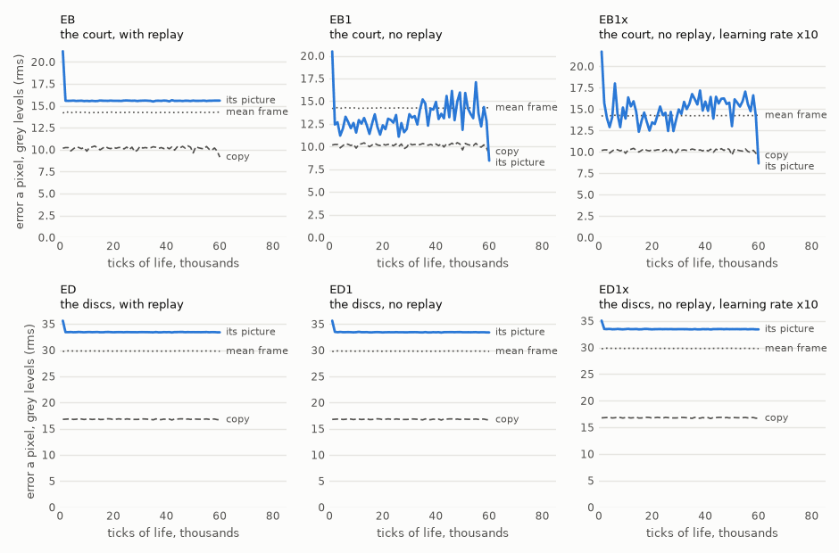
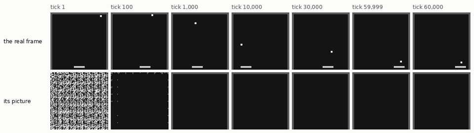
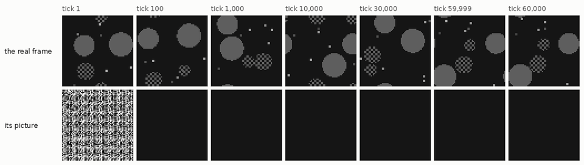

# vm-00126: A Life That Never Sees

**Date:** 2026-11-28
**Status:** Complete (one seed an arm: a look, not a measurement)
**Source:** `exp/vm-00126` (code: `visual-motor-agent/dev/`)
**Outputs:** `~/data/research/visual-motor-agent/exp_00126/`
**Task plan:** [`../tasks/00139-never-sees.md`](../tasks/00139-never-sees.md)

## Goal

The owner, 2026-11-27: "lets try different stuff - lets have empty input (black for example) and train model on a real image - so the idea is that weights of transformer are changing under the influence of real image - but model do not actually ever see the image in the first place - I want o see what will happen".

The frame reaches the model by one way only: as the target of its updates. What does a model paint that has never been given a frame?

## Method

The one watching transformer of vm-00120 (`configs/W1_discs.json`, `configs/W1_breakout.json`), seed 1, 60k ticks, with `online.blind = [0, 0, 64, 64]` (task 00118's blind spot over the whole frame): every frame the model is given is black, while acting and in every update; the targets and memory are the real frames. The body's values and the move stay as they are: in the court the body's hunger is the score (a hit sets it to 0, a miss adds .5), in the disc world it is 0.

| Arm | World | The update |
|---|---|---|
| EB, ED | the court, the discs | as always: the newest window and 7 replayed from memory |
| EB1, ED1 (mine) | the court, the discs | `online.batch = 1`: the newest window only, no replay |
| EB1x, ED1x (mine, added after the first lives were seen) | the court, the discs | the newest window only, the learning rate 10 times larger (`ppo.lr = .003`) |

With black input the model cannot tell a replayed window from the present one, so replay pulls its picture toward the average of all it has lived. Without replay the weights follow the present alone.

**How it is seen.**

- **In the life, at every tick** (`online.pred_score`): before the model learns from a frame, its picture of that frame is read: the sharp decoding (`pair`) of what it predicts for the current frame from the window as it sees it (black). Its error against the real frame stands beside two that need no model: the last real frame (copy) and the mean of all frames so far. An error is the root of the mean squared error a pixel, in grey levels (rms); skill is 1 − the picture's summed squared error / the other's (0: level; below 0: worse).
- **Frames kept** (`online.pred_record`, `online.pred_every`): the real frame and the picture at the first and last 64 ticks and at every 100th.
- **After the life** the last weights are frozen and read the same way on the life's own world as it goes on (`pred_show.py after`): given black frames as in the life, as the expected value of every pixel, and shown the real frames for the first time. And on the exam (`wm_measures.py score`), as the life saw frames and shown whole frames.

The lives ran two a card: at 33 ticks per second with replay (the RTX 4090, 30 minutes) and at 66 without (the RTX 3090, 15 minutes; EB1x and ED1x 18 minutes, beside the scoring).

## Readings, set before the results

One seed an arm: a look.

1. **What does the model paint?** The pictures and the video.
2. **Is its picture better than repeating the last frame, and than the average frame?**
3. **Do the changing weights carry the present?** No replay against replay; the life's last ticks against the same weights frozen.
4. **Shown real frames for the first time:** what does it do?

**What I expect** (written before any life of this experiment ran, but for a trial of 400 ticks that only showed the option runs):

- With the usual update the picture settles within a few thousand ticks to the scenery without its things: the court's walls and background with no ball and no paddle, the discs' world an empty background.
- Its error is then the things themselves. Against copy it loses clearly in both worlds; against the mean frame it is about level.
- Without replay the picture follows the slow things with a lag: a paddle where it has lately been, faint trails of the slow discs. A lower error than with replay, still above copy's.
- Frozen at the end: with replay no different from the life; without replay worse than the life's last ticks.
- Shown whole frames: nothing useful. The input weights of every grey but black were never trained.

**Changed on the way, after the first two lives were seen:** two more lives of mine, EB1x and ED1x (the newest window only, the learning rate 10 times larger: do faster weights follow the discs?), and a reading of the court's paddle and ball in the kept pictures.

## Results

One seed an arm: every number below is one life's.

**In short: a model that is never given a frame paints the scenery. Of the things in it, it paints only a slow one on one line (the court's paddle), and only when nothing else is replayed to it.**

- **With the usual update the picture is the scenery and nothing else:** the court's walls and background without paddle or ball, the discs' world an empty background. It is settled by 2,000 ticks and hardly changes again.
- **It is worse than repeating the last frame, and worse than the mean frame:** an error of 15.6 grey levels a pixel in the court against copy's 10.2 and the mean frame's 14.3; 33.4 against 16.8 and 29.8 in the disc world.
- **Without replay the weights carry the present, where the present is slow.** The court life paints a paddle in .980 of its pictures, a median of 2.5 px from the real one (a paddle standing at its mean place would be 13.6 px off). Its error is 13.2: between copy's and the mean frame's. It never paints the ball.
- **The discs do not appear.** With replay never. Without it a few pixels of the discs' grey come up in 3% to 4% of the pictures, more often than chance where a disc really is, and 10 times the learning rate changes little.
- **Frozen, the present goes stale.** The court life without replay keeps its paddle where it last was, and from 65 ticks on its picture is worse (19.1) than the scenery alone (15.6).
- **Shown real frames for the first time,** the court lives paint far worse (28.0 against 15.6); the disc lives paint the same empty background.

*A panel a life: the error of the model's picture of the current frame, made before it learns from it (blue), beside the last real frame (copy, dashed) and the mean of all frames so far (dotted). By 1,000 ticks.*

*The court life without replay (EB1): the real frame over the picture the model paints for it, never having been given a frame.*

*The same with the usual update (EB).*

*The disc life without replay (ED1).*

### 1. What does the model paint?

- **The scenery, settled early.** With the usual update (EB, ED) the picture all but stops changing by 2,000 ticks (4 and 2 different pictures among the 644 kept after that): every pixel its most frequent grey. In the court that is the walls and the background. The paddle is over any one column about a fifth of the time and the ball almost nowhere, so neither is painted (a paddle in .005 of the kept pictures). In the disc world a pixel is under a disc or a dot one tick in five: the picture is the background alone.
- **A paddle, without replay.** EB1 paints the court with a paddle from about tick 600 on, near the real paddle's place tick after tick; the video shows it following.
- **No ball, ever,** in any court life: a ball pixel in .000 of EB1's kept pictures and in .003 of EB1x's.
- **No disc** in any disc life. Without replay a handful of pixels of the discs' grey come up now and then (a count of mine on the 644 pictures kept from tick 2,000 on): in 18 pictures of ED1 and 25 of ED1x, about 20 to 30 pixels a picture, .35 and .51 of them where a disc or a dot really is, against .20 for a pixel at random. With replay none.

### 2. Against copy and the mean frame

| The life after its first 1,000 ticks | Its picture, rms | Copy, rms | The mean frame, rms | Skill against copy | Skill against the mean frame | Windows of 1,000 ticks better than copy |
|---|---|---|---|---|---|---|
| EB: the court, replay | 15.6 | 10.2 | 14.3 | −1.35 | −.19 | 0 of 59 |
| EB1: the court, no replay | 13.2 | 10.2 | 14.3 | −.69 | .14 | 1 of 59 |
| EB1x: the court, no replay, learning rate x10 | 14.9 | 10.2 | 14.3 | −1.15 | −.09 | 1 of 59 |
| ED: the discs, replay | 33.4 | 16.8 | 29.8 | −2.95 | −.26 | 0 of 59 |
| ED1: the discs, no replay | 33.4 | 16.8 | 29.8 | −2.96 | −.26 | 0 of 59 |
| ED1x: the discs, no replay, learning rate x10 | 33.4 | 16.8 | 29.8 | −2.96 | −.26 | 0 of 59 |

- **Never better than copy over a life.** Repeating the last frame is wrong only where a thing has moved; a picture without things is wrong wherever a thing is.
- **With replay it is below the mean frame too** (skill −.19 and −.26). The sharp decoding paints each pixel's most frequent grey; for the squared error the mean is the better guess.
- **Without replay the court's picture is above the mean frame** (.14) and well short of copy (−.69). It beats copy in 1 window of 59, the last: 8.5 against 9.2, in a stretch where copy too has its lowest error of the life.
- **A learning rate 10 times larger follows the paddle worse, not better:** an error of 14.9 against 13.2.
- **The disc lives are one number three times** (33.4, 33.4, 33.4): the error of an empty background.

### 3. Do the changing weights carry the present?

| The court's kept pictures from tick 1,000 on (654 a life) | EB: replay | EB1: no replay | EB1x: no replay, learning rate x10 |
|---|---|---|---|
| With a paddle | .005 | .980 | .839 |
| The painted paddle's place off, median px | – | 2.5 | 4.0 |
| Within 2 px of the real one | – | .457 | .322 |
| Within 6 px | – | .852 | .705 |
| A paddle standing at its mean place: off, median px | 13.6 | 13.6 | 13.6 |

The last weights frozen, on the life's own world as it goes on after the life's end (`pred_show.py after`): the picture's error, rms.

| Ticks after the life's end | EB | EB1 | EB1x | ED | ED1 | ED1x |
|---|---|---|---|---|---|---|
| 1 to 8 | 15.6 | 11.1 | 12.0 | 33.2 | 33.2 | 33.2 |
| 9 to 64 | 15.6 | 12.7 | 12.9 | 33.5 | 33.5 | 33.5 |
| 65 to 512 | 15.6 | 19.1 | 18.6 | 33.4 | 33.4 | 33.4 |
| 513 to 2,000 | 15.6 | 17.7 | 17.4 | 33.4 | 33.4 | 33.4 |
| Copy, 1 to 2,000 | 10.0 | 10.0 | 10.0 | 16.8 | 16.8 | 16.8 |
| As the expected value of every pixel, 1 to 8 | 14.4 | 9.9 | 11.3 | 29.6 | 29.8 | 29.7 |
| As the expected value of every pixel, 513 to 2,000 | 14.3 | 16.9 | 17.0 | 29.8 | 29.9 | 29.8 |

- **Yes, where the thing is slow and nothing is replayed.** The court life without replay paints the paddle within 2 px of its place in .457 of its pictures and within 6 px in .852. The paddle's place went from the frames into the weights, a tick at a time, and from the weights into the picture.
- **Replay wipes it out.** With 7 replayed windows in every update the same model paints a paddle in .005 of its pictures. A black window of an hour ago and a black window of now are the same to the model, so every update asks it for all the paddle's places at once.
- **Frozen, the weights hold the last present.** For 8 ticks after the life's end EB1's frozen picture is as good as in the life (11.1). From 65 ticks on it is worse than the scenery alone (19.1 and 17.7 against EB's 15.6): a paddle painted where it was is wrong twice.
- **Of the discs the weights hold next to nothing of the present.** At the life's end neither the sharp picture nor the expected value of every pixel is better right after the end than later (29.8 and 29.9: the mean frame's error). The rare pixels of disc grey in the pictures without replay (section 1) say a trace is there at times, below what the sharp decoding shows.
- **Why the paddle and not the discs** (my reading, not tested). The paddle is one thing on one line: it moves a median of under 1 px a tick along two rows, and where it is can be said with one number. The discs are four things over the whole frame, each over a pixel for ten to thirty ticks, and the next disc over that pixel comes from elsewhere. One update a tick moves the weights enough for the one number and too little for the rest. 10 times the learning rate made the glimpses of the discs a little more frequent and the paddle less exact.

### 4. Shown real frames for the first time

The last weights frozen on the life's own world, ticks 1 to 2,000 after the life's end; the picture made as the life makes it (the earlier patches of the frame being painted are given as the model is given frames).

| The picture's error, rms | EB | EB1 | EB1x | ED | ED1 | ED1x |
|---|---|---|---|---|---|---|
| Given black frames, as in the life | 15.6 | 17.9 | 17.5 | 33.4 | 33.4 | 33.4 |
| Shown the real frames | 28.0 | 27.5 | 46.0 | 33.4 | 33.4 | 33.4 |
| Copy | 10.0 | 10.0 | 10.0 | 16.8 | 16.8 | 16.8 |

- **The court lives paint far worse when they are shown the world.** The input weights of every grey but black were never trained: a real frame is noise to them.
- **The disc lives paint the same empty background, to the last digit.** In the disc world the body's values are 0 as well, so nothing the model was ever given changed from tick to tick. It learnt to paint without reading its input (my reading).
- **The exam's dream is another thing again.** `wm_measures.py score` reads a model's first dreamed tick, and a dream feeds the model its own picture while it paints a frame: this model was never given that either. Next-frame skill there, against copy:

| The exam's first dreamed tick, next-frame skill | EB | EB1 | EB1x | ED | ED1 | ED1x |
|---|---|---|---|---|---|---|
| The life's own world, black frames | −7.18 | −3.59 | −18.32 | −3.09 | −3.09 | −3.09 |
| The exam, black frames | −6.88 | −4.03 | −19.36 | −2.52 | −2.52 | −2.52 |
| The exam, whole frames | −5.60 | −6.33 | −19.67 | −2.52 | −2.52 | −2.52 |

### Against what I expected

- "With the usual update the picture settles within a few thousand ticks to the scenery without its things": right, by 2,000 ticks.
- "Against copy it loses clearly in both worlds; against the mean frame it is about level": right against copy; against the mean frame it is below (−.19 and −.26), not level.
- "Without replay the picture follows the slow things with a lag: a paddle where it has lately been, faint trails of the slow discs; a lower error than with replay, still above copy's": right for the paddle and for the error; wrong for the discs, which leave no trail at all.
- "Frozen at the end: with replay no different from the life; without replay worse than the life's last ticks": right.
- "Shown whole frames: nothing useful": right. I did not expect the disc lives to take no notice of the frames at all.

### The numbers

### In the life: the picture of a frame before the model learns from it

| Life | Ticks | The picture, rms | Copy, rms | The mean frame, rms | Skill against copy | Skill against the mean frame |
|---|---|---|---|---|---|---|
| EB | 1k | 21.2 | 10.2 | 14.2 | −3.35 | −1.24 |
| EB | 5k | 15.6 | 10.1 | 14.3 | −1.38 | −.19 |
| EB | 20k | 15.6 | 10.3 | 14.3 | −1.29 | −.19 |
| EB | 40k | 15.6 | 10.3 | 14.2 | −1.29 | −.20 |
| EB | 60k | 15.6 | 9.2 | 14.3 | −1.90 | −.19 |
| EB | all after 1k | 15.6 | 10.2 | 14.3 | −1.35 | −.19 |
| EB1 | 1k | 20.5 | 10.2 | 14.2 | −3.05 | −1.09 |
| EB1 | 5k | 12.0 | 10.1 | 14.3 | −.40 | .30 |
| EB1 | 20k | 12.4 | 10.3 | 14.3 | −.44 | .25 |
| EB1 | 40k | 14.9 | 10.3 | 14.2 | −1.10 | −.10 |
| EB1 | 60k | 8.5 | 9.2 | 14.3 | .15 | .65 |
| EB1 | all after 1k | 13.2 | 10.2 | 14.3 | −.69 | .14 |
| EB1x | 1k | 21.7 | 10.2 | 14.2 | −3.57 | −1.35 |
| EB1x | 5k | 14.1 | 10.1 | 14.3 | −.94 | .03 |
| EB1x | 20k | 13.5 | 10.3 | 14.3 | −.71 | .11 |
| EB1x | 40k | 15.9 | 10.3 | 14.2 | −1.38 | −.25 |
| EB1x | 60k | 8.7 | 9.2 | 14.3 | .11 | .63 |
| EB1x | all after 1k | 14.9 | 10.2 | 14.3 | −1.15 | −.09 |
| ED | 1k | 35.6 | 16.8 | 29.8 | −3.50 | −.43 |
| ED | 5k | 33.4 | 16.8 | 29.8 | −2.97 | −.26 |
| ED | 20k | 33.4 | 16.7 | 29.8 | −2.98 | −.26 |
| ED | 40k | 33.4 | 16.8 | 29.8 | −2.98 | −.26 |
| ED | 60k | 33.4 | 16.7 | 29.8 | −3.00 | −.26 |
| ED | all after 1k | 33.4 | 16.8 | 29.8 | −2.95 | −.26 |
| ED1 | 1k | 35.6 | 16.8 | 29.8 | −3.51 | −.43 |
| ED1 | 5k | 33.5 | 16.8 | 29.8 | −2.98 | −.26 |
| ED1 | 20k | 33.4 | 16.7 | 29.8 | −2.98 | −.26 |
| ED1 | 40k | 33.4 | 16.8 | 29.8 | −2.98 | −.26 |
| ED1 | 60k | 33.4 | 16.7 | 29.8 | −3.00 | −.26 |
| ED1 | all after 1k | 33.4 | 16.8 | 29.8 | −2.96 | −.26 |
| ED1x | 1k | 35.0 | 16.8 | 29.8 | −3.36 | −.38 |
| ED1x | 5k | 33.4 | 16.8 | 29.8 | −2.97 | −.26 |
| ED1x | 20k | 33.4 | 16.7 | 29.8 | −2.99 | −.26 |
| ED1x | 40k | 33.4 | 16.8 | 29.8 | −2.98 | −.26 |
| ED1x | 60k | 33.4 | 16.7 | 29.8 | −3.00 | −.26 |
| ED1x | all after 1k | 33.4 | 16.8 | 29.8 | −2.96 | −.26 |

### The court: the paddle and the ball in the pictures kept from tick 1,000 on

| Life | Pictures | With a paddle | The paddle's place off, median px | Within 2 px | Within 6 px | A paddle standing at its mean place: off, median px | With a ball pixel |
|---|---|---|---|---|---|---|---|
| EB | 654 | .005 | 10.5 | .000 | .000 | 13.6 | .000 |
| EB1 | 654 | .980 | 2.5 | .457 | .852 | 13.6 | .000 |
| EB1x | 654 | .839 | 4.0 | .322 | .705 | 13.6 | .003 |

### After the life: the last weights frozen, on the life's own world as it goes on

| Life | Ticks after the end | The frozen picture, rms | Copy, rms | Skill against copy |
|---|---|---|---|---|
| EB | the last 57 of the life | 15.6 | 9.5 | −1.68 |
| EB | 1 to 8 | 15.6 | 9.8 | −1.55 |
| EB | 9 to 64 | 15.6 | 9.4 | −1.74 |
| EB | 65 to 512 | 15.6 | 9.8 | −1.53 |
| EB | 513 to 2,000 | 15.6 | 10.0 | −1.41 |
| EB1 | the last 57 of the life | 15.1 | 9.5 | −1.52 |
| EB1 | 1 to 8 | 11.1 | 9.8 | −.28 |
| EB1 | 9 to 64 | 12.7 | 9.4 | −.81 |
| EB1 | 65 to 512 | 19.1 | 9.8 | −2.80 |
| EB1 | 513 to 2,000 | 17.7 | 10.0 | −2.12 |
| EB1x | the last 57 of the life | 14.6 | 9.5 | −1.36 |
| EB1x | 1 to 8 | 12.0 | 9.8 | −.50 |
| EB1x | 9 to 64 | 12.9 | 9.4 | −.87 |
| EB1x | 65 to 512 | 18.6 | 9.8 | −2.58 |
| EB1x | 513 to 2,000 | 17.4 | 10.0 | −2.00 |
| ED | the last 57 of the life | 33.4 | 16.8 | −2.94 |
| ED | 1 to 8 | 33.2 | 16.3 | −3.16 |
| ED | 9 to 64 | 33.5 | 17.0 | −2.88 |
| ED | 65 to 512 | 33.4 | 16.7 | −2.99 |
| ED | 513 to 2,000 | 33.4 | 16.8 | −2.98 |
| ED1 | the last 57 of the life | 33.4 | 16.8 | −2.94 |
| ED1 | 1 to 8 | 33.2 | 16.3 | −3.16 |
| ED1 | 9 to 64 | 33.5 | 17.0 | −2.88 |
| ED1 | 65 to 512 | 33.4 | 16.7 | −2.99 |
| ED1 | 513 to 2,000 | 33.4 | 16.8 | −2.98 |
| ED1x | the last 57 of the life | 33.4 | 16.8 | −2.94 |
| ED1x | 1 to 8 | 33.2 | 16.3 | −3.16 |
| ED1x | 9 to 64 | 33.5 | 17.0 | −2.88 |
| ED1x | 65 to 512 | 33.4 | 16.7 | −2.99 |
| ED1x | 513 to 2,000 | 33.4 | 16.8 | −2.98 |

## Checks

- **No pixel of a real frame reaches the model** (`tests/test_never_sees.py`): the same weights in two disc worlds of other seeds, learning off, paint the same pictures at every tick; shown their frames they paint others.
- **Every life's files** (120 checks, 0 failed): 7 checkpoints and the final one; a log that ends at tick 60,000 without an error; the settings differ from the plain life of vm-00122 in the black frame, the scoring of the picture, the update and the learning rate alone; 60 rows of metrics with the picture's errors; the kept frames of the first and last 64 ticks and of every 100th (727); the frozen scorings.
- **The option and the tool:** `tests/test_never_sees.py` (11): the errors in the metrics are those of the kept frames; the frames kept; what the option is refused with; the exam as a blind life saw it; the frozen weights lined up with the life paint what the life painted; the paddle and the ball read on pictures made by hand.
- **The whole dev suite:** 2,181 passed, 34 skipped.

## Next

For the owner's word (mine):

- **What this says about the model.** Its weights can hold the present, but only what stands still, and replay, which the model needs in order to learn a world, wipes it out. As it is, the weights are no place for a moving thing.
- **If the idea is to be taken further:** a place of their own for the fast weights. vm-00094's flexible layer (`online.fast`) puts the newest window's gradient into separate weights that fade, and replay into the slow ones; given black frames, that would show whether a present kept apart from replay survives it. One court life.
- **Otherwise back to the dream:** a life trained on frames drawn with dice (vm-00125), and the disc world with variety.

## Files

- `Makefile`: `runs`, `frozen`, `table`, `images`, `video`.
- `images/errors.png`, `images/pictures_<arm>.png` (`make images`).
- A video (not in the repository): `~/data/research/visual-motor-agent/exp_00126/videos/never_sees.mp4`: the kept ticks of all six lives as a time-lapse, the real frame beside the model's picture (`make video`).
- Counts of mine that no tool makes (the stray pixels in the disc pictures, the first painted paddle, how the paddle moves): `~/data/research/visual-motor-agent/exp_00126/scratch/glimpse126.py`, not in the repository.
- New in `dev/`: `online.pred_score`, `online.pred_record` and `online.pred_every` for one transformer (`lifetime.py`); `wm_measures.Pieces(..., lived=True)` for a run with `online.blind`; `pred_show.py` (`table`, `after`, `curves`, `strip`, `video`, the court's paddle and ball in the pictures); `tests/test_never_sees.py`.
